# Sandbox provider leaderboard

Run [`45952135262`](https://github.com/starslingdev/hpc-sandbox-benchmarks/actions/runs/45952135262) · commit [`f26ecf06029e1224930d8602d8e952fede4c4aa6`](https://github.com/starslingdev/hpc-sandbox-benchmarks/commit/f26ecf06029e1224930d8602d8e952fede4c4aa6) ·
dataset [`data/dataset/runs/45952135262.json`](data/dataset/runs/45952135262.json) · generated 2026-11-27T10:31:13.781Z

**Partial results — incomplete experiment.** 715 of 1176 planned cells complete; 461 incomplete; 0 excluded.
Only verified measurements are ranked. Missing trials and failed cells remain in the dataset's frozen coverage; provider coverage is uneven and these results do not establish a complete comparison.

Comparison cohort: `sha256:eaeb13be1389ce028632c8cb08c9b608a72324bf5dbd194cdbd555c54636c545`. Compare scores only with the same workload and eligible metric cohort.

Requested target for every provider: **4 vCPU · 8 GiB RAM · 40 GB disk**. This run contains **835 metric records**
backed by **18421 retained trial observations**, across **64 metrics** and
**15 providers**; every emitted, catalogued metric has a ranked table below
(median across sandboxes), grouped by dimension with its headline first — some behind a disclosure triangle, none omitted.
Generated from the published Run dataset — do not edit by hand. Methodology:
[`docs/methodology.md`](docs/methodology.md).

**How to read:** value = median across sandboxes (one machine, one vote) · interval = cluster bootstrap,
labelled 95% but ≈77% actual coverage at 3 sandboxes (see methodology) · rows share a rank only
when statistically indistinguishable or tied on the median (see details below) · a coverage gap means unmeasured, never a score of zero.
CPU/RAM comparability uses observed vCPU and RAM (±10% RAM); disk is a workload-capacity gate
surfaced through coverage gaps, not part of the compute-match verdict.

**Document order:** the real-world developer workflows lead, because what a developer or a CI job
actually waits on is what this benchmark exists to measure. The synthetic microbenchmarks (`cpu`, `disk`, `memory`, `network`, `system`)
load one hardware axis in isolation — a real question, but a different one — so each is collapsed by
default; expand a section to read its tables.

**The `realworld` section is drawn, not tabulated.** One stacked chart per repo, each bar a
whole pipeline on one environment and each segment a task. Its per-task rankings — the medians,
intervals and trial counts every bar is built from — are still here, one triangle down: the charts
are what the section is FOR, and the tables are how you check them.

**Every synthetic metric is charted too.** Each dimension shows its headline metrics as ranked bar
charts above the triangle, and every other metric's chart sits beside its table inside. Bars are
the same medians the tables print, best first, with the 95% interval as a whisker; each chart
scales to its own largest value, so lengths compare within a chart and never across two.

## Providers in this run

Each provider's isolation technology — the **declared** technology is authoritative. **Detected**
uses the in-sandbox system probe's runtime, boundary class, and confidence when available,
with the setup probe as a fallback. Older runs may have a coarse setup result. A VM may sit
beneath a container; `kvm` alone cannot identify the sandbox's innermost boundary.
Detection is a cross-check, not a guarantee
of provider architecture.

| Provider | Isolation (declared) | Detected |
| --- | --- | --- |
| Blaxel | microVM | firecracker (microVM, confirmed) |
| boat | KVM virtual machine | firecracker (microVM, strong) |
| Brezel | Firecracker microVM | — |
| CreateOS | Firecracker microVM | firecracker (microVM, confirmed) |
| Daytona (container) | container (Sysbox/OCI) | — |
| Daytona (VM, arm) | microVM (Linux VM) | — |
| Daytona (VM, arm, burst) | microVM (Linux VM) | — |
| Daytona (VM) | microVM (Linux VM) | firecracker (microVM, confirmed) |
| Daytona (VM, burst) | microVM (Linux VM) | firecracker (microVM, confirmed) |
| DigitalOcean MicroVMs | Firecracker microVM (one container image per VM) | containerd-runc (container, confirmed) on firecracker |
| E2B | Firecracker microVM | firecracker (microVM, confirmed) |
| Freestyle | KVM virtual machine | — |
| Microsandbox Cloud | libkrun microVM (cloud) | libkrun (microVM, strong) |
| Modal (gVisor) | gVisor container | gvisor (user-kernel, confirmed) |
| Modal (VM, burst) | microVM (VM runtime) | cloud-hypervisor (microVM, confirmed) |
| Modal (VM) | microVM (VM runtime) | cloud-hypervisor (microVM, confirmed) |
| Namespace | microVM (dedicated instance) | oci-container (container, likely) on firecracker |
| Novita | microVM | firecracker (microVM, confirmed) |
| run.cloud | Firecracker microVM | firecracker (microVM, confirmed) |
| tama | container (shared kernel) | — |
| Vercel Sandbox | Firecracker microVM | firecracker (microVM, confirmed) |

_Not present in this run: Baseten Sandboxes, Tangle Sandbox — registered providers that reported no data (not dispatched, or every cell was lost before reporting anything)._

> **Comparability warning:** Daytona (VM, burst)'s observed compute did not match the requested CPU/RAM target; its observed allocation was **8 vCPU · 8.77 GiB RAM · 39.1 GB disk**. Its measured ranks are not like-for-like with compute-matched providers.

> **Comparability warning:** DigitalOcean MicroVMs's observed compute did not match the requested CPU/RAM target; its observed allocation was **8 vCPU · 15.64 GiB RAM · 310.1 GB disk**. Its measured ranks are not like-for-like with compute-matched providers.

> **Comparability warning:** Modal (gVisor)'s observed compute did not match the requested CPU/RAM target; its observed allocation was **17 vCPU · 8 GiB RAM · 512 GB disk**. Its measured ranks are not like-for-like with compute-matched providers.

> **Comparability warning:** Modal (VM, burst)'s observed compute did not match the requested CPU/RAM target; its observed allocation was **8 vCPU · 7.76 GiB RAM · 504 GB disk**. Its measured ranks are not like-for-like with compute-matched providers.

## realworld

What a developer or a CI job actually waits on: each bar is one environment's whole pipeline
for that repo, segmented by task in execution order. Each chart scales to its own slowest pipeline, so compare bar lengths within a chart and the printed totals across charts.

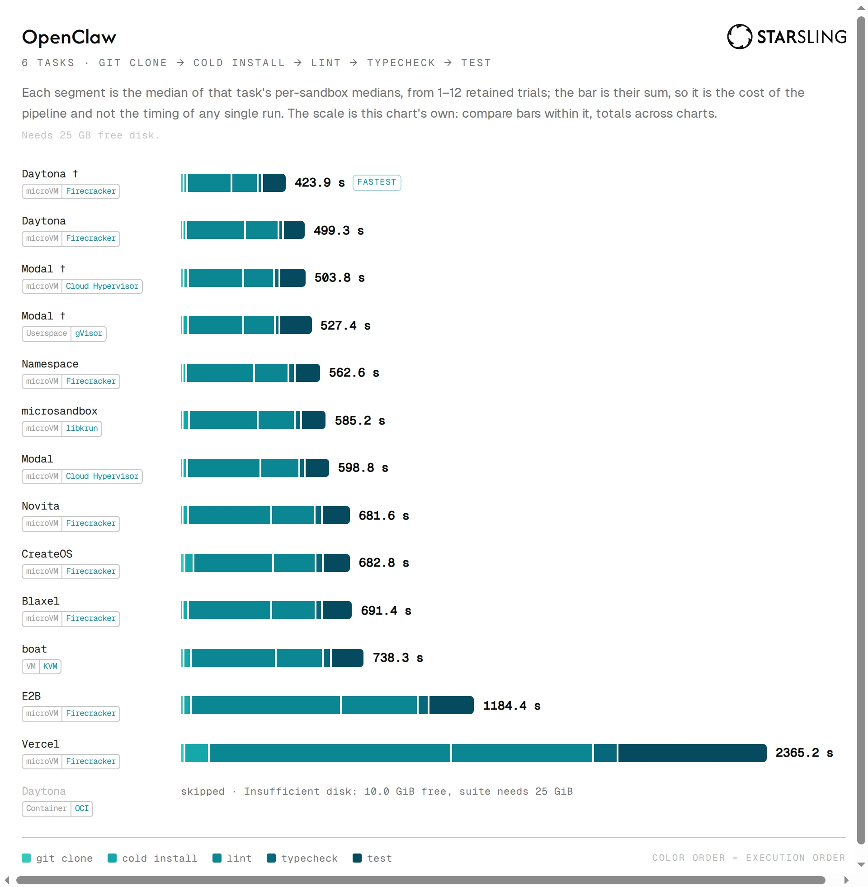

<strong>Per-task rankings</strong> · 21 tasks, with medians, intervals and trial counts

### Mastra: cold install _(headline)_

Seconds · lower is better

_Namespace leads · Modal (VM, burst) is ~1.1× higher (lower is better)._

| Rank | Provider | Mastra: cold install (Seconds) | 95% bootstrap interval | Sandboxes | Trials | Note |
| ---: | --- | ---: | ---: | ---: | ---: | --- |
| 1 | Namespace | 36.1 | 35.72 – 36.34 | 12 | 12 | — |
| 2 | Modal (VM, burst) | 39.41 | 38.38 – 40.61 | 12 | 12 | — |
| 3 | Modal (VM) | 41.42 | 41.17 – 41.92 | 12 | 12 | — |
| 4 | Novita | 45.85 | 44.99 – 48.2 | 12 | 12 | — |
| 4 | Modal (gVisor) | 47.35 | 46.77 – 48.31 | 12 | 12 | tied |
| 4 | Blaxel | 48.91 | 46.92 – 53.65 | 12 | 12 | tied |
| 4 | DigitalOcean MicroVMs | 51.05 | 49.87 – 55.5 | 12 | 12 | tied |
| 8 | Vercel Sandbox | 57.94 | 55.25 – 77.13 | 12 | 12 | — |
| 8 | CreateOS | 62.26 | 57.29 – 63.64 | 12 | 12 | tied |
| 8 | Microsandbox Cloud | 62.94 | 59.14 – 65.91 | 12 | 12 | tied |
| 11 | run.cloud | 74.44 | 72.89 – 81.64 | 12 | 12 | — |
| 11 | E2B | 74.87 | 73.47 – 81.28 | 12 | 12 | tied |
| 13 | boat | 95.17 | 78.74 – 105.1 | 12 | 12 | — |

### Better-Auth: build

Seconds · lower is better

_Modal (VM, burst) leads · Modal (gVisor) is ~1.1× higher (lower is better)._

| Rank | Provider | Better-Auth: build (Seconds) | 95% bootstrap interval | Sandboxes | Trials | Note |
| ---: | --- | ---: | ---: | ---: | ---: | --- |
| 1 | Modal (VM, burst) | 40.83 | 40.15 – 41.64 | 12 | 12 | — |
| 2 | Modal (gVisor) | 46.62 | 42.52 – 47.93 | 12 | 12 | — |
| 3 | Namespace | 49.05 | 48.69 – 49.97 | 12 | 12 | — |
| 4 | DigitalOcean MicroVMs | 53.84 | 53.01 – 54.78 | 12 | 12 | — |
| 5 | Modal (VM) | 55.58 | 54.83 – 56.41 | 12 | 12 | — |
| 6 | Novita | 68.98 | 67.6 – 69.76 | 12 | 12 | — |
| 6 | CreateOS | 70.22 | 63.86 – 74.63 | 12 | 12 | tied |
| 6 | Blaxel | 71.03 | 68.81 – 75.35 | 12 | 12 | tied |
| 6 | Microsandbox Cloud | 72.9 | 71.88 – 74.11 | 12 | 12 | tied |
| 10 | Vercel Sandbox | 87.38 | 84.01 – 102.8 | 12 | 12 | — |
| 10 | boat | 88.29 | 74.88 – 98.59 | 12 | 12 | tied |
| 10 | run.cloud | 98.24 | 94.82 – 108.5 | 12 | 12 | tied |
| 10 | E2B | 101.2 | 89.77 – 104.9 | 12 | 12 | tied |

### Better-Auth: cold install

Seconds · lower is better

_Namespace leads · Modal (VM, burst) is ~1.3× higher (lower is better)._

| Rank | Provider | Better-Auth: cold install (Seconds) | 95% bootstrap interval | Sandboxes | Trials | Note |
| ---: | --- | ---: | ---: | ---: | ---: | --- |
| 1 | Namespace | 9.23 | 9.175 – 9.454 | 12 | 12 | — |
| 2 | Modal (VM, burst) | 11.61 | 11.13 – 11.91 | 12 | 12 | — |
| 3 | Novita | 13.37 | 12.67 – 14.15 | 12 | 12 | — |
| 3 | Modal (VM) | 13.43 | 11.79 – 13.79 | 12 | 12 | tied |
| 5 | Microsandbox Cloud | 15.15 | 14.64 – 15.66 | 12 | 12 | — |
| 5 | DigitalOcean MicroVMs | 15.78 | 15.24 – 16.22 | 12 | 12 | tied |
| 7 | Blaxel | 17.26 | 16.6 – 17.79 | 12 | 12 | — |
| 8 | Modal (gVisor) | 18.41 | 18.09 – 19.28 | 12 | 12 | — |
| 8 | Vercel Sandbox | 18.75 | 17.39 – 21.71 | 12 | 12 | tied |
| 10 | run.cloud | 21.34 | 19.82 – 27.67 | 12 | 12 | — |
| 10 | CreateOS | 22.37 | 19.29 – 26.18 | 12 | 12 | tied |
| 10 | E2B | 24.08 | 20.15 – 30.19 | 12 | 12 | tied |
| 10 | boat | 24.83 | 17.13 – 33.96 | 12 | 12 | tied |

### Better-Auth: git clone

Seconds · lower is better

_Namespace leads · Modal (VM) is ~1.2× higher (lower is better)._

| Rank | Provider | Better-Auth: git clone (Seconds) | 95% bootstrap interval | Sandboxes | Trials | Note |
| ---: | --- | ---: | ---: | ---: | ---: | --- |
| 1 | Namespace | 0.5295 | 0.5195 – 0.548 | 12 | 12 | — |
| 2 | Modal (VM) | 0.619 | 0.5885 – 1.637 | 12 | 12 | — |
| 2 | Modal (VM, burst) | 0.6425 | 0.6175 – 2.301 | 12 | 12 | tied |
| 2 | Blaxel | 0.697 | 0.6775 – 0.7335 | 12 | 12 | tied |
| 5 | Modal (gVisor) | 0.762 | 0.7375 – 2.126 | 12 | 12 | — |
| 5 | Vercel Sandbox | 0.8095 | 0.7885 – 0.9655 | 12 | 12 | tied |
| 7 | DigitalOcean MicroVMs | 1.504 | 1.32 – 1.563 | 12 | 12 | — |
| 7 | CreateOS | 1.554 | 1.129 – 2.038 | 12 | 12 | tied |
| 7 | Microsandbox Cloud | 1.614 | 1.492 – 1.698 | 12 | 12 | tied |
| 10 | run.cloud | 1.828 | 1.717 – 2.019 | 12 | 12 | — |
| 10 | Novita | 1.929 | 1.746 – 2.03 | 12 | 12 | tied |
| 10 | E2B | 2.063 | 1.428 – 3.761 | 12 | 12 | tied |
| 10 | boat | 2.33 | 1.851 – 2.629 | 12 | 12 | tied |

### Better-Auth: lint (Biome)

Seconds · lower is better

_Modal (VM, burst) leads · DigitalOcean MicroVMs is ~1.1× higher (lower is better)._

| Rank | Provider | Better-Auth: lint (Biome) (Seconds) | 95% bootstrap interval | Sandboxes | Trials | Note |
| ---: | --- | ---: | ---: | ---: | ---: | --- |
| 1 | Modal (VM, burst) | 1.902 | 1.877 – 1.944 | 12 | 12 | — |
| 2 | DigitalOcean MicroVMs | 2.048 | 2.034 – 2.073 | 12 | 12 | — |
| 3 | Namespace | 2.513 | 2.466 – 2.676 | 12 | 12 | — |
| 4 | Modal (VM) | 3.049 | 2.856 – 3.085 | 12 | 12 | — |
| 5 | Novita | 3.308 | 3.192 – 3.333 | 12 | 12 | — |
| 5 | Microsandbox Cloud | 3.331 | 3.263 – 3.415 | 12 | 12 | tied |
| 5 | boat | 3.442 | 3.064 – 3.885 | 12 | 12 | tied |
| 5 | CreateOS | 3.447 | 3.278 – 3.713 | 12 | 12 | tied |
| 5 | Blaxel | 3.656 | 3.607 – 3.757 | 12 | 12 | tied |
| 10 | Vercel Sandbox | 4.144 | 4.067 – 4.923 | 12 | 12 | — |
| 10 | run.cloud | 4.98 | 4.765 – 5.11 | 12 | 12 | tied |
| 10 | E2B | 5.005 | 4.559 – 5.075 | 12 | 12 | tied |
| 13 | Modal (gVisor) | 5.628 | 5.474 – 5.883 | 12 | 12 | — |

### Better-Auth: lint deps (Knip)

Seconds · lower is better

_Namespace, Modal (VM, burst) and Modal (VM) share the top on this metric (lower is better)._

| Rank | Provider | Better-Auth: lint deps (Knip) (Seconds) | 95% bootstrap interval | Sandboxes | Trials | Note |
| ---: | --- | ---: | ---: | ---: | ---: | --- |
| 1 | Namespace | 9.729 | 9.529 – 9.941 | 12 | 12 | — |
| 1 | Modal (VM, burst) | 10 | 9.802 – 10.13 | 12 | 12 | tied |
| 1 | Modal (VM) | 10.05 | 9.417 – 10.26 | 12 | 12 | tied |
| 4 | Microsandbox Cloud | 10.71 | 10.58 – 10.81 | 12 | 12 | — |
| 5 | Blaxel | 11.26 | 11.04 – 11.69 | 12 | 12 | — |
| 5 | Novita | 11.35 | 11.09 – 11.58 | 12 | 12 | tied |
| 5 | DigitalOcean MicroVMs | 11.53 | 11.4 – 11.75 | 12 | 12 | tied |
| 8 | Modal (gVisor) | 12.32 | 12.19 – 12.97 | 12 | 12 | — |
| 8 | CreateOS | 12.34 | 11.47 – 13.83 | 12 | 12 | tied |
| 8 | boat | 13.22 | 10.86 – 15.04 | 12 | 12 | tied |
| 11 | Vercel Sandbox | 14.73 | 14.2 – 18.25 | 12 | 12 | — |
| 11 | run.cloud | 18.35 | 18.05 – 19.33 | 12 | 12 | tied |
| 11 | E2B | 18.61 | 16.92 – 19.64 | 12 | 12 | tied |

### Better-Auth: lint format

Seconds · lower is better

_Namespace leads · Modal (VM, burst) is ~1.2× higher (lower is better)._

| Rank | Provider | Better-Auth: lint format (Seconds) | 95% bootstrap interval | Sandboxes | Trials | Note |
| ---: | --- | ---: | ---: | ---: | ---: | --- |
| 1 | Namespace | 2.222 | 2.115 – 2.398 | 12 | 12 | — |
| 2 | Modal (VM, burst) | 2.654 | 2.553 – 2.697 | 12 | 12 | — |
| 2 | Modal (VM) | 2.667 | 2.633 – 2.732 | 12 | 12 | tied |
| 4 | DigitalOcean MicroVMs | 2.768 | 2.718 – 2.819 | 12 | 12 | — |
| 4 | Microsandbox Cloud | 2.805 | 2.761 – 2.896 | 12 | 12 | tied |
| 4 | Modal (gVisor) | 2.867 | 2.798 – 2.999 | 12 | 12 | tied |
| 4 | CreateOS | 2.999 | 2.837 – 3.237 | 12 | 12 | tied |
| 4 | Blaxel | 3.064 | 3.001 – 3.135 | 12 | 12 | tied |
| 4 | Novita | 3.08 | 3.026 – 3.116 | 12 | 12 | tied |
| 4 | boat | 3.173 | 2.88 – 4.061 | 12 | 12 | tied |
| 11 | Vercel Sandbox | 4.458 | 4.288 – 5.309 | 12 | 12 | — |
| 11 | run.cloud | 4.998 | 4.889 – 5.184 | 12 | 12 | tied |
| 11 | E2B | 5.17 | 4.279 – 5.308 | 12 | 12 | tied |

### Better-Auth: lint packages

Seconds · lower is better

_DigitalOcean MicroVMs leads · Modal (VM, burst) is ~1.1× higher (lower is better)._

| Rank | Provider | Better-Auth: lint packages (Seconds) | 95% bootstrap interval | Sandboxes | Trials | Note |
| ---: | --- | ---: | ---: | ---: | ---: | --- |
| 1 | DigitalOcean MicroVMs | 1.677 | 1.651 – 1.687 | 12 | 12 | — |
| 2 | Modal (VM, burst) | 1.831 | 1.764 – 1.841 | 12 | 12 | — |
| 3 | Modal (gVisor) | 2.071 | 2.053 – 2.141 | 12 | 12 | — |
| 3 | Namespace | 2.101 | 2.047 – 2.176 | 12 | 12 | tied |
| 5 | Modal (VM) | 2.62 | 2.484 – 2.643 | 12 | 12 | — |
| 6 | Novita | 2.664 | 2.64 – 2.741 | 12 | 12 | — |
| 7 | Microsandbox Cloud | 2.831 | 2.755 – 2.913 | 12 | 12 | — |
| 8 | Blaxel | 3.046 | 2.975 – 3.113 | 12 | 12 | — |
| 8 | boat | 3.263 | 2.716 – 3.676 | 12 | 12 | tied |
| 8 | CreateOS | 3.322 | 2.766 – 3.55 | 12 | 12 | tied |
| 11 | Vercel Sandbox | 3.585 | 3.53 – 4.571 | 12 | 12 | — |
| 11 | E2B | 4.122 | 3.861 – 4.311 | 12 | 12 | tied |
| 11 | run.cloud | 4.21 | 4.082 – 4.422 | 12 | 12 | tied |

### Better-Auth: lint spell

Seconds · lower is better

_Namespace leads · Modal (VM, burst) is ~1.1× higher (lower is better)._

| Rank | Provider | Better-Auth: lint spell (Seconds) | 95% bootstrap interval | Sandboxes | Trials | Note |
| ---: | --- | ---: | ---: | ---: | ---: | --- |
| 1 | Namespace | 5.788 | 5.582 – 6.101 | 12 | 12 | — |
| 2 | Modal (VM, burst) | 6.431 | 6.357 – 6.465 | 12 | 12 | — |
| 3 | Modal (VM) | 6.515 | 6.451 – 6.618 | 12 | 12 | — |
| 4 | DigitalOcean MicroVMs | 7.014 | 6.953 – 7.088 | 12 | 12 | — |
| 4 | Microsandbox Cloud | 7.137 | 6.904 – 7.482 | 12 | 12 | tied |
| 4 | Modal (gVisor) | 7.34 | 7.239 – 7.746 | 12 | 12 | tied |
| 4 | Novita | 7.784 | 7.675 – 7.889 | 12 | 12 | tied |
| 4 | CreateOS | 8.287 | 7.016 – 9.012 | 12 | 12 | tied |
| 9 | Blaxel | 9.125 | 8.958 – 9.22 | 12 | 12 | — |
| 9 | boat | 9.517 | 6.951 – 11.55 | 12 | 12 | tied |
| 11 | Vercel Sandbox | 11.18 | 10.79 – 12.95 | 12 | 12 | — |
| 11 | E2B | 12.71 | 11.5 – 13.24 | 12 | 12 | tied |
| 11 | run.cloud | 12.99 | 12.53 – 13.99 | 12 | 12 | tied |

### Better-Auth: lint types

Seconds · lower is better

_Modal (VM, burst) leads · DigitalOcean MicroVMs is ~1.1× higher (lower is better)._

| Rank | Provider | Better-Auth: lint types (Seconds) | 95% bootstrap interval | Sandboxes | Trials | Note |
| ---: | --- | ---: | ---: | ---: | ---: | --- |
| 1 | Modal (VM, burst) | 14.4 | 13.91 – 14.77 | 12 | 12 | — |
| 2 | DigitalOcean MicroVMs | 15.21 | 15.1 – 15.76 | 12 | 12 | — |
| 3 | Modal (gVisor) | 21.12 | 21.05 – 22.97 | 12 | 12 | — |
| 4 | Modal (VM) | 26.04 | 25.6 – 26.49 | 12 | 12 | — |
| 5 | Namespace | 28.87 | 27.31 – 30.3 | 12 | 12 | — |
| 6 | Novita | 33.34 | 31.37 – 33.91 | 12 | 12 | — |
| 6 | Blaxel | 33.97 | 32.76 – 35.21 | 12 | 12 | tied |
| 6 | CreateOS | 34.75 | 30.75 – 40.86 | 12 | 12 | tied |
| 6 | Microsandbox Cloud | 36.41 | 36.05 – 37.59 | 12 | 12 | tied |
| 10 | Vercel Sandbox | 43.5 | 42.24 – 51.63 | 12 | 12 | — |
| 10 | boat | 44.77 | 36.44 – 54.93 | 12 | 12 | tied |
| 10 | E2B | 49.51 | 45.39 – 51.78 | 12 | 12 | tied |
| 10 | run.cloud | 50.18 | 45.81 – 53.3 | 12 | 12 | tied |

### Better-Auth: typecheck

Seconds · lower is better

_Namespace and Modal (VM, burst) share the top on this metric (lower is better)._

| Rank | Provider | Better-Auth: typecheck (Seconds) | 95% bootstrap interval | Sandboxes | Trials | Note |
| ---: | --- | ---: | ---: | ---: | ---: | --- |
| 1 | Namespace | 35.2 | 32.08 – 37.27 | 12 | 12 | — |
| 1 | Modal (VM, burst) | 35.49 | 34.66 – 36.96 | 12 | 12 | tied |
| 3 | DigitalOcean MicroVMs | 37.1 | 36.82 – 38 | 12 | 12 | — |
| 3 | Modal (VM) | 37.43 | 36.85 – 39.69 | 12 | 12 | tied |
| 5 | Modal (gVisor) | 39.76 | 38.7 – 44.1 | 12 | 12 | — |
| 6 | Novita | 43.72 | 42.95 – 45.61 | 12 | 12 | — |
| 6 | Microsandbox Cloud | 43.78 | 42.83 – 44.27 | 12 | 12 | tied |
| 8 | Blaxel | 48.66 | 47.51 – 52.01 | 12 | 12 | — |
| 8 | CreateOS | 48.73 | 42.92 – 52.15 | 12 | 12 | tied |
| 10 | boat | 60.17 | 48.43 – 64.93 | 12 | 12 | — |
| 10 | Vercel Sandbox | 62.79 | 61.53 – 80.09 | 12 | 12 | tied |
| 10 | E2B | 71.47 | 62.48 – 77.34 | 12 | 12 | tied |
| 10 | run.cloud | 76.56 | 70.86 – 85.91 | 12 | 12 | tied |

### Mastra: build:core

Seconds · lower is better

_Namespace and Modal (VM, burst) share the top on this metric (lower is better)._

| Rank | Provider | Mastra: build:core (Seconds) | 95% bootstrap interval | Sandboxes | Trials | Note |
| ---: | --- | ---: | ---: | ---: | ---: | --- |
| 1 | Namespace | 60.13 | 57.92 – 67.16 | 12 | 12 | — |
| 1 | Modal (VM, burst) | 61.72 | 60.69 – 62.32 | 12 | 12 | tied |
| 3 | Modal (gVisor) | 68.08 | 65.74 – 76.22 | 12 | 12 | — |
| 3 | Modal (VM) | 69.23 | 68.76 – 70.02 | 12 | 12 | tied |
| 3 | DigitalOcean MicroVMs | 71.36 | 69.91 – 74.29 | 12 | 12 | tied |
| 3 | CreateOS | 74.87 | 67.29 – 80.71 | 12 | 12 | tied |
| 3 | Novita | 76.85 | 76.21 – 78.03 | 12 | 12 | tied |
| 8 | Blaxel | 83.73 | 82.29 – 86.36 | 12 | 12 | — |
| 8 | boat | 87.67 | 79.2 – 104.8 | 12 | 12 | tied |
| 8 | Microsandbox Cloud | 99.1 | 89.77 – 101.6 | 12 | 12 | tied |
| 11 | Vercel Sandbox | 117.1 | 110.6 – 167.8 | 12 | 12 | — |
| 11 | E2B | 130.9 | 121.3 – 138.9 | 12 | 12 | tied |
| 11 | run.cloud | 132.3 | 101.2 – 133.6 | 12 | 12 | tied |

### Mastra: git clone

Seconds · lower is better

_Namespace leads · Modal (VM) is ~1.1× higher (lower is better)._

| Rank | Provider | Mastra: git clone (Seconds) | 95% bootstrap interval | Sandboxes | Trials | Note |
| ---: | --- | ---: | ---: | ---: | ---: | --- |
| 1 | Namespace | 1.446 | 1.397 – 1.473 | 12 | 12 | — |
| 2 | Modal (VM) | 1.659 | 1.643 – 1.681 | 12 | 12 | — |
| 3 | Modal (VM, burst) | 1.708 | 1.687 – 2.913 | 12 | 12 | — |
| 3 | Blaxel | 1.96 | 1.911 – 2.029 | 12 | 12 | tied |
| 5 | Modal (gVisor) | 2.133 | 2.106 – 2.633 | 12 | 12 | — |
| 5 | Vercel Sandbox | 2.309 | 2.23 – 2.857 | 12 | 12 | tied |
| 7 | boat | 3.436 | 3.354 – 3.92 | 12 | 12 | — |
| 7 | Novita | 3.439 | 3.144 – 3.524 | 12 | 12 | tied |
| 7 | run.cloud | 3.543 | 3.462 – 3.724 | 12 | 12 | tied |
| 7 | DigitalOcean MicroVMs | 4.348 | 2.562 – 4.402 | 12 | 12 | tied |
| 7 | CreateOS | 5.017 | 3.034 – 17.74 | 12 | 12 | tied |
| 7 | E2B | 6.693 | 4.72 – 11.02 | 12 | 12 | tied |
| 7 | Microsandbox Cloud | 18.09 | 7.075 – 37.47 | 12 | 12 | tied |

### Mastra: lint:format

Seconds · lower is better

_Namespace leads · Modal (VM, burst) is ~1.2× higher (lower is better)._

| Rank | Provider | Mastra: lint:format (Seconds) | 95% bootstrap interval | Sandboxes | Trials | Note |
| ---: | --- | ---: | ---: | ---: | ---: | --- |
| 1 | Namespace | 72.41 | 71.14 – 75.04 | 12 | 12 | — |
| 2 | Modal (VM, burst) | 86.57 | 85.35 – 88.39 | 12 | 12 | — |
| 2 | Modal (VM) | 86.79 | 86.09 – 89.14 | 12 | 12 | tied |
| 2 | DigitalOcean MicroVMs | 88.71 | 86.88 – 90.44 | 12 | 12 | tied |
| 5 | Modal (gVisor) | 94.47 | 91.05 – 102.9 | 12 | 12 | — |
| 5 | Novita | 97.59 | 96.3 – 99.06 | 12 | 12 | tied |
| 7 | Blaxel | 102.2 | 99.4 – 107.7 | 12 | 12 | — |
| 7 | CreateOS | 104.3 | 101 – 108.3 | 12 | 12 | tied |
| 9 | Microsandbox Cloud | 122.3 | 121.6 – 123 | 12 | 12 | — |
| 9 | boat | 124 | 98.72 – 128 | 12 | 12 | tied |
| 11 | Vercel Sandbox | 146.4 | 141.6 – 211.3 | 12 | 12 | — |
| 11 | run.cloud | 164 | 124.8 – 166.4 | 12 | 12 | tied |
| 11 | E2B | 164.5 | 158.1 – 178.1 | 12 | 12 | tied |

### Mastra: test:core

Seconds · lower is better

_Namespace leads on median (lower is better); see notes for how ranks are decided._

| Rank | Provider | Mastra: test:core (Seconds) | 95% bootstrap interval | Sandboxes | Trials | Note |
| ---: | --- | ---: | ---: | ---: | ---: | --- |
| 1 | Namespace | 869 | 862.6 – 881.6 | 12 | 12 | — |
| 2 | CreateOS | 894.5 | 890.4 – 901.3 | 12 | 12 | — |
| 3 | Modal (VM, burst) | 912.6 | 900.9 – 919.9 | 12 | 12 | — |
| 4 | Modal (VM) | 928.8 | 923.3 – 934.1 | 12 | 12 | — |
| 5 | DigitalOcean MicroVMs | 950.8 | 947.9 – 960.3 | 12 | 12 | — |
| 6 | Novita | 1003 | 995.9 – 1009 | 12 | 12 | — |
| 7 | Blaxel | 1074 | 1071 – 1084 | 12 | 12 | — |
| 7 | Modal (gVisor) | 1089 | 1049 – 1134 | 10 | 10 | tied |
| 7 | Microsandbox Cloud | 1103 | 1080 – 1109 | 11 | 11 | tied |
| 7 | boat | 1236 | 1014 – 1393 | 12 | 12 | tied |
| 7 | Vercel Sandbox | 1282 | 1249 – 1652 | 12 | 12 | tied |
| 7 | E2B | 1414 | 1395 – 1482 | 12 | 12 | tied |
| 7 | run.cloud | 1504 | 1159 – 1516 | 12 | 12 | tied |

### OpenClaw: cold install

Seconds · lower is better

_Namespace leads · Modal (VM, burst) is ~1.2× higher (lower is better)._

| Rank | Provider | OpenClaw: cold install (Seconds) | 95% bootstrap interval | Sandboxes | Trials | Note |
| ---: | --- | ---: | ---: | ---: | ---: | --- |
| 1 | Namespace | 9.559 | 9.504 – 9.697 | 12 | 12 | — |
| 2 | Modal (VM, burst) | 11.26 | 11.02 – 11.88 | 12 | 12 | — |
| 3 | Modal (VM) | 13.48 | 13.08 – 14.08 | 12 | 12 | — |
| 4 | Novita | 14.15 | 13.57 – 15.25 | 12 | 12 | — |
| 4 | Modal (gVisor) | 14.89 | 14.76 – 15.27 | 12 | 12 | tied |
| 6 | Blaxel | 16.71 | 15.69 – 17.18 | 12 | 12 | — |
| 6 | Vercel Sandbox | 16.92 | 16.46 – 18.43 | 12 | 12 | tied |
| 8 | Microsandbox Cloud | 18.94 | 18.1 – 51.68 | 11 | 11 | — |
| 8 | boat | 19.4 | 17.15 – 21.37 | 12 | 12 | tied |
| 10 | CreateOS | 21.96 | 21.38 – 23.46 | 6 | 6 | — |
| 10 | run.cloud | 22.58 | 21.56 – 24.59 | 12 | 12 | tied |
| 10 | E2B | 25.68 | 21.05 – 32.27 | 12 | 12 | tied |
| 10 | DigitalOcean MicroVMs | 27.5 | 24.5 – 30.95 | 12 | 12 | tied |

### OpenClaw: git clone

Seconds · lower is better

_Namespace leads · Modal (VM) is ~1.3× higher (lower is better)._

| Rank | Provider | OpenClaw: git clone (Seconds) | 95% bootstrap interval | Sandboxes | Trials | Note |
| ---: | --- | ---: | ---: | ---: | ---: | --- |
| 1 | Namespace | 2.16 | 2.127 – 3.546 | 12 | 12 | — |
| 2 | Modal (VM) | 2.755 | 2.699 – 5.419 | 12 | 12 | — |
| 2 | Blaxel | 3.031 | 2.827 – 3.104 | 12 | 12 | tied |
| 4 | Vercel Sandbox | 3.559 | 3.445 – 3.716 | 12 | 12 | — |
| 4 | Modal (gVisor) | 3.617 | 3.508 – 3.873 | 12 | 12 | tied |
| 6 | Novita | 4.464 | 3.881 – 4.835 | 12 | 12 | — |
| 7 | Microsandbox Cloud | 5.25 | 4.758 – 6.565 | 11 | 11 | — |
| 7 | Modal (VM, burst) | 8.295 | 5.663 – 8.679 | 12 | 12 | tied |
| 7 | E2B | 8.852 | 5.957 – 11.52 | 12 | 12 | tied |
| 7 | DigitalOcean MicroVMs | 8.917 | 4.63 – 9.005 | 12 | 12 | tied |
| 7 | boat | 9.338 | 4.881 – 10.3 | 12 | 12 | tied |
| 7 | run.cloud | 9.794 | 9.347 – 10.06 | 12 | 12 | tied |
| 7 | CreateOS | 10.13 | 5.401 – 10.97 | 6 | 6 | tied |

### OpenClaw: lint (all extensions)

Seconds · lower is better

_Modal (VM, burst) and Modal (gVisor) share the top on this metric (lower is better)._

| Rank | Provider | OpenClaw: lint (all extensions) (Seconds) | 95% bootstrap interval | Sandboxes | Trials | Note |
| ---: | --- | ---: | ---: | ---: | ---: | --- |
| 1 | Modal (VM, burst) | 127.4 | 125.5 – 132.3 | 12 | 12 | — |
| 1 | Modal (gVisor) | 130.6 | 126.5 – 135.7 | 12 | 12 | tied |
| 3 | Namespace | 149.4 | 144.7 – 153.4 | 12 | 12 | — |
| 3 | Modal (VM) | 151.8 | 149.6 – 156 | 12 | 12 | tied |
| 5 | Microsandbox Cloud | 167.2 | 157.1 – 187.8 | 11 | 11 | — |
| 5 | CreateOS | 171.1 | 140.8 – 182.2 | 6 | 6 | tied |
| 5 | Blaxel | 178.3 | 175.6 – 182.8 | 12 | 12 | tied |
| 5 | Novita | 179 | 174.2 – 184.7 | 12 | 12 | tied |
| 9 | boat | 197.1 | 187.8 – 236.6 | 12 | 12 | — |
| 9 | DigitalOcean MicroVMs | 202.4 | 200.4 – 212 | 12 | 12 | tied |
| 9 | Vercel Sandbox | 208.9 | 205.7 – 212.5 | 12 | 12 | tied |
| 12 | run.cloud | 259.2 | 224.5 – 278.5 | 12 | 12 | — |
| 13 | E2B | 306.6 | 297.4 – 318.4 | 12 | 12 | — |

### OpenClaw: lint (Oxlint)

Seconds · lower is better

_Modal (gVisor) leads · Modal (VM, burst) is ~1.1× higher (lower is better)._

| Rank | Provider | OpenClaw: lint (Oxlint) (Seconds) | 95% bootstrap interval | Sandboxes | Trials | Note |
| ---: | --- | ---: | ---: | ---: | ---: | --- |
| 1 | Modal (gVisor) | 220.6 | 213.7 – 223 | 12 | 12 | — |
| 2 | Modal (VM, burst) | 231.9 | 228.4 – 233.4 | 12 | 12 | — |
| 3 | Namespace | 295.2 | 291.1 – 299.5 | 12 | 12 | — |
| 3 | Modal (VM) | 296.3 | 293 – 298 | 12 | 12 | tied |
| 3 | Microsandbox Cloud | 317.2 | 291.3 – 349.6 | 11 | 11 | tied |
| 3 | CreateOS | 341 | 303.7 – 369.7 | 6 | 6 | tied |
| 3 | Blaxel | 343.3 | 340.4 – 347.3 | 12 | 12 | tied |
| 3 | Novita | 344.5 | 339.2 – 353 | 12 | 12 | tied |
| 3 | boat | 363.5 | 334 – 435.6 | 12 | 12 | tied |
| 3 | DigitalOcean MicroVMs | 370.5 | 362.2 – 383.7 | 12 | 12 | tied |
| 11 | Vercel Sandbox | 388.3 | 380.8 – 394.2 | 12 | 12 | — |
| 12 | run.cloud | 469 | 436.3 – 533.9 | 12 | 12 | — |
| 13 | E2B | 601.1 | 584.1 – 616.5 | 12 | 12 | — |

### OpenClaw: typecheck (test tree)

Seconds · lower is better

_Modal (VM) leads · Namespace is ~1.1× higher (lower is better)._

| Rank | Provider | OpenClaw: typecheck (test tree) (Seconds) | 95% bootstrap interval | Sandboxes | Trials | Note |
| ---: | --- | ---: | ---: | ---: | ---: | --- |
| 1 | Modal (VM) | 93.72 | 93.12 – 96.31 | 12 | 12 | — |
| 2 | Namespace | 105.4 | 102.5 – 114.2 | 12 | 12 | — |
| 2 | CreateOS | 110.7 | 99.11 – 113.9 | 6 | 6 | tied |
| 2 | Modal (VM, burst) | 111.6 | 110.4 – 114.1 | 12 | 12 | tied |
| 2 | Microsandbox Cloud | 113 | 104.1 – 123.7 | 11 | 11 | tied |
| 2 | Novita | 113.9 | 111.7 – 116.1 | 12 | 12 | tied |
| 7 | Blaxel | 121.4 | 119.1 – 123.6 | 12 | 12 | — |
| 8 | Modal (gVisor) | 136.4 | 134 – 139.7 | 12 | 12 | — |
| 8 | Vercel Sandbox | 136.5 | 134.8 – 138.6 | 12 | 12 | tied |
| 8 | boat | 140.9 | 126 – 167.7 | 12 | 12 | tied |
| 8 | DigitalOcean MicroVMs | 153.4 | 151.7 – 160.7 | 12 | 12 | tied |
| 12 | run.cloud | 170.8 | 166.9 – 183.4 | 12 | 12 | — |
| 12 | E2B | 181.5 | 176.9 – 192.8 | 12 | 12 | tied |

### OpenClaw: typecheck (tsgo)

Seconds · lower is better

_Modal (gVisor) leads · Modal (VM, burst) is ~1.2× higher (lower is better)._

| Rank | Provider | OpenClaw: typecheck (tsgo) (Seconds) | 95% bootstrap interval | Sandboxes | Trials | Note |
| ---: | --- | ---: | ---: | ---: | ---: | --- |
| 1 | Modal (gVisor) | 12.05 | 11.77 – 12.39 | 12 | 12 | — |
| 2 | Modal (VM, burst) | 13.89 | 13.66 – 14.05 | 12 | 12 | — |
| 3 | Modal (VM) | 17.26 | 16.59 – 17.75 | 12 | 12 | — |
| 4 | Namespace | 19.08 | 18.77 – 20.15 | 12 | 12 | — |
| 4 | CreateOS | 19.25 | 18.37 – 19.78 | 6 | 6 | tied |
| 4 | Microsandbox Cloud | 20.09 | 18.69 – 21.26 | 11 | 11 | tied |
| 4 | Blaxel | 20.79 | 20.36 – 21.9 | 12 | 12 | tied |
| 4 | Novita | 21.25 | 20.45 – 21.77 | 12 | 12 | tied |
| 4 | DigitalOcean MicroVMs | 21.52 | 20.8 – 22.05 | 12 | 12 | tied |
| 4 | boat | 22.56 | 21.21 – 25.82 | 12 | 12 | tied |
| 4 | Vercel Sandbox | 24.56 | 23.86 – 24.89 | 12 | 12 | tied |
| 12 | run.cloud | 30.37 | 27.9 – 31.83 | 12 | 12 | — |
| 13 | E2B | 36.01 | 33.66 – 36.56 | 12 | 12 | — |

## cpu

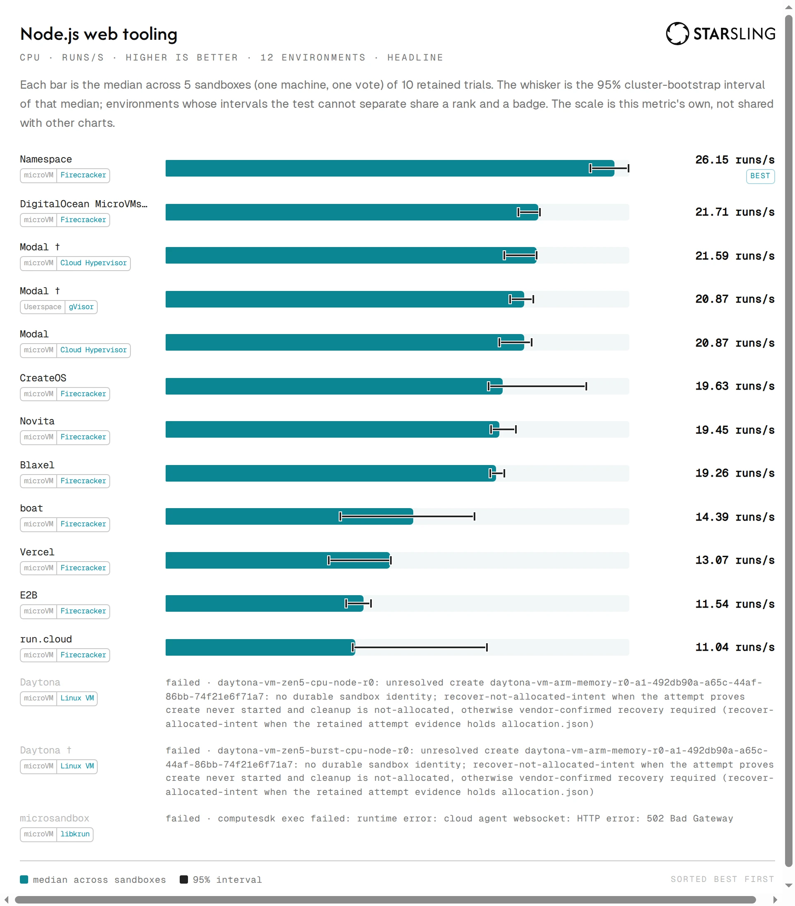

<strong>1 synthetic metric</strong> · headline: Node.js web tooling

### Node.js web tooling _(headline)_

runs/s · higher is better

_Namespace leads · ~1.2× DigitalOcean MicroVMs on median (higher is better)._

| Rank | Provider | Node.js web tooling (runs/s) | 95% bootstrap interval | Sandboxes | Trials | Note |
| ---: | --- | ---: | ---: | ---: | ---: | --- |
| 1 | Namespace | 26.15 | 24.68 – 27.01 | 5 | 10 | — |
| 2 | DigitalOcean MicroVMs | 21.71 | 20.48 – 21.86 | 5 | 10 | — |
| 2 | Modal (VM, burst) | 21.59 | 19.69 – 21.68 | 5 | 10 | tied |
| 2 | Modal (gVisor) | 20.87 | 20.04 – 21.48 | 5 | 10 | tied |
| 2 | Modal (VM) | 20.87 | 19.41 – 21.36 | 5 | 10 | tied |
| 2 | CreateOS | 19.63 | 18.74 – 24.56 | 5 | 10 | tied |
| 2 | Novita | 19.45 | 18.91 – 20.45 | 5 | 10 | tied |
| 2 | Blaxel | 19.26 | 18.88 – 19.78 | 5 | 10 | tied |
| 9 | boat | 14.39 | 10.11 – 18.04 | 5 | 10 | — |
| 9 | Vercel Sandbox | 13.07 | 9.465 – 13.18 | 5 | 10 | tied |
| 9 | E2B | 11.54 | 10.45 – 12 | 5 | 10 | tied |
| 9 | run.cloud | 11.04 | 10.85 – 18.77 | 5 | 10 | tied |

## disk

<strong>9 synthetic metrics</strong> · headline: fio rand write 4KB, O_DIRECT (MB/s)

### fio rand write 4KB, O_DIRECT (MB/s) _(headline)_

MB/s · higher is better

_Modal (VM) leads on median (higher is better); see notes for how ranks are decided._

| Rank | Provider | fio rand write 4KB, O_DIRECT (MB/s) (MB/s) | 95% bootstrap interval | Sandboxes | Trials | Note |
| ---: | --- | ---: | ---: | ---: | ---: | --- |
| 1 | Modal (VM) | 1384 | 826.8 – 1528 | 3 | 6 | — |
| 2 | Vercel Sandbox | 1355 | 1135 – 1387 | 3 | 6 | too few sandboxes |
| 3 | Modal (VM, burst) | 839.4 | 824.2 – 907 | 3 | 6 | too few sandboxes |
| 4 | Blaxel | 814.2 | 780.7 – 876.1 | 3 | 6 | too few sandboxes |
| 5 | Modal (gVisor) | 794.3 | 794.3 – 813.2 | 3 | 6 | too few sandboxes |
| 6 | run.cloud | 469.2 | 464 – 471.9 | 3 | 6 | too few sandboxes |
| 7 | CreateOS | 446.7 | 337.1 – 453.5 | 3 | 6 | too few sandboxes |
| 8 | DigitalOcean MicroVMs | 397.9 | 392.7 – 579.9 | 3 | 6 | too few sandboxes |
| 9 | Namespace | 382.7 | 378 – 385.9 | 3 | 6 | too few sandboxes |
| 10 | Novita | 326.6 | 324.5 – 327.2 | 3 | 6 | too few sandboxes |
| 11 | E2B | 198.7 | 198.2 – 241.7 | 3 | 6 | too few sandboxes |
| 12 | Microsandbox Cloud | 178.3 | 168.8 – 274.2 | 3 | 6 | too few sandboxes |
| 13 | boat | 156.2 | 65.38 – 176.2 | 3 | 6 | too few sandboxes |

### fio rand read 4KB, O_DIRECT (IOPS)

IOPS · higher is better

_Modal (VM) leads · ~1.5× Vercel Sandbox on median (higher is better)._

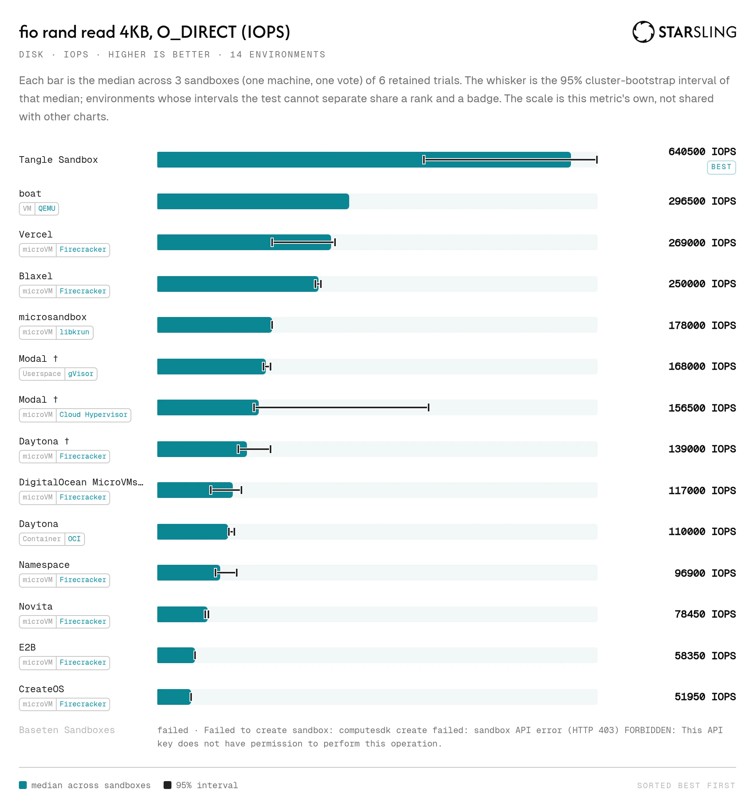

| Rank | Provider | fio rand read 4KB, O_DIRECT (IOPS) (IOPS) | 95% bootstrap interval | Sandboxes | Trials | Note |
| ---: | --- | ---: | ---: | ---: | ---: | --- |
| 1 | Modal (VM) | 375500 | 187000 – 426500 | 3 | 6 | — |
| 2 | Vercel Sandbox | 257000 | 250500 – 260000 | 3 | 6 | too few sandboxes |
| 3 | Blaxel | 244000 | 219000 – 267000 | 3 | 6 | too few sandboxes |
| 4 | Modal (VM, burst) | 208500 | 179000 – 216500 | 3 | 6 | too few sandboxes |
| 5 | Modal (gVisor) | 175500 | 169500 – 176000 | 3 | 6 | too few sandboxes |
| 6 | Microsandbox Cloud | 145000 | 137500 – 216500 | 3 | 6 | too few sandboxes |
| 7 | run.cloud | 113000 | 107900 – 118500 | 3 | 6 | too few sandboxes |
| 8 | DigitalOcean MicroVMs | 94700 | 89850 – 173000 | 3 | 6 | too few sandboxes |
| 9 | Namespace | 89850 | 88550 – 90050 | 3 | 6 | too few sandboxes |
| 10 | Novita | 79500 | 73800 – 81500 | 3 | 6 | too few sandboxes |
| 11 | CreateOS | 51850 | 50050 – 53200 | 3 | 6 | too few sandboxes |
| 12 | E2B | 48750 | 47800 – 60450 | 3 | 6 | too few sandboxes |
| 13 | boat | 11300 | 6883 – 12600 | 3 | 6 | too few sandboxes |

### fio rand read 4KB, O_DIRECT (MB/s)

MB/s · higher is better

_Modal (VM) leads · ~1.5× Vercel Sandbox on median (higher is better)._

| Rank | Provider | fio rand read 4KB, O_DIRECT (MB/s) (MB/s) | 95% bootstrap interval | Sandboxes | Trials | Note |
| ---: | --- | ---: | ---: | ---: | ---: | --- |
| 1 | Modal (VM) | 1538 | 766.5 – 1747 | 3 | 6 | — |
| 2 | Vercel Sandbox | 1053 | 1026 – 1065 | 3 | 6 | too few sandboxes |
| 3 | Blaxel | 999.3 | 895.5 – 1094 | 3 | 6 | too few sandboxes |
| 4 | Modal (VM, burst) | 854.6 | 734 – 887.6 | 3 | 6 | too few sandboxes |
| 5 | Modal (gVisor) | 719.8 | 694.2 – 720.4 | 3 | 6 | too few sandboxes |
| 6 | Microsandbox Cloud | 594 | 564.7 – 887.1 | 3 | 6 | too few sandboxes |
| 7 | run.cloud | 462.4 | 440.9 – 486.5 | 3 | 6 | too few sandboxes |
| 8 | DigitalOcean MicroVMs | 386.9 | 368.1 – 708.3 | 3 | 6 | too few sandboxes |
| 9 | Namespace | 368.1 | 362.8 – 369.1 | 3 | 6 | too few sandboxes |
| 10 | Novita | 325.6 | 302 – 334 | 3 | 6 | too few sandboxes |
| 11 | CreateOS | 212.3 | 205 – 217.6 | 3 | 6 | too few sandboxes |
| 12 | E2B | 199.8 | 196.1 – 247.5 | 3 | 6 | too few sandboxes |
| 13 | boat | 46.4 | 28.21 – 51.59 | 3 | 6 | too few sandboxes |

### fio rand write 4KB, O_DIRECT (IOPS)

IOPS · higher is better

_Modal (VM) leads on median (higher is better); see notes for how ranks are decided._

| Rank | Provider | fio rand write 4KB, O_DIRECT (IOPS) (IOPS) | 95% bootstrap interval | Sandboxes | Trials | Note |
| ---: | --- | ---: | ---: | ---: | ---: | --- |
| 1 | Modal (VM) | 338000 | 202000 – 373000 | 3 | 6 | — |
| 2 | Vercel Sandbox | 330500 | 277000 – 338500 | 3 | 6 | too few sandboxes |
| 3 | Modal (VM, burst) | 205000 | 201500 – 221500 | 3 | 6 | too few sandboxes |
| 4 | Blaxel | 198500 | 190500 – 213500 | 3 | 6 | too few sandboxes |
| 5 | Modal (gVisor) | 194000 | 193500 – 198500 | 3 | 6 | too few sandboxes |
| 6 | run.cloud | 114500 | 113000 – 115500 | 3 | 6 | too few sandboxes |
| 7 | CreateOS | 109500 | 82350 – 110500 | 3 | 6 | too few sandboxes |
| 8 | DigitalOcean MicroVMs | 96950 | 95800 – 141500 | 3 | 6 | too few sandboxes |
| 9 | Namespace | 93500 | 92350 – 94100 | 3 | 6 | too few sandboxes |
| 10 | Novita | 79750 | 79250 – 79850 | 3 | 6 | too few sandboxes |
| 11 | E2B | 48500 | 48400 – 58950 | 3 | 6 | too few sandboxes |
| 12 | Microsandbox Cloud | 43550 | 41200 – 67000 | 3 | 6 | too few sandboxes |
| 13 | boat | 38100 | 15950 – 43000 | 3 | 6 | too few sandboxes |

### fio seq read 1MB, O_DIRECT (IOPS)

IOPS · higher is better

_Modal (gVisor) leads · ~6.7× Modal (VM) on median (higher is better)._

| Rank | Provider | fio seq read 1MB, O_DIRECT (IOPS) (IOPS) | 95% bootstrap interval | Sandboxes | Trials | Note |
| ---: | --- | ---: | ---: | ---: | ---: | --- |
| 1 | Modal (gVisor) | 91700 | 88550 – 93700 | 3 | 6 | — |
| 2 | Modal (VM) | 13700 | 11100 – 14000 | 3 | 6 | too few sandboxes |
| 3 | Modal (VM, burst) | 12600 | 10250 – 12900 | 3 | 6 | too few sandboxes |
| 4 | Novita | 12550 | 12100 – 13000 | 3 | 6 | too few sandboxes |
| 5 | run.cloud | 7108 | 6124 – 7577 | 3 | 6 | too few sandboxes |
| 6 | Microsandbox Cloud | 6313 | 6150 – 10194 | 3 | 6 | too few sandboxes |
| 7 | Vercel Sandbox | 5671 | 5654 – 5698 | 3 | 6 | too few sandboxes |
| 8 | Blaxel | 4357 | 3995 – 4374 | 3 | 6 | too few sandboxes |
| 9 | CreateOS | 3123 | 2670 – 3256 | 3 | 6 | too few sandboxes |
| 10 | DigitalOcean MicroVMs | 2807 | 2403 – 2992 | 3 | 6 | too few sandboxes |
| 11 | Namespace | 2609 | 2596 – 2705 | 3 | 6 | too few sandboxes |
| 12 | boat | 773.5 | 769.5 – 1533 | 3 | 6 | too few sandboxes |
| 13 | E2B | 599.5 | 599 – 599.5 | 3 | 6 | too few sandboxes |

### fio seq read 1MB, O_DIRECT (MB/s)

MB/s · higher is better

_Modal (gVisor) leads · ~6.7× Modal (VM) on median (higher is better)._

| Rank | Provider | fio seq read 1MB, O_DIRECT (MB/s) (MB/s) | 95% bootstrap interval | Sandboxes | Trials | Note |
| ---: | --- | ---: | ---: | ---: | ---: | --- |
| 1 | Modal (gVisor) | 96100 | 92880 – 98250 | 3 | 6 | — |
| 2 | Modal (VM) | 14390 | 11650 – 14710 | 3 | 6 | too few sandboxes |
| 3 | Modal (VM, burst) | 13210 | 10720 – 13530 | 3 | 6 | too few sandboxes |
| 3 | Novita | 13210 | 12670 – 13580 | 3 | 6 | too few sandboxes, equal medians |
| 5 | run.cloud | 7454 | 6423 – 7947 | 3 | 6 | too few sandboxes |
| 6 | Microsandbox Cloud | 6621 | 6450 – 10710 | 3 | 6 | too few sandboxes |
| 7 | Vercel Sandbox | 5948 | 5930 – 5975 | 3 | 6 | too few sandboxes |
| 8 | Blaxel | 4571 | 4191 – 4588 | 3 | 6 | too few sandboxes |
| 9 | CreateOS | 3276 | 2801 – 3415 | 3 | 6 | too few sandboxes |
| 10 | DigitalOcean MicroVMs | 2945 | 2521 – 3138 | 3 | 6 | too few sandboxes |
| 11 | Namespace | 2737 | 2724 – 2837 | 3 | 6 | too few sandboxes |
| 12 | boat | 812.6 | 807.9 – 1609 | 3 | 6 | too few sandboxes |
| 13 | E2B | 630.2 | 630.2 – 630.7 | 3 | 6 | too few sandboxes |

### fio seq write 1MB, O_DIRECT (IOPS)

IOPS · higher is better

_Modal (VM) leads on median (higher is better); see notes for how ranks are decided._

| Rank | Provider | fio seq write 1MB, O_DIRECT (IOPS) (IOPS) | 95% bootstrap interval | Sandboxes | Trials | Note |
| ---: | --- | ---: | ---: | ---: | ---: | --- |
| 1 | Modal (VM) | 10400 | 8844 – 10550 | 3 | 6 | — |
| 2 | Modal (gVisor) | 9998 | 8761 – 10194 | 3 | 6 | too few sandboxes |
| 3 | Modal (VM, burst) | 9944 | 7048 – 10500 | 3 | 6 | too few sandboxes |
| 4 | Novita | 6198 | 5620 – 6766 | 3 | 6 | too few sandboxes |
| 5 | Blaxel | 5086 | 3057 – 5303 | 3 | 6 | too few sandboxes |
| 6 | Vercel Sandbox | 4898 | 4746 – 5062 | 3 | 6 | too few sandboxes |
| 7 | Microsandbox Cloud | 4896 | 4248 – 6116 | 3 | 6 | too few sandboxes |
| 8 | DigitalOcean MicroVMs | 2693 | 2526 – 3106 | 3 | 6 | too few sandboxes |
| 9 | CreateOS | 2290 | 2124 – 2306 | 3 | 6 | too few sandboxes |
| 10 | Namespace | 2211 | 2193 – 2264 | 3 | 6 | too few sandboxes |
| 11 | boat | 1442 | 1010 – 1479 | 3 | 6 | too few sandboxes |
| 12 | run.cloud | 794 | 782 – 864 | 3 | 6 | too few sandboxes |
| 13 | E2B | 602 | 599 – 605.5 | 3 | 6 | too few sandboxes |

### fio seq write 1MB, O_DIRECT (MB/s)

MB/s · higher is better

_Modal (VM) leads on median (higher is better); see notes for how ranks are decided._

| Rank | Provider | fio seq write 1MB, O_DIRECT (MB/s) (MB/s) | 95% bootstrap interval | Sandboxes | Trials | Note |
| ---: | --- | ---: | ---: | ---: | ---: | --- |
| 1 | Modal (VM) | 10950 | 9246 – 11010 | 3 | 6 | — |
| 2 | Modal (gVisor) | 10470 | 9187 – 10720 | 3 | 6 | too few sandboxes |
| 3 | Modal (VM, burst) | 10430 | 7391 – 10990 | 3 | 6 | too few sandboxes |
| 4 | Novita | 6500 | 5894 – 7096 | 3 | 6 | too few sandboxes |
| 5 | Blaxel | 5334 | 3207 – 5562 | 3 | 6 | too few sandboxes |
| 6 | Vercel Sandbox | 5137 | 4979 – 5309 | 3 | 6 | too few sandboxes |
| 7 | Microsandbox Cloud | 5135 | 4456 – 6414 | 3 | 6 | too few sandboxes |
| 8 | DigitalOcean MicroVMs | 2825 | 2650 – 3258 | 3 | 6 | too few sandboxes |
| 9 | CreateOS | 2403 | 2228 – 2419 | 3 | 6 | too few sandboxes |
| 10 | Namespace | 2319 | 2301 – 2376 | 3 | 6 | too few sandboxes |
| 11 | boat | 1513 | 1061 – 1552 | 3 | 6 | too few sandboxes |
| 12 | run.cloud | 834.1 | 821.6 – 907.5 | 3 | 6 | too few sandboxes |
| 13 | E2B | 633.3 | 630.2 – 636.5 | 3 | 6 | too few sandboxes |

### Hardlink throughput

bogo ops/s · higher is better

_Modal (VM) leads · ~1.6× CreateOS on median (higher is better)._

| Rank | Provider | Hardlink throughput (bogo ops/s) | 95% bootstrap interval | Sandboxes | Trials | Note |
| ---: | --- | ---: | ---: | ---: | ---: | --- |
| 1 | Modal (VM) | 30.16 | 7.87 – 31.09 | 3 | 6 | — |
| 2 | CreateOS | 18.36 | 18.16 – 18.52 | 3 | 6 | too few sandboxes |
| 3 | Namespace | 18.21 | 18.2 – 18.24 | 3 | 6 | too few sandboxes |
| 4 | Blaxel | 16.95 | 16.77 – 17.2 | 3 | 6 | too few sandboxes |
| 5 | Novita | 12.16 | 12.14 – 12.28 | 3 | 6 | too few sandboxes |
| 6 | Vercel Sandbox | 11.8 | 11.71 – 11.99 | 3 | 6 | too few sandboxes |
| 7 | DigitalOcean MicroVMs | 9.49 | 9.455 – 9.49 | 3 | 6 | too few sandboxes |
| 8 | Microsandbox Cloud | 8.17 | 8.11 – 8.31 | 3 | 6 | too few sandboxes |
| 9 | E2B | 7.59 | 7.475 – 9.94 | 3 | 6 | too few sandboxes |
| 10 | Modal (VM, burst) | 7.39 | 7.37 – 7.455 | 3 | 6 | too few sandboxes |
| 11 | boat | 7.1 | 6.71 – 9.255 | 3 | 6 | too few sandboxes |
| 12 | run.cloud | 4.82 | 4.805 – 4.825 | 3 | 6 | too few sandboxes |
| 13 | Modal (gVisor) | 4.695 | 4.675 – 4.76 | 3 | 6 | too few sandboxes |

## memory

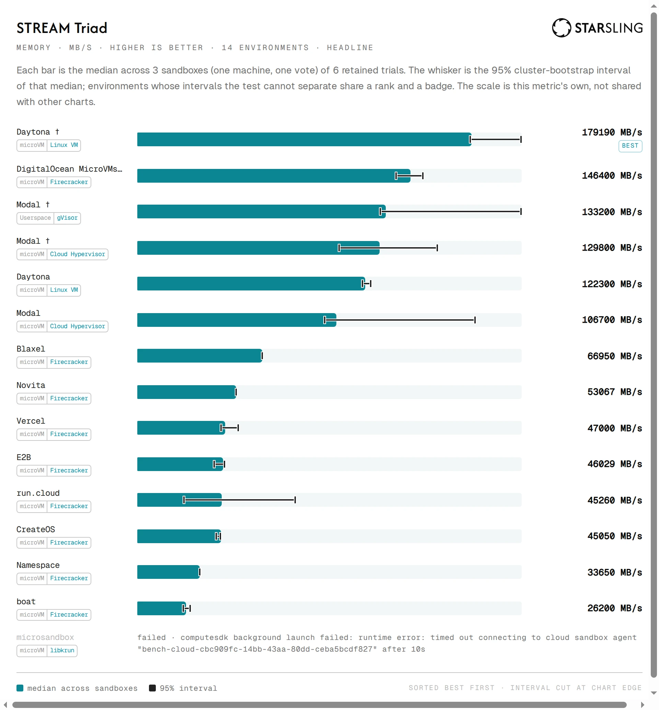

<strong>4 synthetic metrics</strong> · headline: STREAM Triad

### STREAM Triad _(headline)_

MB/s · higher is better

_Daytona (VM, burst) leads · ~1.2× DigitalOcean MicroVMs on median (higher is better)._

| Rank | Provider | STREAM Triad (MB/s) | 95% bootstrap interval | Sandboxes | Trials | Note |
| ---: | --- | ---: | ---: | ---: | ---: | --- |
| 1 | Daytona (VM, burst) | 179190 | 178300 – 264000 | 3 | 6 | — |
| 2 | DigitalOcean MicroVMs | 146400 | 138400 – 153600 | 3 | 6 | too few sandboxes |
| 3 | Modal (gVisor) | 133200 | 129800 – 369700 | 3 | 6 | too few sandboxes |
| 4 | Modal (VM, burst) | 129800 | 107900 – 161000 | 3 | 6 | too few sandboxes |
| 5 | Daytona (VM) | 122300 | 120400 – 125600 | 3 | 6 | too few sandboxes |
| 6 | Modal (VM) | 106700 | 100200 – 181500 | 3 | 6 | too few sandboxes |
| 7 | Blaxel | 66950 | 66472 – 67350 | 3 | 6 | too few sandboxes |
| 8 | Novita | 53067 | 52440 – 53524 | 3 | 6 | too few sandboxes |
| 9 | Vercel Sandbox | 47000 | 44665 – 54600 | 3 | 6 | too few sandboxes |
| 10 | E2B | 46029 | 40970 – 47050 | 3 | 6 | too few sandboxes |
| 11 | run.cloud | 45260 | 24820 – 84920 | 3 | 6 | too few sandboxes |
| 12 | CreateOS | 45050 | 41995 – 45060 | 3 | 6 | too few sandboxes |
| 13 | Namespace | 33650 | 33650 – 33680 | 3 | 6 | too few sandboxes |
| 14 | boat | 26200 | 24410 – 28810 | 3 | 6 | too few sandboxes |

### STREAM Add

MB/s · higher is better

_Daytona (VM, burst) leads · ~1.2× DigitalOcean MicroVMs on median (higher is better)._

| Rank | Provider | STREAM Add (MB/s) | 95% bootstrap interval | Sandboxes | Trials | Note |
| ---: | --- | ---: | ---: | ---: | ---: | --- |
| 1 | Daytona (VM, burst) | 177200 | 176200 – 261400 | 3 | 6 | — |
| 2 | DigitalOcean MicroVMs | 146800 | 134000 – 152900 | 3 | 6 | too few sandboxes |
| 3 | Modal (gVisor) | 132700 | 129300 – 369500 | 3 | 6 | too few sandboxes |
| 4 | Modal (VM, burst) | 128900 | 104100 – 159200 | 3 | 6 | too few sandboxes |
| 5 | Daytona (VM) | 121600 | 119679 – 124900 | 3 | 6 | too few sandboxes |
| 6 | Modal (VM) | 105900 | 98930 – 181200 | 3 | 6 | too few sandboxes |
| 7 | Blaxel | 66630 | 66092 – 67140 | 3 | 6 | too few sandboxes |
| 8 | Novita | 52800 | 52270 – 53440 | 3 | 6 | too few sandboxes |
| 9 | E2B | 46260 | 41060 – 47030 | 3 | 6 | too few sandboxes |
| 10 | Vercel Sandbox | 46240 | 43600 – 54040 | 3 | 6 | too few sandboxes |
| 11 | run.cloud | 45240 | 24790 – 83330 | 3 | 6 | too few sandboxes |
| 12 | CreateOS | 44780 | 41850 – 44910 | 3 | 6 | too few sandboxes |
| 13 | Namespace | 33540 | 33510 – 33600 | 3 | 6 | too few sandboxes |
| 14 | boat | 26590 | 23710 – 29340 | 3 | 6 | too few sandboxes |

### STREAM Copy

MB/s · higher is better

_Daytona (VM, burst) leads · ~1.2× DigitalOcean MicroVMs on median (higher is better)._

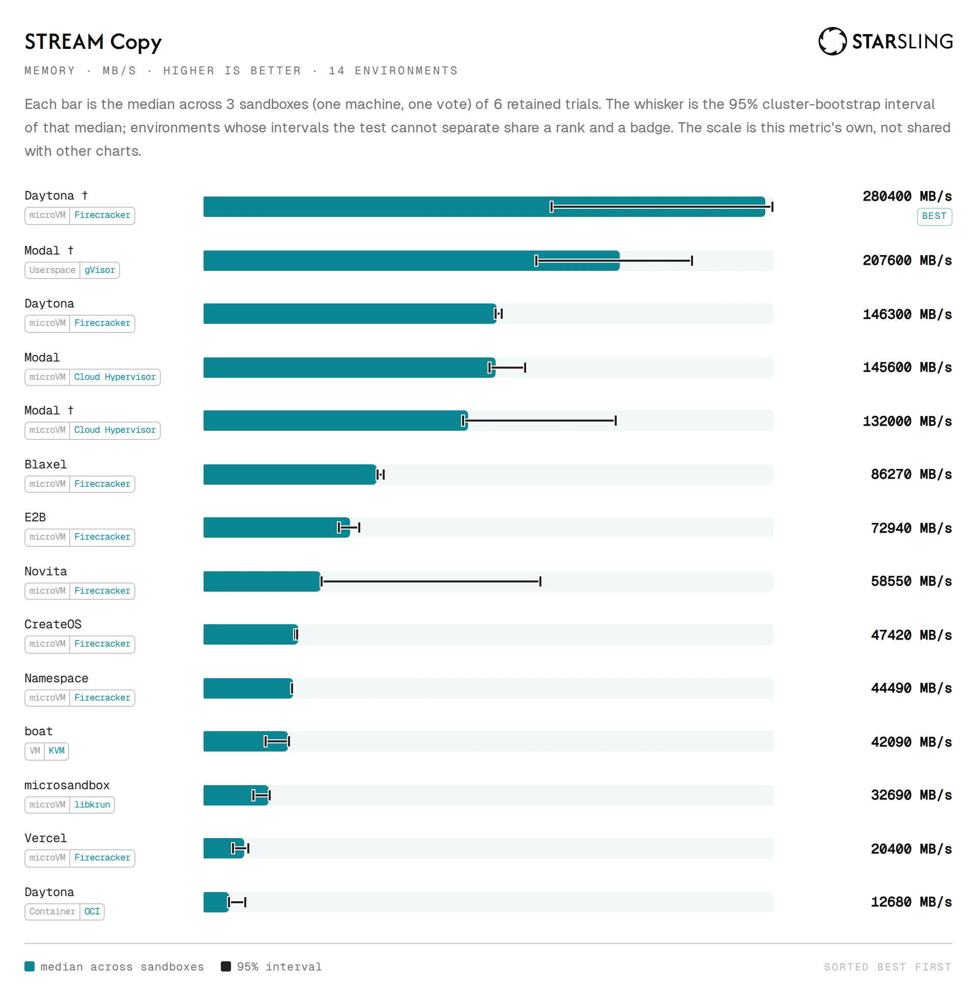

| Rank | Provider | STREAM Copy (MB/s) | 95% bootstrap interval | Sandboxes | Trials | Note |
| ---: | --- | ---: | ---: | ---: | ---: | --- |
| 1 | Daytona (VM, burst) | 218300 | 215500 – 284500 | 3 | 6 | — |
| 2 | DigitalOcean MicroVMs | 185300 | 155400 – 196987 | 3 | 6 | too few sandboxes |
| 3 | Modal (gVisor) | 179100 | 174800 – 442052 | 3 | 6 | too few sandboxes |
| 4 | Modal (VM, burst) | 178600 | 149800 – 210300 | 3 | 6 | too few sandboxes |
| 5 | Daytona (VM) | 146600 | 143700 – 150300 | 3 | 6 | too few sandboxes |
| 6 | Modal (VM) | 144900 | 135400 – 194757 | 3 | 6 | too few sandboxes |
| 7 | Blaxel | 87050 | 86420 – 89800 | 3 | 6 | too few sandboxes |
| 8 | E2B | 71990 | 65590 – 74080 | 3 | 6 | too few sandboxes |
| 9 | run.cloud | 62370 | 35230 – 90320 | 3 | 6 | too few sandboxes |
| 10 | Novita | 58199 | 58010 – 58460 | 3 | 6 | too few sandboxes |
| 11 | CreateOS | 47600 | 45590 – 48100 | 3 | 6 | too few sandboxes |
| 12 | Namespace | 44650 | 44600 – 44860 | 3 | 6 | too few sandboxes |
| 13 | Vercel Sandbox | 40270 | 39180 – 87640 | 3 | 6 | too few sandboxes |
| 14 | boat | 34040 | 32810 – 37250 | 3 | 6 | too few sandboxes |

### STREAM Scale

MB/s · higher is better

_Daytona (VM, burst) leads · ~1.1× DigitalOcean MicroVMs on median (higher is better)._

| Rank | Provider | STREAM Scale (MB/s) | 95% bootstrap interval | Sandboxes | Trials | Note |
| ---: | --- | ---: | ---: | ---: | ---: | --- |
| 1 | Daytona (VM, burst) | 165000 | 164000 – 245900 | 3 | 6 | — |
| 2 | DigitalOcean MicroVMs | 146500 | 128300 – 147400 | 3 | 6 | too few sandboxes |
| 3 | Modal (gVisor) | 123400 | 120600 – 340200 | 3 | 6 | too few sandboxes |
| 4 | Modal (VM, burst) | 120469 | 97570 – 148300 | 3 | 6 | too few sandboxes |
| 5 | Daytona (VM) | 112300 | 109900 – 115400 | 3 | 6 | too few sandboxes |
| 6 | Modal (VM) | 96950 | 89910 – 173600 | 3 | 6 | too few sandboxes |
| 7 | Blaxel | 61990 | 61110 – 62230 | 3 | 6 | too few sandboxes |
| 8 | Novita | 50790 | 49950 – 50910 | 3 | 6 | too few sandboxes |
| 9 | Vercel Sandbox | 42200 | 40000 – 46260 | 3 | 6 | too few sandboxes |
| 10 | E2B | 41360 | 34520 – 42590 | 3 | 6 | too few sandboxes |
| 11 | CreateOS | 41040 | 38350 – 41140 | 3 | 6 | too few sandboxes |
| 12 | run.cloud | 40872 | 22440 – 88800 | 3 | 6 | too few sandboxes |
| 13 | Namespace | 30650 | 30620 – 30690 | 3 | 6 | too few sandboxes |
| 14 | boat | 24730 | 21610 – 26650 | 3 | 6 | too few sandboxes |

## network

<strong>22 synthetic metrics</strong> · headlines: iperf3 WAN download · iperf3 WAN upload

### iperf3 WAN download _(headline)_

Mbits/sec · higher is better

_Vercel Sandbox leads · ~1.3× Namespace on median (higher is better)._

| Rank | Provider | iperf3 WAN download (Mbits/sec) | 95% bootstrap interval | Sandboxes | Trials | Note |
| ---: | --- | ---: | ---: | ---: | ---: | --- |
| 1 | Vercel Sandbox | 9204 | 6100 – 10830 | 3 | 6 | — |
| 2 | Namespace | 7185 | 7146 – 7313 | 3 | 6 | too few sandboxes |
| 3 | Novita | 5641 | 1022 – 5806 | 3 | 6 | too few sandboxes |
| 4 | run.cloud | 4715 | 4303 – 6892 | 3 | 6 | too few sandboxes |
| 5 | DigitalOcean MicroVMs | 4429 | 4011 – 4520 | 3 | 6 | too few sandboxes |
| 6 | Modal (VM, burst) | 3405 | 1818 – 4905 | 3 | 6 | too few sandboxes |
| 7 | Blaxel | 3345 | 3040 – 3453 | 3 | 6 | too few sandboxes |
| 8 | Modal (gVisor) | 2293 | 2279 – 2433 | 3 | 6 | too few sandboxes |
| 9 | Modal (VM) | 2169 | 2136 – 2413 | 3 | 6 | too few sandboxes |
| 10 | E2B | 1024 | 629.2 – 2420 | 3 | 6 | too few sandboxes |
| 11 | boat | 815.3 | 303.2 – 919.8 | 3 | 6 | too few sandboxes |
| 12 | Microsandbox Cloud | 417.7 | 357.1 – 802.4 | 3 | 6 | too few sandboxes |
| 13 | CreateOS | 275.6 | 265.5 – 5303 | 3 | 6 | too few sandboxes |

### iperf3 WAN upload _(headline)_

Mbits/sec · higher is better

_DigitalOcean MicroVMs leads · ~2.6× Vercel Sandbox on median (higher is better)._

| Rank | Provider | iperf3 WAN upload (Mbits/sec) | 95% bootstrap interval | Sandboxes | Trials | Note |
| ---: | --- | ---: | ---: | ---: | ---: | --- |
| 1 | DigitalOcean MicroVMs | 16520 | 16180 – 18750 | 3 | 6 | — |
| 2 | Vercel Sandbox | 6302 | 5219 – 6660 | 3 | 6 | too few sandboxes |
| 3 | Modal (VM) | 4618 | 4393 – 4968 | 3 | 6 | too few sandboxes |
| 4 | Namespace | 4275 | 3604 – 4833 | 3 | 6 | too few sandboxes |
| 5 | Novita | 3780 | 1124 – 4519 | 3 | 6 | too few sandboxes |
| 6 | Modal (VM, burst) | 3605 | 3363 – 4251 | 3 | 6 | too few sandboxes |
| 7 | Blaxel | 2437 | 2252 – 2509 | 3 | 6 | too few sandboxes |
| 8 | run.cloud | 1907 | 705.9 – 1933 | 3 | 6 | too few sandboxes |
| 9 | Modal (gVisor) | 1891 | 1861 – 2096 | 3 | 6 | too few sandboxes |
| 10 | E2B | 1372 | 1215 – 1650 | 3 | 6 | too few sandboxes |
| 11 | boat | 910.5 | 695.5 – 914.2 | 3 | 6 | too few sandboxes |
| 12 | CreateOS | 878.1 | 634.7 – 1486 | 3 | 6 | too few sandboxes |
| 13 | Microsandbox Cloud | 500.4 | 267.4 – 817 | 3 | 6 | too few sandboxes |

### iperf3 loopback TCP, 1 stream

Mbits/sec · higher is better

_Novita leads · ~1.4× DigitalOcean MicroVMs on median (higher is better)._

| Rank | Provider | iperf3 loopback TCP, 1 stream (Mbits/sec) | 95% bootstrap interval | Sandboxes | Trials | Note |
| ---: | --- | ---: | ---: | ---: | ---: | --- |
| 1 | Novita | 158454 | 158413 – 161571 | 3 | 6 | — |
| 2 | DigitalOcean MicroVMs | 110557 | 93832 – 122242 | 3 | 6 | too few sandboxes |
| 3 | CreateOS | 95999 | 66530 – 102180 | 3 | 6 | too few sandboxes |
| 4 | boat | 78412 | 75375 – 113592 | 3 | 6 | too few sandboxes |
| 5 | Blaxel | 68565 | 66630 – 70604 | 3 | 6 | too few sandboxes |
| 6 | Modal (VM, burst) | 66793 | 59104 – 91140 | 3 | 6 | too few sandboxes |
| 7 | Modal (VM) | 55790 | 55150 – 55852 | 3 | 6 | too few sandboxes |
| 8 | Modal (gVisor) | 50950 | 40180 – 51770 | 3 | 6 | too few sandboxes |
| 9 | Microsandbox Cloud | 46050 | 37820 – 52000 | 3 | 6 | too few sandboxes |
| 10 | E2B | 44520 | 43710 – 50400 | 3 | 6 | too few sandboxes |
| 11 | Vercel Sandbox | 41761 | 36830 – 55860 | 3 | 6 | too few sandboxes |
| 12 | Namespace | 36722 | 35910 – 36830 | 3 | 6 | too few sandboxes |
| 13 | run.cloud | 13410 | 12530 – 28702 | 3 | 6 | too few sandboxes |

### iperf3 loopback TCP, 10 streams

Mbits/sec · higher is better

_CreateOS leads · ~1.1× Novita on median (higher is better)._

| Rank | Provider | iperf3 loopback TCP, 10 streams (Mbits/sec) | 95% bootstrap interval | Sandboxes | Trials | Note |
| ---: | --- | ---: | ---: | ---: | ---: | --- |
| 1 | CreateOS | 175700 | 83260 – 204768 | 3 | 6 | — |
| 2 | Novita | 157450 | 157151 – 159757 | 3 | 6 | too few sandboxes |
| 3 | DigitalOcean MicroVMs | 126600 | 95163 – 159633 | 3 | 6 | too few sandboxes |
| 4 | Blaxel | 91072 | 88845 – 91358 | 3 | 6 | too few sandboxes |
| 5 | boat | 68810 | 43980 – 69590 | 3 | 6 | too few sandboxes |
| 6 | Microsandbox Cloud | 63070 | 63025 – 64217 | 3 | 6 | too few sandboxes |
| 7 | E2B | 60088 | 54165 – 62031 | 3 | 6 | too few sandboxes |
| 8 | Modal (VM) | 58310 | 51208 – 58674 | 3 | 6 | too few sandboxes |
| 9 | Modal (VM, burst) | 58087 | 45335 – 71379 | 3 | 6 | too few sandboxes |
| 10 | Namespace | 43680 | 40146 – 44257 | 3 | 6 | too few sandboxes |
| 11 | Vercel Sandbox | 40840 | 34340 – 46600 | 3 | 6 | too few sandboxes |
| 12 | Modal (gVisor) | 39685 | 36440 – 40660 | 3 | 6 | too few sandboxes |
| 13 | run.cloud | 16357 | 14211 – 32920 | 3 | 6 | too few sandboxes |

### iperf3 loopback UDP, 10G objective

Mbits/sec · higher is better

_run.cloud leads on median (higher is better); see notes for how ranks are decided._

| Rank | Provider | iperf3 loopback UDP, 10G objective (Mbits/sec) | 95% bootstrap interval | Sandboxes | Trials | Note |
| ---: | --- | ---: | ---: | ---: | ---: | --- |
| 1 | run.cloud | 10000 | 9999 – 10000 | 3 | 6 | — |
| 2 | Blaxel | 9999 | 9999 – 9999 | 3 | 6 | too few sandboxes |
| 2 | boat | 9999 | 9999 – 9999 | 3 | 6 | too few sandboxes, equal medians |
| 2 | CreateOS | 9999 | 9999 – 9999 | 3 | 6 | too few sandboxes, equal medians |
| 2 | DigitalOcean MicroVMs | 9999 | 9999 – 9999 | 3 | 6 | too few sandboxes, equal medians |
| 2 | E2B | 9999 | 9999 – 10000 | 3 | 6 | too few sandboxes, equal medians |
| 2 | Microsandbox Cloud | 9999 | 9999 – 9999 | 3 | 6 | too few sandboxes, equal medians |
| 2 | Modal (gVisor) | 9999 | 9999 – 9999 | 3 | 6 | too few sandboxes, equal medians |
| 2 | Modal (VM, burst) | 9999 | 9999 – 9999 | 3 | 6 | too few sandboxes, equal medians |
| 2 | Modal (VM) | 9999 | 9999 – 9999 | 3 | 6 | too few sandboxes, equal medians |
| 2 | Namespace | 9999 | 9999 – 9999 | 3 | 6 | too few sandboxes, equal medians |
| 2 | Novita | 9999 | 9999 – 9999 | 3 | 6 | too few sandboxes, equal medians |
| 2 | Vercel Sandbox | 9999 | 9999 – 9999 | 3 | 6 | too few sandboxes, equal medians |

### github.com HTTPS

ms · lower is better

_Namespace leads · Modal (VM) is ~1.2× higher (lower is better)._

| Rank | Provider | github.com HTTPS (ms) | 95% bootstrap interval | Sandboxes | Trials | Note |
| ---: | --- | ---: | ---: | ---: | ---: | --- |
| 1 | Namespace | 14.65 | 14.16 – 14.69 | 3 | 90 | — |
| 2 | Modal (VM) | 17.19 | 15.52 – 17.65 | 3 | 90 | too few sandboxes |
| 3 | Vercel Sandbox | 26.16 | 25.77 – 40.65 | 3 | 90 | too few sandboxes |
| 4 | Blaxel | 26.47 | 24.88 – 27.06 | 3 | 90 | too few sandboxes |
| 5 | CreateOS | 43.08 | 35.46 – 44.69 | 3 | 90 | too few sandboxes |
| 6 | Modal (VM, burst) | 46.71 | 15.42 – 516.4 | 3 | 90 | too few sandboxes |
| 7 | Modal (gVisor) | 57.09 | 22.53 – 512.3 | 3 | 90 | too few sandboxes |
| 8 | Microsandbox Cloud | 66.39 | 62.13 – 71.36 | 3 | 90 | too few sandboxes |
| 9 | E2B | 104.6 | 96.14 – 104.7 | 3 | 90 | too few sandboxes |
| 10 | run.cloud | 113 | 110.9 – 124.1 | 3 | 90 | too few sandboxes |
| 11 | boat | 131.8 | 114.2 – 549.4 | 3 | 90 | too few sandboxes |
| 12 | DigitalOcean MicroVMs | 313 | 312.4 – 313.3 | 3 | 90 | too few sandboxes |
| 13 | Novita | 513.1 | 512 – 562.6 | 3 | 90 | too few sandboxes |

### api.github.com HTTPS

ms · lower is better

_Namespace leads · Modal (VM) is ~1.3× higher (lower is better)._

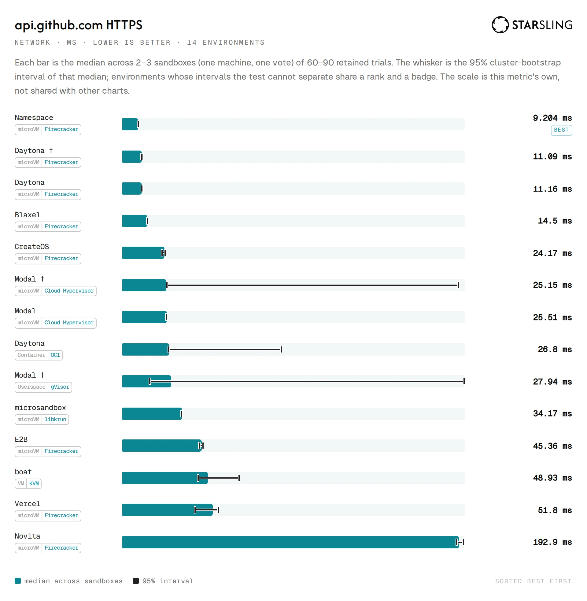

| Rank | Provider | api.github.com HTTPS (ms) | 95% bootstrap interval | Sandboxes | Trials | Note |
| ---: | --- | ---: | ---: | ---: | ---: | --- |
| 1 | Namespace | 8.655 | 8.619 – 9.289 | 3 | 90 | — |
| 2 | Modal (VM) | 10.84 | 10.56 – 11.3 | 3 | 90 | too few sandboxes |
| 3 | Blaxel | 13.91 | 13.79 – 14.29 | 3 | 90 | too few sandboxes |
| 4 | Vercel Sandbox | 19.23 | 15.17 – 20.32 | 3 | 90 | too few sandboxes |
| 5 | Modal (VM, burst) | 22.28 | 10.25 – 23.34 | 3 | 90 | too few sandboxes |
| 6 | CreateOS | 22.97 | 21.46 – 23.39 | 3 | 90 | too few sandboxes |
| 7 | Modal (gVisor) | 27.33 | 16.52 – 196.2 | 3 | 90 | too few sandboxes |
| 8 | E2B | 42.84 | 41.42 – 47.06 | 3 | 90 | too few sandboxes |
| 9 | run.cloud | 48.99 | 40.49 – 58.73 | 3 | 90 | too few sandboxes |
| 10 | boat | 53.75 | 44.01 – 106.1 | 3 | 90 | too few sandboxes |
| 11 | Microsandbox Cloud | 69.06 | 49.96 – 81.83 | 3 | 90 | too few sandboxes |
| 12 | DigitalOcean MicroVMs | 121.6 | 121.3 – 122.8 | 3 | 90 | too few sandboxes |
| 13 | Novita | 192.5 | 189.7 – 195 | 3 | 90 | too few sandboxes |

### raw.githubusercontent.com HTTPS

ms · lower is better

_Namespace leads · Modal (VM) is ~1.2× higher (lower is better)._

| Rank | Provider | raw.githubusercontent.com HTTPS (ms) | 95% bootstrap interval | Sandboxes | Trials | Note |
| ---: | --- | ---: | ---: | ---: | ---: | --- |
| 1 | Namespace | 7.131 | 7.058 – 7.361 | 3 | 90 | — |
| 2 | Modal (VM) | 8.805 | 8.787 – 8.867 | 3 | 90 | too few sandboxes |
| 3 | DigitalOcean MicroVMs | 10.33 | 10.15 – 10.73 | 3 | 90 | too few sandboxes |
| 4 | Blaxel | 11.35 | 11.27 – 13.21 | 3 | 90 | too few sandboxes |
| 5 | Modal (VM, burst) | 12.12 | 7.648 – 12.53 | 3 | 90 | too few sandboxes |
| 6 | Modal (gVisor) | 15.58 | 14.75 – 17.38 | 3 | 90 | too few sandboxes |
| 7 | Vercel Sandbox | 17.06 | 13.42 – 17.96 | 3 | 90 | too few sandboxes |
| 8 | CreateOS | 20.77 | 19.12 – 21.13 | 3 | 90 | too few sandboxes |
| 9 | run.cloud | 25.26 | 24.62 – 32.16 | 3 | 90 | too few sandboxes |
| 10 | boat | 27.55 | 21.28 – 96.24 | 3 | 90 | too few sandboxes |
| 11 | E2B | 31.15 | 29.63 – 31.23 | 3 | 90 | too few sandboxes |
| 12 | Novita | 41.16 | 40.59 – 41.62 | 3 | 90 | too few sandboxes |
| 13 | Microsandbox Cloud | 86.58 | 72.73 – 87.74 | 3 | 90 | too few sandboxes |

### registry.npmjs.org HTTPS

ms · lower is better

_Namespace leads · Modal (VM) is ~1.1× higher (lower is better)._

| Rank | Provider | registry.npmjs.org HTTPS (ms) | 95% bootstrap interval | Sandboxes | Trials | Note |
| ---: | --- | ---: | ---: | ---: | ---: | --- |
| 1 | Namespace | 12.98 | 12.73 – 12.99 | 3 | 90 | — |
| 2 | Modal (VM) | 14.5 | 14.45 – 14.71 | 3 | 90 | too few sandboxes |
| 3 | DigitalOcean MicroVMs | 17.13 | 16.84 – 17.14 | 3 | 90 | too few sandboxes |
| 4 | Modal (VM, burst) | 17.38 | 14.31 – 24.75 | 3 | 90 | too few sandboxes |
| 5 | Blaxel | 19.07 | 18.66 – 19.48 | 3 | 90 | too few sandboxes |
| 6 | Modal (gVisor) | 23.83 | 23.1 – 27.46 | 3 | 90 | too few sandboxes |
| 7 | Vercel Sandbox | 24.15 | 22.4 – 26.51 | 3 | 90 | too few sandboxes |
| 8 | CreateOS | 29.86 | 28.04 – 30.84 | 3 | 90 | too few sandboxes |
| 9 | run.cloud | 34.9 | 34.05 – 42.18 | 3 | 90 | too few sandboxes |
| 10 | E2B | 43.97 | 42.2 – 45.66 | 3 | 90 | too few sandboxes |
| 11 | boat | 44.26 | 38.2 – 145.2 | 3 | 90 | too few sandboxes |
| 12 | Novita | 62.07 | 61.39 – 62.17 | 3 | 90 | too few sandboxes |
| 13 | Microsandbox Cloud | 80.26 | 77.79 – 84.9 | 3 | 90 | too few sandboxes |

### pypi.org HTTPS

ms · lower is better

_Namespace leads · DigitalOcean MicroVMs is ~1.4× higher (lower is better)._

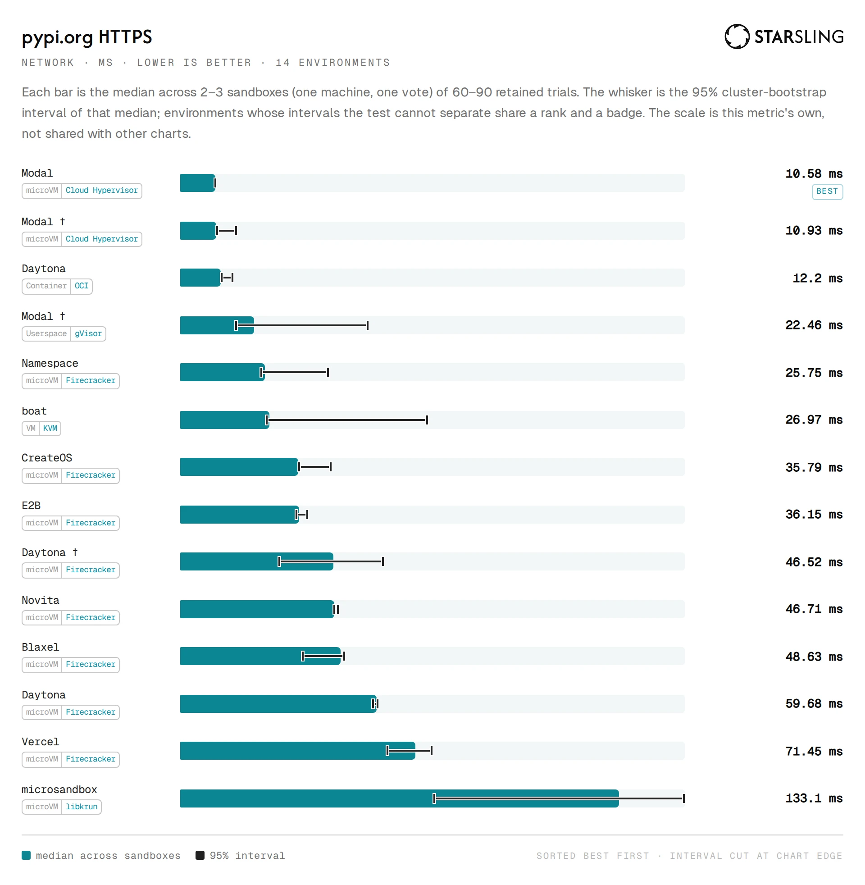

| Rank | Provider | pypi.org HTTPS (ms) | 95% bootstrap interval | Sandboxes | Trials | Note |
| ---: | --- | ---: | ---: | ---: | ---: | --- |
| 1 | Namespace | 8.023 | 7.903 – 8.243 | 3 | 90 | — |
| 2 | DigitalOcean MicroVMs | 11.55 | 11.42 – 11.87 | 3 | 90 | too few sandboxes |
| 3 | Modal (VM, burst) | 13.55 | 9.015 – 15.16 | 3 | 90 | too few sandboxes |
| 4 | Blaxel | 13.69 | 13.45 – 15.12 | 3 | 90 | too few sandboxes |
| 5 | Vercel Sandbox | 20.43 | 20.18 – 20.75 | 3 | 90 | too few sandboxes |
| 6 | Modal (gVisor) | 20.75 | 15.76 – 28.01 | 3 | 90 | too few sandboxes |
| 7 | CreateOS | 22.76 | 21.16 – 22.86 | 3 | 90 | too few sandboxes |
| 8 | Modal (VM) | 23.76 | 10.82 – 24.86 | 3 | 90 | too few sandboxes |
| 9 | run.cloud | 25.86 | 25.13 – 33.61 | 3 | 90 | too few sandboxes |
| 10 | boat | 34.41 | 24.28 – 122.4 | 3 | 90 | too few sandboxes |
| 11 | E2B | 35.37 | 34 – 37.62 | 3 | 90 | too few sandboxes |
| 12 | Novita | 45.5 | 44.6 – 46.31 | 3 | 90 | too few sandboxes |
| 13 | Microsandbox Cloud | 75.43 | 41.27 – 77.17 | 3 | 90 | too few sandboxes |

### files.pythonhosted.org HTTPS

ms · lower is better

_Namespace leads · Modal (VM) is ~1.3× higher (lower is better)._

| Rank | Provider | files.pythonhosted.org HTTPS (ms) | 95% bootstrap interval | Sandboxes | Trials | Note |
| ---: | --- | ---: | ---: | ---: | ---: | --- |
| 1 | Namespace | 6.956 | 6.871 – 7.016 | 3 | 90 | — |
| 2 | Modal (VM) | 9.037 | 9.014 – 9.051 | 3 | 90 | too few sandboxes |
| 3 | DigitalOcean MicroVMs | 10.25 | 10.1 – 10.65 | 3 | 90 | too few sandboxes |
| 4 | Modal (VM, burst) | 11.58 | 8.46 – 12.14 | 3 | 90 | too few sandboxes |
| 5 | Blaxel | 11.83 | 11.75 – 12.19 | 3 | 90 | too few sandboxes |
| 6 | Modal (gVisor) | 15.67 | 14.52 – 17.26 | 3 | 90 | too few sandboxes |
| 7 | Vercel Sandbox | 16.25 | 13.69 – 18.04 | 3 | 90 | too few sandboxes |
| 8 | CreateOS | 20.79 | 19.49 – 21.99 | 3 | 90 | too few sandboxes |
| 9 | run.cloud | 25.4 | 25.37 – 33.08 | 3 | 90 | too few sandboxes |
| 10 | boat | 31.97 | 25.42 – 99.73 | 3 | 90 | too few sandboxes |
| 11 | E2B | 33.33 | 32.94 – 33.93 | 3 | 90 | too few sandboxes |
| 12 | Microsandbox Cloud | 33.68 | 33.11 – 38.37 | 3 | 90 | too few sandboxes |
| 13 | Novita | 41.23 | 41.06 – 42.39 | 3 | 90 | too few sandboxes |

### ghcr.io/v2 HTTPS

ms · lower is better

_Namespace leads · Modal (VM) is ~1.2× higher (lower is better)._

| Rank | Provider | ghcr.io/v2 HTTPS (ms) | 95% bootstrap interval | Sandboxes | Trials | Note |
| ---: | --- | ---: | ---: | ---: | ---: | --- |
| 1 | Namespace | 14.87 | 14.7 – 16.68 | 3 | 90 | — |
| 2 | Modal (VM) | 17.75 | 14.43 – 18.03 | 3 | 90 | too few sandboxes |
| 3 | Vercel Sandbox | 19.67 | 18.72 – 23.36 | 3 | 90 | too few sandboxes |
| 4 | Blaxel | 20.72 | 19.52 – 22.35 | 3 | 90 | too few sandboxes |
| 5 | CreateOS | 25.34 | 23.78 – 27.28 | 3 | 90 | too few sandboxes |
| 6 | Modal (gVisor) | 35.85 | 18.78 – 206.1 | 3 | 90 | too few sandboxes |
| 7 | Modal (VM, burst) | 89.13 | 15.8 – 90.38 | 3 | 90 | too few sandboxes |
| 8 | E2B | 110.8 | 109.4 – 111.8 | 3 | 90 | too few sandboxes |
| 9 | DigitalOcean MicroVMs | 130.3 | 129.7 – 130.8 | 3 | 90 | too few sandboxes |
| 10 | Microsandbox Cloud | 135.7 | 134.6 – 154.3 | 3 | 90 | too few sandboxes |
| 11 | boat | 146 | 139.7 – 220.9 | 3 | 90 | too few sandboxes |
| 12 | run.cloud | 151.1 | 147.8 – 151.3 | 3 | 90 | too few sandboxes |
| 13 | Novita | 200.6 | 195 – 202.1 | 3 | 90 | too few sandboxes |

### gcr.io/v2 HTTPS

ms · lower is better

_Modal (VM) leads on median (lower is better); see notes for how ranks are decided._

| Rank | Provider | gcr.io/v2 HTTPS (ms) | 95% bootstrap interval | Sandboxes | Trials | Note |
| ---: | --- | ---: | ---: | ---: | ---: | --- |
| 1 | Modal (VM) | 13.32 | 12.91 – 14.41 | 3 | 90 | — |
| 2 | Namespace | 13.68 | 13.13 – 14.13 | 3 | 90 | too few sandboxes |
| 3 | Blaxel | 16.78 | 16.78 – 16.83 | 3 | 90 | too few sandboxes |
| 4 | E2B | 17.89 | 16.16 – 21.24 | 3 | 90 | too few sandboxes |
| 5 | Novita | 20.53 | 20.17 – 20.68 | 3 | 90 | too few sandboxes |
| 6 | Vercel Sandbox | 22.5 | 19.07 – 24.45 | 3 | 90 | too few sandboxes |
| 7 | Modal (gVisor) | 29.6 | 19.38 – 30.53 | 3 | 90 | too few sandboxes |
| 8 | Modal (VM, burst) | 30.13 | 12.74 – 34.69 | 3 | 90 | too few sandboxes |
| 9 | CreateOS | 63.12 | 61.54 – 196 | 3 | 90 | too few sandboxes |
| 10 | Microsandbox Cloud | 152.9 | 152.1 – 180.4 | 3 | 90 | too few sandboxes |
| 11 | boat | 511.1 | 510.1 – 596.6 | 3 | 90 | too few sandboxes |
| 12 | run.cloud | 531.2 | 525.1 – 532.7 | 3 | 90 | too few sandboxes |
| 13 | DigitalOcean MicroVMs | 825.4 | 823.4 – 826.2 | 3 | 90 | too few sandboxes |

### auth.docker.io token HTTPS

ms · lower is better

_Namespace leads on median (lower is better); see notes for how ranks are decided._

| Rank | Provider | auth.docker.io token HTTPS (ms) | 95% bootstrap interval | Sandboxes | Trials | Note |
| ---: | --- | ---: | ---: | ---: | ---: | --- |
| 1 | Namespace | 21.38 | 21.16 – 22.73 | 3 | 90 | — |
| 2 | Modal (VM) | 21.85 | 21.45 – 22.61 | 3 | 90 | too few sandboxes |
| 3 | Blaxel | 25.82 | 25.04 – 26.89 | 3 | 90 | too few sandboxes |
| 4 | Vercel Sandbox | 31.39 | 27.1 – 33 | 3 | 90 | too few sandboxes |
| 5 | Modal (gVisor) | 35.42 | 28.03 – 112.8 | 3 | 90 | too few sandboxes |
| 6 | CreateOS | 35.64 | 35.44 – 37 | 3 | 90 | too few sandboxes |
| 7 | DigitalOcean MicroVMs | 59.8 | 59.04 – 60.11 | 3 | 90 | too few sandboxes |
| 8 | Modal (VM, burst) | 107.8 | 22.1 – 110.7 | 3 | 90 | too few sandboxes |
| 9 | boat | 119.4 | 116.3 – 145.4 | 3 | 90 | too few sandboxes |
| 10 | Novita | 125.6 | 125.2 – 127.4 | 3 | 90 | too few sandboxes |
| 11 | run.cloud | 129.7 | 121.7 – 129.9 | 3 | 90 | too few sandboxes |
| 12 | E2B | 133.1 | 124.1 – 133.1 | 3 | 90 | too few sandboxes |
| 13 | Microsandbox Cloud | 146 | 140.8 – 148.2 | 3 | 90 | too few sandboxes |

### crates.io HTTPS

ms · lower is better

_Namespace leads · Modal (VM) is ~1.1× higher (lower is better)._

| Rank | Provider | crates.io HTTPS (ms) | 95% bootstrap interval | Sandboxes | Trials | Note |
| ---: | --- | ---: | ---: | ---: | ---: | --- |
| 1 | Namespace | 10.8 | 9.874 – 11 | 3 | 90 | — |
| 2 | Modal (VM) | 11.49 | 10.88 – 12.48 | 3 | 90 | too few sandboxes |
| 3 | DigitalOcean MicroVMs | 13.47 | 13.2 – 14.43 | 3 | 90 | too few sandboxes |
| 4 | Blaxel | 15.53 | 14.95 – 15.57 | 3 | 90 | too few sandboxes |
| 5 | Modal (VM, burst) | 17.48 | 10.77 – 18.36 | 3 | 90 | too few sandboxes |
| 6 | Modal (gVisor) | 19.15 | 17.21 – 23.15 | 3 | 90 | too few sandboxes |
| 7 | Vercel Sandbox | 20.11 | 16.15 – 21 | 3 | 90 | too few sandboxes |
| 8 | CreateOS | 26.14 | 25.61 – 26.8 | 3 | 90 | too few sandboxes |
| 9 | boat | 26.99 | 21.83 – 86.12 | 3 | 90 | too few sandboxes |
| 10 | run.cloud | 29.5 | 27.9 – 37.43 | 3 | 90 | too few sandboxes |
| 11 | E2B | 38.45 | 36.2 – 39.61 | 3 | 90 | too few sandboxes |
| 12 | Microsandbox Cloud | 40.83 | 39.75 – 42.92 | 3 | 90 | too few sandboxes |
| 13 | Novita | 45.27 | 43.65 – 45.55 | 3 | 90 | too few sandboxes |

### index.crates.io config HTTPS

ms · lower is better

_Namespace leads · Modal (VM) is ~1.2× higher (lower is better)._

| Rank | Provider | index.crates.io config HTTPS (ms) | 95% bootstrap interval | Sandboxes | Trials | Note |
| ---: | --- | ---: | ---: | ---: | ---: | --- |
| 1 | Namespace | 7.096 | 7.037 – 7.135 | 3 | 90 | — |
| 2 | Modal (VM) | 8.367 | 7.675 – 8.591 | 3 | 90 | too few sandboxes |
| 3 | DigitalOcean MicroVMs | 10.58 | 10.08 – 10.87 | 3 | 90 | too few sandboxes |
| 4 | Blaxel | 11.63 | 11.1 – 11.88 | 3 | 90 | too few sandboxes |
| 5 | Modal (VM, burst) | 11.8 | 8.111 – 11.99 | 3 | 90 | too few sandboxes |
| 6 | Modal (gVisor) | 14.67 | 14.23 – 16.86 | 3 | 90 | too few sandboxes |
| 7 | Vercel Sandbox | 15.74 | 12.55 – 17.78 | 3 | 90 | too few sandboxes |
| 8 | CreateOS | 21.77 | 20.14 – 21.8 | 3 | 90 | too few sandboxes |
| 9 | boat | 25.92 | 19.76 – 113 | 3 | 90 | too few sandboxes |
| 10 | run.cloud | 26.64 | 25.12 – 33.28 | 3 | 90 | too few sandboxes |
| 11 | E2B | 32.48 | 32.17 – 32.96 | 3 | 90 | too few sandboxes |
| 12 | Microsandbox Cloud | 38.39 | 37.75 – 39.37 | 3 | 90 | too few sandboxes |
| 13 | Novita | 40.79 | 40.16 – 41.2 | 3 | 90 | too few sandboxes |

### github.com cold DNS

ms · lower is better

_Vercel Sandbox leads on median (lower is better); see notes for how ranks are decided._

| Rank | Provider | github.com cold DNS (ms) | 95% bootstrap interval | Sandboxes | Trials | Note |
| ---: | --- | ---: | ---: | ---: | ---: | --- |
| 1 | Vercel Sandbox | 0 | 0 – 3 | 3 | 3 | — |
| 2 | Blaxel | 3 | 0 – 4 | 3 | 3 | too few sandboxes |
| 3 | Modal (gVisor) | 4 | 3 – 16 | 3 | 3 | too few sandboxes |
| 3 | Modal (VM) | 4 | 4 – 8 | 3 | 3 | too few sandboxes, equal medians |
| 3 | Namespace | 4 | 0 – 12 | 3 | 3 | too few sandboxes, equal medians |
| 6 | run.cloud | 7 | 4 – 16 | 3 | 3 | too few sandboxes |
| 7 | boat | 8 | 7 – 36 | 3 | 3 | too few sandboxes |
| 7 | CreateOS | 8 | 8 – 8 | 3 | 3 | too few sandboxes, equal medians |
| 7 | Microsandbox Cloud | 8 | 8 – 12 | 3 | 3 | too few sandboxes, equal medians |
| 7 | Modal (VM, burst) | 8 | 4 – 28 | 3 | 3 | too few sandboxes, equal medians |
| 11 | E2B | 12 | 12 – 20 | 3 | 3 | too few sandboxes |
| 12 | DigitalOcean MicroVMs | 16 | 16 – 16 | 3 | 3 | too few sandboxes |
| 13 | Novita | 20 | 12 – 20 | 3 | 3 | too few sandboxes |

### registry.npmjs.org cold DNS

ms · lower is better

_Blaxel leads · Modal (VM) is ~1.3× higher (lower is better)._

| Rank | Provider | registry.npmjs.org cold DNS (ms) | 95% bootstrap interval | Sandboxes | Trials | Note |
| ---: | --- | ---: | ---: | ---: | ---: | --- |
| 1 | Blaxel | 3 | 3 – 8 | 3 | 3 | — |
| 2 | Modal (VM) | 4 | 4 – 4 | 3 | 3 | too few sandboxes |
| 2 | Namespace | 4 | 0 – 4 | 3 | 3 | too few sandboxes, equal medians |
| 2 | run.cloud | 4 | 4 – 8 | 3 | 3 | too few sandboxes, equal medians |
| 2 | Vercel Sandbox | 4 | 3 – 4 | 3 | 3 | too few sandboxes, equal medians |
| 6 | Modal (gVisor) | 5 | 4 – 16 | 3 | 3 | too few sandboxes |
| 7 | CreateOS | 7 | 4 – 8 | 3 | 3 | too few sandboxes |
| 8 | DigitalOcean MicroVMs | 8 | 8 – 12 | 3 | 3 | too few sandboxes |
| 8 | Modal (VM, burst) | 8 | 4 – 40 | 3 | 3 | too few sandboxes, equal medians |
| 10 | E2B | 12 | 8 – 12 | 3 | 3 | too few sandboxes |
| 10 | Microsandbox Cloud | 12 | 8 – 12 | 3 | 3 | too few sandboxes, equal medians |
| 12 | Novita | 16 | 16 – 20 | 3 | 3 | too few sandboxes |
| 13 | boat | 17 | 16 – 43 | 3 | 3 | too few sandboxes |

### docker.io cold DNS

ms · lower is better

_Modal (VM) and Vercel Sandbox share the top on this metric (lower is better)._

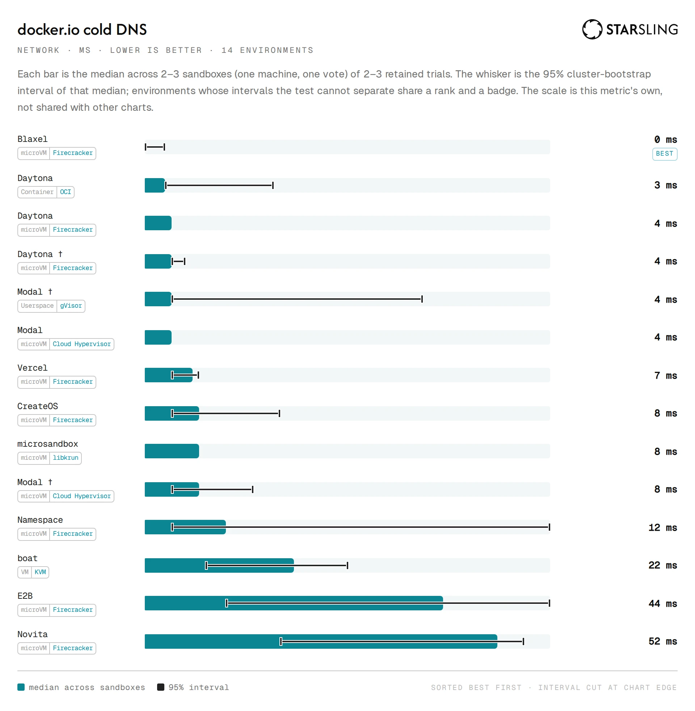

| Rank | Provider | docker.io cold DNS (ms) | 95% bootstrap interval | Sandboxes | Trials | Note |
| ---: | --- | ---: | ---: | ---: | ---: | --- |
| 1 | Modal (VM) | 0 | 0 – 4 | 3 | 3 | — |
| 1 | Vercel Sandbox | 0 | 0 – 4 | 3 | 3 | too few sandboxes, equal medians |
| 3 | Blaxel | 4 | 4 – 4 | 3 | 3 | too few sandboxes |
| 3 | Modal (gVisor) | 4 | 3 – 119 | 3 | 3 | too few sandboxes, equal medians |
| 3 | Modal (VM, burst) | 4 | 4 – 44 | 3 | 3 | too few sandboxes, equal medians |
| 6 | CreateOS | 8 | 4 – 8 | 3 | 3 | too few sandboxes |
| 7 | Microsandbox Cloud | 12 | 8 – 16 | 3 | 3 | too few sandboxes |
| 7 | run.cloud | 12 | 4 – 15 | 3 | 3 | too few sandboxes, equal medians |
| 9 | boat | 15 | 8 – 42 | 3 | 3 | too few sandboxes |
| 10 | Namespace | 20 | 16 – 60 | 3 | 3 | too few sandboxes |
| 10 | Novita | 20 | 16 – 20 | 3 | 3 | too few sandboxes, equal medians |
| 12 | DigitalOcean MicroVMs | 36 | 36 – 48 | 3 | 3 | too few sandboxes |
| 13 | E2B | 76 | 48 – 80 | 3 | 3 | too few sandboxes |

### pypi.org cold DNS

ms · lower is better

_Blaxel and Vercel Sandbox share the top on this metric (lower is better)._

| Rank | Provider | pypi.org cold DNS (ms) | 95% bootstrap interval | Sandboxes | Trials | Note |
| ---: | --- | ---: | ---: | ---: | ---: | --- |
| 1 | Blaxel | 4 | 4 – 4 | 3 | 3 | — |
| 1 | Vercel Sandbox | 4 | 3 – 4 | 3 | 3 | too few sandboxes, equal medians |
| 3 | Microsandbox Cloud | 8 | 8 – 12 | 3 | 3 | too few sandboxes |
| 3 | Modal (VM) | 8 | 4 – 12 | 3 | 3 | too few sandboxes, equal medians |
| 3 | run.cloud | 8 | 4 – 15 | 3 | 3 | too few sandboxes, equal medians |
| 6 | boat | 10 | 8 – 36 | 3 | 3 | too few sandboxes |
| 7 | Modal (gVisor) | 13 | 5 – 52 | 3 | 3 | too few sandboxes |
| 8 | CreateOS | 16 | 15 – 19 | 3 | 3 | too few sandboxes |
| 9 | Modal (VM, burst) | 24 | 8 – 40 | 3 | 3 | too few sandboxes |
| 10 | Namespace | 64 | 48 – 68 | 3 | 3 | too few sandboxes |
| 11 | DigitalOcean MicroVMs | 68 | 48 – 68 | 3 | 3 | too few sandboxes |
| 12 | Novita | 72 | 20 – 104 | 3 | 3 | too few sandboxes |
| 13 | E2B | 76 | 20 – 84 | 3 | 3 | too few sandboxes |

### rubygems.org cold DNS

ms · lower is better

_run.cloud leads · Microsandbox Cloud is ~5.0× higher (lower is better)._

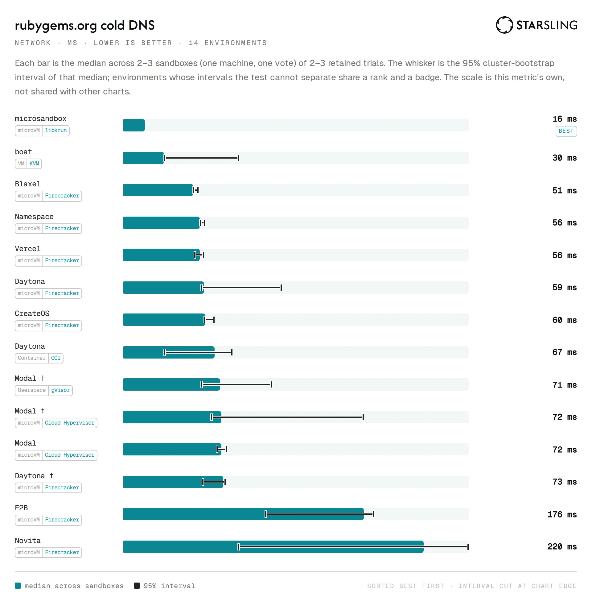

| Rank | Provider | rubygems.org cold DNS (ms) | 95% bootstrap interval | Sandboxes | Trials | Note |
| ---: | --- | ---: | ---: | ---: | ---: | --- |
| 1 | run.cloud | 4 | 4 – 8 | 3 | 3 | — |
| 2 | Microsandbox Cloud | 20 | 16 – 20 | 3 | 3 | too few sandboxes |
| 3 | boat | 29 | 29 – 55 | 3 | 3 | too few sandboxes |
| 4 | DigitalOcean MicroVMs | 44 | 40 – 44 | 3 | 3 | too few sandboxes |
| 5 | Namespace | 52 | 52 – 56 | 3 | 3 | too few sandboxes |
| 5 | Vercel Sandbox | 52 | 51 – 56 | 3 | 3 | too few sandboxes, equal medians |
| 7 | Blaxel | 55 | 51 – 55 | 3 | 3 | too few sandboxes |
| 8 | CreateOS | 56 | 55 – 67 | 3 | 3 | too few sandboxes |
| 9 | Modal (VM) | 60 | 52 – 60 | 3 | 3 | too few sandboxes |
| 10 | Modal (gVisor) | 72 | 51 – 118 | 3 | 3 | too few sandboxes |
| 11 | Modal (VM, burst) | 108 | 60 – 116 | 3 | 3 | too few sandboxes |
| 12 | Novita | 124 | 88 – 168 | 3 | 3 | too few sandboxes |
| 13 | E2B | 140 | 80 – 148 | 3 | 3 | too few sandboxes |

### Node 22 download

Mbits/sec · higher is better

_Vercel Sandbox leads · ~1.1× DigitalOcean MicroVMs on median (higher is better)._

| Rank | Provider | Node 22 download (Mbits/sec) | 95% bootstrap interval | Sandboxes | Trials | Note |
| ---: | --- | ---: | ---: | ---: | ---: | --- |
| 1 | Vercel Sandbox | 2958 | 2472 – 3090 | 3 | 3 | — |
| 2 | DigitalOcean MicroVMs | 2574 | 2260 – 2942 | 3 | 3 | too few sandboxes |
| 3 | Blaxel | 2540 | 2431 – 2733 | 3 | 3 | too few sandboxes |
| 4 | Namespace | 2474 | 2416 – 2519 | 3 | 3 | too few sandboxes |
| 5 | run.cloud | 2173 | 2120 – 2312 | 3 | 3 | too few sandboxes |
| 6 | Modal (VM) | 2123 | 1150 – 2348 | 3 | 3 | too few sandboxes |
| 7 | Modal (VM, burst) | 2041 | 1186 – 2171 | 3 | 3 | too few sandboxes |
| 8 | Modal (gVisor) | 1698 | 977.6 – 2681 | 3 | 3 | too few sandboxes |
| 9 | CreateOS | 868.2 | 855.3 – 2470 | 3 | 3 | too few sandboxes |
| 10 | boat | 813.1 | 330.2 – 822 | 3 | 3 | too few sandboxes |
| 11 | Novita | 806.9 | 729.2 – 1002 | 3 | 3 | too few sandboxes |
| 12 | Microsandbox Cloud | 755.9 | 345.9 – 799.7 | 3 | 3 | too few sandboxes |
| 13 | E2B | 327.8 | 296 – 1497 | 3 | 3 | too few sandboxes |

## system

<strong>7 synthetic metrics</strong> · headline: Git common operations

### Git common operations _(headline)_

Seconds · lower is better

_Namespace leads · CreateOS is ~1.1× higher (lower is better)._

| Rank | Provider | Git common operations (Seconds) | 95% bootstrap interval | Sandboxes | Trials | Note |
| ---: | --- | ---: | ---: | ---: | ---: | --- |
| 1 | Namespace | 32.48 | 32.16 – 32.78 | 3 | 6 | — |
| 2 | CreateOS | 37.3 | 37.1 – 37.53 | 3 | 6 | too few sandboxes |
| 3 | Modal (VM, burst) | 39.09 | 38.97 – 39.15 | 3 | 6 | too few sandboxes |
| 4 | Modal (VM) | 39.21 | 39.07 – 39.53 | 3 | 6 | too few sandboxes |
| 5 | DigitalOcean MicroVMs | 41 | 40.73 – 41.34 | 3 | 6 | too few sandboxes |
| 6 | boat | 42.55 | 37.04 – 44.19 | 3 | 6 | too few sandboxes |
| 7 | Modal (gVisor) | 42.82 | 40.95 – 43.26 | 3 | 6 | too few sandboxes |
| 8 | Novita | 44.09 | 43.99 – 44.61 | 3 | 6 | too few sandboxes |
| 9 | Microsandbox Cloud | 47.12 | 44.74 – 47.27 | 3 | 6 | too few sandboxes |
| 10 | Blaxel | 51.01 | 50.82 – 51.63 | 3 | 6 | too few sandboxes |
| 11 | run.cloud | 60.05 | 58.64 – 60.47 | 3 | 6 | too few sandboxes |
| 12 | Vercel Sandbox | 61.21 | 59.15 – 80.53 | 3 | 6 | too few sandboxes |
| 13 | E2B | 64.71 | 59.84 – 70.61 | 3 | 6 | too few sandboxes |

### pgbench RO (s100, 50c)

TPS · higher is better

_DigitalOcean MicroVMs leads · ~1.2× Modal (gVisor) on median (higher is better)._

| Rank | Provider | pgbench RO (s100, 50c) (TPS) | 95% bootstrap interval | Sandboxes | Trials | Note |
| ---: | --- | ---: | ---: | ---: | ---: | --- |
| 1 | DigitalOcean MicroVMs | 636700 | 631900 – 697100 | 3 | 6 | — |
| 2 | Modal (gVisor) | 530300 | 357700 – 543400 | 3 | 6 | too few sandboxes |
| 3 | Modal (VM, burst) | 442100 | 409400 – 623900 | 3 | 6 | too few sandboxes |
| 4 | CreateOS | 301500 | 280400 – 307200 | 3 | 6 | too few sandboxes |
| 5 | Novita | 300100 | 296000 – 308100 | 3 | 6 | too few sandboxes |
| 6 | Namespace | 260700 | 257900 – 260800 | 3 | 6 | too few sandboxes |
| 7 | Blaxel | 255100 | 254300 – 255900 | 2 | 4 | too few sandboxes |
| 8 | boat | 222200 | 212300 – 241800 | 3 | 6 | too few sandboxes |
| 9 | Modal (VM) | 218900 | 216800 – 223600 | 3 | 6 | too few sandboxes |
| 10 | Vercel Sandbox | 191300 | 98440 – 195200 | 3 | 6 | too few sandboxes |
| 11 | Microsandbox Cloud | 187000 | 165400 – 204900 | 3 | 6 | too few sandboxes |
| 12 | E2B | 162700 | 162200 – 163600 | 3 | 6 | too few sandboxes |
| 13 | run.cloud | 141500 | 139300 – 142500 | 3 | 6 | too few sandboxes |

### pgbench RO latency (s100, 50c)

ms · lower is better

_DigitalOcean MicroVMs leads · Modal (gVisor) is ~1.2× higher (lower is better)._

| Rank | Provider | pgbench RO latency (s100, 50c) (ms) | 95% bootstrap interval | Sandboxes | Trials | Note |
| ---: | --- | ---: | ---: | ---: | ---: | --- |
| 1 | DigitalOcean MicroVMs | 0.0785 | 0.072 – 0.079 | 3 | 6 | — |
| 2 | Modal (gVisor) | 0.094 | 0.092 – 0.1395 | 3 | 6 | too few sandboxes |
| 3 | Modal (VM, burst) | 0.113 | 0.0805 – 0.122 | 3 | 6 | too few sandboxes |
| 4 | CreateOS | 0.166 | 0.1635 – 0.1795 | 3 | 6 | too few sandboxes |
| 5 | Novita | 0.1665 | 0.1625 – 0.1685 | 3 | 6 | too few sandboxes |
| 6 | Namespace | 0.192 | 0.192 – 0.194 | 3 | 6 | too few sandboxes |
| 7 | Blaxel | 0.1963 | 0.1955 – 0.197 | 2 | 4 | too few sandboxes |
| 8 | boat | 0.227 | 0.2095 – 0.236 | 3 | 6 | too few sandboxes |
| 9 | Modal (VM) | 0.2285 | 0.224 – 0.231 | 3 | 6 | too few sandboxes |
| 10 | Vercel Sandbox | 0.2615 | 0.2565 – 0.5085 | 3 | 6 | too few sandboxes |
| 11 | Microsandbox Cloud | 0.267 | 0.244 – 0.3025 | 3 | 6 | too few sandboxes |
| 12 | E2B | 0.3075 | 0.3055 – 0.308 | 3 | 6 | too few sandboxes |
| 13 | run.cloud | 0.3535 | 0.351 – 0.359 | 3 | 6 | too few sandboxes |

### pgbench RW (s100, 50c)

TPS · higher is better

_Modal (gVisor) leads · ~1.3× Modal (VM, burst) on median (higher is better)._

| Rank | Provider | pgbench RW (s100, 50c) (TPS) | 95% bootstrap interval | Sandboxes | Trials | Note |
| ---: | --- | ---: | ---: | ---: | ---: | --- |
| 1 | Modal (gVisor) | 42430 | 31140 – 42840 | 3 | 6 | — |
| 2 | Modal (VM, burst) | 33610 | 29980 – 35260 | 3 | 6 | too few sandboxes |
| 3 | Novita | 28160 | 26710 – 29930 | 3 | 6 | too few sandboxes |
| 4 | Namespace | 22860 | 21810 – 23010 | 3 | 6 | too few sandboxes |
| 5 | DigitalOcean MicroVMs | 19770 | 19430 – 20070 | 3 | 6 | too few sandboxes |
| 6 | Blaxel | 19080 | 18370 – 19790 | 2 | 4 | too few sandboxes |
| 7 | Modal (VM) | 19000 | 18680 – 19140 | 3 | 6 | too few sandboxes |
| 8 | Vercel Sandbox | 18660 | 9756 – 19500 | 3 | 6 | too few sandboxes |
| 9 | CreateOS | 16730 | 16510 – 17430 | 3 | 6 | too few sandboxes |
| 10 | Microsandbox Cloud | 14270 | 12200 – 14410 | 3 | 6 | too few sandboxes |
| 11 | E2B | 10330 | 9927 – 10550 | 3 | 6 | too few sandboxes |
| 12 | run.cloud | 10280 | 9839 – 10370 | 3 | 6 | too few sandboxes |
| 13 | boat | 601.4 | 331.4 – 700.2 | 3 | 6 | too few sandboxes |

### pgbench RW latency (s100, 50c)

ms · lower is better

_Modal (gVisor) leads · Modal (VM, burst) is ~1.3× higher (lower is better)._

| Rank | Provider | pgbench RW latency (s100, 50c) (ms) | 95% bootstrap interval | Sandboxes | Trials | Note |
| ---: | --- | ---: | ---: | ---: | ---: | --- |
| 1 | Modal (gVisor) | 1.179 | 1.167 – 1.606 | 3 | 6 | — |
| 2 | Modal (VM, burst) | 1.488 | 1.418 – 1.669 | 3 | 6 | too few sandboxes |
| 3 | Novita | 1.777 | 1.671 – 1.873 | 3 | 6 | too few sandboxes |
| 4 | Namespace | 2.188 | 2.173 – 2.293 | 3 | 6 | too few sandboxes |
| 5 | DigitalOcean MicroVMs | 2.53 | 2.499 – 2.574 | 3 | 6 | too few sandboxes |
| 6 | Blaxel | 2.627 | 2.528 – 2.725 | 2 | 4 | too few sandboxes |
| 7 | Modal (VM) | 2.632 | 2.612 – 2.678 | 3 | 6 | too few sandboxes |
| 8 | Vercel Sandbox | 2.681 | 2.566 – 5.131 | 3 | 6 | too few sandboxes |
| 9 | CreateOS | 3.019 | 2.869 – 3.029 | 3 | 6 | too few sandboxes |
| 10 | Microsandbox Cloud | 3.504 | 3.471 – 4.098 | 3 | 6 | too few sandboxes |
| 11 | E2B | 4.846 | 4.75 – 5.049 | 3 | 6 | too few sandboxes |
| 12 | run.cloud | 4.87 | 4.821 – 5.083 | 3 | 6 | too few sandboxes |
| 13 | boat | 87.13 | 71.49 – 151.1 | 3 | 6 | too few sandboxes |

### PyBench

Milliseconds · lower is better

_Namespace leads · boat is ~1.2× higher (lower is better)._

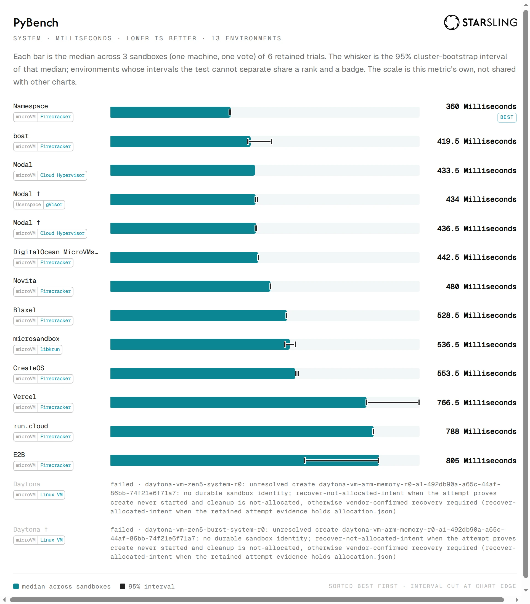

| Rank | Provider | PyBench (Milliseconds) | 95% bootstrap interval | Sandboxes | Trials | Note |
| ---: | --- | ---: | ---: | ---: | ---: | --- |
| 1 | Namespace | 360 | 355.5 – 362.5 | 3 | 6 | — |
| 2 | boat | 419.5 | 410 – 485 | 3 | 6 | too few sandboxes |
| 3 | Modal (VM) | 433.5 | 433.5 – 433.5 | 3 | 6 | too few sandboxes |
| 4 | Modal (gVisor) | 434 | 433.5 – 441 | 3 | 6 | too few sandboxes |
| 5 | Modal (VM, burst) | 436.5 | 433 – 439.5 | 3 | 6 | too few sandboxes |
| 6 | DigitalOcean MicroVMs | 442.5 | 442 – 444.5 | 3 | 6 | too few sandboxes |
| 7 | Novita | 480 | 478 – 481 | 3 | 6 | too few sandboxes |
| 8 | Blaxel | 528.5 | 528 – 529 | 3 | 6 | too few sandboxes |
| 9 | Microsandbox Cloud | 536.5 | 521 – 555.5 | 3 | 6 | too few sandboxes |
| 10 | CreateOS | 553.5 | 553 – 563.5 | 3 | 6 | too few sandboxes |
| 11 | Vercel Sandbox | 766.5 | 766 – 1174 | 3 | 6 | too few sandboxes |
| 12 | run.cloud | 788 | 785.5 – 789.5 | 3 | 6 | too few sandboxes |
| 13 | E2B | 805 | 581 – 805 | 3 | 6 | too few sandboxes |

### SQLite Speedtest

Seconds · lower is better

_Namespace leads · CreateOS is ~1.1× higher (lower is better)._

| Rank | Provider | SQLite Speedtest (Seconds) | 95% bootstrap interval | Sandboxes | Trials | Note |
| ---: | --- | ---: | ---: | ---: | ---: | --- |
| 1 | Namespace | 31.48 | 31.22 – 32.05 | 3 | 6 | — |
| 2 | CreateOS | 34.53 | 34.16 – 39.67 | 3 | 6 | too few sandboxes |
| 3 | DigitalOcean MicroVMs | 39.02 | 38.79 – 39.08 | 3 | 6 | too few sandboxes |
| 4 | Novita | 40.35 | 40.3 – 40.69 | 3 | 6 | too few sandboxes |
| 5 | Blaxel | 48.49 | 48.46 – 49.08 | 3 | 6 | too few sandboxes |
| 6 | Modal (VM, burst) | 51.15 | 33.59 – 51.6 | 3 | 6 | too few sandboxes |
| 7 | Modal (VM) | 51.68 | 51.08 – 51.77 | 3 | 6 | too few sandboxes |
| 8 | Vercel Sandbox | 64.12 | 61.31 – 82.66 | 3 | 6 | too few sandboxes |
| 9 | E2B | 69.47 | 59.91 – 75.97 | 3 | 6 | too few sandboxes |
| 10 | boat | 77.82 | 60.87 – 86.63 | 3 | 6 | too few sandboxes |
| 11 | Modal (gVisor) | 80.53 | 76 – 97.38 | 3 | 6 | too few sandboxes |
| 12 | Microsandbox Cloud | 81.18 | 73.69 – 81.39 | 3 | 6 | too few sandboxes |
| 13 | run.cloud | 83.72 | 80.16 – 86.35 | 3 | 6 | too few sandboxes |

## economics

What one run of each realworld pipeline costs, in USD. Lower is better. Not ranked: the two
kinds of cost are not directly comparable.

The first chart plots each environment's three-pipeline total: cost against time, bottom left
best. The three after it show each pipeline's cost per run, the median across sandboxes.

- **Billed**: the provider's own bill rate × pipeline time: each sandbox's bill × its timed
  seconds ÷ its billed seconds.
- **Estimated**: the provider's published prices × pipeline time.

Both price the pipeline's timed steps alone. A sandbox's whole bill also covers boot, setup
and an untimed warm-up of each task; it is under provider bills.

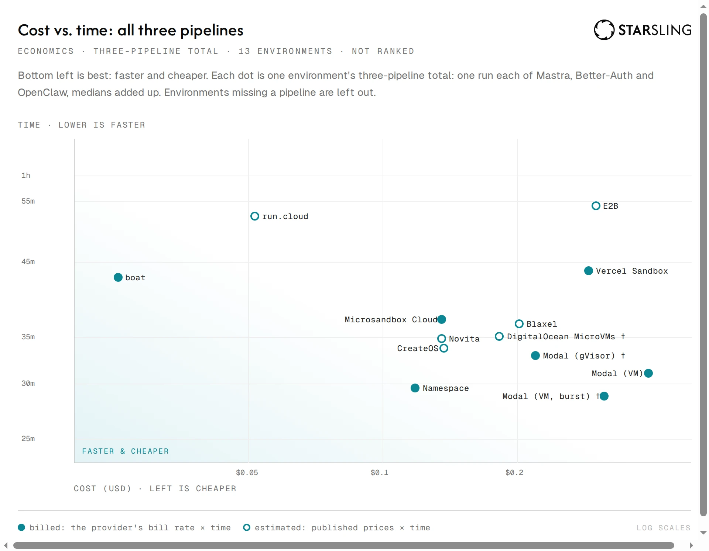

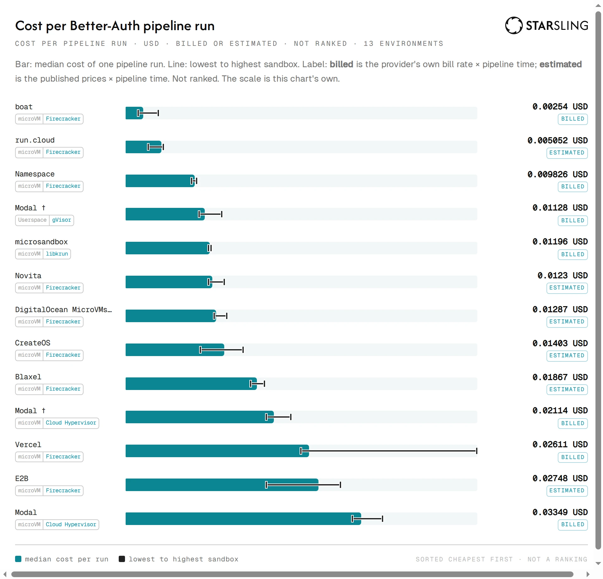

Cost per run table and provider bills

| Pipeline | Provider | Cost | Median USD per run | Lowest – highest | Sandboxes |
| --- | --- | --- | ---: | ---: | ---: |
| Mastra | boat | **Billed** | 0.01549 | 0.0113 – 0.02027 | 12 |
| Mastra | run.cloud | Estimated (at least) | 0.03103 | 0.02024 – 0.03354 | 12 |
| Mastra | Namespace | **Billed** | 0.06952 | 0.06785 – 0.073 | 12 |
| Mastra | Modal (gVisor) | **Billed** | 0.0726 | 0.06877 – 0.08897 | 10 |
| Mastra | CreateOS | Estimated | 0.07758 | 0.0725 – 0.07956 | 12 |
| Mastra | Novita | Estimated | 0.07981 | 0.07642 – 0.08061 | 12 |
| Mastra | Microsandbox Cloud | **Billed** | 0.0852 | 0.08333 – 0.08616 | 11 |
| Mastra | DigitalOcean MicroVMs | Estimated | 0.1011 | 0.09916 – 0.1056 | 12 |
| Mastra | Blaxel | Estimated (at most) | 0.1206 | 0.1192 – 0.1328 | 12 |
| Mastra | Vercel Sandbox | **Billed** | 0.1455 | 0.1384 – 0.2077 | 12 |
| Mastra | Modal (VM, burst) | **Billed** | 0.1553 | 0.1532 – 0.1599 | 12 |
| Mastra | E2B | Estimated | 0.1651 | 0.1501 – 0.1826 | 12 |
| Mastra | Modal (VM) | **Billed** | 0.2378 | 0.236 – 0.2558 | 12 |
| Better-Auth | boat | **Billed** | 0.00254 | 0.001718 – 0.004734 | 12 |
| Better-Auth | run.cloud | Estimated (at least) | 0.005052 | 0.003086 – 0.005474 | 12 |
| Better-Auth | Namespace | **Billed** | 0.009826 | 0.009258 – 0.01016 | 12 |
| Better-Auth | Modal (gVisor) | **Billed** | 0.01128 | 0.0104 – 0.01379 | 12 |
| Better-Auth | Microsandbox Cloud | **Billed** | 0.01196 | 0.01174 – 0.01224 | 12 |
| Better-Auth | Novita | Estimated | 0.0123 | 0.01171 – 0.01408 | 12 |
| Better-Auth | DigitalOcean MicroVMs | Estimated | 0.01287 | 0.01251 – 0.01446 | 12 |
| Better-Auth | CreateOS | Estimated | 0.01403 | 0.01054 – 0.01685 | 12 |
| Better-Auth | Blaxel | Estimated (at most) | 0.01867 | 0.01774 – 0.01981 | 12 |
| Better-Auth | Modal (VM, burst) | **Billed** | 0.02114 | 0.01994 – 0.02357 | 12 |
| Better-Auth | Vercel Sandbox | **Billed** | 0.02611 | 0.02483 – 0.05007 | 12 |
| Better-Auth | E2B | Estimated | 0.02748 | 0.01996 – 0.03066 | 12 |
| Better-Auth | Modal (VM) | **Billed** | 0.03349 | 0.03216 – 0.03664 | 12 |
| OpenClaw | boat | **Billed** | 0.007612 | 0.006424 – 0.01222 | 12 |
| OpenClaw | run.cloud | Estimated (at least) | 0.01577 | 0.01039 – 0.01889 | 12 |
| OpenClaw | Microsandbox Cloud | **Billed** | 0.03824 | 0.03611 – 0.05387 | 11 |
| OpenClaw | Namespace | **Billed** | 0.03903 | 0.03739 – 0.04604 | 12 |
| OpenClaw | Novita | Estimated | 0.04349 | 0.04232 – 0.04583 | 12 |
| OpenClaw | CreateOS | Estimated | 0.0457 | 0.03911 – 0.04857 | 6 |
| OpenClaw | Blaxel | Estimated (at most) | 0.06287 | 0.06156 – 0.0664 | 12 |
| OpenClaw | DigitalOcean MicroVMs | Estimated | 0.06866 | 0.06609 – 0.07139 | 12 |
| OpenClaw | E2B | Estimated | 0.1068 | 0.08404 – 0.1143 | 12 |
| OpenClaw | Vercel Sandbox | **Billed** | 0.1169 | 0.1138 – 0.1688 | 12 |
| OpenClaw | Modal (VM) | **Billed** | 0.1218 | 0.1142 – 0.1284 | 12 |
| OpenClaw | Modal (VM, burst) | **Billed** | 0.1357 | 0.1342 – 0.1461 | 12 |
| OpenClaw | Modal (gVisor) | **Billed** | 0.136 | 0.1287 – 0.1478 | 12 |

#### Provider bills

What each provider's billing API charged for each whole sandbox (boot, setup and untimed
warm-ups included), read after the sandbox was deleted.
A sandbox with no bill shows why; it never counts as zero. A total appears only when every
sandbox was billed.

| Provider | Billed sandboxes | Total billed (USD) | No bill (reason) |
| --- | ---: | ---: | --- |
| Blaxel | 42 of 56 | — | 14 × `provider_api_error` |
| boat | 56 of 56 | 0.7161 USD | — |
| Daytona (VM) | 0 of 3 | — | 3 × `provider_api_error` |
| Daytona (VM, burst) | 0 of 3 | — | 3 × `provider_api_error` |
| Microsandbox Cloud | 56 of 56 | 3.551 USD | — |
| Modal (gVisor) | 56 of 56 | 7.315 USD | — |
| Modal (VM, burst) | 56 of 56 | 8.418 USD | — |
| Modal (VM) | 56 of 56 | 11.34 USD | — |
| Namespace | 56 of 56 | 3.103 USD | — |
| run.cloud | 0 of 56 | — | 56 × `not_sandbox_scoped` |
| Vercel Sandbox | 56 of 56 | 7.768 USD | — |

#### Provider bills per suite

Median and lowest – highest bill across the suite's billed sandboxes. A total appears only when
every sandbox in the suite was billed.

| Provider | Suite | Median bill | Lowest – highest | Billed sandboxes | Suite total | No bill (reason) | Source |
| --- | --- | ---: | ---: | ---: | ---: | --- | --- |
| Blaxel | realworld-mastra | 0.1607 USD | 0.1594 – 0.167 | 8 of 12 | — | 4 × `provider_api_error` | provider-reported |
| Blaxel | realworld-better-auth | 0.05805 USD | 0.05529 – 0.05897 | 9 of 12 | — | 3 × `provider_api_error` | provider-reported |
| Blaxel | realworld-openclaw | 0.1471 USD | 0.1436 – 0.1536 | 9 of 12 | — | 3 × `provider_api_error` | provider-reported |
| Blaxel | cpu-node | 0.01794 USD | 0.01776 – 0.01803 | 3 of 5 | — | 2 × `provider_api_error` | provider-reported |
| Blaxel | system | 0.03202 USD | 0.03146 – 0.03257 | 2 of 3 | — | 1 × `provider_api_error` | provider-reported |
| Blaxel | pgbench | 0.06063 USD | 0.04296 – 0.06072 | 3 of 3 | 0.1643 USD | — | provider-reported |
| Blaxel | memory | 0.009936 USD | 0.009108 – 0.01003 | 3 of 3 | 0.02907 USD | — | provider-reported |
| Blaxel | disk | 0.0839 USD | 0.08363 – 0.08418 | 2 of 3 | — | 1 × `provider_api_error` | provider-reported |
| Blaxel | network | 0.02852 USD | 0.02824 – 0.02916 | 3 of 3 | 0.08593 USD | — | provider-reported |
| boat | realworld-mastra | 0.02166 USD | 0.01685 – 0.02877 | 12 of 12 | 0.2695 USD | — | provider-reported |
| boat | realworld-better-auth | 0.00903 USD | 0.00582 – 0.01166 | 12 of 12 | 0.1024 USD | — | provider-reported |
| boat | realworld-openclaw | 0.01758 USD | 0.01511 – 0.02631 | 12 of 12 | 0.2245 USD | — | provider-reported |
| boat | cpu-node | 0.00283 USD | 0.00257 – 0.00375 | 5 of 5 | 0.01545 USD | — | provider-reported |
| boat | system | 0.00512 USD | 0.00468 – 0.00554 | 3 of 3 | 0.01534 USD | — | provider-reported |
| boat | pgbench | 0.01014 USD | 0.0095 – 0.01175 | 3 of 3 | 0.03139 USD | — | provider-reported |
| boat | memory | 0.00345 USD | 0.0021 – 0.00355 | 3 of 3 | 0.0091 USD | — | provider-reported |
| boat | disk | 0.01021 USD | 0.00955 – 0.0128 | 3 of 3 | 0.03256 USD | — | provider-reported |
| boat | network | 0.00536 USD | 0.00458 – 0.00596 | 3 of 3 | 0.0159 USD | — | provider-reported |
| Microsandbox Cloud | realworld-mastra | 0.1178 USD | 0.1151 – 0.1195 | 12 of 12 | 1.414 USD | — | calculated from provider usage |
| Microsandbox Cloud | realworld-better-auth | 0.03808 USD | 0.03768 – 0.03913 | 12 of 12 | 0.4596 USD | — | calculated from provider usage |
| Microsandbox Cloud | realworld-openclaw | 0.09242 USD | 0.08599 – 0.1249 | 12 of 12 | 1.181 USD | — | calculated from provider usage |
| Microsandbox Cloud | cpu-node | 0.003156 USD | 0.0028 – 0.003669 | 5 of 5 | 0.01602 USD | — | calculated from provider usage |
| Microsandbox Cloud | system | 0.02714 USD | 0.02593 – 0.02749 | 3 of 3 | 0.08056 USD | — | calculated from provider usage |
| Microsandbox Cloud | pgbench | 0.04233 USD | 0.04218 – 0.04273 | 3 of 3 | 0.1272 USD | — | calculated from provider usage |
| Microsandbox Cloud | memory | 0.003521 USD | 0.003505 – 0.006438 | 3 of 3 | 0.01346 USD | — | calculated from provider usage |
| Microsandbox Cloud | disk | 0.05985 USD | 0.05974 – 0.06 | 3 of 3 | 0.1796 USD | — | calculated from provider usage |
| Microsandbox Cloud | network | 0.02642 USD | 0.02616 – 0.02714 | 3 of 3 | 0.07972 USD | — | calculated from provider usage |
| Modal (gVisor) | realworld-mastra | 0.09739 USD | 0.09523 – 0.122 | 12 of 12 | 1.226 USD | — | provider-reported |
| Modal (gVisor) | realworld-better-auth | 0.0446 USD | 0.04277 – 0.05228 | 12 of 12 | 0.5466 USD | — | provider-reported |
| Modal (gVisor) | realworld-openclaw | 0.3437 USD | 0.3308 – 0.3657 | 12 of 12 | 4.156 USD | — | provider-reported |
| Modal (gVisor) | cpu-node | 0.008342 USD | 0.008239 – 0.008692 | 5 of 5 | 0.04208 USD | — | provider-reported |
| Modal (gVisor) | system | 0.01271 USD | 0.01214 – 0.01379 | 3 of 3 | 0.03863 USD | — | provider-reported |
| Modal (gVisor) | pgbench | 0.2898 USD | 0.2898 – 0.291 | 3 of 3 | 0.8707 USD | — | provider-reported |
| Modal (gVisor) | memory | 0.01394 USD | 0.006623 – 0.01499 | 3 of 3 | 0.03555 USD | — | provider-reported |
| Modal (gVisor) | disk | 0.122 USD | 0.1216 – 0.1221 | 3 of 3 | 0.3657 USD | — | provider-reported |
| Modal (gVisor) | network | 0.01136 USD | 0.01035 – 0.01151 | 3 of 3 | 0.03322 USD | — | provider-reported |
| Modal (VM, burst) | realworld-mastra | 0.1985 USD | 0.1915 – 0.2217 | 12 of 12 | 2.434 USD | — | provider-reported |
| Modal (VM, burst) | realworld-better-auth | 0.06477 USD | 0.06142 – 0.06958 | 12 of 12 | 0.7812 USD | — | provider-reported |
| Modal (VM, burst) | realworld-openclaw | 0.2977 USD | 0.2912 – 0.3126 | 12 of 12 | 3.597 USD | — | provider-reported |
| Modal (VM, burst) | cpu-node | 0.03895 USD | 0.03843 – 0.03919 | 5 of 5 | 0.1941 USD | — | provider-reported |
| Modal (VM, burst) | system | 0.05665 USD | 0.05259 – 0.05683 | 3 of 3 | 0.1661 USD | — | provider-reported |
| Modal (VM, burst) | pgbench | 0.2109 USD | 0.2076 – 0.2116 | 3 of 3 | 0.6301 USD | — | provider-reported |
| Modal (VM, burst) | memory | 0.01589 USD | 0.01535 – 0.01817 | 3 of 3 | 0.04941 USD | — | provider-reported |
| Modal (VM, burst) | disk | 0.1342 USD | 0.1339 – 0.1348 | 3 of 3 | 0.403 USD | — | provider-reported |
| Modal (VM, burst) | network | 0.05436 USD | 0.05338 – 0.05576 | 3 of 3 | 0.1635 USD | — | provider-reported |
| Modal (VM) | realworld-mastra | 0.3389 USD | 0.3362 – 0.3621 | 12 of 12 | 4.095 USD | — | provider-reported |
| Modal (VM) | realworld-better-auth | 0.1311 USD | 0.1279 – 0.1354 | 12 of 12 | 1.576 USD | — | provider-reported |
| Modal (VM) | realworld-openclaw | 0.3045 USD | 0.2907 – 0.3171 | 12 of 12 | 3.646 USD | — | provider-reported |
| Modal (VM) | cpu-node | 0.06222 USD | 0.05908 – 0.06227 | 5 of 5 | 0.3079 USD | — | provider-reported |
| Modal (VM) | system | 0.09087 USD | 0.08886 – 0.09101 | 3 of 3 | 0.2707 USD | — | provider-reported |
| Modal (VM) | pgbench | 0.16 USD | 0.1593 – 0.1602 | 3 of 3 | 0.4794 USD | — | provider-reported |
| Modal (VM) | memory | 0.02081 USD | 0.01896 – 0.02082 | 3 of 3 | 0.06059 USD | — | provider-reported |
| Modal (VM) | disk | 0.2135 USD | 0.2128 – 0.2146 | 3 of 3 | 0.6409 USD | — | provider-reported |
| Modal (VM) | network | 0.08638 USD | 0.08612 – 0.08859 | 3 of 3 | 0.2611 USD | — | provider-reported |
| Namespace | realworld-mastra | 0.09288 USD | 0.09139 – 0.09756 | 12 of 12 | 1.12 USD | — | calculated from provider usage |
| Namespace | realworld-better-auth | 0.03295 USD | 0.03092 – 0.03382 | 12 of 12 | 0.3924 USD | — | calculated from provider usage |
| Namespace | realworld-openclaw | 0.08957 USD | 0.08745 – 0.09981 | 12 of 12 | 1.089 USD | — | calculated from provider usage |
| Namespace | cpu-node | 0.011 USD | 0.01095 – 0.01168 | 5 of 5 | 0.05625 USD | — | calculated from provider usage |
| Namespace | system | 0.01691 USD | 0.01691 – 0.01691 | 3 of 3 | 0.05072 USD | — | calculated from provider usage |
| Namespace | pgbench | 0.04188 USD | 0.04186 – 0.04198 | 3 of 3 | 0.1257 USD | — | calculated from provider usage |
| Namespace | memory | 0.009477 USD | 0.009468 – 0.01019 | 3 of 3 | 0.02914 USD | — | calculated from provider usage |
| Namespace | disk | 0.05995 USD | 0.05995 – 0.06012 | 3 of 3 | 0.18 USD | — | calculated from provider usage |
| Namespace | network | 0.01972 USD | 0.01907 – 0.02116 | 3 of 3 | 0.05995 USD | — | calculated from provider usage |
| Vercel Sandbox | realworld-mastra | 0.1934 USD | 0.1853 – 0.2751 | 12 of 12 | 2.599 USD | — | calculated from provider usage |
| Vercel Sandbox | realworld-better-auth | 0.07358 USD | 0.0708 – 0.1194 | 12 of 12 | 0.9835 USD | — | calculated from provider usage |
| Vercel Sandbox | realworld-openclaw | 0.2657 USD | 0.2601 – 0.366 | 12 of 12 | 3.296 USD | — | calculated from provider usage |
| Vercel Sandbox | cpu-node | 0.01808 USD | 0.01744 – 0.02244 | 5 of 5 | 0.09367 USD | — | calculated from provider usage |
| Vercel Sandbox | system | 0.03009 USD | 0.02927 – 0.03862 | 3 of 3 | 0.09799 USD | — | calculated from provider usage |
| Vercel Sandbox | pgbench | 0.1021 USD | 0.1019 – 0.1034 | 3 of 3 | 0.3074 USD | — | calculated from provider usage |
| Vercel Sandbox | memory | 0.01485 USD | 0.0121 – 0.01502 | 3 of 3 | 0.04197 USD | — | calculated from provider usage |
| Vercel Sandbox | disk | 0.09241 USD | 0.0921 – 0.09331 | 3 of 3 | 0.2778 USD | — | calculated from provider usage |
| Vercel Sandbox | network | 0.0239 USD | 0.02331 – 0.0239 | 3 of 3 | 0.0711 USD | — | calculated from provider usage |

## Coverage gaps

372 uncovered results across 12 providers (Blaxel 1, Brezel 56, CreateOS 2, Daytona (container) 55, Daytona (VM, arm, burst) 55, Daytona (VM, arm) 9, Daytona (VM, burst) 53, Daytona (VM) 53, Freestyle 9, Microsandbox Cloud 12, Modal (gVisor) 2, tama 65). A gap is a missing result — the provider **failing to cover** that workload — never a tie or a zero.

Full coverage table

| Provider | Benchmark | Outcome | Detail |
| --- | --- | --- | --- |
| Blaxel | pgbench | **failed** | Partial publication withheld unverified measurements: pgbench_scaling_factor_100_clients_50_mode_read_only, pgbench_scaling_factor_100_clients_50_mode_read_only_average_latency, pgbench_scaling_factor_100_clients_50_mode_read_write, pgbench_scaling_factor_100_clients_50_mode_read_write_average_latency |
| Brezel | cpu-node | **failed** | brezel-cpu-node-r0: brezel ComputeSDK inventory list callback failed |
| Brezel | cpu-node | **failed** | brezel-cpu-node-r1: brezel ComputeSDK inventory list callback failed |
| Brezel | cpu-node | **failed** | brezel-cpu-node-r2: brezel ComputeSDK inventory list callback failed |
| Brezel | cpu-node | **failed** | brezel-cpu-node-r3: brezel ComputeSDK inventory list callback failed |
| Brezel | cpu-node | **failed** | brezel-cpu-node-r4: brezel ComputeSDK inventory list callback failed |
| Brezel | disk | **failed** | brezel-disk-r0: brezel ComputeSDK inventory list callback failed |
| Brezel | disk | **failed** | brezel-disk-r1: brezel ComputeSDK inventory list callback failed |
| Brezel | disk | **failed** | brezel-disk-r2: brezel ComputeSDK inventory list callback failed |
| Brezel | memory | **failed** | brezel-memory-r0: brezel ComputeSDK inventory list callback failed |
| Brezel | memory | **failed** | brezel-memory-r1: brezel ComputeSDK inventory list callback failed |
| Brezel | memory | **failed** | brezel-memory-r2: brezel ComputeSDK inventory list callback failed |
| Brezel | network | **failed** | brezel-network-r0: brezel ComputeSDK inventory list callback failed |
| Brezel | network | **failed** | brezel-network-r1: brezel ComputeSDK inventory list callback failed |
| Brezel | network | **failed** | brezel-network-r2: brezel ComputeSDK inventory list callback failed |
| Brezel | pgbench | **failed** | brezel-pgbench-r0: brezel ComputeSDK inventory list callback failed |
| Brezel | pgbench | **failed** | brezel-pgbench-r1: brezel ComputeSDK inventory list callback failed |
| Brezel | pgbench | **failed** | brezel-pgbench-r2: brezel ComputeSDK inventory list callback failed |
| Brezel | realworld-better-auth | **failed** | brezel-realworld-better-auth-r0: brezel ComputeSDK inventory list callback failed |
| Brezel | realworld-better-auth | **failed** | brezel-realworld-better-auth-r1: brezel ComputeSDK inventory list callback failed |
| Brezel | realworld-better-auth | **failed** | brezel-realworld-better-auth-r10: brezel ComputeSDK inventory list callback failed |
| Brezel | realworld-better-auth | **failed** | brezel-realworld-better-auth-r11: brezel ComputeSDK inventory list callback failed |
| Brezel | realworld-better-auth | **failed** | brezel-realworld-better-auth-r2: brezel ComputeSDK inventory list callback failed |
| Brezel | realworld-better-auth | **failed** | brezel-realworld-better-auth-r3: brezel ComputeSDK inventory list callback failed |
| Brezel | realworld-better-auth | **failed** | brezel-realworld-better-auth-r4: brezel ComputeSDK inventory list callback failed |
| Brezel | realworld-better-auth | **failed** | brezel-realworld-better-auth-r5: brezel ComputeSDK inventory list callback failed |
| Brezel | realworld-better-auth | **failed** | brezel-realworld-better-auth-r6: brezel ComputeSDK inventory list callback failed |
| Brezel | realworld-better-auth | **failed** | brezel-realworld-better-auth-r7: brezel ComputeSDK inventory list callback failed |
| Brezel | realworld-better-auth | **failed** | brezel-realworld-better-auth-r8: brezel ComputeSDK inventory list callback failed |
| Brezel | realworld-better-auth | **failed** | brezel-realworld-better-auth-r9: brezel ComputeSDK inventory list callback failed |
| Brezel | realworld-mastra | **failed** | brezel-realworld-mastra-r0: brezel ComputeSDK inventory list callback failed |
| Brezel | realworld-mastra | **failed** | brezel-realworld-mastra-r1: brezel ComputeSDK inventory list callback failed |
| Brezel | realworld-mastra | **failed** | brezel-realworld-mastra-r10: brezel ComputeSDK inventory list callback failed |
| Brezel | realworld-mastra | **failed** | brezel-realworld-mastra-r11: brezel ComputeSDK inventory list callback failed |
| Brezel | realworld-mastra | **failed** | brezel-realworld-mastra-r2: brezel ComputeSDK inventory list callback failed |
| Brezel | realworld-mastra | **failed** | brezel-realworld-mastra-r3: brezel ComputeSDK inventory list callback failed |
| Brezel | realworld-mastra | **failed** | brezel-realworld-mastra-r4: brezel ComputeSDK inventory list callback failed |
| Brezel | realworld-mastra | **failed** | brezel-realworld-mastra-r5: brezel ComputeSDK inventory list callback failed |
| Brezel | realworld-mastra | **failed** | brezel-realworld-mastra-r6: brezel ComputeSDK inventory list callback failed |
| Brezel | realworld-mastra | **failed** | brezel-realworld-mastra-r7: brezel ComputeSDK inventory list callback failed |
| Brezel | realworld-mastra | **failed** | brezel-realworld-mastra-r8: brezel ComputeSDK inventory list callback failed |
| Brezel | realworld-mastra | **failed** | brezel-realworld-mastra-r9: brezel ComputeSDK inventory list callback failed |
| Brezel | realworld-openclaw | **failed** | brezel-realworld-openclaw-r0: brezel ComputeSDK inventory list callback failed |
| Brezel | realworld-openclaw | **failed** | brezel-realworld-openclaw-r1: brezel ComputeSDK inventory list callback failed |
| Brezel | realworld-openclaw | **failed** | brezel-realworld-openclaw-r10: brezel ComputeSDK inventory list callback failed |
| Brezel | realworld-openclaw | **failed** | brezel-realworld-openclaw-r11: brezel ComputeSDK inventory list callback failed |
| Brezel | realworld-openclaw | **failed** | brezel-realworld-openclaw-r2: brezel ComputeSDK inventory list callback failed |
| Brezel | realworld-openclaw | **failed** | brezel-realworld-openclaw-r3: brezel ComputeSDK inventory list callback failed |
| Brezel | realworld-openclaw | **failed** | brezel-realworld-openclaw-r4: brezel ComputeSDK inventory list callback failed |
| Brezel | realworld-openclaw | **failed** | brezel-realworld-openclaw-r5: brezel ComputeSDK inventory list callback failed |
| Brezel | realworld-openclaw | **failed** | brezel-realworld-openclaw-r6: brezel ComputeSDK inventory list callback failed |
| Brezel | realworld-openclaw | **failed** | brezel-realworld-openclaw-r7: brezel ComputeSDK inventory list callback failed |
| Brezel | realworld-openclaw | **failed** | brezel-realworld-openclaw-r8: brezel ComputeSDK inventory list callback failed |
| Brezel | realworld-openclaw | **failed** | brezel-realworld-openclaw-r9: brezel ComputeSDK inventory list callback failed |
| Brezel | system | **failed** | brezel-system-r0: brezel ComputeSDK inventory list callback failed |
| Brezel | system | **failed** | brezel-system-r1: brezel ComputeSDK inventory list callback failed |
| Brezel | system | **failed** | brezel-system-r2: brezel ComputeSDK inventory list callback failed |
| CreateOS | realworld-openclaw | **failed** | Failed to create sandbox: computesdk create failed: service unavailable |
| CreateOS | realworld-openclaw | **failed** | Partial publication withheld unverified measurements: realworld_openclaw_task_git_clone, realworld_openclaw_task_cold_install, realworld_openclaw_task_lint_oxlint, realworld_openclaw_task_lint_extensions_all, realworld_openclaw_task_typecheck, realworld_openclaw_task_test_types |
| Daytona (container) | cpu-node | **failed** | daytona-container-cpu-node-r0: unresolved create daytona-vm-arm-memory-r0-a1-492db90a-a65c-44af-86bb-74f21e6f71a7: no durable sandbox identity; recover-not-allocated-intent when the attempt proves create never started and cleanup is not-allocated, otherwise vendor-confirmed recovery required (recover-allocated-intent when the retained attempt evidence holds allocation.json) |
| Daytona (container) | cpu-node | **failed** | daytona-container-cpu-node-r1: unresolved create daytona-vm-arm-memory-r0-a1-492db90a-a65c-44af-86bb-74f21e6f71a7: no durable sandbox identity; recover-not-allocated-intent when the attempt proves create never started and cleanup is not-allocated, otherwise vendor-confirmed recovery required (recover-allocated-intent when the retained attempt evidence holds allocation.json) |
| Daytona (container) | cpu-node | **failed** | daytona-container-cpu-node-r2: unresolved create daytona-vm-arm-memory-r0-a1-492db90a-a65c-44af-86bb-74f21e6f71a7: no durable sandbox identity; recover-not-allocated-intent when the attempt proves create never started and cleanup is not-allocated, otherwise vendor-confirmed recovery required (recover-allocated-intent when the retained attempt evidence holds allocation.json) |
| Daytona (container) | cpu-node | **failed** | daytona-container-cpu-node-r3: unresolved create daytona-vm-arm-memory-r0-a1-492db90a-a65c-44af-86bb-74f21e6f71a7: no durable sandbox identity; recover-not-allocated-intent when the attempt proves create never started and cleanup is not-allocated, otherwise vendor-confirmed recovery required (recover-allocated-intent when the retained attempt evidence holds allocation.json) |
| Daytona (container) | cpu-node | **failed** | daytona-container-cpu-node-r4: unresolved create daytona-vm-arm-memory-r0-a1-492db90a-a65c-44af-86bb-74f21e6f71a7: no durable sandbox identity; recover-not-allocated-intent when the attempt proves create never started and cleanup is not-allocated, otherwise vendor-confirmed recovery required (recover-allocated-intent when the retained attempt evidence holds allocation.json) |
| Daytona (container) | disk | **failed** | daytona-container-disk-r0: unresolved create daytona-vm-arm-memory-r0-a1-492db90a-a65c-44af-86bb-74f21e6f71a7: no durable sandbox identity; recover-not-allocated-intent when the attempt proves create never started and cleanup is not-allocated, otherwise vendor-confirmed recovery required (recover-allocated-intent when the retained attempt evidence holds allocation.json) |
| Daytona (container) | disk | **failed** | daytona-container-disk-r1: unresolved create daytona-vm-arm-memory-r0-a1-492db90a-a65c-44af-86bb-74f21e6f71a7: no durable sandbox identity; recover-not-allocated-intent when the attempt proves create never started and cleanup is not-allocated, otherwise vendor-confirmed recovery required (recover-allocated-intent when the retained attempt evidence holds allocation.json) |
| Daytona (container) | disk | **failed** | daytona-container-disk-r2: unresolved create daytona-vm-arm-memory-r0-a1-492db90a-a65c-44af-86bb-74f21e6f71a7: no durable sandbox identity; recover-not-allocated-intent when the attempt proves create never started and cleanup is not-allocated, otherwise vendor-confirmed recovery required (recover-allocated-intent when the retained attempt evidence holds allocation.json) |
| Daytona (container) | memory | **failed** | Failed to create sandbox: account daytona admission stopped after daytona-vm-arm-memory-r0: allocation ownership or journal release remains unresolved |
| Daytona (container) | memory | **failed** | Partial publication withheld unverified measurements: stream_type_copy, stream_type_scale, stream_type_add, stream_type_triad |
| Daytona (container) | network | **failed** | daytona-container-network-r0: unresolved create daytona-vm-arm-memory-r0-a1-492db90a-a65c-44af-86bb-74f21e6f71a7: no durable sandbox identity; recover-not-allocated-intent when the attempt proves create never started and cleanup is not-allocated, otherwise vendor-confirmed recovery required (recover-allocated-intent when the retained attempt evidence holds allocation.json) |
| Daytona (container) | network | **failed** | daytona-container-network-r1: unresolved create daytona-vm-arm-memory-r0-a1-492db90a-a65c-44af-86bb-74f21e6f71a7: no durable sandbox identity; recover-not-allocated-intent when the attempt proves create never started and cleanup is not-allocated, otherwise vendor-confirmed recovery required (recover-allocated-intent when the retained attempt evidence holds allocation.json) |
| Daytona (container) | network | **failed** | daytona-container-network-r2: unresolved create daytona-vm-arm-memory-r0-a1-492db90a-a65c-44af-86bb-74f21e6f71a7: no durable sandbox identity; recover-not-allocated-intent when the attempt proves create never started and cleanup is not-allocated, otherwise vendor-confirmed recovery required (recover-allocated-intent when the retained attempt evidence holds allocation.json) |
| Daytona (container) | pgbench | **failed** | daytona-container-pgbench-r0: unresolved create daytona-vm-arm-memory-r0-a1-492db90a-a65c-44af-86bb-74f21e6f71a7: no durable sandbox identity; recover-not-allocated-intent when the attempt proves create never started and cleanup is not-allocated, otherwise vendor-confirmed recovery required (recover-allocated-intent when the retained attempt evidence holds allocation.json) |
| Daytona (container) | pgbench | **failed** | daytona-container-pgbench-r1: unresolved create daytona-vm-arm-memory-r0-a1-492db90a-a65c-44af-86bb-74f21e6f71a7: no durable sandbox identity; recover-not-allocated-intent when the attempt proves create never started and cleanup is not-allocated, otherwise vendor-confirmed recovery required (recover-allocated-intent when the retained attempt evidence holds allocation.json) |
| Daytona (container) | pgbench | **failed** | daytona-container-pgbench-r2: unresolved create daytona-vm-arm-memory-r0-a1-492db90a-a65c-44af-86bb-74f21e6f71a7: no durable sandbox identity; recover-not-allocated-intent when the attempt proves create never started and cleanup is not-allocated, otherwise vendor-confirmed recovery required (recover-allocated-intent when the retained attempt evidence holds allocation.json) |
| Daytona (container) | realworld-better-auth | **failed** | daytona-container-realworld-better-auth-r0: unresolved create daytona-vm-arm-memory-r0-a1-492db90a-a65c-44af-86bb-74f21e6f71a7: no durable sandbox identity; recover-not-allocated-intent when the attempt proves create never started and cleanup is not-allocated, otherwise vendor-confirmed recovery required (recover-allocated-intent when the retained attempt evidence holds allocation.json) |
| Daytona (container) | realworld-better-auth | **failed** | daytona-container-realworld-better-auth-r1: unresolved create daytona-vm-arm-memory-r0-a1-492db90a-a65c-44af-86bb-74f21e6f71a7: no durable sandbox identity; recover-not-allocated-intent when the attempt proves create never started and cleanup is not-allocated, otherwise vendor-confirmed recovery required (recover-allocated-intent when the retained attempt evidence holds allocation.json) |
| Daytona (container) | realworld-better-auth | **failed** | daytona-container-realworld-better-auth-r10: unresolved create daytona-vm-arm-memory-r0-a1-492db90a-a65c-44af-86bb-74f21e6f71a7: no durable sandbox identity; recover-not-allocated-intent when the attempt proves create never started and cleanup is not-allocated, otherwise vendor-confirmed recovery required (recover-allocated-intent when the retained attempt evidence holds allocation.json) |
| Daytona (container) | realworld-better-auth | **failed** | daytona-container-realworld-better-auth-r11: unresolved create daytona-vm-arm-memory-r0-a1-492db90a-a65c-44af-86bb-74f21e6f71a7: no durable sandbox identity; recover-not-allocated-intent when the attempt proves create never started and cleanup is not-allocated, otherwise vendor-confirmed recovery required (recover-allocated-intent when the retained attempt evidence holds allocation.json) |
| Daytona (container) | realworld-better-auth | **failed** | daytona-container-realworld-better-auth-r2: unresolved create daytona-vm-arm-memory-r0-a1-492db90a-a65c-44af-86bb-74f21e6f71a7: no durable sandbox identity; recover-not-allocated-intent when the attempt proves create never started and cleanup is not-allocated, otherwise vendor-confirmed recovery required (recover-allocated-intent when the retained attempt evidence holds allocation.json) |
| Daytona (container) | realworld-better-auth | **failed** | daytona-container-realworld-better-auth-r3: unresolved create daytona-vm-arm-memory-r0-a1-492db90a-a65c-44af-86bb-74f21e6f71a7: no durable sandbox identity; recover-not-allocated-intent when the attempt proves create never started and cleanup is not-allocated, otherwise vendor-confirmed recovery required (recover-allocated-intent when the retained attempt evidence holds allocation.json) |
| Daytona (container) | realworld-better-auth | **failed** | daytona-container-realworld-better-auth-r4: unresolved create daytona-vm-arm-memory-r0-a1-492db90a-a65c-44af-86bb-74f21e6f71a7: no durable sandbox identity; recover-not-allocated-intent when the attempt proves create never started and cleanup is not-allocated, otherwise vendor-confirmed recovery required (recover-allocated-intent when the retained attempt evidence holds allocation.json) |
| Daytona (container) | realworld-better-auth | **failed** | daytona-container-realworld-better-auth-r5: unresolved create daytona-vm-arm-memory-r0-a1-492db90a-a65c-44af-86bb-74f21e6f71a7: no durable sandbox identity; recover-not-allocated-intent when the attempt proves create never started and cleanup is not-allocated, otherwise vendor-confirmed recovery required (recover-allocated-intent when the retained attempt evidence holds allocation.json) |
| Daytona (container) | realworld-better-auth | **failed** | daytona-container-realworld-better-auth-r6: unresolved create daytona-vm-arm-memory-r0-a1-492db90a-a65c-44af-86bb-74f21e6f71a7: no durable sandbox identity; recover-not-allocated-intent when the attempt proves create never started and cleanup is not-allocated, otherwise vendor-confirmed recovery required (recover-allocated-intent when the retained attempt evidence holds allocation.json) |
| Daytona (container) | realworld-better-auth | **failed** | daytona-container-realworld-better-auth-r7: unresolved create daytona-vm-arm-memory-r0-a1-492db90a-a65c-44af-86bb-74f21e6f71a7: no durable sandbox identity; recover-not-allocated-intent when the attempt proves create never started and cleanup is not-allocated, otherwise vendor-confirmed recovery required (recover-allocated-intent when the retained attempt evidence holds allocation.json) |
| Daytona (container) | realworld-better-auth | **failed** | daytona-container-realworld-better-auth-r8: unresolved create daytona-vm-arm-memory-r0-a1-492db90a-a65c-44af-86bb-74f21e6f71a7: no durable sandbox identity; recover-not-allocated-intent when the attempt proves create never started and cleanup is not-allocated, otherwise vendor-confirmed recovery required (recover-allocated-intent when the retained attempt evidence holds allocation.json) |
| Daytona (container) | realworld-better-auth | **failed** | daytona-container-realworld-better-auth-r9: unresolved create daytona-vm-arm-memory-r0-a1-492db90a-a65c-44af-86bb-74f21e6f71a7: no durable sandbox identity; recover-not-allocated-intent when the attempt proves create never started and cleanup is not-allocated, otherwise vendor-confirmed recovery required (recover-allocated-intent when the retained attempt evidence holds allocation.json) |
| Daytona (container) | realworld-mastra | **failed** | daytona-container-realworld-mastra-r0: unresolved create daytona-vm-arm-memory-r0-a1-492db90a-a65c-44af-86bb-74f21e6f71a7: no durable sandbox identity; recover-not-allocated-intent when the attempt proves create never started and cleanup is not-allocated, otherwise vendor-confirmed recovery required (recover-allocated-intent when the retained attempt evidence holds allocation.json) |
| Daytona (container) | realworld-mastra | **failed** | daytona-container-realworld-mastra-r1: unresolved create daytona-vm-arm-memory-r0-a1-492db90a-a65c-44af-86bb-74f21e6f71a7: no durable sandbox identity; recover-not-allocated-intent when the attempt proves create never started and cleanup is not-allocated, otherwise vendor-confirmed recovery required (recover-allocated-intent when the retained attempt evidence holds allocation.json) |
| Daytona (container) | realworld-mastra | **failed** | daytona-container-realworld-mastra-r10: unresolved create daytona-vm-arm-memory-r0-a1-492db90a-a65c-44af-86bb-74f21e6f71a7: no durable sandbox identity; recover-not-allocated-intent when the attempt proves create never started and cleanup is not-allocated, otherwise vendor-confirmed recovery required (recover-allocated-intent when the retained attempt evidence holds allocation.json) |
| Daytona (container) | realworld-mastra | **failed** | daytona-container-realworld-mastra-r11: unresolved create daytona-vm-arm-memory-r0-a1-492db90a-a65c-44af-86bb-74f21e6f71a7: no durable sandbox identity; recover-not-allocated-intent when the attempt proves create never started and cleanup is not-allocated, otherwise vendor-confirmed recovery required (recover-allocated-intent when the retained attempt evidence holds allocation.json) |
| Daytona (container) | realworld-mastra | **failed** | daytona-container-realworld-mastra-r2: unresolved create daytona-vm-arm-memory-r0-a1-492db90a-a65c-44af-86bb-74f21e6f71a7: no durable sandbox identity; recover-not-allocated-intent when the attempt proves create never started and cleanup is not-allocated, otherwise vendor-confirmed recovery required (recover-allocated-intent when the retained attempt evidence holds allocation.json) |
| Daytona (container) | realworld-mastra | **failed** | daytona-container-realworld-mastra-r3: unresolved create daytona-vm-arm-memory-r0-a1-492db90a-a65c-44af-86bb-74f21e6f71a7: no durable sandbox identity; recover-not-allocated-intent when the attempt proves create never started and cleanup is not-allocated, otherwise vendor-confirmed recovery required (recover-allocated-intent when the retained attempt evidence holds allocation.json) |
| Daytona (container) | realworld-mastra | **failed** | daytona-container-realworld-mastra-r4: unresolved create daytona-vm-arm-memory-r0-a1-492db90a-a65c-44af-86bb-74f21e6f71a7: no durable sandbox identity; recover-not-allocated-intent when the attempt proves create never started and cleanup is not-allocated, otherwise vendor-confirmed recovery required (recover-allocated-intent when the retained attempt evidence holds allocation.json) |
| Daytona (container) | realworld-mastra | **failed** | daytona-container-realworld-mastra-r5: unresolved create daytona-vm-arm-memory-r0-a1-492db90a-a65c-44af-86bb-74f21e6f71a7: no durable sandbox identity; recover-not-allocated-intent when the attempt proves create never started and cleanup is not-allocated, otherwise vendor-confirmed recovery required (recover-allocated-intent when the retained attempt evidence holds allocation.json) |
| Daytona (container) | realworld-mastra | **failed** | daytona-container-realworld-mastra-r6: unresolved create daytona-vm-arm-memory-r0-a1-492db90a-a65c-44af-86bb-74f21e6f71a7: no durable sandbox identity; recover-not-allocated-intent when the attempt proves create never started and cleanup is not-allocated, otherwise vendor-confirmed recovery required (recover-allocated-intent when the retained attempt evidence holds allocation.json) |
| Daytona (container) | realworld-mastra | **failed** | daytona-container-realworld-mastra-r7: unresolved create daytona-vm-arm-memory-r0-a1-492db90a-a65c-44af-86bb-74f21e6f71a7: no durable sandbox identity; recover-not-allocated-intent when the attempt proves create never started and cleanup is not-allocated, otherwise vendor-confirmed recovery required (recover-allocated-intent when the retained attempt evidence holds allocation.json) |
| Daytona (container) | realworld-mastra | **failed** | daytona-container-realworld-mastra-r8: unresolved create daytona-vm-arm-memory-r0-a1-492db90a-a65c-44af-86bb-74f21e6f71a7: no durable sandbox identity; recover-not-allocated-intent when the attempt proves create never started and cleanup is not-allocated, otherwise vendor-confirmed recovery required (recover-allocated-intent when the retained attempt evidence holds allocation.json) |
| Daytona (container) | realworld-mastra | **failed** | daytona-container-realworld-mastra-r9: unresolved create daytona-vm-arm-memory-r0-a1-492db90a-a65c-44af-86bb-74f21e6f71a7: no durable sandbox identity; recover-not-allocated-intent when the attempt proves create never started and cleanup is not-allocated, otherwise vendor-confirmed recovery required (recover-allocated-intent when the retained attempt evidence holds allocation.json) |
| Daytona (container) | realworld-openclaw | **failed** | daytona-container-realworld-openclaw-r0: unresolved create daytona-vm-arm-memory-r0-a1-492db90a-a65c-44af-86bb-74f21e6f71a7: no durable sandbox identity; recover-not-allocated-intent when the attempt proves create never started and cleanup is not-allocated, otherwise vendor-confirmed recovery required (recover-allocated-intent when the retained attempt evidence holds allocation.json) |
| Daytona (container) | realworld-openclaw | **failed** | daytona-container-realworld-openclaw-r1: unresolved create daytona-vm-arm-memory-r0-a1-492db90a-a65c-44af-86bb-74f21e6f71a7: no durable sandbox identity; recover-not-allocated-intent when the attempt proves create never started and cleanup is not-allocated, otherwise vendor-confirmed recovery required (recover-allocated-intent when the retained attempt evidence holds allocation.json) |
| Daytona (container) | realworld-openclaw | **failed** | daytona-container-realworld-openclaw-r10: unresolved create daytona-vm-arm-memory-r0-a1-492db90a-a65c-44af-86bb-74f21e6f71a7: no durable sandbox identity; recover-not-allocated-intent when the attempt proves create never started and cleanup is not-allocated, otherwise vendor-confirmed recovery required (recover-allocated-intent when the retained attempt evidence holds allocation.json) |
| Daytona (container) | realworld-openclaw | **failed** | daytona-container-realworld-openclaw-r11: unresolved create daytona-vm-arm-memory-r0-a1-492db90a-a65c-44af-86bb-74f21e6f71a7: no durable sandbox identity; recover-not-allocated-intent when the attempt proves create never started and cleanup is not-allocated, otherwise vendor-confirmed recovery required (recover-allocated-intent when the retained attempt evidence holds allocation.json) |
| Daytona (container) | realworld-openclaw | **failed** | daytona-container-realworld-openclaw-r2: unresolved create daytona-vm-arm-memory-r0-a1-492db90a-a65c-44af-86bb-74f21e6f71a7: no durable sandbox identity; recover-not-allocated-intent when the attempt proves create never started and cleanup is not-allocated, otherwise vendor-confirmed recovery required (recover-allocated-intent when the retained attempt evidence holds allocation.json) |
| Daytona (container) | realworld-openclaw | **failed** | daytona-container-realworld-openclaw-r3: unresolved create daytona-vm-arm-memory-r0-a1-492db90a-a65c-44af-86bb-74f21e6f71a7: no durable sandbox identity; recover-not-allocated-intent when the attempt proves create never started and cleanup is not-allocated, otherwise vendor-confirmed recovery required (recover-allocated-intent when the retained attempt evidence holds allocation.json) |
| Daytona (container) | realworld-openclaw | **failed** | daytona-container-realworld-openclaw-r4: unresolved create daytona-vm-arm-memory-r0-a1-492db90a-a65c-44af-86bb-74f21e6f71a7: no durable sandbox identity; recover-not-allocated-intent when the attempt proves create never started and cleanup is not-allocated, otherwise vendor-confirmed recovery required (recover-allocated-intent when the retained attempt evidence holds allocation.json) |
| Daytona (container) | realworld-openclaw | **failed** | daytona-container-realworld-openclaw-r5: unresolved create daytona-vm-arm-memory-r0-a1-492db90a-a65c-44af-86bb-74f21e6f71a7: no durable sandbox identity; recover-not-allocated-intent when the attempt proves create never started and cleanup is not-allocated, otherwise vendor-confirmed recovery required (recover-allocated-intent when the retained attempt evidence holds allocation.json) |
| Daytona (container) | realworld-openclaw | **failed** | daytona-container-realworld-openclaw-r6: unresolved create daytona-vm-arm-memory-r0-a1-492db90a-a65c-44af-86bb-74f21e6f71a7: no durable sandbox identity; recover-not-allocated-intent when the attempt proves create never started and cleanup is not-allocated, otherwise vendor-confirmed recovery required (recover-allocated-intent when the retained attempt evidence holds allocation.json) |
| Daytona (container) | realworld-openclaw | **failed** | daytona-container-realworld-openclaw-r7: unresolved create daytona-vm-arm-memory-r0-a1-492db90a-a65c-44af-86bb-74f21e6f71a7: no durable sandbox identity; recover-not-allocated-intent when the attempt proves create never started and cleanup is not-allocated, otherwise vendor-confirmed recovery required (recover-allocated-intent when the retained attempt evidence holds allocation.json) |
| Daytona (container) | realworld-openclaw | **failed** | daytona-container-realworld-openclaw-r8: unresolved create daytona-vm-arm-memory-r0-a1-492db90a-a65c-44af-86bb-74f21e6f71a7: no durable sandbox identity; recover-not-allocated-intent when the attempt proves create never started and cleanup is not-allocated, otherwise vendor-confirmed recovery required (recover-allocated-intent when the retained attempt evidence holds allocation.json) |
| Daytona (container) | realworld-openclaw | **failed** | daytona-container-realworld-openclaw-r9: unresolved create daytona-vm-arm-memory-r0-a1-492db90a-a65c-44af-86bb-74f21e6f71a7: no durable sandbox identity; recover-not-allocated-intent when the attempt proves create never started and cleanup is not-allocated, otherwise vendor-confirmed recovery required (recover-allocated-intent when the retained attempt evidence holds allocation.json) |
| Daytona (container) | system | **failed** | daytona-container-system-r0: unresolved create daytona-vm-arm-memory-r0-a1-492db90a-a65c-44af-86bb-74f21e6f71a7: no durable sandbox identity; recover-not-allocated-intent when the attempt proves create never started and cleanup is not-allocated, otherwise vendor-confirmed recovery required (recover-allocated-intent when the retained attempt evidence holds allocation.json) |
| Daytona (container) | system | **failed** | daytona-container-system-r1: unresolved create daytona-vm-arm-memory-r0-a1-492db90a-a65c-44af-86bb-74f21e6f71a7: no durable sandbox identity; recover-not-allocated-intent when the attempt proves create never started and cleanup is not-allocated, otherwise vendor-confirmed recovery required (recover-allocated-intent when the retained attempt evidence holds allocation.json) |
| Daytona (container) | system | **failed** | daytona-container-system-r2: unresolved create daytona-vm-arm-memory-r0-a1-492db90a-a65c-44af-86bb-74f21e6f71a7: no durable sandbox identity; recover-not-allocated-intent when the attempt proves create never started and cleanup is not-allocated, otherwise vendor-confirmed recovery required (recover-allocated-intent when the retained attempt evidence holds allocation.json) |
| Daytona (VM, arm, burst) | cpu-node | **failed** | daytona-vm-arm-burst-cpu-node-r0: unresolved create daytona-vm-arm-memory-r0-a1-492db90a-a65c-44af-86bb-74f21e6f71a7: no durable sandbox identity; recover-not-allocated-intent when the attempt proves create never started and cleanup is not-allocated, otherwise vendor-confirmed recovery required (recover-allocated-intent when the retained attempt evidence holds allocation.json) |
| Daytona (VM, arm, burst) | cpu-node | **failed** | daytona-vm-arm-burst-cpu-node-r1: unresolved create daytona-vm-arm-memory-r0-a1-492db90a-a65c-44af-86bb-74f21e6f71a7: no durable sandbox identity; recover-not-allocated-intent when the attempt proves create never started and cleanup is not-allocated, otherwise vendor-confirmed recovery required (recover-allocated-intent when the retained attempt evidence holds allocation.json) |
| Daytona (VM, arm, burst) | cpu-node | **failed** | daytona-vm-arm-burst-cpu-node-r2: unresolved create daytona-vm-arm-memory-r0-a1-492db90a-a65c-44af-86bb-74f21e6f71a7: no durable sandbox identity; recover-not-allocated-intent when the attempt proves create never started and cleanup is not-allocated, otherwise vendor-confirmed recovery required (recover-allocated-intent when the retained attempt evidence holds allocation.json) |
| Daytona (VM, arm, burst) | cpu-node | **failed** | daytona-vm-arm-burst-cpu-node-r3: unresolved create daytona-vm-arm-memory-r0-a1-492db90a-a65c-44af-86bb-74f21e6f71a7: no durable sandbox identity; recover-not-allocated-intent when the attempt proves create never started and cleanup is not-allocated, otherwise vendor-confirmed recovery required (recover-allocated-intent when the retained attempt evidence holds allocation.json) |
| Daytona (VM, arm, burst) | cpu-node | **failed** | daytona-vm-arm-burst-cpu-node-r4: unresolved create daytona-vm-arm-memory-r0-a1-492db90a-a65c-44af-86bb-74f21e6f71a7: no durable sandbox identity; recover-not-allocated-intent when the attempt proves create never started and cleanup is not-allocated, otherwise vendor-confirmed recovery required (recover-allocated-intent when the retained attempt evidence holds allocation.json) |
| Daytona (VM, arm, burst) | disk | **failed** | daytona-vm-arm-burst-disk-r0: unresolved create daytona-vm-arm-memory-r0-a1-492db90a-a65c-44af-86bb-74f21e6f71a7: no durable sandbox identity; recover-not-allocated-intent when the attempt proves create never started and cleanup is not-allocated, otherwise vendor-confirmed recovery required (recover-allocated-intent when the retained attempt evidence holds allocation.json) |
| Daytona (VM, arm, burst) | disk | **failed** | daytona-vm-arm-burst-disk-r1: unresolved create daytona-vm-arm-memory-r0-a1-492db90a-a65c-44af-86bb-74f21e6f71a7: no durable sandbox identity; recover-not-allocated-intent when the attempt proves create never started and cleanup is not-allocated, otherwise vendor-confirmed recovery required (recover-allocated-intent when the retained attempt evidence holds allocation.json) |
| Daytona (VM, arm, burst) | disk | **failed** | daytona-vm-arm-burst-disk-r2: unresolved create daytona-vm-arm-memory-r0-a1-492db90a-a65c-44af-86bb-74f21e6f71a7: no durable sandbox identity; recover-not-allocated-intent when the attempt proves create never started and cleanup is not-allocated, otherwise vendor-confirmed recovery required (recover-allocated-intent when the retained attempt evidence holds allocation.json) |
| Daytona (VM, arm, burst) | memory | **failed** | Failed to create sandbox: account daytona admission stopped after daytona-vm-arm-memory-r0: allocation ownership or journal release remains unresolved |
| Daytona (VM, arm, burst) | memory | **failed** | Partial publication withheld unverified measurements: stream_type_copy, stream_type_scale, stream_type_add, stream_type_triad |
| Daytona (VM, arm, burst) | network | **failed** | daytona-vm-arm-burst-network-r0: unresolved create daytona-vm-arm-memory-r0-a1-492db90a-a65c-44af-86bb-74f21e6f71a7: no durable sandbox identity; recover-not-allocated-intent when the attempt proves create never started and cleanup is not-allocated, otherwise vendor-confirmed recovery required (recover-allocated-intent when the retained attempt evidence holds allocation.json) |
| Daytona (VM, arm, burst) | network | **failed** | daytona-vm-arm-burst-network-r1: unresolved create daytona-vm-arm-memory-r0-a1-492db90a-a65c-44af-86bb-74f21e6f71a7: no durable sandbox identity; recover-not-allocated-intent when the attempt proves create never started and cleanup is not-allocated, otherwise vendor-confirmed recovery required (recover-allocated-intent when the retained attempt evidence holds allocation.json) |
| Daytona (VM, arm, burst) | network | **failed** | daytona-vm-arm-burst-network-r2: unresolved create daytona-vm-arm-memory-r0-a1-492db90a-a65c-44af-86bb-74f21e6f71a7: no durable sandbox identity; recover-not-allocated-intent when the attempt proves create never started and cleanup is not-allocated, otherwise vendor-confirmed recovery required (recover-allocated-intent when the retained attempt evidence holds allocation.json) |
| Daytona (VM, arm, burst) | pgbench | **failed** | daytona-vm-arm-burst-pgbench-r0: unresolved create daytona-vm-arm-memory-r0-a1-492db90a-a65c-44af-86bb-74f21e6f71a7: no durable sandbox identity; recover-not-allocated-intent when the attempt proves create never started and cleanup is not-allocated, otherwise vendor-confirmed recovery required (recover-allocated-intent when the retained attempt evidence holds allocation.json) |
| Daytona (VM, arm, burst) | pgbench | **failed** | daytona-vm-arm-burst-pgbench-r1: unresolved create daytona-vm-arm-memory-r0-a1-492db90a-a65c-44af-86bb-74f21e6f71a7: no durable sandbox identity; recover-not-allocated-intent when the attempt proves create never started and cleanup is not-allocated, otherwise vendor-confirmed recovery required (recover-allocated-intent when the retained attempt evidence holds allocation.json) |
| Daytona (VM, arm, burst) | pgbench | **failed** | daytona-vm-arm-burst-pgbench-r2: unresolved create daytona-vm-arm-memory-r0-a1-492db90a-a65c-44af-86bb-74f21e6f71a7: no durable sandbox identity; recover-not-allocated-intent when the attempt proves create never started and cleanup is not-allocated, otherwise vendor-confirmed recovery required (recover-allocated-intent when the retained attempt evidence holds allocation.json) |
| Daytona (VM, arm, burst) | realworld-better-auth | **failed** | daytona-vm-arm-burst-realworld-better-auth-r0: unresolved create daytona-vm-arm-memory-r0-a1-492db90a-a65c-44af-86bb-74f21e6f71a7: no durable sandbox identity; recover-not-allocated-intent when the attempt proves create never started and cleanup is not-allocated, otherwise vendor-confirmed recovery required (recover-allocated-intent when the retained attempt evidence holds allocation.json) |
| Daytona (VM, arm, burst) | realworld-better-auth | **failed** | daytona-vm-arm-burst-realworld-better-auth-r1: unresolved create daytona-vm-arm-memory-r0-a1-492db90a-a65c-44af-86bb-74f21e6f71a7: no durable sandbox identity; recover-not-allocated-intent when the attempt proves create never started and cleanup is not-allocated, otherwise vendor-confirmed recovery required (recover-allocated-intent when the retained attempt evidence holds allocation.json) |
| Daytona (VM, arm, burst) | realworld-better-auth | **failed** | daytona-vm-arm-burst-realworld-better-auth-r10: unresolved create daytona-vm-arm-memory-r0-a1-492db90a-a65c-44af-86bb-74f21e6f71a7: no durable sandbox identity; recover-not-allocated-intent when the attempt proves create never started and cleanup is not-allocated, otherwise vendor-confirmed recovery required (recover-allocated-intent when the retained attempt evidence holds allocation.json) |
| Daytona (VM, arm, burst) | realworld-better-auth | **failed** | daytona-vm-arm-burst-realworld-better-auth-r11: unresolved create daytona-vm-arm-memory-r0-a1-492db90a-a65c-44af-86bb-74f21e6f71a7: no durable sandbox identity; recover-not-allocated-intent when the attempt proves create never started and cleanup is not-allocated, otherwise vendor-confirmed recovery required (recover-allocated-intent when the retained attempt evidence holds allocation.json) |
| Daytona (VM, arm, burst) | realworld-better-auth | **failed** | daytona-vm-arm-burst-realworld-better-auth-r2: unresolved create daytona-vm-arm-memory-r0-a1-492db90a-a65c-44af-86bb-74f21e6f71a7: no durable sandbox identity; recover-not-allocated-intent when the attempt proves create never started and cleanup is not-allocated, otherwise vendor-confirmed recovery required (recover-allocated-intent when the retained attempt evidence holds allocation.json) |
| Daytona (VM, arm, burst) | realworld-better-auth | **failed** | daytona-vm-arm-burst-realworld-better-auth-r3: unresolved create daytona-vm-arm-memory-r0-a1-492db90a-a65c-44af-86bb-74f21e6f71a7: no durable sandbox identity; recover-not-allocated-intent when the attempt proves create never started and cleanup is not-allocated, otherwise vendor-confirmed recovery required (recover-allocated-intent when the retained attempt evidence holds allocation.json) |
| Daytona (VM, arm, burst) | realworld-better-auth | **failed** | daytona-vm-arm-burst-realworld-better-auth-r4: unresolved create daytona-vm-arm-memory-r0-a1-492db90a-a65c-44af-86bb-74f21e6f71a7: no durable sandbox identity; recover-not-allocated-intent when the attempt proves create never started and cleanup is not-allocated, otherwise vendor-confirmed recovery required (recover-allocated-intent when the retained attempt evidence holds allocation.json) |
| Daytona (VM, arm, burst) | realworld-better-auth | **failed** | daytona-vm-arm-burst-realworld-better-auth-r5: unresolved create daytona-vm-arm-memory-r0-a1-492db90a-a65c-44af-86bb-74f21e6f71a7: no durable sandbox identity; recover-not-allocated-intent when the attempt proves create never started and cleanup is not-allocated, otherwise vendor-confirmed recovery required (recover-allocated-intent when the retained attempt evidence holds allocation.json) |
| Daytona (VM, arm, burst) | realworld-better-auth | **failed** | daytona-vm-arm-burst-realworld-better-auth-r6: unresolved create daytona-vm-arm-memory-r0-a1-492db90a-a65c-44af-86bb-74f21e6f71a7: no durable sandbox identity; recover-not-allocated-intent when the attempt proves create never started and cleanup is not-allocated, otherwise vendor-confirmed recovery required (recover-allocated-intent when the retained attempt evidence holds allocation.json) |
| Daytona (VM, arm, burst) | realworld-better-auth | **failed** | daytona-vm-arm-burst-realworld-better-auth-r7: unresolved create daytona-vm-arm-memory-r0-a1-492db90a-a65c-44af-86bb-74f21e6f71a7: no durable sandbox identity; recover-not-allocated-intent when the attempt proves create never started and cleanup is not-allocated, otherwise vendor-confirmed recovery required (recover-allocated-intent when the retained attempt evidence holds allocation.json) |
| Daytona (VM, arm, burst) | realworld-better-auth | **failed** | daytona-vm-arm-burst-realworld-better-auth-r8: unresolved create daytona-vm-arm-memory-r0-a1-492db90a-a65c-44af-86bb-74f21e6f71a7: no durable sandbox identity; recover-not-allocated-intent when the attempt proves create never started and cleanup is not-allocated, otherwise vendor-confirmed recovery required (recover-allocated-intent when the retained attempt evidence holds allocation.json) |
| Daytona (VM, arm, burst) | realworld-better-auth | **failed** | daytona-vm-arm-burst-realworld-better-auth-r9: unresolved create daytona-vm-arm-memory-r0-a1-492db90a-a65c-44af-86bb-74f21e6f71a7: no durable sandbox identity; recover-not-allocated-intent when the attempt proves create never started and cleanup is not-allocated, otherwise vendor-confirmed recovery required (recover-allocated-intent when the retained attempt evidence holds allocation.json) |
| Daytona (VM, arm, burst) | realworld-mastra | **failed** | daytona-vm-arm-burst-realworld-mastra-r0: unresolved create daytona-vm-arm-memory-r0-a1-492db90a-a65c-44af-86bb-74f21e6f71a7: no durable sandbox identity; recover-not-allocated-intent when the attempt proves create never started and cleanup is not-allocated, otherwise vendor-confirmed recovery required (recover-allocated-intent when the retained attempt evidence holds allocation.json) |
| Daytona (VM, arm, burst) | realworld-mastra | **failed** | daytona-vm-arm-burst-realworld-mastra-r1: unresolved create daytona-vm-arm-memory-r0-a1-492db90a-a65c-44af-86bb-74f21e6f71a7: no durable sandbox identity; recover-not-allocated-intent when the attempt proves create never started and cleanup is not-allocated, otherwise vendor-confirmed recovery required (recover-allocated-intent when the retained attempt evidence holds allocation.json) |
| Daytona (VM, arm, burst) | realworld-mastra | **failed** | daytona-vm-arm-burst-realworld-mastra-r10: unresolved create daytona-vm-arm-memory-r0-a1-492db90a-a65c-44af-86bb-74f21e6f71a7: no durable sandbox identity; recover-not-allocated-intent when the attempt proves create never started and cleanup is not-allocated, otherwise vendor-confirmed recovery required (recover-allocated-intent when the retained attempt evidence holds allocation.json) |
| Daytona (VM, arm, burst) | realworld-mastra | **failed** | daytona-vm-arm-burst-realworld-mastra-r11: unresolved create daytona-vm-arm-memory-r0-a1-492db90a-a65c-44af-86bb-74f21e6f71a7: no durable sandbox identity; recover-not-allocated-intent when the attempt proves create never started and cleanup is not-allocated, otherwise vendor-confirmed recovery required (recover-allocated-intent when the retained attempt evidence holds allocation.json) |
| Daytona (VM, arm, burst) | realworld-mastra | **failed** | daytona-vm-arm-burst-realworld-mastra-r2: unresolved create daytona-vm-arm-memory-r0-a1-492db90a-a65c-44af-86bb-74f21e6f71a7: no durable sandbox identity; recover-not-allocated-intent when the attempt proves create never started and cleanup is not-allocated, otherwise vendor-confirmed recovery required (recover-allocated-intent when the retained attempt evidence holds allocation.json) |
| Daytona (VM, arm, burst) | realworld-mastra | **failed** | daytona-vm-arm-burst-realworld-mastra-r3: unresolved create daytona-vm-arm-memory-r0-a1-492db90a-a65c-44af-86bb-74f21e6f71a7: no durable sandbox identity; recover-not-allocated-intent when the attempt proves create never started and cleanup is not-allocated, otherwise vendor-confirmed recovery required (recover-allocated-intent when the retained attempt evidence holds allocation.json) |
| Daytona (VM, arm, burst) | realworld-mastra | **failed** | daytona-vm-arm-burst-realworld-mastra-r4: unresolved create daytona-vm-arm-memory-r0-a1-492db90a-a65c-44af-86bb-74f21e6f71a7: no durable sandbox identity; recover-not-allocated-intent when the attempt proves create never started and cleanup is not-allocated, otherwise vendor-confirmed recovery required (recover-allocated-intent when the retained attempt evidence holds allocation.json) |
| Daytona (VM, arm, burst) | realworld-mastra | **failed** | daytona-vm-arm-burst-realworld-mastra-r5: unresolved create daytona-vm-arm-memory-r0-a1-492db90a-a65c-44af-86bb-74f21e6f71a7: no durable sandbox identity; recover-not-allocated-intent when the attempt proves create never started and cleanup is not-allocated, otherwise vendor-confirmed recovery required (recover-allocated-intent when the retained attempt evidence holds allocation.json) |
| Daytona (VM, arm, burst) | realworld-mastra | **failed** | daytona-vm-arm-burst-realworld-mastra-r6: unresolved create daytona-vm-arm-memory-r0-a1-492db90a-a65c-44af-86bb-74f21e6f71a7: no durable sandbox identity; recover-not-allocated-intent when the attempt proves create never started and cleanup is not-allocated, otherwise vendor-confirmed recovery required (recover-allocated-intent when the retained attempt evidence holds allocation.json) |
| Daytona (VM, arm, burst) | realworld-mastra | **failed** | daytona-vm-arm-burst-realworld-mastra-r7: unresolved create daytona-vm-arm-memory-r0-a1-492db90a-a65c-44af-86bb-74f21e6f71a7: no durable sandbox identity; recover-not-allocated-intent when the attempt proves create never started and cleanup is not-allocated, otherwise vendor-confirmed recovery required (recover-allocated-intent when the retained attempt evidence holds allocation.json) |
| Daytona (VM, arm, burst) | realworld-mastra | **failed** | daytona-vm-arm-burst-realworld-mastra-r8: unresolved create daytona-vm-arm-memory-r0-a1-492db90a-a65c-44af-86bb-74f21e6f71a7: no durable sandbox identity; recover-not-allocated-intent when the attempt proves create never started and cleanup is not-allocated, otherwise vendor-confirmed recovery required (recover-allocated-intent when the retained attempt evidence holds allocation.json) |
| Daytona (VM, arm, burst) | realworld-mastra | **failed** | daytona-vm-arm-burst-realworld-mastra-r9: unresolved create daytona-vm-arm-memory-r0-a1-492db90a-a65c-44af-86bb-74f21e6f71a7: no durable sandbox identity; recover-not-allocated-intent when the attempt proves create never started and cleanup is not-allocated, otherwise vendor-confirmed recovery required (recover-allocated-intent when the retained attempt evidence holds allocation.json) |
| Daytona (VM, arm, burst) | realworld-openclaw | **failed** | daytona-vm-arm-burst-realworld-openclaw-r0: unresolved create daytona-vm-arm-memory-r0-a1-492db90a-a65c-44af-86bb-74f21e6f71a7: no durable sandbox identity; recover-not-allocated-intent when the attempt proves create never started and cleanup is not-allocated, otherwise vendor-confirmed recovery required (recover-allocated-intent when the retained attempt evidence holds allocation.json) |
| Daytona (VM, arm, burst) | realworld-openclaw | **failed** | daytona-vm-arm-burst-realworld-openclaw-r1: unresolved create daytona-vm-arm-memory-r0-a1-492db90a-a65c-44af-86bb-74f21e6f71a7: no durable sandbox identity; recover-not-allocated-intent when the attempt proves create never started and cleanup is not-allocated, otherwise vendor-confirmed recovery required (recover-allocated-intent when the retained attempt evidence holds allocation.json) |
| Daytona (VM, arm, burst) | realworld-openclaw | **failed** | daytona-vm-arm-burst-realworld-openclaw-r10: unresolved create daytona-vm-arm-memory-r0-a1-492db90a-a65c-44af-86bb-74f21e6f71a7: no durable sandbox identity; recover-not-allocated-intent when the attempt proves create never started and cleanup is not-allocated, otherwise vendor-confirmed recovery required (recover-allocated-intent when the retained attempt evidence holds allocation.json) |
| Daytona (VM, arm, burst) | realworld-openclaw | **failed** | daytona-vm-arm-burst-realworld-openclaw-r11: unresolved create daytona-vm-arm-memory-r0-a1-492db90a-a65c-44af-86bb-74f21e6f71a7: no durable sandbox identity; recover-not-allocated-intent when the attempt proves create never started and cleanup is not-allocated, otherwise vendor-confirmed recovery required (recover-allocated-intent when the retained attempt evidence holds allocation.json) |
| Daytona (VM, arm, burst) | realworld-openclaw | **failed** | daytona-vm-arm-burst-realworld-openclaw-r2: unresolved create daytona-vm-arm-memory-r0-a1-492db90a-a65c-44af-86bb-74f21e6f71a7: no durable sandbox identity; recover-not-allocated-intent when the attempt proves create never started and cleanup is not-allocated, otherwise vendor-confirmed recovery required (recover-allocated-intent when the retained attempt evidence holds allocation.json) |
| Daytona (VM, arm, burst) | realworld-openclaw | **failed** | daytona-vm-arm-burst-realworld-openclaw-r3: unresolved create daytona-vm-arm-memory-r0-a1-492db90a-a65c-44af-86bb-74f21e6f71a7: no durable sandbox identity; recover-not-allocated-intent when the attempt proves create never started and cleanup is not-allocated, otherwise vendor-confirmed recovery required (recover-allocated-intent when the retained attempt evidence holds allocation.json) |
| Daytona (VM, arm, burst) | realworld-openclaw | **failed** | daytona-vm-arm-burst-realworld-openclaw-r4: unresolved create daytona-vm-arm-memory-r0-a1-492db90a-a65c-44af-86bb-74f21e6f71a7: no durable sandbox identity; recover-not-allocated-intent when the attempt proves create never started and cleanup is not-allocated, otherwise vendor-confirmed recovery required (recover-allocated-intent when the retained attempt evidence holds allocation.json) |
| Daytona (VM, arm, burst) | realworld-openclaw | **failed** | daytona-vm-arm-burst-realworld-openclaw-r5: unresolved create daytona-vm-arm-memory-r0-a1-492db90a-a65c-44af-86bb-74f21e6f71a7: no durable sandbox identity; recover-not-allocated-intent when the attempt proves create never started and cleanup is not-allocated, otherwise vendor-confirmed recovery required (recover-allocated-intent when the retained attempt evidence holds allocation.json) |
| Daytona (VM, arm, burst) | realworld-openclaw | **failed** | daytona-vm-arm-burst-realworld-openclaw-r6: unresolved create daytona-vm-arm-memory-r0-a1-492db90a-a65c-44af-86bb-74f21e6f71a7: no durable sandbox identity; recover-not-allocated-intent when the attempt proves create never started and cleanup is not-allocated, otherwise vendor-confirmed recovery required (recover-allocated-intent when the retained attempt evidence holds allocation.json) |
| Daytona (VM, arm, burst) | realworld-openclaw | **failed** | daytona-vm-arm-burst-realworld-openclaw-r7: unresolved create daytona-vm-arm-memory-r0-a1-492db90a-a65c-44af-86bb-74f21e6f71a7: no durable sandbox identity; recover-not-allocated-intent when the attempt proves create never started and cleanup is not-allocated, otherwise vendor-confirmed recovery required (recover-allocated-intent when the retained attempt evidence holds allocation.json) |
| Daytona (VM, arm, burst) | realworld-openclaw | **failed** | daytona-vm-arm-burst-realworld-openclaw-r8: unresolved create daytona-vm-arm-memory-r0-a1-492db90a-a65c-44af-86bb-74f21e6f71a7: no durable sandbox identity; recover-not-allocated-intent when the attempt proves create never started and cleanup is not-allocated, otherwise vendor-confirmed recovery required (recover-allocated-intent when the retained attempt evidence holds allocation.json) |
| Daytona (VM, arm, burst) | realworld-openclaw | **failed** | daytona-vm-arm-burst-realworld-openclaw-r9: unresolved create daytona-vm-arm-memory-r0-a1-492db90a-a65c-44af-86bb-74f21e6f71a7: no durable sandbox identity; recover-not-allocated-intent when the attempt proves create never started and cleanup is not-allocated, otherwise vendor-confirmed recovery required (recover-allocated-intent when the retained attempt evidence holds allocation.json) |
| Daytona (VM, arm, burst) | system | **failed** | daytona-vm-arm-burst-system-r0: unresolved create daytona-vm-arm-memory-r0-a1-492db90a-a65c-44af-86bb-74f21e6f71a7: no durable sandbox identity; recover-not-allocated-intent when the attempt proves create never started and cleanup is not-allocated, otherwise vendor-confirmed recovery required (recover-allocated-intent when the retained attempt evidence holds allocation.json) |
| Daytona (VM, arm, burst) | system | **failed** | daytona-vm-arm-burst-system-r1: unresolved create daytona-vm-arm-memory-r0-a1-492db90a-a65c-44af-86bb-74f21e6f71a7: no durable sandbox identity; recover-not-allocated-intent when the attempt proves create never started and cleanup is not-allocated, otherwise vendor-confirmed recovery required (recover-allocated-intent when the retained attempt evidence holds allocation.json) |
| Daytona (VM, arm, burst) | system | **failed** | daytona-vm-arm-burst-system-r2: unresolved create daytona-vm-arm-memory-r0-a1-492db90a-a65c-44af-86bb-74f21e6f71a7: no durable sandbox identity; recover-not-allocated-intent when the attempt proves create never started and cleanup is not-allocated, otherwise vendor-confirmed recovery required (recover-allocated-intent when the retained attempt evidence holds allocation.json) |
| Daytona (VM, arm) | cpu-node | **failed** | Publication withheld for daytona-vm-arm: unresolved cleanup: daytona-vm-arm-memory-r0-a1-492db90a-a65c-44af-86bb-74f21e6f71a7 |
| Daytona (VM, arm) | disk | **failed** | Publication withheld for daytona-vm-arm: unresolved cleanup: daytona-vm-arm-memory-r0-a1-492db90a-a65c-44af-86bb-74f21e6f71a7 |
| Daytona (VM, arm) | memory | **failed** | Publication withheld for daytona-vm-arm: unresolved cleanup: daytona-vm-arm-memory-r0-a1-492db90a-a65c-44af-86bb-74f21e6f71a7 |
| Daytona (VM, arm) | network | **failed** | Publication withheld for daytona-vm-arm: unresolved cleanup: daytona-vm-arm-memory-r0-a1-492db90a-a65c-44af-86bb-74f21e6f71a7 |
| Daytona (VM, arm) | pgbench | **failed** | Publication withheld for daytona-vm-arm: unresolved cleanup: daytona-vm-arm-memory-r0-a1-492db90a-a65c-44af-86bb-74f21e6f71a7 |
| Daytona (VM, arm) | realworld-better-auth | **failed** | Publication withheld for daytona-vm-arm: unresolved cleanup: daytona-vm-arm-memory-r0-a1-492db90a-a65c-44af-86bb-74f21e6f71a7 |
| Daytona (VM, arm) | realworld-mastra | **failed** | Publication withheld for daytona-vm-arm: unresolved cleanup: daytona-vm-arm-memory-r0-a1-492db90a-a65c-44af-86bb-74f21e6f71a7 |
| Daytona (VM, arm) | realworld-openclaw | **failed** | Publication withheld for daytona-vm-arm: unresolved cleanup: daytona-vm-arm-memory-r0-a1-492db90a-a65c-44af-86bb-74f21e6f71a7 |
| Daytona (VM, arm) | system | **failed** | Publication withheld for daytona-vm-arm: unresolved cleanup: daytona-vm-arm-memory-r0-a1-492db90a-a65c-44af-86bb-74f21e6f71a7 |
| Daytona (VM, burst) | cpu-node | **failed** | daytona-vm-zen5-burst-cpu-node-r0: unresolved create daytona-vm-arm-memory-r0-a1-492db90a-a65c-44af-86bb-74f21e6f71a7: no durable sandbox identity; recover-not-allocated-intent when the attempt proves create never started and cleanup is not-allocated, otherwise vendor-confirmed recovery required (recover-allocated-intent when the retained attempt evidence holds allocation.json) |
| Daytona (VM, burst) | cpu-node | **failed** | daytona-vm-zen5-burst-cpu-node-r1: unresolved create daytona-vm-arm-memory-r0-a1-492db90a-a65c-44af-86bb-74f21e6f71a7: no durable sandbox identity; recover-not-allocated-intent when the attempt proves create never started and cleanup is not-allocated, otherwise vendor-confirmed recovery required (recover-allocated-intent when the retained attempt evidence holds allocation.json) |
| Daytona (VM, burst) | cpu-node | **failed** | daytona-vm-zen5-burst-cpu-node-r2: unresolved create daytona-vm-arm-memory-r0-a1-492db90a-a65c-44af-86bb-74f21e6f71a7: no durable sandbox identity; recover-not-allocated-intent when the attempt proves create never started and cleanup is not-allocated, otherwise vendor-confirmed recovery required (recover-allocated-intent when the retained attempt evidence holds allocation.json) |
| Daytona (VM, burst) | cpu-node | **failed** | daytona-vm-zen5-burst-cpu-node-r3: unresolved create daytona-vm-arm-memory-r0-a1-492db90a-a65c-44af-86bb-74f21e6f71a7: no durable sandbox identity; recover-not-allocated-intent when the attempt proves create never started and cleanup is not-allocated, otherwise vendor-confirmed recovery required (recover-allocated-intent when the retained attempt evidence holds allocation.json) |
| Daytona (VM, burst) | cpu-node | **failed** | daytona-vm-zen5-burst-cpu-node-r4: unresolved create daytona-vm-arm-memory-r0-a1-492db90a-a65c-44af-86bb-74f21e6f71a7: no durable sandbox identity; recover-not-allocated-intent when the attempt proves create never started and cleanup is not-allocated, otherwise vendor-confirmed recovery required (recover-allocated-intent when the retained attempt evidence holds allocation.json) |
| Daytona (VM, burst) | disk | **failed** | daytona-vm-zen5-burst-disk-r0: unresolved create daytona-vm-arm-memory-r0-a1-492db90a-a65c-44af-86bb-74f21e6f71a7: no durable sandbox identity; recover-not-allocated-intent when the attempt proves create never started and cleanup is not-allocated, otherwise vendor-confirmed recovery required (recover-allocated-intent when the retained attempt evidence holds allocation.json) |
| Daytona (VM, burst) | disk | **failed** | daytona-vm-zen5-burst-disk-r1: unresolved create daytona-vm-arm-memory-r0-a1-492db90a-a65c-44af-86bb-74f21e6f71a7: no durable sandbox identity; recover-not-allocated-intent when the attempt proves create never started and cleanup is not-allocated, otherwise vendor-confirmed recovery required (recover-allocated-intent when the retained attempt evidence holds allocation.json) |
| Daytona (VM, burst) | disk | **failed** | daytona-vm-zen5-burst-disk-r2: unresolved create daytona-vm-arm-memory-r0-a1-492db90a-a65c-44af-86bb-74f21e6f71a7: no durable sandbox identity; recover-not-allocated-intent when the attempt proves create never started and cleanup is not-allocated, otherwise vendor-confirmed recovery required (recover-allocated-intent when the retained attempt evidence holds allocation.json) |
| Daytona (VM, burst) | network | **failed** | daytona-vm-zen5-burst-network-r0: unresolved create daytona-vm-arm-memory-r0-a1-492db90a-a65c-44af-86bb-74f21e6f71a7: no durable sandbox identity; recover-not-allocated-intent when the attempt proves create never started and cleanup is not-allocated, otherwise vendor-confirmed recovery required (recover-allocated-intent when the retained attempt evidence holds allocation.json) |
| Daytona (VM, burst) | network | **failed** | daytona-vm-zen5-burst-network-r1: unresolved create daytona-vm-arm-memory-r0-a1-492db90a-a65c-44af-86bb-74f21e6f71a7: no durable sandbox identity; recover-not-allocated-intent when the attempt proves create never started and cleanup is not-allocated, otherwise vendor-confirmed recovery required (recover-allocated-intent when the retained attempt evidence holds allocation.json) |
| Daytona (VM, burst) | network | **failed** | daytona-vm-zen5-burst-network-r2: unresolved create daytona-vm-arm-memory-r0-a1-492db90a-a65c-44af-86bb-74f21e6f71a7: no durable sandbox identity; recover-not-allocated-intent when the attempt proves create never started and cleanup is not-allocated, otherwise vendor-confirmed recovery required (recover-allocated-intent when the retained attempt evidence holds allocation.json) |
| Daytona (VM, burst) | pgbench | **failed** | daytona-vm-zen5-burst-pgbench-r0: unresolved create daytona-vm-arm-memory-r0-a1-492db90a-a65c-44af-86bb-74f21e6f71a7: no durable sandbox identity; recover-not-allocated-intent when the attempt proves create never started and cleanup is not-allocated, otherwise vendor-confirmed recovery required (recover-allocated-intent when the retained attempt evidence holds allocation.json) |
| Daytona (VM, burst) | pgbench | **failed** | daytona-vm-zen5-burst-pgbench-r1: unresolved create daytona-vm-arm-memory-r0-a1-492db90a-a65c-44af-86bb-74f21e6f71a7: no durable sandbox identity; recover-not-allocated-intent when the attempt proves create never started and cleanup is not-allocated, otherwise vendor-confirmed recovery required (recover-allocated-intent when the retained attempt evidence holds allocation.json) |
| Daytona (VM, burst) | pgbench | **failed** | daytona-vm-zen5-burst-pgbench-r2: unresolved create daytona-vm-arm-memory-r0-a1-492db90a-a65c-44af-86bb-74f21e6f71a7: no durable sandbox identity; recover-not-allocated-intent when the attempt proves create never started and cleanup is not-allocated, otherwise vendor-confirmed recovery required (recover-allocated-intent when the retained attempt evidence holds allocation.json) |
| Daytona (VM, burst) | realworld-better-auth | **failed** | daytona-vm-zen5-burst-realworld-better-auth-r0: unresolved create daytona-vm-arm-memory-r0-a1-492db90a-a65c-44af-86bb-74f21e6f71a7: no durable sandbox identity; recover-not-allocated-intent when the attempt proves create never started and cleanup is not-allocated, otherwise vendor-confirmed recovery required (recover-allocated-intent when the retained attempt evidence holds allocation.json) |
| Daytona (VM, burst) | realworld-better-auth | **failed** | daytona-vm-zen5-burst-realworld-better-auth-r1: unresolved create daytona-vm-arm-memory-r0-a1-492db90a-a65c-44af-86bb-74f21e6f71a7: no durable sandbox identity; recover-not-allocated-intent when the attempt proves create never started and cleanup is not-allocated, otherwise vendor-confirmed recovery required (recover-allocated-intent when the retained attempt evidence holds allocation.json) |
| Daytona (VM, burst) | realworld-better-auth | **failed** | daytona-vm-zen5-burst-realworld-better-auth-r10: unresolved create daytona-vm-arm-memory-r0-a1-492db90a-a65c-44af-86bb-74f21e6f71a7: no durable sandbox identity; recover-not-allocated-intent when the attempt proves create never started and cleanup is not-allocated, otherwise vendor-confirmed recovery required (recover-allocated-intent when the retained attempt evidence holds allocation.json) |
| Daytona (VM, burst) | realworld-better-auth | **failed** | daytona-vm-zen5-burst-realworld-better-auth-r11: unresolved create daytona-vm-arm-memory-r0-a1-492db90a-a65c-44af-86bb-74f21e6f71a7: no durable sandbox identity; recover-not-allocated-intent when the attempt proves create never started and cleanup is not-allocated, otherwise vendor-confirmed recovery required (recover-allocated-intent when the retained attempt evidence holds allocation.json) |
| Daytona (VM, burst) | realworld-better-auth | **failed** | daytona-vm-zen5-burst-realworld-better-auth-r2: unresolved create daytona-vm-arm-memory-r0-a1-492db90a-a65c-44af-86bb-74f21e6f71a7: no durable sandbox identity; recover-not-allocated-intent when the attempt proves create never started and cleanup is not-allocated, otherwise vendor-confirmed recovery required (recover-allocated-intent when the retained attempt evidence holds allocation.json) |
| Daytona (VM, burst) | realworld-better-auth | **failed** | daytona-vm-zen5-burst-realworld-better-auth-r3: unresolved create daytona-vm-arm-memory-r0-a1-492db90a-a65c-44af-86bb-74f21e6f71a7: no durable sandbox identity; recover-not-allocated-intent when the attempt proves create never started and cleanup is not-allocated, otherwise vendor-confirmed recovery required (recover-allocated-intent when the retained attempt evidence holds allocation.json) |
| Daytona (VM, burst) | realworld-better-auth | **failed** | daytona-vm-zen5-burst-realworld-better-auth-r4: unresolved create daytona-vm-arm-memory-r0-a1-492db90a-a65c-44af-86bb-74f21e6f71a7: no durable sandbox identity; recover-not-allocated-intent when the attempt proves create never started and cleanup is not-allocated, otherwise vendor-confirmed recovery required (recover-allocated-intent when the retained attempt evidence holds allocation.json) |
| Daytona (VM, burst) | realworld-better-auth | **failed** | daytona-vm-zen5-burst-realworld-better-auth-r5: unresolved create daytona-vm-arm-memory-r0-a1-492db90a-a65c-44af-86bb-74f21e6f71a7: no durable sandbox identity; recover-not-allocated-intent when the attempt proves create never started and cleanup is not-allocated, otherwise vendor-confirmed recovery required (recover-allocated-intent when the retained attempt evidence holds allocation.json) |
| Daytona (VM, burst) | realworld-better-auth | **failed** | daytona-vm-zen5-burst-realworld-better-auth-r6: unresolved create daytona-vm-arm-memory-r0-a1-492db90a-a65c-44af-86bb-74f21e6f71a7: no durable sandbox identity; recover-not-allocated-intent when the attempt proves create never started and cleanup is not-allocated, otherwise vendor-confirmed recovery required (recover-allocated-intent when the retained attempt evidence holds allocation.json) |
| Daytona (VM, burst) | realworld-better-auth | **failed** | daytona-vm-zen5-burst-realworld-better-auth-r7: unresolved create daytona-vm-arm-memory-r0-a1-492db90a-a65c-44af-86bb-74f21e6f71a7: no durable sandbox identity; recover-not-allocated-intent when the attempt proves create never started and cleanup is not-allocated, otherwise vendor-confirmed recovery required (recover-allocated-intent when the retained attempt evidence holds allocation.json) |
| Daytona (VM, burst) | realworld-better-auth | **failed** | daytona-vm-zen5-burst-realworld-better-auth-r8: unresolved create daytona-vm-arm-memory-r0-a1-492db90a-a65c-44af-86bb-74f21e6f71a7: no durable sandbox identity; recover-not-allocated-intent when the attempt proves create never started and cleanup is not-allocated, otherwise vendor-confirmed recovery required (recover-allocated-intent when the retained attempt evidence holds allocation.json) |
| Daytona (VM, burst) | realworld-better-auth | **failed** | daytona-vm-zen5-burst-realworld-better-auth-r9: unresolved create daytona-vm-arm-memory-r0-a1-492db90a-a65c-44af-86bb-74f21e6f71a7: no durable sandbox identity; recover-not-allocated-intent when the attempt proves create never started and cleanup is not-allocated, otherwise vendor-confirmed recovery required (recover-allocated-intent when the retained attempt evidence holds allocation.json) |
| Daytona (VM, burst) | realworld-mastra | **failed** | daytona-vm-zen5-burst-realworld-mastra-r0: unresolved create daytona-vm-arm-memory-r0-a1-492db90a-a65c-44af-86bb-74f21e6f71a7: no durable sandbox identity; recover-not-allocated-intent when the attempt proves create never started and cleanup is not-allocated, otherwise vendor-confirmed recovery required (recover-allocated-intent when the retained attempt evidence holds allocation.json) |
| Daytona (VM, burst) | realworld-mastra | **failed** | daytona-vm-zen5-burst-realworld-mastra-r1: unresolved create daytona-vm-arm-memory-r0-a1-492db90a-a65c-44af-86bb-74f21e6f71a7: no durable sandbox identity; recover-not-allocated-intent when the attempt proves create never started and cleanup is not-allocated, otherwise vendor-confirmed recovery required (recover-allocated-intent when the retained attempt evidence holds allocation.json) |
| Daytona (VM, burst) | realworld-mastra | **failed** | daytona-vm-zen5-burst-realworld-mastra-r10: unresolved create daytona-vm-arm-memory-r0-a1-492db90a-a65c-44af-86bb-74f21e6f71a7: no durable sandbox identity; recover-not-allocated-intent when the attempt proves create never started and cleanup is not-allocated, otherwise vendor-confirmed recovery required (recover-allocated-intent when the retained attempt evidence holds allocation.json) |
| Daytona (VM, burst) | realworld-mastra | **failed** | daytona-vm-zen5-burst-realworld-mastra-r11: unresolved create daytona-vm-arm-memory-r0-a1-492db90a-a65c-44af-86bb-74f21e6f71a7: no durable sandbox identity; recover-not-allocated-intent when the attempt proves create never started and cleanup is not-allocated, otherwise vendor-confirmed recovery required (recover-allocated-intent when the retained attempt evidence holds allocation.json) |
| Daytona (VM, burst) | realworld-mastra | **failed** | daytona-vm-zen5-burst-realworld-mastra-r2: unresolved create daytona-vm-arm-memory-r0-a1-492db90a-a65c-44af-86bb-74f21e6f71a7: no durable sandbox identity; recover-not-allocated-intent when the attempt proves create never started and cleanup is not-allocated, otherwise vendor-confirmed recovery required (recover-allocated-intent when the retained attempt evidence holds allocation.json) |
| Daytona (VM, burst) | realworld-mastra | **failed** | daytona-vm-zen5-burst-realworld-mastra-r3: unresolved create daytona-vm-arm-memory-r0-a1-492db90a-a65c-44af-86bb-74f21e6f71a7: no durable sandbox identity; recover-not-allocated-intent when the attempt proves create never started and cleanup is not-allocated, otherwise vendor-confirmed recovery required (recover-allocated-intent when the retained attempt evidence holds allocation.json) |
| Daytona (VM, burst) | realworld-mastra | **failed** | daytona-vm-zen5-burst-realworld-mastra-r4: unresolved create daytona-vm-arm-memory-r0-a1-492db90a-a65c-44af-86bb-74f21e6f71a7: no durable sandbox identity; recover-not-allocated-intent when the attempt proves create never started and cleanup is not-allocated, otherwise vendor-confirmed recovery required (recover-allocated-intent when the retained attempt evidence holds allocation.json) |
| Daytona (VM, burst) | realworld-mastra | **failed** | daytona-vm-zen5-burst-realworld-mastra-r5: unresolved create daytona-vm-arm-memory-r0-a1-492db90a-a65c-44af-86bb-74f21e6f71a7: no durable sandbox identity; recover-not-allocated-intent when the attempt proves create never started and cleanup is not-allocated, otherwise vendor-confirmed recovery required (recover-allocated-intent when the retained attempt evidence holds allocation.json) |
| Daytona (VM, burst) | realworld-mastra | **failed** | daytona-vm-zen5-burst-realworld-mastra-r6: unresolved create daytona-vm-arm-memory-r0-a1-492db90a-a65c-44af-86bb-74f21e6f71a7: no durable sandbox identity; recover-not-allocated-intent when the attempt proves create never started and cleanup is not-allocated, otherwise vendor-confirmed recovery required (recover-allocated-intent when the retained attempt evidence holds allocation.json) |
| Daytona (VM, burst) | realworld-mastra | **failed** | daytona-vm-zen5-burst-realworld-mastra-r7: unresolved create daytona-vm-arm-memory-r0-a1-492db90a-a65c-44af-86bb-74f21e6f71a7: no durable sandbox identity; recover-not-allocated-intent when the attempt proves create never started and cleanup is not-allocated, otherwise vendor-confirmed recovery required (recover-allocated-intent when the retained attempt evidence holds allocation.json) |
| Daytona (VM, burst) | realworld-mastra | **failed** | daytona-vm-zen5-burst-realworld-mastra-r8: unresolved create daytona-vm-arm-memory-r0-a1-492db90a-a65c-44af-86bb-74f21e6f71a7: no durable sandbox identity; recover-not-allocated-intent when the attempt proves create never started and cleanup is not-allocated, otherwise vendor-confirmed recovery required (recover-allocated-intent when the retained attempt evidence holds allocation.json) |
| Daytona (VM, burst) | realworld-mastra | **failed** | daytona-vm-zen5-burst-realworld-mastra-r9: unresolved create daytona-vm-arm-memory-r0-a1-492db90a-a65c-44af-86bb-74f21e6f71a7: no durable sandbox identity; recover-not-allocated-intent when the attempt proves create never started and cleanup is not-allocated, otherwise vendor-confirmed recovery required (recover-allocated-intent when the retained attempt evidence holds allocation.json) |
| Daytona (VM, burst) | realworld-openclaw | **failed** | daytona-vm-zen5-burst-realworld-openclaw-r0: unresolved create daytona-vm-arm-memory-r0-a1-492db90a-a65c-44af-86bb-74f21e6f71a7: no durable sandbox identity; recover-not-allocated-intent when the attempt proves create never started and cleanup is not-allocated, otherwise vendor-confirmed recovery required (recover-allocated-intent when the retained attempt evidence holds allocation.json) |
| Daytona (VM, burst) | realworld-openclaw | **failed** | daytona-vm-zen5-burst-realworld-openclaw-r1: unresolved create daytona-vm-arm-memory-r0-a1-492db90a-a65c-44af-86bb-74f21e6f71a7: no durable sandbox identity; recover-not-allocated-intent when the attempt proves create never started and cleanup is not-allocated, otherwise vendor-confirmed recovery required (recover-allocated-intent when the retained attempt evidence holds allocation.json) |
| Daytona (VM, burst) | realworld-openclaw | **failed** | daytona-vm-zen5-burst-realworld-openclaw-r10: unresolved create daytona-vm-arm-memory-r0-a1-492db90a-a65c-44af-86bb-74f21e6f71a7: no durable sandbox identity; recover-not-allocated-intent when the attempt proves create never started and cleanup is not-allocated, otherwise vendor-confirmed recovery required (recover-allocated-intent when the retained attempt evidence holds allocation.json) |
| Daytona (VM, burst) | realworld-openclaw | **failed** | daytona-vm-zen5-burst-realworld-openclaw-r11: unresolved create daytona-vm-arm-memory-r0-a1-492db90a-a65c-44af-86bb-74f21e6f71a7: no durable sandbox identity; recover-not-allocated-intent when the attempt proves create never started and cleanup is not-allocated, otherwise vendor-confirmed recovery required (recover-allocated-intent when the retained attempt evidence holds allocation.json) |
| Daytona (VM, burst) | realworld-openclaw | **failed** | daytona-vm-zen5-burst-realworld-openclaw-r2: unresolved create daytona-vm-arm-memory-r0-a1-492db90a-a65c-44af-86bb-74f21e6f71a7: no durable sandbox identity; recover-not-allocated-intent when the attempt proves create never started and cleanup is not-allocated, otherwise vendor-confirmed recovery required (recover-allocated-intent when the retained attempt evidence holds allocation.json) |
| Daytona (VM, burst) | realworld-openclaw | **failed** | daytona-vm-zen5-burst-realworld-openclaw-r3: unresolved create daytona-vm-arm-memory-r0-a1-492db90a-a65c-44af-86bb-74f21e6f71a7: no durable sandbox identity; recover-not-allocated-intent when the attempt proves create never started and cleanup is not-allocated, otherwise vendor-confirmed recovery required (recover-allocated-intent when the retained attempt evidence holds allocation.json) |
| Daytona (VM, burst) | realworld-openclaw | **failed** | daytona-vm-zen5-burst-realworld-openclaw-r4: unresolved create daytona-vm-arm-memory-r0-a1-492db90a-a65c-44af-86bb-74f21e6f71a7: no durable sandbox identity; recover-not-allocated-intent when the attempt proves create never started and cleanup is not-allocated, otherwise vendor-confirmed recovery required (recover-allocated-intent when the retained attempt evidence holds allocation.json) |
| Daytona (VM, burst) | realworld-openclaw | **failed** | daytona-vm-zen5-burst-realworld-openclaw-r5: unresolved create daytona-vm-arm-memory-r0-a1-492db90a-a65c-44af-86bb-74f21e6f71a7: no durable sandbox identity; recover-not-allocated-intent when the attempt proves create never started and cleanup is not-allocated, otherwise vendor-confirmed recovery required (recover-allocated-intent when the retained attempt evidence holds allocation.json) |
| Daytona (VM, burst) | realworld-openclaw | **failed** | daytona-vm-zen5-burst-realworld-openclaw-r6: unresolved create daytona-vm-arm-memory-r0-a1-492db90a-a65c-44af-86bb-74f21e6f71a7: no durable sandbox identity; recover-not-allocated-intent when the attempt proves create never started and cleanup is not-allocated, otherwise vendor-confirmed recovery required (recover-allocated-intent when the retained attempt evidence holds allocation.json) |
| Daytona (VM, burst) | realworld-openclaw | **failed** | daytona-vm-zen5-burst-realworld-openclaw-r7: unresolved create daytona-vm-arm-memory-r0-a1-492db90a-a65c-44af-86bb-74f21e6f71a7: no durable sandbox identity; recover-not-allocated-intent when the attempt proves create never started and cleanup is not-allocated, otherwise vendor-confirmed recovery required (recover-allocated-intent when the retained attempt evidence holds allocation.json) |
| Daytona (VM, burst) | realworld-openclaw | **failed** | daytona-vm-zen5-burst-realworld-openclaw-r8: unresolved create daytona-vm-arm-memory-r0-a1-492db90a-a65c-44af-86bb-74f21e6f71a7: no durable sandbox identity; recover-not-allocated-intent when the attempt proves create never started and cleanup is not-allocated, otherwise vendor-confirmed recovery required (recover-allocated-intent when the retained attempt evidence holds allocation.json) |
| Daytona (VM, burst) | realworld-openclaw | **failed** | daytona-vm-zen5-burst-realworld-openclaw-r9: unresolved create daytona-vm-arm-memory-r0-a1-492db90a-a65c-44af-86bb-74f21e6f71a7: no durable sandbox identity; recover-not-allocated-intent when the attempt proves create never started and cleanup is not-allocated, otherwise vendor-confirmed recovery required (recover-allocated-intent when the retained attempt evidence holds allocation.json) |
| Daytona (VM, burst) | system | **failed** | daytona-vm-zen5-burst-system-r0: unresolved create daytona-vm-arm-memory-r0-a1-492db90a-a65c-44af-86bb-74f21e6f71a7: no durable sandbox identity; recover-not-allocated-intent when the attempt proves create never started and cleanup is not-allocated, otherwise vendor-confirmed recovery required (recover-allocated-intent when the retained attempt evidence holds allocation.json) |
| Daytona (VM, burst) | system | **failed** | daytona-vm-zen5-burst-system-r1: unresolved create daytona-vm-arm-memory-r0-a1-492db90a-a65c-44af-86bb-74f21e6f71a7: no durable sandbox identity; recover-not-allocated-intent when the attempt proves create never started and cleanup is not-allocated, otherwise vendor-confirmed recovery required (recover-allocated-intent when the retained attempt evidence holds allocation.json) |
| Daytona (VM, burst) | system | **failed** | daytona-vm-zen5-burst-system-r2: unresolved create daytona-vm-arm-memory-r0-a1-492db90a-a65c-44af-86bb-74f21e6f71a7: no durable sandbox identity; recover-not-allocated-intent when the attempt proves create never started and cleanup is not-allocated, otherwise vendor-confirmed recovery required (recover-allocated-intent when the retained attempt evidence holds allocation.json) |
| Daytona (VM) | cpu-node | **failed** | daytona-vm-zen5-cpu-node-r0: unresolved create daytona-vm-arm-memory-r0-a1-492db90a-a65c-44af-86bb-74f21e6f71a7: no durable sandbox identity; recover-not-allocated-intent when the attempt proves create never started and cleanup is not-allocated, otherwise vendor-confirmed recovery required (recover-allocated-intent when the retained attempt evidence holds allocation.json) |
| Daytona (VM) | cpu-node | **failed** | daytona-vm-zen5-cpu-node-r1: unresolved create daytona-vm-arm-memory-r0-a1-492db90a-a65c-44af-86bb-74f21e6f71a7: no durable sandbox identity; recover-not-allocated-intent when the attempt proves create never started and cleanup is not-allocated, otherwise vendor-confirmed recovery required (recover-allocated-intent when the retained attempt evidence holds allocation.json) |
| Daytona (VM) | cpu-node | **failed** | daytona-vm-zen5-cpu-node-r2: unresolved create daytona-vm-arm-memory-r0-a1-492db90a-a65c-44af-86bb-74f21e6f71a7: no durable sandbox identity; recover-not-allocated-intent when the attempt proves create never started and cleanup is not-allocated, otherwise vendor-confirmed recovery required (recover-allocated-intent when the retained attempt evidence holds allocation.json) |
| Daytona (VM) | cpu-node | **failed** | daytona-vm-zen5-cpu-node-r3: unresolved create daytona-vm-arm-memory-r0-a1-492db90a-a65c-44af-86bb-74f21e6f71a7: no durable sandbox identity; recover-not-allocated-intent when the attempt proves create never started and cleanup is not-allocated, otherwise vendor-confirmed recovery required (recover-allocated-intent when the retained attempt evidence holds allocation.json) |
| Daytona (VM) | cpu-node | **failed** | daytona-vm-zen5-cpu-node-r4: unresolved create daytona-vm-arm-memory-r0-a1-492db90a-a65c-44af-86bb-74f21e6f71a7: no durable sandbox identity; recover-not-allocated-intent when the attempt proves create never started and cleanup is not-allocated, otherwise vendor-confirmed recovery required (recover-allocated-intent when the retained attempt evidence holds allocation.json) |
| Daytona (VM) | disk | **failed** | daytona-vm-zen5-disk-r0: unresolved create daytona-vm-arm-memory-r0-a1-492db90a-a65c-44af-86bb-74f21e6f71a7: no durable sandbox identity; recover-not-allocated-intent when the attempt proves create never started and cleanup is not-allocated, otherwise vendor-confirmed recovery required (recover-allocated-intent when the retained attempt evidence holds allocation.json) |
| Daytona (VM) | disk | **failed** | daytona-vm-zen5-disk-r1: unresolved create daytona-vm-arm-memory-r0-a1-492db90a-a65c-44af-86bb-74f21e6f71a7: no durable sandbox identity; recover-not-allocated-intent when the attempt proves create never started and cleanup is not-allocated, otherwise vendor-confirmed recovery required (recover-allocated-intent when the retained attempt evidence holds allocation.json) |
| Daytona (VM) | disk | **failed** | daytona-vm-zen5-disk-r2: unresolved create daytona-vm-arm-memory-r0-a1-492db90a-a65c-44af-86bb-74f21e6f71a7: no durable sandbox identity; recover-not-allocated-intent when the attempt proves create never started and cleanup is not-allocated, otherwise vendor-confirmed recovery required (recover-allocated-intent when the retained attempt evidence holds allocation.json) |
| Daytona (VM) | network | **failed** | daytona-vm-zen5-network-r0: unresolved create daytona-vm-arm-memory-r0-a1-492db90a-a65c-44af-86bb-74f21e6f71a7: no durable sandbox identity; recover-not-allocated-intent when the attempt proves create never started and cleanup is not-allocated, otherwise vendor-confirmed recovery required (recover-allocated-intent when the retained attempt evidence holds allocation.json) |
| Daytona (VM) | network | **failed** | daytona-vm-zen5-network-r1: unresolved create daytona-vm-arm-memory-r0-a1-492db90a-a65c-44af-86bb-74f21e6f71a7: no durable sandbox identity; recover-not-allocated-intent when the attempt proves create never started and cleanup is not-allocated, otherwise vendor-confirmed recovery required (recover-allocated-intent when the retained attempt evidence holds allocation.json) |
| Daytona (VM) | network | **failed** | daytona-vm-zen5-network-r2: unresolved create daytona-vm-arm-memory-r0-a1-492db90a-a65c-44af-86bb-74f21e6f71a7: no durable sandbox identity; recover-not-allocated-intent when the attempt proves create never started and cleanup is not-allocated, otherwise vendor-confirmed recovery required (recover-allocated-intent when the retained attempt evidence holds allocation.json) |
| Daytona (VM) | pgbench | **failed** | daytona-vm-zen5-pgbench-r0: unresolved create daytona-vm-arm-memory-r0-a1-492db90a-a65c-44af-86bb-74f21e6f71a7: no durable sandbox identity; recover-not-allocated-intent when the attempt proves create never started and cleanup is not-allocated, otherwise vendor-confirmed recovery required (recover-allocated-intent when the retained attempt evidence holds allocation.json) |
| Daytona (VM) | pgbench | **failed** | daytona-vm-zen5-pgbench-r1: unresolved create daytona-vm-arm-memory-r0-a1-492db90a-a65c-44af-86bb-74f21e6f71a7: no durable sandbox identity; recover-not-allocated-intent when the attempt proves create never started and cleanup is not-allocated, otherwise vendor-confirmed recovery required (recover-allocated-intent when the retained attempt evidence holds allocation.json) |
| Daytona (VM) | pgbench | **failed** | daytona-vm-zen5-pgbench-r2: unresolved create daytona-vm-arm-memory-r0-a1-492db90a-a65c-44af-86bb-74f21e6f71a7: no durable sandbox identity; recover-not-allocated-intent when the attempt proves create never started and cleanup is not-allocated, otherwise vendor-confirmed recovery required (recover-allocated-intent when the retained attempt evidence holds allocation.json) |
| Daytona (VM) | realworld-better-auth | **failed** | daytona-vm-zen5-realworld-better-auth-r0: unresolved create daytona-vm-arm-memory-r0-a1-492db90a-a65c-44af-86bb-74f21e6f71a7: no durable sandbox identity; recover-not-allocated-intent when the attempt proves create never started and cleanup is not-allocated, otherwise vendor-confirmed recovery required (recover-allocated-intent when the retained attempt evidence holds allocation.json) |
| Daytona (VM) | realworld-better-auth | **failed** | daytona-vm-zen5-realworld-better-auth-r1: unresolved create daytona-vm-arm-memory-r0-a1-492db90a-a65c-44af-86bb-74f21e6f71a7: no durable sandbox identity; recover-not-allocated-intent when the attempt proves create never started and cleanup is not-allocated, otherwise vendor-confirmed recovery required (recover-allocated-intent when the retained attempt evidence holds allocation.json) |
| Daytona (VM) | realworld-better-auth | **failed** | daytona-vm-zen5-realworld-better-auth-r10: unresolved create daytona-vm-arm-memory-r0-a1-492db90a-a65c-44af-86bb-74f21e6f71a7: no durable sandbox identity; recover-not-allocated-intent when the attempt proves create never started and cleanup is not-allocated, otherwise vendor-confirmed recovery required (recover-allocated-intent when the retained attempt evidence holds allocation.json) |
| Daytona (VM) | realworld-better-auth | **failed** | daytona-vm-zen5-realworld-better-auth-r11: unresolved create daytona-vm-arm-memory-r0-a1-492db90a-a65c-44af-86bb-74f21e6f71a7: no durable sandbox identity; recover-not-allocated-intent when the attempt proves create never started and cleanup is not-allocated, otherwise vendor-confirmed recovery required (recover-allocated-intent when the retained attempt evidence holds allocation.json) |
| Daytona (VM) | realworld-better-auth | **failed** | daytona-vm-zen5-realworld-better-auth-r2: unresolved create daytona-vm-arm-memory-r0-a1-492db90a-a65c-44af-86bb-74f21e6f71a7: no durable sandbox identity; recover-not-allocated-intent when the attempt proves create never started and cleanup is not-allocated, otherwise vendor-confirmed recovery required (recover-allocated-intent when the retained attempt evidence holds allocation.json) |
| Daytona (VM) | realworld-better-auth | **failed** | daytona-vm-zen5-realworld-better-auth-r3: unresolved create daytona-vm-arm-memory-r0-a1-492db90a-a65c-44af-86bb-74f21e6f71a7: no durable sandbox identity; recover-not-allocated-intent when the attempt proves create never started and cleanup is not-allocated, otherwise vendor-confirmed recovery required (recover-allocated-intent when the retained attempt evidence holds allocation.json) |
| Daytona (VM) | realworld-better-auth | **failed** | daytona-vm-zen5-realworld-better-auth-r4: unresolved create daytona-vm-arm-memory-r0-a1-492db90a-a65c-44af-86bb-74f21e6f71a7: no durable sandbox identity; recover-not-allocated-intent when the attempt proves create never started and cleanup is not-allocated, otherwise vendor-confirmed recovery required (recover-allocated-intent when the retained attempt evidence holds allocation.json) |
| Daytona (VM) | realworld-better-auth | **failed** | daytona-vm-zen5-realworld-better-auth-r5: unresolved create daytona-vm-arm-memory-r0-a1-492db90a-a65c-44af-86bb-74f21e6f71a7: no durable sandbox identity; recover-not-allocated-intent when the attempt proves create never started and cleanup is not-allocated, otherwise vendor-confirmed recovery required (recover-allocated-intent when the retained attempt evidence holds allocation.json) |
| Daytona (VM) | realworld-better-auth | **failed** | daytona-vm-zen5-realworld-better-auth-r6: unresolved create daytona-vm-arm-memory-r0-a1-492db90a-a65c-44af-86bb-74f21e6f71a7: no durable sandbox identity; recover-not-allocated-intent when the attempt proves create never started and cleanup is not-allocated, otherwise vendor-confirmed recovery required (recover-allocated-intent when the retained attempt evidence holds allocation.json) |
| Daytona (VM) | realworld-better-auth | **failed** | daytona-vm-zen5-realworld-better-auth-r7: unresolved create daytona-vm-arm-memory-r0-a1-492db90a-a65c-44af-86bb-74f21e6f71a7: no durable sandbox identity; recover-not-allocated-intent when the attempt proves create never started and cleanup is not-allocated, otherwise vendor-confirmed recovery required (recover-allocated-intent when the retained attempt evidence holds allocation.json) |
| Daytona (VM) | realworld-better-auth | **failed** | daytona-vm-zen5-realworld-better-auth-r8: unresolved create daytona-vm-arm-memory-r0-a1-492db90a-a65c-44af-86bb-74f21e6f71a7: no durable sandbox identity; recover-not-allocated-intent when the attempt proves create never started and cleanup is not-allocated, otherwise vendor-confirmed recovery required (recover-allocated-intent when the retained attempt evidence holds allocation.json) |
| Daytona (VM) | realworld-better-auth | **failed** | daytona-vm-zen5-realworld-better-auth-r9: unresolved create daytona-vm-arm-memory-r0-a1-492db90a-a65c-44af-86bb-74f21e6f71a7: no durable sandbox identity; recover-not-allocated-intent when the attempt proves create never started and cleanup is not-allocated, otherwise vendor-confirmed recovery required (recover-allocated-intent when the retained attempt evidence holds allocation.json) |
| Daytona (VM) | realworld-mastra | **failed** | daytona-vm-zen5-realworld-mastra-r0: unresolved create daytona-vm-arm-memory-r0-a1-492db90a-a65c-44af-86bb-74f21e6f71a7: no durable sandbox identity; recover-not-allocated-intent when the attempt proves create never started and cleanup is not-allocated, otherwise vendor-confirmed recovery required (recover-allocated-intent when the retained attempt evidence holds allocation.json) |
| Daytona (VM) | realworld-mastra | **failed** | daytona-vm-zen5-realworld-mastra-r1: unresolved create daytona-vm-arm-memory-r0-a1-492db90a-a65c-44af-86bb-74f21e6f71a7: no durable sandbox identity; recover-not-allocated-intent when the attempt proves create never started and cleanup is not-allocated, otherwise vendor-confirmed recovery required (recover-allocated-intent when the retained attempt evidence holds allocation.json) |
| Daytona (VM) | realworld-mastra | **failed** | daytona-vm-zen5-realworld-mastra-r10: unresolved create daytona-vm-arm-memory-r0-a1-492db90a-a65c-44af-86bb-74f21e6f71a7: no durable sandbox identity; recover-not-allocated-intent when the attempt proves create never started and cleanup is not-allocated, otherwise vendor-confirmed recovery required (recover-allocated-intent when the retained attempt evidence holds allocation.json) |
| Daytona (VM) | realworld-mastra | **failed** | daytona-vm-zen5-realworld-mastra-r11: unresolved create daytona-vm-arm-memory-r0-a1-492db90a-a65c-44af-86bb-74f21e6f71a7: no durable sandbox identity; recover-not-allocated-intent when the attempt proves create never started and cleanup is not-allocated, otherwise vendor-confirmed recovery required (recover-allocated-intent when the retained attempt evidence holds allocation.json) |
| Daytona (VM) | realworld-mastra | **failed** | daytona-vm-zen5-realworld-mastra-r2: unresolved create daytona-vm-arm-memory-r0-a1-492db90a-a65c-44af-86bb-74f21e6f71a7: no durable sandbox identity; recover-not-allocated-intent when the attempt proves create never started and cleanup is not-allocated, otherwise vendor-confirmed recovery required (recover-allocated-intent when the retained attempt evidence holds allocation.json) |
| Daytona (VM) | realworld-mastra | **failed** | daytona-vm-zen5-realworld-mastra-r3: unresolved create daytona-vm-arm-memory-r0-a1-492db90a-a65c-44af-86bb-74f21e6f71a7: no durable sandbox identity; recover-not-allocated-intent when the attempt proves create never started and cleanup is not-allocated, otherwise vendor-confirmed recovery required (recover-allocated-intent when the retained attempt evidence holds allocation.json) |
| Daytona (VM) | realworld-mastra | **failed** | daytona-vm-zen5-realworld-mastra-r4: unresolved create daytona-vm-arm-memory-r0-a1-492db90a-a65c-44af-86bb-74f21e6f71a7: no durable sandbox identity; recover-not-allocated-intent when the attempt proves create never started and cleanup is not-allocated, otherwise vendor-confirmed recovery required (recover-allocated-intent when the retained attempt evidence holds allocation.json) |
| Daytona (VM) | realworld-mastra | **failed** | daytona-vm-zen5-realworld-mastra-r5: unresolved create daytona-vm-arm-memory-r0-a1-492db90a-a65c-44af-86bb-74f21e6f71a7: no durable sandbox identity; recover-not-allocated-intent when the attempt proves create never started and cleanup is not-allocated, otherwise vendor-confirmed recovery required (recover-allocated-intent when the retained attempt evidence holds allocation.json) |
| Daytona (VM) | realworld-mastra | **failed** | daytona-vm-zen5-realworld-mastra-r6: unresolved create daytona-vm-arm-memory-r0-a1-492db90a-a65c-44af-86bb-74f21e6f71a7: no durable sandbox identity; recover-not-allocated-intent when the attempt proves create never started and cleanup is not-allocated, otherwise vendor-confirmed recovery required (recover-allocated-intent when the retained attempt evidence holds allocation.json) |
| Daytona (VM) | realworld-mastra | **failed** | daytona-vm-zen5-realworld-mastra-r7: unresolved create daytona-vm-arm-memory-r0-a1-492db90a-a65c-44af-86bb-74f21e6f71a7: no durable sandbox identity; recover-not-allocated-intent when the attempt proves create never started and cleanup is not-allocated, otherwise vendor-confirmed recovery required (recover-allocated-intent when the retained attempt evidence holds allocation.json) |
| Daytona (VM) | realworld-mastra | **failed** | daytona-vm-zen5-realworld-mastra-r8: unresolved create daytona-vm-arm-memory-r0-a1-492db90a-a65c-44af-86bb-74f21e6f71a7: no durable sandbox identity; recover-not-allocated-intent when the attempt proves create never started and cleanup is not-allocated, otherwise vendor-confirmed recovery required (recover-allocated-intent when the retained attempt evidence holds allocation.json) |
| Daytona (VM) | realworld-mastra | **failed** | daytona-vm-zen5-realworld-mastra-r9: unresolved create daytona-vm-arm-memory-r0-a1-492db90a-a65c-44af-86bb-74f21e6f71a7: no durable sandbox identity; recover-not-allocated-intent when the attempt proves create never started and cleanup is not-allocated, otherwise vendor-confirmed recovery required (recover-allocated-intent when the retained attempt evidence holds allocation.json) |
| Daytona (VM) | realworld-openclaw | **failed** | daytona-vm-zen5-realworld-openclaw-r0: unresolved create daytona-vm-arm-memory-r0-a1-492db90a-a65c-44af-86bb-74f21e6f71a7: no durable sandbox identity; recover-not-allocated-intent when the attempt proves create never started and cleanup is not-allocated, otherwise vendor-confirmed recovery required (recover-allocated-intent when the retained attempt evidence holds allocation.json) |
| Daytona (VM) | realworld-openclaw | **failed** | daytona-vm-zen5-realworld-openclaw-r1: unresolved create daytona-vm-arm-memory-r0-a1-492db90a-a65c-44af-86bb-74f21e6f71a7: no durable sandbox identity; recover-not-allocated-intent when the attempt proves create never started and cleanup is not-allocated, otherwise vendor-confirmed recovery required (recover-allocated-intent when the retained attempt evidence holds allocation.json) |
| Daytona (VM) | realworld-openclaw | **failed** | daytona-vm-zen5-realworld-openclaw-r10: unresolved create daytona-vm-arm-memory-r0-a1-492db90a-a65c-44af-86bb-74f21e6f71a7: no durable sandbox identity; recover-not-allocated-intent when the attempt proves create never started and cleanup is not-allocated, otherwise vendor-confirmed recovery required (recover-allocated-intent when the retained attempt evidence holds allocation.json) |
| Daytona (VM) | realworld-openclaw | **failed** | daytona-vm-zen5-realworld-openclaw-r11: unresolved create daytona-vm-arm-memory-r0-a1-492db90a-a65c-44af-86bb-74f21e6f71a7: no durable sandbox identity; recover-not-allocated-intent when the attempt proves create never started and cleanup is not-allocated, otherwise vendor-confirmed recovery required (recover-allocated-intent when the retained attempt evidence holds allocation.json) |
| Daytona (VM) | realworld-openclaw | **failed** | daytona-vm-zen5-realworld-openclaw-r2: unresolved create daytona-vm-arm-memory-r0-a1-492db90a-a65c-44af-86bb-74f21e6f71a7: no durable sandbox identity; recover-not-allocated-intent when the attempt proves create never started and cleanup is not-allocated, otherwise vendor-confirmed recovery required (recover-allocated-intent when the retained attempt evidence holds allocation.json) |
| Daytona (VM) | realworld-openclaw | **failed** | daytona-vm-zen5-realworld-openclaw-r3: unresolved create daytona-vm-arm-memory-r0-a1-492db90a-a65c-44af-86bb-74f21e6f71a7: no durable sandbox identity; recover-not-allocated-intent when the attempt proves create never started and cleanup is not-allocated, otherwise vendor-confirmed recovery required (recover-allocated-intent when the retained attempt evidence holds allocation.json) |
| Daytona (VM) | realworld-openclaw | **failed** | daytona-vm-zen5-realworld-openclaw-r4: unresolved create daytona-vm-arm-memory-r0-a1-492db90a-a65c-44af-86bb-74f21e6f71a7: no durable sandbox identity; recover-not-allocated-intent when the attempt proves create never started and cleanup is not-allocated, otherwise vendor-confirmed recovery required (recover-allocated-intent when the retained attempt evidence holds allocation.json) |
| Daytona (VM) | realworld-openclaw | **failed** | daytona-vm-zen5-realworld-openclaw-r5: unresolved create daytona-vm-arm-memory-r0-a1-492db90a-a65c-44af-86bb-74f21e6f71a7: no durable sandbox identity; recover-not-allocated-intent when the attempt proves create never started and cleanup is not-allocated, otherwise vendor-confirmed recovery required (recover-allocated-intent when the retained attempt evidence holds allocation.json) |
| Daytona (VM) | realworld-openclaw | **failed** | daytona-vm-zen5-realworld-openclaw-r6: unresolved create daytona-vm-arm-memory-r0-a1-492db90a-a65c-44af-86bb-74f21e6f71a7: no durable sandbox identity; recover-not-allocated-intent when the attempt proves create never started and cleanup is not-allocated, otherwise vendor-confirmed recovery required (recover-allocated-intent when the retained attempt evidence holds allocation.json) |
| Daytona (VM) | realworld-openclaw | **failed** | daytona-vm-zen5-realworld-openclaw-r7: unresolved create daytona-vm-arm-memory-r0-a1-492db90a-a65c-44af-86bb-74f21e6f71a7: no durable sandbox identity; recover-not-allocated-intent when the attempt proves create never started and cleanup is not-allocated, otherwise vendor-confirmed recovery required (recover-allocated-intent when the retained attempt evidence holds allocation.json) |
| Daytona (VM) | realworld-openclaw | **failed** | daytona-vm-zen5-realworld-openclaw-r8: unresolved create daytona-vm-arm-memory-r0-a1-492db90a-a65c-44af-86bb-74f21e6f71a7: no durable sandbox identity; recover-not-allocated-intent when the attempt proves create never started and cleanup is not-allocated, otherwise vendor-confirmed recovery required (recover-allocated-intent when the retained attempt evidence holds allocation.json) |
| Daytona (VM) | realworld-openclaw | **failed** | daytona-vm-zen5-realworld-openclaw-r9: unresolved create daytona-vm-arm-memory-r0-a1-492db90a-a65c-44af-86bb-74f21e6f71a7: no durable sandbox identity; recover-not-allocated-intent when the attempt proves create never started and cleanup is not-allocated, otherwise vendor-confirmed recovery required (recover-allocated-intent when the retained attempt evidence holds allocation.json) |
| Daytona (VM) | system | **failed** | daytona-vm-zen5-system-r0: unresolved create daytona-vm-arm-memory-r0-a1-492db90a-a65c-44af-86bb-74f21e6f71a7: no durable sandbox identity; recover-not-allocated-intent when the attempt proves create never started and cleanup is not-allocated, otherwise vendor-confirmed recovery required (recover-allocated-intent when the retained attempt evidence holds allocation.json) |
| Daytona (VM) | system | **failed** | daytona-vm-zen5-system-r1: unresolved create daytona-vm-arm-memory-r0-a1-492db90a-a65c-44af-86bb-74f21e6f71a7: no durable sandbox identity; recover-not-allocated-intent when the attempt proves create never started and cleanup is not-allocated, otherwise vendor-confirmed recovery required (recover-allocated-intent when the retained attempt evidence holds allocation.json) |
| Daytona (VM) | system | **failed** | daytona-vm-zen5-system-r2: unresolved create daytona-vm-arm-memory-r0-a1-492db90a-a65c-44af-86bb-74f21e6f71a7: no durable sandbox identity; recover-not-allocated-intent when the attempt proves create never started and cleanup is not-allocated, otherwise vendor-confirmed recovery required (recover-allocated-intent when the retained attempt evidence holds allocation.json) |
| Freestyle | cpu-node | **failed** | Publication withheld for freestyle: unresolved cleanup: freestyle-realworld-mastra-r8-a1-dd7e34b7-539e-4d1b-a3b8-9081aba9faa4; unresolved cleanup: freestyle-realworld-openclaw-r5-a1-e2f54c46-b5f4-4b45-8271-5f495384c9d1; unresolved cleanup: freestyle-realworld-better-auth-r8-a1-cfb4c385-1124-4d58-b8b9-5a3e67258b34; unresolved cleanup: freestyle-realworld-openclaw-r10-a1-9375a6f6-3086-454a-b223-7435a2aaaa02; unresolved cleanup: freestyle-realworld-better-auth-r7-a1-d29f7ce2-4c36-4d81-ad42-fcd354b0e0de; and 16 more |
| Freestyle | disk | **failed** | Publication withheld for freestyle: unresolved cleanup: freestyle-realworld-mastra-r8-a1-dd7e34b7-539e-4d1b-a3b8-9081aba9faa4; unresolved cleanup: freestyle-realworld-openclaw-r5-a1-e2f54c46-b5f4-4b45-8271-5f495384c9d1; unresolved cleanup: freestyle-realworld-better-auth-r8-a1-cfb4c385-1124-4d58-b8b9-5a3e67258b34; unresolved cleanup: freestyle-realworld-openclaw-r10-a1-9375a6f6-3086-454a-b223-7435a2aaaa02; unresolved cleanup: freestyle-realworld-better-auth-r7-a1-d29f7ce2-4c36-4d81-ad42-fcd354b0e0de; and 16 more |
| Freestyle | memory | **failed** | Publication withheld for freestyle: unresolved cleanup: freestyle-realworld-mastra-r8-a1-dd7e34b7-539e-4d1b-a3b8-9081aba9faa4; unresolved cleanup: freestyle-realworld-openclaw-r5-a1-e2f54c46-b5f4-4b45-8271-5f495384c9d1; unresolved cleanup: freestyle-realworld-better-auth-r8-a1-cfb4c385-1124-4d58-b8b9-5a3e67258b34; unresolved cleanup: freestyle-realworld-openclaw-r10-a1-9375a6f6-3086-454a-b223-7435a2aaaa02; unresolved cleanup: freestyle-realworld-better-auth-r7-a1-d29f7ce2-4c36-4d81-ad42-fcd354b0e0de; and 16 more |
| Freestyle | network | **failed** | Publication withheld for freestyle: unresolved cleanup: freestyle-realworld-mastra-r8-a1-dd7e34b7-539e-4d1b-a3b8-9081aba9faa4; unresolved cleanup: freestyle-realworld-openclaw-r5-a1-e2f54c46-b5f4-4b45-8271-5f495384c9d1; unresolved cleanup: freestyle-realworld-better-auth-r8-a1-cfb4c385-1124-4d58-b8b9-5a3e67258b34; unresolved cleanup: freestyle-realworld-openclaw-r10-a1-9375a6f6-3086-454a-b223-7435a2aaaa02; unresolved cleanup: freestyle-realworld-better-auth-r7-a1-d29f7ce2-4c36-4d81-ad42-fcd354b0e0de; and 16 more |
| Freestyle | pgbench | **failed** | Publication withheld for freestyle: unresolved cleanup: freestyle-realworld-mastra-r8-a1-dd7e34b7-539e-4d1b-a3b8-9081aba9faa4; unresolved cleanup: freestyle-realworld-openclaw-r5-a1-e2f54c46-b5f4-4b45-8271-5f495384c9d1; unresolved cleanup: freestyle-realworld-better-auth-r8-a1-cfb4c385-1124-4d58-b8b9-5a3e67258b34; unresolved cleanup: freestyle-realworld-openclaw-r10-a1-9375a6f6-3086-454a-b223-7435a2aaaa02; unresolved cleanup: freestyle-realworld-better-auth-r7-a1-d29f7ce2-4c36-4d81-ad42-fcd354b0e0de; and 16 more |
| Freestyle | realworld-better-auth | **failed** | Publication withheld for freestyle: unresolved cleanup: freestyle-realworld-mastra-r8-a1-dd7e34b7-539e-4d1b-a3b8-9081aba9faa4; unresolved cleanup: freestyle-realworld-openclaw-r5-a1-e2f54c46-b5f4-4b45-8271-5f495384c9d1; unresolved cleanup: freestyle-realworld-better-auth-r8-a1-cfb4c385-1124-4d58-b8b9-5a3e67258b34; unresolved cleanup: freestyle-realworld-openclaw-r10-a1-9375a6f6-3086-454a-b223-7435a2aaaa02; unresolved cleanup: freestyle-realworld-better-auth-r7-a1-d29f7ce2-4c36-4d81-ad42-fcd354b0e0de; and 16 more |
| Freestyle | realworld-mastra | **failed** | Publication withheld for freestyle: unresolved cleanup: freestyle-realworld-mastra-r8-a1-dd7e34b7-539e-4d1b-a3b8-9081aba9faa4; unresolved cleanup: freestyle-realworld-openclaw-r5-a1-e2f54c46-b5f4-4b45-8271-5f495384c9d1; unresolved cleanup: freestyle-realworld-better-auth-r8-a1-cfb4c385-1124-4d58-b8b9-5a3e67258b34; unresolved cleanup: freestyle-realworld-openclaw-r10-a1-9375a6f6-3086-454a-b223-7435a2aaaa02; unresolved cleanup: freestyle-realworld-better-auth-r7-a1-d29f7ce2-4c36-4d81-ad42-fcd354b0e0de; and 16 more |
| Freestyle | realworld-openclaw | **failed** | Publication withheld for freestyle: unresolved cleanup: freestyle-realworld-mastra-r8-a1-dd7e34b7-539e-4d1b-a3b8-9081aba9faa4; unresolved cleanup: freestyle-realworld-openclaw-r5-a1-e2f54c46-b5f4-4b45-8271-5f495384c9d1; unresolved cleanup: freestyle-realworld-better-auth-r8-a1-cfb4c385-1124-4d58-b8b9-5a3e67258b34; unresolved cleanup: freestyle-realworld-openclaw-r10-a1-9375a6f6-3086-454a-b223-7435a2aaaa02; unresolved cleanup: freestyle-realworld-better-auth-r7-a1-d29f7ce2-4c36-4d81-ad42-fcd354b0e0de; and 16 more |
| Freestyle | system | **failed** | Publication withheld for freestyle: unresolved cleanup: freestyle-realworld-mastra-r8-a1-dd7e34b7-539e-4d1b-a3b8-9081aba9faa4; unresolved cleanup: freestyle-realworld-openclaw-r5-a1-e2f54c46-b5f4-4b45-8271-5f495384c9d1; unresolved cleanup: freestyle-realworld-better-auth-r8-a1-cfb4c385-1124-4d58-b8b9-5a3e67258b34; unresolved cleanup: freestyle-realworld-openclaw-r10-a1-9375a6f6-3086-454a-b223-7435a2aaaa02; unresolved cleanup: freestyle-realworld-better-auth-r7-a1-d29f7ce2-4c36-4d81-ad42-fcd354b0e0de; and 16 more |
| Microsandbox Cloud | cpu-node | **failed** | computesdk exec failed: runtime error: cloud agent websocket: HTTP error: 502 Bad Gateway |
| Microsandbox Cloud | cpu-node | **failed** | Partial publication withheld unverified measurements: node_web_tooling_runs_per_s |
| Microsandbox Cloud | cpu-node | **failed** | computesdk exec failed: runtime error: timed out connecting to cloud sandbox agent "bench-cloud-187884e1-616f-4734-8e12-e6f65a211125" after 10s |
| Microsandbox Cloud | cpu-node | **failed** | computesdk exec failed: runtime error: timed out connecting to cloud sandbox agent "bench-cloud-f5052716-2ae1-4bab-942a-ebc35a84b696" after 10s |
| Microsandbox Cloud | memory | **failed** | computesdk background launch failed: runtime error: timed out connecting to cloud sandbox agent "bench-cloud-cbc909fc-14bb-43aa-80dd-ceba5bcdf827" after 10s |
| Microsandbox Cloud | memory | **failed** | Partial publication withheld unverified measurements: stream_type_copy, stream_type_scale, stream_type_add, stream_type_triad |
| Microsandbox Cloud | memory | **failed** | computesdk background launch failed: runtime error: cloud agent websocket: HTTP error: 502 Bad Gateway |
| Microsandbox Cloud | memory | **failed** | Step "clone repo" lost its sandbox: 12 consecutive detached polls failed (last: computesdk filesystem exists failed: runtime error: cloud agent websocket: HTTP error: 502 Bad Gateway) — the sandbox stopped responding, not a quiet long step |
| Microsandbox Cloud | realworld-mastra | **failed** | PTS ran but every trial failed for 1 of 5 declared metrics: realworld_mastra_task_test_core (realworld-mastra/pts_realworld-mastra.xml) — attempted, no value recorded |
| Microsandbox Cloud | realworld-mastra | **failed** | Partial publication withheld unverified measurements: realworld_mastra_task_test_core |
| Microsandbox Cloud | realworld-openclaw | **failed** | computesdk background launch failed: runtime error: cloud agent websocket: HTTP error: 502 Bad Gateway |
| Microsandbox Cloud | realworld-openclaw | **failed** | Partial publication withheld unverified measurements: realworld_openclaw_task_git_clone, realworld_openclaw_task_cold_install, realworld_openclaw_task_lint_oxlint, realworld_openclaw_task_lint_extensions_all, realworld_openclaw_task_typecheck, realworld_openclaw_task_test_types |
| Modal (gVisor) | realworld-mastra | **failed** | PTS ran but every trial failed for 1 of 5 declared metrics: realworld_mastra_task_test_core (realworld-mastra/pts_realworld-mastra.xml) — attempted, no value recorded |
| Modal (gVisor) | realworld-mastra | **failed** | Partial publication withheld unverified measurements: realworld_mastra_task_test_core |
| tama | cpu-node | **failed** | Failed to create sandbox: tama new bench-7c9c249c-d792-4adb-b6e5-b3b7ed4a710a --ttl 0 --json --image ghcr.io/starslingdev/sandbox-benchmarks-toolchain:v9 --cpu 4 --memory 8192: exit 1; tama: image build failed; process exit 1 |
| tama | cpu-node | **failed** | Partial publication withheld unverified measurements: node_web_tooling_runs_per_s |
| tama | cpu-node | **failed** | Failed to create sandbox: tama new bench-6ba955fb-3152-43c4-be94-a631eb66ee00 --ttl 0 --json --image ghcr.io/starslingdev/sandbox-benchmarks-toolchain:v9 --cpu 4 --memory 8192: exit 1; tama: image build failed; process exit 1 |
| tama | cpu-node | **failed** | Failed to create sandbox: tama new bench-51196bd4-90eb-49eb-92bd-1d4e7414be93 --ttl 0 --json --image ghcr.io/starslingdev/sandbox-benchmarks-toolchain:v9 --cpu 4 --memory 8192: exit 1; tama: image build failed; process exit 1 |
| tama | cpu-node | **failed** | Failed to create sandbox: tama new bench-88ee952a-8112-4246-853b-1e5b47d4b9dd --ttl 0 --json --image ghcr.io/starslingdev/sandbox-benchmarks-toolchain:v9 --cpu 4 --memory 8192: exit 1; tama: image build failed; process exit 1 |
| tama | cpu-node | **failed** | Failed to create sandbox: tama new bench-fb68708e-3fcc-4858-9657-05581f8a1d2b --ttl 0 --json --image ghcr.io/starslingdev/sandbox-benchmarks-toolchain:v9 --cpu 4 --memory 8192: exit 1; tama: image build failed; process exit 1 |
| tama | disk | **failed** | Failed to create sandbox: tama new bench-5606ce3c-73a4-4df7-835d-d6be567a8250 --ttl 0 --json --image ghcr.io/starslingdev/sandbox-benchmarks-toolchain:v9 --cpu 4 --memory 8192: exit 1; tama: image build failed; process exit 1 |
| tama | disk | **failed** | Partial publication withheld unverified measurements: hardlink_bogo_ops_per_s, fio_type_sequential_read_engine_linux_aio_direct_yes_block_size_1mb_job_count_1_disk_target_default_test_directory_mb_per_s, fio_type_sequential_read_engine_linux_aio_direct_yes_block_size_1mb_job_count_1_disk_target_default_test_directory_iops, fio_type_sequential_write_engine_linux_aio_direct_yes_block_size_1mb_job_count_1_disk_target_default_test_directory_mb_per_s, fio_type_sequential_write_engine_linux_aio_direct_yes_block_size_1mb_job_count_1_disk_target_default_test_directory_iops, fio_type_random_read_engine_linux_aio_direct_yes_block_size_4kb_job_count_1_disk_target_default_test_directory_mb_per_s, fio_type_random_read_engine_linux_aio_direct_yes_block_size_4kb_job_count_1_disk_target_default_test_directory_iops, fio_type_random_write_engine_linux_aio_direct_yes_block_size_4kb_job_count_1_disk_target_default_test_directory_mb_per_s, fio_type_random_write_engine_linux_aio_direct_yes_block_size_4kb_job_count_1_disk_target_default_test_directory_iops |
| tama | disk | **failed** | Failed to create sandbox: tama new bench-d901dc38-643f-4ebb-ab1d-a86f3dfec326 --ttl 0 --json --image ghcr.io/starslingdev/sandbox-benchmarks-toolchain:v9 --cpu 4 --memory 8192: exit 1; tama: image build failed; process exit 1 |
| tama | disk | **failed** | Failed to create sandbox: tama new bench-89365f2d-f37d-4920-8f30-bd72092a17fe --ttl 0 --json --image ghcr.io/starslingdev/sandbox-benchmarks-toolchain:v9 --cpu 4 --memory 8192: exit 1; tama: image build failed; process exit 1 |
| tama | memory | **failed** | Failed to create sandbox: tama new bench-8957038e-0520-4558-af90-cd3231094d2f --ttl 0 --json --image ghcr.io/starslingdev/sandbox-benchmarks-toolchain:v9 --cpu 4 --memory 8192: exit 1; tama: image build failed; process exit 1 |
| tama | memory | **failed** | Partial publication withheld unverified measurements: stream_type_copy, stream_type_scale, stream_type_add, stream_type_triad |
| tama | memory | **failed** | Failed to create sandbox: tama new bench-36c2e84b-f843-4f35-abfe-4f9351e8c009 --ttl 0 --json --image ghcr.io/starslingdev/sandbox-benchmarks-toolchain:v9 --cpu 4 --memory 8192: exit 1; tama: image build failed; process exit 1 |
| tama | memory | **failed** | Failed to create sandbox: tama new bench-d451a53c-a85a-41c7-a46d-7c6bd59578fe --ttl 0 --json --image ghcr.io/starslingdev/sandbox-benchmarks-toolchain:v9 --cpu 4 --memory 8192: exit 1; tama: image build failed; process exit 1 |
| tama | network | **failed** | Failed to create sandbox: tama new bench-1f44e787-5ecb-40e7-93a7-caecc389fcd9 --ttl 0 --json --image ghcr.io/starslingdev/sandbox-benchmarks-toolchain:v9 --cpu 4 --memory 8192: exit 1; tama: image build failed; process exit 1 |
| tama | network | **failed** | Partial publication withheld unverified measurements: iperf_server_address_localhost_server_port_5201_duration_10_seconds_test_tcp_parallel_1, iperf_server_address_localhost_server_port_5201_duration_10_seconds_test_tcp_parallel_10, iperf_server_address_localhost_server_port_5201_duration_10_seconds_test_udp_10000mbit_objective_parallel_1, iperf_wan_direction_download, iperf_wan_direction_upload, network_https_github_com_total_ms, network_https_api_github_com_total_ms, network_https_raw_githubusercontent_com_total_ms, network_https_registry_npmjs_org_total_ms, network_https_pypi_org_total_ms, network_https_files_pythonhosted_org_total_ms, network_https_ghcr_io_v2_total_ms, network_https_gcr_io_v2_total_ms, network_https_auth_docker_io_registry_token_total_ms, network_https_crates_io_total_ms, network_https_index_crates_io_config_total_ms, network_dns_cold_github_com_ms, network_dns_cold_registry_npmjs_org_ms, network_dns_cold_docker_io_ms, network_dns_cold_pypi_org_ms, network_dns_cold_rubygems_org_ms, network_download_node_v22_23_1_linux_x64_mbits_per_sec |
| tama | network | **failed** | Failed to create sandbox: tama new bench-712db09e-063f-44d0-b4b1-2ae10fb95470 --ttl 0 --json --image ghcr.io/starslingdev/sandbox-benchmarks-toolchain:v9 --cpu 4 --memory 8192: exit 1; tama: image build failed; process exit 1 |
| tama | network | **failed** | Failed to create sandbox: tama new bench-d293d106-2adc-485e-9041-629af8b02e5b --ttl 0 --json --image ghcr.io/starslingdev/sandbox-benchmarks-toolchain:v9 --cpu 4 --memory 8192: exit 1; tama: image build failed; process exit 1 |
| tama | pgbench | **failed** | Failed to create sandbox: tama new bench-4a903e0a-42ec-4312-bbac-a0979111c028 --ttl 0 --json --image ghcr.io/starslingdev/sandbox-benchmarks-toolchain:v9 --cpu 4 --memory 8192: exit 1; tama: image build failed; process exit 1 |
| tama | pgbench | **failed** | Partial publication withheld unverified measurements: pgbench_scaling_factor_100_clients_50_mode_read_only, pgbench_scaling_factor_100_clients_50_mode_read_only_average_latency, pgbench_scaling_factor_100_clients_50_mode_read_write, pgbench_scaling_factor_100_clients_50_mode_read_write_average_latency |
| tama | pgbench | **failed** | Failed to create sandbox: tama new bench-ba82218a-2c74-4244-aa16-8599284be556 --ttl 0 --json --image ghcr.io/starslingdev/sandbox-benchmarks-toolchain:v9 --cpu 4 --memory 8192: exit 1; tama: image build failed; process exit 1 |
| tama | pgbench | **failed** | Failed to create sandbox: tama new bench-6df630b8-8c7a-4d34-89ae-00c30531154c --ttl 0 --json --image ghcr.io/starslingdev/sandbox-benchmarks-toolchain:v9 --cpu 4 --memory 8192: exit 1; tama: image build failed; process exit 1 |
| tama | realworld-better-auth | **failed** | Failed to create sandbox: tama new bench-fd0d48b4-6391-4a6a-8fd8-bc8695de6679 --ttl 0 --json --image ghcr.io/starslingdev/sandbox-benchmarks-toolchain:v9 --cpu 4 --memory 8192: exit 1; tama: image build failed; process exit 1 |
| tama | realworld-better-auth | **failed** | Partial publication withheld unverified measurements: realworld_better_auth_task_git_clone, realworld_better_auth_task_cold_install, realworld_better_auth_task_lint_biome, realworld_better_auth_task_lint_deps_knip, realworld_better_auth_task_lint_format, realworld_better_auth_task_lint_spell, realworld_better_auth_task_lint_types, realworld_better_auth_task_lint_packages, realworld_better_auth_task_typecheck, realworld_better_auth_task_build |
| tama | realworld-better-auth | **failed** | Failed to create sandbox: tama new bench-d4927683-657a-4935-b154-aed4c22d6191 --ttl 0 --json --image ghcr.io/starslingdev/sandbox-benchmarks-toolchain:v9 --cpu 4 --memory 8192: exit 1; tama: image build failed; process exit 1 |
| tama | realworld-better-auth | **failed** | Failed to create sandbox: tama new bench-f1fe2945-39ce-42f7-9601-0200a6d4730b --ttl 0 --json --image ghcr.io/starslingdev/sandbox-benchmarks-toolchain:v9 --cpu 4 --memory 8192: exit 1; tama: image build failed; process exit 1 |
| tama | realworld-better-auth | **failed** | Failed to create sandbox: tama new bench-6a9cea55-728a-4172-bb46-847012100951 --ttl 0 --json --image ghcr.io/starslingdev/sandbox-benchmarks-toolchain:v9 --cpu 4 --memory 8192: exit 1; tama: image build failed; process exit 1 |
| tama | realworld-better-auth | **failed** | Failed to create sandbox: tama new bench-192fe573-b155-483b-a394-3451dbe9b6fb --ttl 0 --json --image ghcr.io/starslingdev/sandbox-benchmarks-toolchain:v9 --cpu 4 --memory 8192: exit 1; tama: image build failed; process exit 1 |
| tama | realworld-better-auth | **failed** | Failed to create sandbox: tama new bench-3a89e435-1083-4bdf-a742-254f6b86e56d --ttl 0 --json --image ghcr.io/starslingdev/sandbox-benchmarks-toolchain:v9 --cpu 4 --memory 8192: exit 1; tama: image build failed; process exit 1 |
| tama | realworld-better-auth | **failed** | Failed to create sandbox: tama new bench-77f57335-1fdd-49d1-b014-e4d1b53c8bac --ttl 0 --json --image ghcr.io/starslingdev/sandbox-benchmarks-toolchain:v9 --cpu 4 --memory 8192: exit 1; tama: image build failed; process exit 1 |
| tama | realworld-better-auth | **failed** | Failed to create sandbox: tama new bench-f4a41cfe-3017-4d8c-9bba-1683869d6931 --ttl 0 --json --image ghcr.io/starslingdev/sandbox-benchmarks-toolchain:v9 --cpu 4 --memory 8192: exit 1; tama: image build failed; process exit 1 |
| tama | realworld-better-auth | **failed** | Failed to create sandbox: tama new bench-e08cb7be-e5e7-4fde-9c81-0a771d13893b --ttl 0 --json --image ghcr.io/starslingdev/sandbox-benchmarks-toolchain:v9 --cpu 4 --memory 8192: exit 1; tama: image build failed; process exit 1 |
| tama | realworld-better-auth | **failed** | Failed to create sandbox: tama new bench-ba6c3194-fe32-4721-8e29-8435883cb622 --ttl 0 --json --image ghcr.io/starslingdev/sandbox-benchmarks-toolchain:v9 --cpu 4 --memory 8192: exit 1; tama: image build failed; process exit 1 |
| tama | realworld-better-auth | **failed** | Failed to create sandbox: tama new bench-6163f737-cee0-44b4-882b-31117517e4e6 --ttl 0 --json --image ghcr.io/starslingdev/sandbox-benchmarks-toolchain:v9 --cpu 4 --memory 8192: exit 1; tama: image build failed; process exit 1 |
| tama | realworld-better-auth | **failed** | Failed to create sandbox: tama new bench-b4f2ee73-602e-4c0a-9a2a-18c9cb05bc92 --ttl 0 --json --image ghcr.io/starslingdev/sandbox-benchmarks-toolchain:v9 --cpu 4 --memory 8192: exit 1; tama: image build failed; process exit 1 |
| tama | realworld-mastra | **failed** | Failed to create sandbox: tama new bench-97804073-eb42-4885-81c0-55f06fd2251e --ttl 0 --json --image ghcr.io/starslingdev/sandbox-benchmarks-toolchain:v9 --cpu 4 --memory 8192: exit 1; tama: image build failed; process exit 1 |
| tama | realworld-mastra | **failed** | Partial publication withheld unverified measurements: realworld_mastra_task_git_clone, realworld_mastra_task_cold_install, realworld_mastra_task_lint_format, realworld_mastra_task_build_core, realworld_mastra_task_test_core |
| tama | realworld-mastra | **failed** | Failed to create sandbox: tama new bench-8ff4105a-f57f-49bf-aead-6af25c469489 --ttl 0 --json --image ghcr.io/starslingdev/sandbox-benchmarks-toolchain:v9 --cpu 4 --memory 8192: exit 1; tama: image build failed; process exit 1 |
| tama | realworld-mastra | **failed** | Failed to create sandbox: tama new bench-4d369807-3278-4eaa-9dbb-691610b61b91 --ttl 0 --json --image ghcr.io/starslingdev/sandbox-benchmarks-toolchain:v9 --cpu 4 --memory 8192: exit 1; tama: image build failed; process exit 1 |
| tama | realworld-mastra | **failed** | Failed to create sandbox: tama new bench-34b51d6b-2ada-4194-b11a-404f0516a3e4 --ttl 0 --json --image ghcr.io/starslingdev/sandbox-benchmarks-toolchain:v9 --cpu 4 --memory 8192: exit 1; tama: image build failed; process exit 1 |
| tama | realworld-mastra | **failed** | Failed to create sandbox: tama new bench-345cb700-62bc-4239-9865-eaa0ab67930b --ttl 0 --json --image ghcr.io/starslingdev/sandbox-benchmarks-toolchain:v9 --cpu 4 --memory 8192: exit 1; tama: image build failed; process exit 1 |
| tama | realworld-mastra | **failed** | Failed to create sandbox: tama new bench-0aa161f3-5af1-441d-94a0-9b848111651b --ttl 0 --json --image ghcr.io/starslingdev/sandbox-benchmarks-toolchain:v9 --cpu 4 --memory 8192: exit 1; tama: image build failed; process exit 1 |
| tama | realworld-mastra | **failed** | Failed to create sandbox: tama new bench-9b540654-9311-43b8-af41-4e0a02934fc8 --ttl 0 --json --image ghcr.io/starslingdev/sandbox-benchmarks-toolchain:v9 --cpu 4 --memory 8192: exit 1; tama: image build failed; process exit 1 |
| tama | realworld-mastra | **failed** | Failed to create sandbox: tama new bench-34f08dee-e27a-49d2-b9da-9be5a4b2ea05 --ttl 0 --json --image ghcr.io/starslingdev/sandbox-benchmarks-toolchain:v9 --cpu 4 --memory 8192: exit 1; tama: image build failed; process exit 1 |
| tama | realworld-mastra | **failed** | Failed to create sandbox: tama new bench-e26815d6-a6a6-447d-8617-7b46dd2648c3 --ttl 0 --json --image ghcr.io/starslingdev/sandbox-benchmarks-toolchain:v9 --cpu 4 --memory 8192: exit 1; tama: image build failed; process exit 1 |
| tama | realworld-mastra | **failed** | Failed to create sandbox: tama new bench-0b7bc740-f2fc-45ca-800e-b74c4efb25ba --ttl 0 --json --image ghcr.io/starslingdev/sandbox-benchmarks-toolchain:v9 --cpu 4 --memory 8192: exit 1; tama: image build failed; process exit 1 |
| tama | realworld-mastra | **failed** | Failed to create sandbox: tama new bench-6c717a02-bc61-42e9-b7d5-4acc0df81660 --ttl 0 --json --image ghcr.io/starslingdev/sandbox-benchmarks-toolchain:v9 --cpu 4 --memory 8192: exit 1; tama: image build failed; process exit 1 |
| tama | realworld-mastra | **failed** | Failed to create sandbox: tama new bench-8fff5c3c-145f-4f60-b78f-f26c481d93df --ttl 0 --json --image ghcr.io/starslingdev/sandbox-benchmarks-toolchain:v9 --cpu 4 --memory 8192: exit 1; tama: image build failed; process exit 1 |
| tama | realworld-openclaw | **failed** | Failed to create sandbox: tama new bench-f4766228-8e52-41c8-a432-a57b5299560a --ttl 0 --json --image ghcr.io/starslingdev/sandbox-benchmarks-toolchain:v9 --cpu 4 --memory 8192: exit 1; tama: image build failed; process exit 1 |
| tama | realworld-openclaw | **failed** | Partial publication withheld unverified measurements: realworld_openclaw_task_git_clone, realworld_openclaw_task_cold_install, realworld_openclaw_task_lint_oxlint, realworld_openclaw_task_lint_extensions_all, realworld_openclaw_task_typecheck, realworld_openclaw_task_test_types |
| tama | realworld-openclaw | **failed** | Failed to create sandbox: tama new bench-70aabd3d-1146-4ed0-b266-63d9bf6da2fc --ttl 0 --json --image ghcr.io/starslingdev/sandbox-benchmarks-toolchain:v9 --cpu 4 --memory 8192: exit 1; tama: image build failed; process exit 1 |
| tama | realworld-openclaw | **failed** | Failed to create sandbox: tama new bench-9a1f2c14-42aa-4f9c-a051-fdd22e20959d --ttl 0 --json --image ghcr.io/starslingdev/sandbox-benchmarks-toolchain:v9 --cpu 4 --memory 8192: exit 1; tama: image build failed; process exit 1 |
| tama | realworld-openclaw | **failed** | Failed to create sandbox: tama new bench-732b5638-206c-48d7-a41c-c7b4731d3f75 --ttl 0 --json --image ghcr.io/starslingdev/sandbox-benchmarks-toolchain:v9 --cpu 4 --memory 8192: exit 1; tama: image build failed; process exit 1 |
| tama | realworld-openclaw | **failed** | Failed to create sandbox: tama new bench-2d30efd4-1489-415b-8417-b72266f7bb70 --ttl 0 --json --image ghcr.io/starslingdev/sandbox-benchmarks-toolchain:v9 --cpu 4 --memory 8192: exit 1; tama: image build failed; process exit 1 |
| tama | realworld-openclaw | **failed** | Failed to create sandbox: tama new bench-92b4fe85-a27b-42ef-89d1-237ef90911b2 --ttl 0 --json --image ghcr.io/starslingdev/sandbox-benchmarks-toolchain:v9 --cpu 4 --memory 8192: exit 1; tama: image build failed; process exit 1 |
| tama | realworld-openclaw | **failed** | Failed to create sandbox: tama new bench-0fe7dcd7-930e-4789-8fbb-67cffd8578ac --ttl 0 --json --image ghcr.io/starslingdev/sandbox-benchmarks-toolchain:v9 --cpu 4 --memory 8192: exit 1; tama: image build failed; process exit 1 |
| tama | realworld-openclaw | **failed** | Failed to create sandbox: tama new bench-53c080b0-3bb5-434b-9033-3a3b2511ce24 --ttl 0 --json --image ghcr.io/starslingdev/sandbox-benchmarks-toolchain:v9 --cpu 4 --memory 8192: exit 1; tama: image build failed; process exit 1 |
| tama | realworld-openclaw | **failed** | Failed to create sandbox: tama new bench-b442583d-b6f8-48a7-bfa7-5dbbd395d353 --ttl 0 --json --image ghcr.io/starslingdev/sandbox-benchmarks-toolchain:v9 --cpu 4 --memory 8192: exit 1; tama: image build failed; process exit 1 |
| tama | realworld-openclaw | **failed** | Failed to create sandbox: tama new bench-f988cc39-1aff-4dc4-96e2-bc24be5451c8 --ttl 0 --json --image ghcr.io/starslingdev/sandbox-benchmarks-toolchain:v9 --cpu 4 --memory 8192: exit 1; tama: image build failed; process exit 1 |
| tama | realworld-openclaw | **failed** | Failed to create sandbox: tama new bench-3df440b2-3680-4101-b810-f4bbfe977154 --ttl 0 --json --image ghcr.io/starslingdev/sandbox-benchmarks-toolchain:v9 --cpu 4 --memory 8192: exit 1; tama: image build failed; process exit 1 |
| tama | realworld-openclaw | **failed** | Failed to create sandbox: tama new bench-3c35df69-e601-40d4-bde3-df1878bab9ee --ttl 0 --json --image ghcr.io/starslingdev/sandbox-benchmarks-toolchain:v9 --cpu 4 --memory 8192: exit 1; tama: image build failed; process exit 1 |
| tama | system | **failed** | Failed to create sandbox: tama new bench-db3247dd-b959-41b4-9bc9-ff66c1da0628 --ttl 0 --json --image ghcr.io/starslingdev/sandbox-benchmarks-toolchain:v9 --cpu 4 --memory 8192: exit 1; tama: image build failed; process exit 1 |
| tama | system | **failed** | Partial publication withheld unverified measurements: pybench_milliseconds, sqlite_speedtest_seconds, git_seconds |
| tama | system | **failed** | Failed to create sandbox: tama new bench-5e3f7109-efab-4662-b91e-a8f799ca5d03 --ttl 0 --json --image ghcr.io/starslingdev/sandbox-benchmarks-toolchain:v9 --cpu 4 --memory 8192: exit 1; tama: image build failed; process exit 1 |
| tama | system | **failed** | Failed to create sandbox: tama new bench-1b2adcc4-bfc7-4d6b-8542-bf575def52ee --ttl 0 --json --image ghcr.io/starslingdev/sandbox-benchmarks-toolchain:v9 --cpu 4 --memory 8192: exit 1; tama: image build failed; process exit 1 |

**failed** — the benchmark was attempted and broke: it threw, timed out, or died with the sandbox.
Unlike a skip, this is a reliability fact about the provider, not a decision made on its behalf.

How rankings are decided

The value is the median of the PER-SANDBOX medians — one machine, one vote — not the median of all
trials pooled together. Pooling would weight each machine by how many trials it ran, and the harness
chooses that count adaptively by watching the variance, so the noisiest machine would carry the most
weight in the published number. The median, not the mean, because a single stalled pass drags a mean
far more than it moves a median.

The interval is a cluster bootstrap of that same statistic (10,000 resamples, seeded from the Run id
so the table is reproducible byte-for-byte): whole sandboxes are resampled with replacement, keeping
each machine's trials intact.

**The interval is labelled 95%, and at these sandbox counts it does not achieve 95%.** Coverage is a
property of how many machines were measured, not of the estimator: simulated at ≈77% for 3 sandboxes,
≈92% at 6, and ≈95% at 20. No percentile bootstrap reaches nominal coverage at 3 clusters. Read a
3-sandbox interval as a resampling envelope over three machines, **not** as a calibrated frequentist
confidence interval. Within-sandbox trials may also be dependent on host scheduling.

Rows are separated only when Mann-Whitney U (two-sided, α = 0.05, enumerated exactly
over the permutation null rather than approximated) finds evidence of stochastic ordering — at these
sample sizes the normal approximation can report a p the exact test cannot actually produce. Where
replicate sandboxes exist that test runs on the PER-SANDBOX MEDIANS, so whole machines are the
exchangeable unit; testing pooled trials instead would treat repeated measurements of one machine as
independent evidence about the provider. KS is reported separately for distribution *shape* and does
not drive the ranking.

**A Note cell always says why a rank is shared, and the reasons are not interchangeable.**
`tied` — the test could have separated those providers and did not, so a faster median earned
inside the noise is not a faster provider. This is the only note that claims two providers are
statistically indistinguishable.
`equal medians` / `equal values` — arithmetic, not a finding: the ranking sorts on the value,
and two identical values have no order between them. It says nothing about the distributions.

Each metric is measured on several independent sandboxes (the **Sandboxes** column), and within each
sandbox the benchmark runs several trials (**Trials**). Trials capture within-machine noise —
neighbours, host contention, virtualization; sandboxes capture the machine-to-machine variation a
user actually experiences when they start a new environment. The ranking and its interval both treat
the SANDBOX as the unit, so more trials on the same machine never make a row look better-evidenced.
Under adaptive trial counts a large **Trials** figure is in fact a sign the machines were unstable
(the harness kept re-running), not that the estimate is precise.

At the sandbox counts this suite produces, a non-significant result means *not enough evidence to
separate*, never *the providers are equal*.

`too few sandboxes` is the extreme of that: the deciding test's best attainable p already exceeds α,
so it could not have separated the rows at any effect size, however far apart their values are.
The floor is a property of the design — here 2 v 3 sandboxes floors at p ≈ 0.20; 3 v 2 sandboxes floors at p ≈ 0.20; 3 v 3 sandboxes floors at p ≈ 0.10; 3 v 3 sandboxes floors at p ≈ 0.20; 3 v 3 sandboxes floors at p ≈ 0.30; 3 v 3 sandboxes floors at p ≈ 0.40; 3 v 3 sandboxes floors at p ≈ 0.60; 3 v 3 sandboxes floors at p ≈ 1.0.
At three sandboxes a side the floor is 2/C(6,3) = 0.1, which is above α, so **no** three-sandbox
comparison in this table can ever be declared separated. That is a fact about the replicate count,
not about the providers. One shape can appear more than once above with different floors: ties
among a provider's per-sandbox medians raise the floor further (to 1.0 when every median in the
comparison is equal), so the count alone does not determine it.
Such rows are ranked on their observed medians and are **not** claimed to be tied — read the gap
between the values, and treat the p-value as unable to settle them either way. Where such a row
nevertheless shares the rank above it, the note reads `equal medians`: the two values are simply
identical, which is the ranking having nothing to order them by — never a finding that the
providers are alike.

### Pairwise tests (vs. row above)

`p vs. above` is the SANDBOX-LEVEL test that decides the rank wherever replicate sandboxes exist —
Mann-Whitney U on each provider's per-sandbox medians, whole machines as the exchangeable unit.
(Only where a provider ran in a single sandbox does it fall back to Mann-Whitney on pooled trials,
which treats repeated measurements of one machine as independent and is anti-conservative.)
`p (KS)` is Kolmogorov-Smirnov on distribution
*shape* — it does not drive the ranking. A tied Mann-Whitney beside a small KS often means the
same typical speed with different behaviour (e.g. bimodal stalls).
These are unadjusted, exploratory per-comparison p-values; no family-wise or false-discovery-rate
correction is applied across providers or metrics.

| Dimension | Metric | Provider | p vs. above | p (KS) |
| --- | --- | --- | ---: | ---: |
| realworld | Mastra: cold install | Namespace | — | — |
| realworld | Mastra: cold install | Modal (VM, burst) | <0.001 | <0.001 |
| realworld | Mastra: cold install | Modal (VM) | 0.012 | <0.001 |
| realworld | Mastra: cold install | Novita | <0.001 | <0.001 |
| realworld | Mastra: cold install | Modal (gVisor) | 0.078 (tied) | 0.019 |
| realworld | Mastra: cold install | Blaxel | 0.14 (tied) | 0.066 |
| realworld | Mastra: cold install | DigitalOcean MicroVMs | 0.13 (tied) | 0.19 |
| realworld | Mastra: cold install | Vercel Sandbox | 0.0056 | 0.019 |
| realworld | Mastra: cold install | CreateOS | 0.76 (tied) | 0.43 |
| realworld | Mastra: cold install | Microsandbox Cloud | 0.59 (tied) | 0.43 |
| realworld | Mastra: cold install | run.cloud | <0.001 | <0.001 |
| realworld | Mastra: cold install | E2B | 0.71 (tied) | 0.99 |
| realworld | Mastra: cold install | boat | 0.020 | 0.019 |
| realworld | Better-Auth: build | Modal (VM, burst) | — | — |
| realworld | Better-Auth: build | Modal (gVisor) | <0.001 | <0.001 |
| realworld | Better-Auth: build | Namespace | <0.001 | <0.001 |
| realworld | Better-Auth: build | DigitalOcean MicroVMs | <0.001 | <0.001 |
| realworld | Better-Auth: build | Modal (VM) | 0.024 | 0.019 |
| realworld | Better-Auth: build | Novita | <0.001 | <0.001 |
| realworld | Better-Auth: build | CreateOS | 0.55 (tied) | 0.19 |
| realworld | Better-Auth: build | Blaxel | 0.44 (tied) | 0.43 |
| realworld | Better-Auth: build | Microsandbox Cloud | 0.35 (tied) | 0.019 |
| realworld | Better-Auth: build | Vercel Sandbox | <0.001 | <0.001 |
| realworld | Better-Auth: build | boat | 0.48 (tied) | 0.19 |
| realworld | Better-Auth: build | run.cloud | 0.18 (tied) | 0.19 |
| realworld | Better-Auth: build | E2B | 1.0 (tied) | 0.79 |
| realworld | Better-Auth: cold install | Namespace | — | — |
| realworld | Better-Auth: cold install | Modal (VM, burst) | <0.001 | <0.001 |
| realworld | Better-Auth: cold install | Novita | <0.001 | <0.001 |
| realworld | Better-Auth: cold install | Modal (VM) | 0.29 (tied) | 0.43 |
| realworld | Better-Auth: cold install | Microsandbox Cloud | <0.001 | <0.001 |
| realworld | Better-Auth: cold install | DigitalOcean MicroVMs | 0.10 (tied) | 0.19 |
| realworld | Better-Auth: cold install | Blaxel | <0.001 | <0.001 |
| realworld | Better-Auth: cold install | Modal (gVisor) | <0.001 | <0.001 |
| realworld | Better-Auth: cold install | Vercel Sandbox | 1.0 (tied) | 0.43 |
| realworld | Better-Auth: cold install | run.cloud | 0.039 | 0.0046 |
| realworld | Better-Auth: cold install | CreateOS | 0.80 (tied) | 0.99 |
| realworld | Better-Auth: cold install | E2B | 0.59 (tied) | 0.79 |
| realworld | Better-Auth: cold install | boat | 1.0 (tied) | 0.79 |
| realworld | Better-Auth: git clone | Namespace | — | — |
| realworld | Better-Auth: git clone | Modal (VM) | <0.001 | <0.001 |
| realworld | Better-Auth: git clone | Modal (VM, burst) | 0.52 (tied) | 0.79 |
| realworld | Better-Auth: git clone | Blaxel | 0.50 (tied) | 0.019 |
| realworld | Better-Auth: git clone | Modal (gVisor) | 0.0031 | 0.0046 |
| realworld | Better-Auth: git clone | Vercel Sandbox | 0.16 (tied) | 0.019 |
| realworld | Better-Auth: git clone | DigitalOcean MicroVMs | <0.001 | <0.001 |
| realworld | Better-Auth: git clone | CreateOS | 0.40 (tied) | 0.19 |
| realworld | Better-Auth: git clone | Microsandbox Cloud | 0.84 (tied) | 0.19 |
| realworld | Better-Auth: git clone | run.cloud | 0.0017 | 0.0046 |
| realworld | Better-Auth: git clone | Novita | 0.66 (tied) | 0.79 |
| realworld | Better-Auth: git clone | E2B | 0.93 (tied) | 0.066 |
| realworld | Better-Auth: git clone | boat | 0.84 (tied) | 0.43 |
| realworld | Better-Auth: lint (Biome) | Modal (VM, burst) | — | — |
| realworld | Better-Auth: lint (Biome) | DigitalOcean MicroVMs | <0.001 | <0.001 |
| realworld | Better-Auth: lint (Biome) | Namespace | <0.001 | <0.001 |
| realworld | Better-Auth: lint (Biome) | Modal (VM) | <0.001 | <0.001 |
| realworld | Better-Auth: lint (Biome) | Novita | <0.001 | <0.001 |
| realworld | Better-Auth: lint (Biome) | Microsandbox Cloud | 0.38 (tied) | 0.43 |
| realworld | Better-Auth: lint (Biome) | boat | 0.41 (tied) | 0.066 |
| realworld | Better-Auth: lint (Biome) | CreateOS | 0.76 (tied) | 0.79 |
| realworld | Better-Auth: lint (Biome) | Blaxel | 0.054 (tied) | 0.019 |
| realworld | Better-Auth: lint (Biome) | Vercel Sandbox | <0.001 | <0.001 |
| realworld | Better-Auth: lint (Biome) | run.cloud | 0.32 (tied) | 0.019 |
| realworld | Better-Auth: lint (Biome) | E2B | 0.84 (tied) | 0.79 |
| realworld | Better-Auth: lint (Biome) | Modal (gVisor) | <0.001 | <0.001 |
| realworld | Better-Auth: lint deps (Knip) | Namespace | — | — |
| realworld | Better-Auth: lint deps (Knip) | Modal (VM, burst) | 0.10 (tied) | 0.019 |
| realworld | Better-Auth: lint deps (Knip) | Modal (VM) | 0.76 (tied) | 0.79 |
| realworld | Better-Auth: lint deps (Knip) | Microsandbox Cloud | 0.0014 | <0.001 |
| realworld | Better-Auth: lint deps (Knip) | Blaxel | <0.001 | <0.001 |
| realworld | Better-Auth: lint deps (Knip) | Novita | 1.0 (tied) | 0.79 |
| realworld | Better-Auth: lint deps (Knip) | DigitalOcean MicroVMs | 0.18 (tied) | 0.43 |
| realworld | Better-Auth: lint deps (Knip) | Modal (gVisor) | <0.001 | <0.001 |
| realworld | Better-Auth: lint deps (Knip) | CreateOS | 0.51 (tied) | 0.066 |
| realworld | Better-Auth: lint deps (Knip) | boat | 0.76 (tied) | 0.79 |
| realworld | Better-Auth: lint deps (Knip) | Vercel Sandbox | 0.020 | 0.0046 |
| realworld | Better-Auth: lint deps (Knip) | run.cloud | 0.29 (tied) | 0.019 |
| realworld | Better-Auth: lint deps (Knip) | E2B | 0.76 (tied) | 0.79 |
| realworld | Better-Auth: lint format | Namespace | — | — |
| realworld | Better-Auth: lint format | Modal (VM, burst) | <0.001 | <0.001 |
| realworld | Better-Auth: lint format | Modal (VM) | 0.20 (tied) | 0.43 |
| realworld | Better-Auth: lint format | DigitalOcean MicroVMs | 0.0087 | 0.019 |
| realworld | Better-Auth: lint format | Microsandbox Cloud | 0.25 (tied) | 0.79 |
| realworld | Better-Auth: lint format | Modal (gVisor) | 0.20 (tied) | 0.066 |
| realworld | Better-Auth: lint format | CreateOS | 0.27 (tied) | 0.43 |
| realworld | Better-Auth: lint format | Blaxel | 0.59 (tied) | 0.19 |
| realworld | Better-Auth: lint format | Novita | 0.42 (tied) | 0.43 |
| realworld | Better-Auth: lint format | boat | 0.38 (tied) | 0.19 |
| realworld | Better-Auth: lint format | Vercel Sandbox | 0.0018 | <0.001 |
| realworld | Better-Auth: lint format | run.cloud | 0.32 (tied) | 0.019 |
| realworld | Better-Auth: lint format | E2B | 0.55 (tied) | 0.43 |
| realworld | Better-Auth: lint packages | DigitalOcean MicroVMs | — | — |
| realworld | Better-Auth: lint packages | Modal (VM, burst) | 0.0011 | <0.001 |
| realworld | Better-Auth: lint packages | Modal (gVisor) | <0.001 | <0.001 |
| realworld | Better-Auth: lint packages | Namespace | 0.90 (tied) | 0.79 |
| realworld | Better-Auth: lint packages | Modal (VM) | <0.001 | <0.001 |
| realworld | Better-Auth: lint packages | Novita | 0.017 | 0.019 |
| realworld | Better-Auth: lint packages | Microsandbox Cloud | 0.0056 | 0.0046 |
| realworld | Better-Auth: lint packages | Blaxel | <0.001 | <0.001 |
| realworld | Better-Auth: lint packages | boat | 0.18 (tied) | 0.0046 |
| realworld | Better-Auth: lint packages | CreateOS | 0.99 (tied) | 0.99 |
| realworld | Better-Auth: lint packages | Vercel Sandbox | 0.0056 | 0.0046 |
| realworld | Better-Auth: lint packages | E2B | 0.38 (tied) | 0.066 |
| realworld | Better-Auth: lint packages | run.cloud | 0.67 (tied) | 0.79 |
| realworld | Better-Auth: lint spell | Namespace | — | — |
| realworld | Better-Auth: lint spell | Modal (VM, burst) | <0.001 | <0.001 |
| realworld | Better-Auth: lint spell | Modal (VM) | 0.028 | 0.066 |
| realworld | Better-Auth: lint spell | DigitalOcean MicroVMs | <0.001 | <0.001 |
| realworld | Better-Auth: lint spell | Microsandbox Cloud | 0.29 (tied) | 0.19 |
| realworld | Better-Auth: lint spell | Modal (gVisor) | 0.097 (tied) | 0.19 |
| realworld | Better-Auth: lint spell | Novita | 0.050 (tied) | 0.0046 |
| realworld | Better-Auth: lint spell | CreateOS | 0.71 (tied) | 0.066 |
| realworld | Better-Auth: lint spell | Blaxel | 0.0053 | 0.0046 |
| realworld | Better-Auth: lint spell | boat | 0.70 (tied) | 0.19 |
| realworld | Better-Auth: lint spell | Vercel Sandbox | 0.012 | <0.001 |
| realworld | Better-Auth: lint spell | E2B | 0.55 (tied) | 0.066 |
| realworld | Better-Auth: lint spell | run.cloud | 0.51 (tied) | 0.43 |
| realworld | Better-Auth: lint types | Modal (VM, burst) | — | — |
| realworld | Better-Auth: lint types | DigitalOcean MicroVMs | <0.001 | <0.001 |
| realworld | Better-Auth: lint types | Modal (gVisor) | <0.001 | <0.001 |
| realworld | Better-Auth: lint types | Modal (VM) | <0.001 | <0.001 |
| realworld | Better-Auth: lint types | Namespace | <0.001 | <0.001 |
| realworld | Better-Auth: lint types | Novita | <0.001 | <0.001 |
| realworld | Better-Auth: lint types | Blaxel | 0.14 (tied) | 0.43 |
| realworld | Better-Auth: lint types | CreateOS | 0.80 (tied) | 0.43 |
| realworld | Better-Auth: lint types | Microsandbox Cloud | 0.32 (tied) | 0.019 |
| realworld | Better-Auth: lint types | Vercel Sandbox | <0.001 | <0.001 |
| realworld | Better-Auth: lint types | boat | 0.76 (tied) | 0.43 |
| realworld | Better-Auth: lint types | E2B | 0.71 (tied) | 0.43 |
| realworld | Better-Auth: lint types | run.cloud | 0.76 (tied) | 0.99 |
| realworld | Better-Auth: typecheck | Namespace | — | — |
| realworld | Better-Auth: typecheck | Modal (VM, burst) | 0.38 (tied) | 0.19 |
| realworld | Better-Auth: typecheck | DigitalOcean MicroVMs | 0.0083 | 0.0046 |
| realworld | Better-Auth: typecheck | Modal (VM) | 0.67 (tied) | 0.79 |
| realworld | Better-Auth: typecheck | Modal (gVisor) | 0.017 | 0.019 |
| realworld | Better-Auth: typecheck | Novita | 0.028 | 0.0046 |
| realworld | Better-Auth: typecheck | Microsandbox Cloud | 0.38 (tied) | 0.19 |
| realworld | Better-Auth: typecheck | Blaxel | <0.001 | <0.001 |
| realworld | Better-Auth: typecheck | CreateOS | 0.71 (tied) | 0.43 |
| realworld | Better-Auth: typecheck | boat | 0.020 | 0.0046 |
| realworld | Better-Auth: typecheck | Vercel Sandbox | 0.078 (tied) | 0.066 |
| realworld | Better-Auth: typecheck | E2B | 0.63 (tied) | 0.066 |
| realworld | Better-Auth: typecheck | run.cloud | 0.22 (tied) | 0.43 |
| realworld | Mastra: build:core | Namespace | — | — |
| realworld | Mastra: build:core | Modal (VM, burst) | 0.67 (tied) | 0.066 |
| realworld | Mastra: build:core | Modal (gVisor) | <0.001 | <0.001 |
| realworld | Mastra: build:core | Modal (VM) | 0.76 (tied) | 0.066 |
| realworld | Mastra: build:core | DigitalOcean MicroVMs | 0.10 (tied) | 0.019 |
| realworld | Mastra: build:core | CreateOS | 0.48 (tied) | 0.19 |
| realworld | Mastra: build:core | Novita | 0.22 (tied) | 0.019 |
| realworld | Mastra: build:core | Blaxel | <0.001 | <0.001 |
| realworld | Mastra: build:core | boat | 0.18 (tied) | 0.19 |
| realworld | Mastra: build:core | Microsandbox Cloud | 0.20 (tied) | 0.066 |
| realworld | Mastra: build:core | Vercel Sandbox | <0.001 | <0.001 |
| realworld | Mastra: build:core | E2B | 0.41 (tied) | 0.066 |
| realworld | Mastra: build:core | run.cloud | 0.76 (tied) | 0.43 |
| realworld | Mastra: git clone | Namespace | — | — |
| realworld | Mastra: git clone | Modal (VM) | 0.0045 | <0.001 |
| realworld | Mastra: git clone | Modal (VM, burst) | 0.011 | 0.019 |
| realworld | Mastra: git clone | Blaxel | 0.18 (tied) | 0.0046 |
| realworld | Mastra: git clone | Modal (gVisor) | <0.001 | <0.001 |
| realworld | Mastra: git clone | Vercel Sandbox | 0.068 (tied) | 0.0046 |
| realworld | Mastra: git clone | boat | <0.001 | <0.001 |
| realworld | Mastra: git clone | Novita | 0.41 (tied) | 0.43 |
| realworld | Mastra: git clone | run.cloud | 0.11 (tied) | 0.19 |
| realworld | Mastra: git clone | DigitalOcean MicroVMs | 0.48 (tied) | 0.019 |
| realworld | Mastra: git clone | CreateOS | 0.22 (tied) | 0.19 |
| realworld | Mastra: git clone | E2B | 0.55 (tied) | 0.19 |
| realworld | Mastra: git clone | Microsandbox Cloud | 0.060 (tied) | 0.19 |
| realworld | Mastra: lint:format | Namespace | — | — |
| realworld | Mastra: lint:format | Modal (VM, burst) | <0.001 | <0.001 |
| realworld | Mastra: lint:format | Modal (VM) | 0.41 (tied) | 0.79 |
| realworld | Mastra: lint:format | DigitalOcean MicroVMs | 0.38 (tied) | 0.19 |
| realworld | Mastra: lint:format | Modal (gVisor) | <0.001 | 0.0046 |
| realworld | Mastra: lint:format | Novita | 0.41 (tied) | 0.066 |
| realworld | Mastra: lint:format | Blaxel | <0.001 | 0.0046 |
| realworld | Mastra: lint:format | CreateOS | 0.55 (tied) | 0.43 |
| realworld | Mastra: lint:format | Microsandbox Cloud | <0.001 | <0.001 |
| realworld | Mastra: lint:format | boat | 0.63 (tied) | 0.066 |
| realworld | Mastra: lint:format | Vercel Sandbox | 0.0018 | <0.001 |
| realworld | Mastra: lint:format | run.cloud | 0.67 (tied) | 0.43 |
| realworld | Mastra: lint:format | E2B | 0.35 (tied) | 0.43 |
| realworld | Mastra: test:core | Namespace | — | — |
| realworld | Mastra: test:core | CreateOS | <0.001 | <0.001 |
| realworld | Mastra: test:core | Modal (VM, burst) | 0.0068 | <0.001 |
| realworld | Mastra: test:core | Modal (VM) | <0.001 | <0.001 |
| realworld | Mastra: test:core | DigitalOcean MicroVMs | <0.001 | <0.001 |
| realworld | Mastra: test:core | Novita | <0.001 | <0.001 |
| realworld | Mastra: test:core | Blaxel | <0.001 | <0.001 |
| realworld | Mastra: test:core | Modal (gVisor) | 0.82 (tied) | 0.087 |
| realworld | Mastra: test:core | Microsandbox Cloud | 1.0 (tied) | 0.098 |
| realworld | Mastra: test:core | boat | 0.19 (tied) | 0.0059 |
| realworld | Mastra: test:core | Vercel Sandbox | 0.16 (tied) | 0.066 |
| realworld | Mastra: test:core | E2B | 0.18 (tied) | 0.0046 |
| realworld | Mastra: test:core | run.cloud | 0.67 (tied) | 0.19 |
| realworld | OpenClaw: cold install | Namespace | — | — |
| realworld | OpenClaw: cold install | Modal (VM, burst) | <0.001 | <0.001 |
| realworld | OpenClaw: cold install | Modal (VM) | 0.0014 | <0.001 |
| realworld | OpenClaw: cold install | Novita | 0.033 | 0.19 |
| realworld | OpenClaw: cold install | Modal (gVisor) | 0.16 (tied) | 0.066 |
| realworld | OpenClaw: cold install | Blaxel | <0.001 | <0.001 |
| realworld | OpenClaw: cold install | Vercel Sandbox | 0.18 (tied) | 0.19 |
| realworld | OpenClaw: cold install | Microsandbox Cloud | 0.023 | 0.023 |
| realworld | OpenClaw: cold install | boat | 0.35 (tied) | 0.35 |
| realworld | OpenClaw: cold install | CreateOS | 0.041 | 0.0098 |
| realworld | OpenClaw: cold install | run.cloud | 0.42 (tied) | 0.67 |
| realworld | OpenClaw: cold install | E2B | 0.97 (tied) | 0.43 |
| realworld | OpenClaw: cold install | DigitalOcean MicroVMs | 0.55 (tied) | 0.43 |
| realworld | OpenClaw: git clone | Namespace | — | — |
| realworld | OpenClaw: git clone | Modal (VM) | 0.010 | <0.001 |
| realworld | OpenClaw: git clone | Blaxel | 0.41 (tied) | 0.019 |
| realworld | OpenClaw: git clone | Vercel Sandbox | <0.001 | <0.001 |
| realworld | OpenClaw: git clone | Modal (gVisor) | 0.35 (tied) | 0.43 |
| realworld | OpenClaw: git clone | Novita | 0.0029 | <0.001 |
| realworld | OpenClaw: git clone | Microsandbox Cloud | 0.011 | 0.0059 |
| realworld | OpenClaw: git clone | Modal (VM, burst) | 0.12 (tied) | 0.0067 |
| realworld | OpenClaw: git clone | E2B | 0.63 (tied) | 0.43 |
| realworld | OpenClaw: git clone | DigitalOcean MicroVMs | 0.22 (tied) | 0.19 |
| realworld | OpenClaw: git clone | boat | 0.32 (tied) | 0.19 |
| realworld | OpenClaw: git clone | run.cloud | 0.32 (tied) | 0.19 |
| realworld | OpenClaw: git clone | CreateOS | 0.89 (tied) | 0.67 |
| realworld | OpenClaw: lint (all extensions) | Modal (VM, burst) | — | — |
| realworld | OpenClaw: lint (all extensions) | Modal (gVisor) | 0.59 (tied) | 0.79 |
| realworld | OpenClaw: lint (all extensions) | Namespace | <0.001 | <0.001 |
| realworld | OpenClaw: lint (all extensions) | Modal (VM) | 0.22 (tied) | 0.066 |
| realworld | OpenClaw: lint (all extensions) | Microsandbox Cloud | <0.001 | 0.0012 |
| realworld | OpenClaw: lint (all extensions) | CreateOS | 0.66 (tied) | 0.69 |
| realworld | OpenClaw: lint (all extensions) | Blaxel | 0.38 (tied) | 0.19 |
| realworld | OpenClaw: lint (all extensions) | Novita | 0.89 (tied) | 0.79 |
| realworld | OpenClaw: lint (all extensions) | boat | 0.010 | <0.001 |
| realworld | OpenClaw: lint (all extensions) | DigitalOcean MicroVMs | 0.76 (tied) | 0.19 |
| realworld | OpenClaw: lint (all extensions) | Vercel Sandbox | 0.18 (tied) | 0.19 |
| realworld | OpenClaw: lint (all extensions) | run.cloud | 0.0029 | <0.001 |
| realworld | OpenClaw: lint (all extensions) | E2B | 0.0018 | 0.0046 |
| realworld | OpenClaw: lint (Oxlint) | Modal (gVisor) | — | — |
| realworld | OpenClaw: lint (Oxlint) | Modal (VM, burst) | 0.0023 | <0.001 |
| realworld | OpenClaw: lint (Oxlint) | Namespace | <0.001 | <0.001 |
| realworld | OpenClaw: lint (Oxlint) | Modal (VM) | 1.0 (tied) | 0.79 |
| realworld | OpenClaw: lint (Oxlint) | Microsandbox Cloud | 0.10 (tied) | 0.0098 |
| realworld | OpenClaw: lint (Oxlint) | CreateOS | 0.30 (tied) | 0.42 |
| realworld | OpenClaw: lint (Oxlint) | Blaxel | 1.0 (tied) | 0.19 |
| realworld | OpenClaw: lint (Oxlint) | Novita | 0.89 (tied) | 0.79 |
| realworld | OpenClaw: lint (Oxlint) | boat | 0.41 (tied) | 0.066 |
| realworld | OpenClaw: lint (Oxlint) | DigitalOcean MicroVMs | 0.84 (tied) | 0.19 |
| realworld | OpenClaw: lint (Oxlint) | Vercel Sandbox | 0.0056 | 0.019 |
| realworld | OpenClaw: lint (Oxlint) | run.cloud | 0.0018 | <0.001 |
| realworld | OpenClaw: lint (Oxlint) | E2B | <0.001 | <0.001 |
| realworld | OpenClaw: typecheck (test tree) | Modal (VM) | — | — |
| realworld | OpenClaw: typecheck (test tree) | Namespace | <0.001 | <0.001 |
| realworld | OpenClaw: typecheck (test tree) | CreateOS | 0.96 (tied) | 0.67 |
| realworld | OpenClaw: typecheck (test tree) | Modal (VM, burst) | 0.21 (tied) | 0.38 |
| realworld | OpenClaw: typecheck (test tree) | Microsandbox Cloud | 0.74 (tied) | 0.13 |
| realworld | OpenClaw: typecheck (test tree) | Novita | 0.69 (tied) | 0.65 |
| realworld | OpenClaw: typecheck (test tree) | Blaxel | <0.001 | <0.001 |
| realworld | OpenClaw: typecheck (test tree) | Modal (gVisor) | <0.001 | <0.001 |
| realworld | OpenClaw: typecheck (test tree) | Vercel Sandbox | 0.89 (tied) | 0.99 |
| realworld | OpenClaw: typecheck (test tree) | boat | 0.89 (tied) | 0.19 |
| realworld | OpenClaw: typecheck (test tree) | DigitalOcean MicroVMs | 0.078 (tied) | 0.0046 |
| realworld | OpenClaw: typecheck (test tree) | run.cloud | <0.001 | <0.001 |
| realworld | OpenClaw: typecheck (test tree) | E2B | 0.13 (tied) | 0.066 |
| realworld | OpenClaw: typecheck (tsgo) | Modal (gVisor) | — | — |
| realworld | OpenClaw: typecheck (tsgo) | Modal (VM, burst) | <0.001 | <0.001 |
| realworld | OpenClaw: typecheck (tsgo) | Modal (VM) | <0.001 | <0.001 |
| realworld | OpenClaw: typecheck (tsgo) | Namespace | <0.001 | <0.001 |
| realworld | OpenClaw: typecheck (tsgo) | CreateOS | 0.60 (tied) | 0.67 |
| realworld | OpenClaw: typecheck (tsgo) | Microsandbox Cloud | 0.18 (tied) | 0.26 |
| realworld | OpenClaw: typecheck (tsgo) | Blaxel | 0.12 (tied) | 0.12 |
| realworld | OpenClaw: typecheck (tsgo) | Novita | 0.67 (tied) | 0.79 |
| realworld | OpenClaw: typecheck (tsgo) | DigitalOcean MicroVMs | 0.51 (tied) | 0.79 |
| realworld | OpenClaw: typecheck (tsgo) | boat | 0.068 (tied) | 0.019 |
| realworld | OpenClaw: typecheck (tsgo) | Vercel Sandbox | 0.18 (tied) | 0.019 |
| realworld | OpenClaw: typecheck (tsgo) | run.cloud | 0.0023 | <0.001 |
| realworld | OpenClaw: typecheck (tsgo) | E2B | 0.0014 | 0.0046 |
| cpu | Node.js web tooling | Namespace | — | — |
| cpu | Node.js web tooling | DigitalOcean MicroVMs | 0.0079 | <0.001 |
| cpu | Node.js web tooling | Modal (VM, burst) | 0.42 (tied) | 0.68 |
| cpu | Node.js web tooling | Modal (gVisor) | 0.22 (tied) | 0.031 |
| cpu | Node.js web tooling | Modal (VM) | 0.84 (tied) | 0.97 |
| cpu | Node.js web tooling | CreateOS | 1.0 (tied) | 0.31 |
| cpu | Node.js web tooling | Novita | 0.55 (tied) | 0.31 |
| cpu | Node.js web tooling | Blaxel | 0.31 (tied) | 0.31 |
| cpu | Node.js web tooling | boat | 0.0079 | <0.001 |
| cpu | Node.js web tooling | Vercel Sandbox | 0.42 (tied) | 0.11 |
| cpu | Node.js web tooling | E2B | 0.15 (tied) | 0.0069 |
| cpu | Node.js web tooling | run.cloud | 0.55 (tied) | 0.31 |
| disk | fio rand write 4KB, O_DIRECT (MB/s) | Modal (VM) | — | — |
| disk | fio rand write 4KB, O_DIRECT (MB/s) | Vercel Sandbox | 1.0 (too few sandboxes) | 0.32 |
| disk | fio rand write 4KB, O_DIRECT (MB/s) | Modal (VM, burst) | 0.10 (too few sandboxes) | 0.0013 |
| disk | fio rand write 4KB, O_DIRECT (MB/s) | Blaxel | 0.40 (too few sandboxes) | 0.077 |
| disk | fio rand write 4KB, O_DIRECT (MB/s) | Modal (gVisor) | 0.60 (too few sandboxes) | 0.32 |
| disk | fio rand write 4KB, O_DIRECT (MB/s) | run.cloud | 0.10 (too few sandboxes) | 0.0013 |
| disk | fio rand write 4KB, O_DIRECT (MB/s) | CreateOS | 0.10 (too few sandboxes) | 0.0013 |
| disk | fio rand write 4KB, O_DIRECT (MB/s) | DigitalOcean MicroVMs | 1.0 (too few sandboxes) | 0.81 |
| disk | fio rand write 4KB, O_DIRECT (MB/s) | Namespace | 0.10 (too few sandboxes) | 0.077 |
| disk | fio rand write 4KB, O_DIRECT (MB/s) | Novita | 0.10 (too few sandboxes) | 0.0013 |
| disk | fio rand write 4KB, O_DIRECT (MB/s) | E2B | 0.10 (too few sandboxes) | 0.0013 |
| disk | fio rand write 4KB, O_DIRECT (MB/s) | Microsandbox Cloud | 0.70 (too few sandboxes) | 0.077 |
| disk | fio rand write 4KB, O_DIRECT (MB/s) | boat | 0.20 (too few sandboxes) | 0.012 |
| disk | fio rand read 4KB, O_DIRECT (IOPS) | Modal (VM) | — | — |
| disk | fio rand read 4KB, O_DIRECT (IOPS) | Vercel Sandbox | 0.70 (too few sandboxes) | 0.077 |
| disk | fio rand read 4KB, O_DIRECT (IOPS) | Blaxel | 0.70 (too few sandboxes) | 0.077 |
| disk | fio rand read 4KB, O_DIRECT (IOPS) | Modal (VM, burst) | 0.10 (too few sandboxes) | 0.077 |
| disk | fio rand read 4KB, O_DIRECT (IOPS) | Modal (gVisor) | 0.10 (too few sandboxes) | 0.012 |
| disk | fio rand read 4KB, O_DIRECT (IOPS) | Microsandbox Cloud | 0.70 (too few sandboxes) | 0.077 |
| disk | fio rand read 4KB, O_DIRECT (IOPS) | run.cloud | 0.10 (too few sandboxes) | 0.0013 |
| disk | fio rand read 4KB, O_DIRECT (IOPS) | DigitalOcean MicroVMs | 0.70 (too few sandboxes) | 0.32 |
| disk | fio rand read 4KB, O_DIRECT (IOPS) | Namespace | 0.30 (too few sandboxes) | 0.32 |
| disk | fio rand read 4KB, O_DIRECT (IOPS) | Novita | 0.10 (too few sandboxes) | 0.0013 |
| disk | fio rand read 4KB, O_DIRECT (IOPS) | CreateOS | 0.10 (too few sandboxes) | 0.0013 |
| disk | fio rand read 4KB, O_DIRECT (IOPS) | E2B | 0.70 (too few sandboxes) | 0.077 |
| disk | fio rand read 4KB, O_DIRECT (IOPS) | boat | 0.10 (too few sandboxes) | 0.0013 |
| disk | fio rand read 4KB, O_DIRECT (MB/s) | Modal (VM) | — | — |
| disk | fio rand read 4KB, O_DIRECT (MB/s) | Vercel Sandbox | 0.70 (too few sandboxes) | 0.077 |
| disk | fio rand read 4KB, O_DIRECT (MB/s) | Blaxel | 0.70 (too few sandboxes) | 0.077 |
| disk | fio rand read 4KB, O_DIRECT (MB/s) | Modal (VM, burst) | 0.10 (too few sandboxes) | 0.077 |
| disk | fio rand read 4KB, O_DIRECT (MB/s) | Modal (gVisor) | 0.10 (too few sandboxes) | 0.012 |
| disk | fio rand read 4KB, O_DIRECT (MB/s) | Microsandbox Cloud | 0.70 (too few sandboxes) | 0.077 |
| disk | fio rand read 4KB, O_DIRECT (MB/s) | run.cloud | 0.10 (too few sandboxes) | 0.0013 |
| disk | fio rand read 4KB, O_DIRECT (MB/s) | DigitalOcean MicroVMs | 0.70 (too few sandboxes) | 0.32 |
| disk | fio rand read 4KB, O_DIRECT (MB/s) | Namespace | 0.30 (too few sandboxes) | 0.32 |
| disk | fio rand read 4KB, O_DIRECT (MB/s) | Novita | 0.10 (too few sandboxes) | 0.0013 |
| disk | fio rand read 4KB, O_DIRECT (MB/s) | CreateOS | 0.10 (too few sandboxes) | 0.0013 |
| disk | fio rand read 4KB, O_DIRECT (MB/s) | E2B | 0.70 (too few sandboxes) | 0.077 |
| disk | fio rand read 4KB, O_DIRECT (MB/s) | boat | 0.10 (too few sandboxes) | 0.0013 |
| disk | fio rand write 4KB, O_DIRECT (IOPS) | Modal (VM) | — | — |
| disk | fio rand write 4KB, O_DIRECT (IOPS) | Vercel Sandbox | 1.0 (too few sandboxes) | 0.32 |
| disk | fio rand write 4KB, O_DIRECT (IOPS) | Modal (VM, burst) | 0.10 (too few sandboxes) | 0.0013 |
| disk | fio rand write 4KB, O_DIRECT (IOPS) | Blaxel | 0.40 (too few sandboxes) | 0.077 |
| disk | fio rand write 4KB, O_DIRECT (IOPS) | Modal (gVisor) | 0.80 (too few sandboxes) | 0.81 |
| disk | fio rand write 4KB, O_DIRECT (IOPS) | run.cloud | 0.10 (too few sandboxes) | 0.0013 |
| disk | fio rand write 4KB, O_DIRECT (IOPS) | CreateOS | 0.10 (too few sandboxes) | 0.0013 |
| disk | fio rand write 4KB, O_DIRECT (IOPS) | DigitalOcean MicroVMs | 1.0 (too few sandboxes) | 0.81 |
| disk | fio rand write 4KB, O_DIRECT (IOPS) | Namespace | 0.10 (too few sandboxes) | 0.077 |
| disk | fio rand write 4KB, O_DIRECT (IOPS) | Novita | 0.10 (too few sandboxes) | 0.0013 |
| disk | fio rand write 4KB, O_DIRECT (IOPS) | E2B | 0.10 (too few sandboxes) | 0.0013 |
| disk | fio rand write 4KB, O_DIRECT (IOPS) | Microsandbox Cloud | 0.70 (too few sandboxes) | 0.077 |
| disk | fio rand write 4KB, O_DIRECT (IOPS) | boat | 0.20 (too few sandboxes) | 0.012 |
| disk | fio seq read 1MB, O_DIRECT (IOPS) | Modal (gVisor) | — | — |
| disk | fio seq read 1MB, O_DIRECT (IOPS) | Modal (VM) | 0.10 (too few sandboxes) | 0.0013 |
| disk | fio seq read 1MB, O_DIRECT (IOPS) | Modal (VM, burst) | 0.40 (too few sandboxes) | 0.32 |
| disk | fio seq read 1MB, O_DIRECT (IOPS) | Novita | 1.0 (too few sandboxes) | 0.81 |
| disk | fio seq read 1MB, O_DIRECT (IOPS) | run.cloud | 0.10 (too few sandboxes) | 0.0013 |
| disk | fio seq read 1MB, O_DIRECT (IOPS) | Microsandbox Cloud | 1.0 (too few sandboxes) | 0.81 |
| disk | fio seq read 1MB, O_DIRECT (IOPS) | Vercel Sandbox | 0.10 (too few sandboxes) | 0.0013 |
| disk | fio seq read 1MB, O_DIRECT (IOPS) | Blaxel | 0.10 (too few sandboxes) | 0.0013 |
| disk | fio seq read 1MB, O_DIRECT (IOPS) | CreateOS | 0.10 (too few sandboxes) | 0.0013 |
| disk | fio seq read 1MB, O_DIRECT (IOPS) | DigitalOcean MicroVMs | 0.40 (too few sandboxes) | 0.077 |
| disk | fio seq read 1MB, O_DIRECT (IOPS) | Namespace | 0.70 (too few sandboxes) | 0.077 |
| disk | fio seq read 1MB, O_DIRECT (IOPS) | boat | 0.10 (too few sandboxes) | 0.0013 |
| disk | fio seq read 1MB, O_DIRECT (IOPS) | E2B | 0.10 (too few sandboxes) | 0.0013 |
| disk | fio seq read 1MB, O_DIRECT (MB/s) | Modal (gVisor) | — | — |
| disk | fio seq read 1MB, O_DIRECT (MB/s) | Modal (VM) | 0.10 (too few sandboxes) | 0.0013 |
| disk | fio seq read 1MB, O_DIRECT (MB/s) | Modal (VM, burst) | 0.40 (too few sandboxes) | 0.32 |
| disk | fio seq read 1MB, O_DIRECT (MB/s) | Novita | 0.80 (too few sandboxes, equal medians) | 0.81 |
| disk | fio seq read 1MB, O_DIRECT (MB/s) | run.cloud | 0.10 (too few sandboxes) | 0.0013 |
| disk | fio seq read 1MB, O_DIRECT (MB/s) | Microsandbox Cloud | 1.0 (too few sandboxes) | 0.81 |
| disk | fio seq read 1MB, O_DIRECT (MB/s) | Vercel Sandbox | 0.10 (too few sandboxes) | 0.0013 |
| disk | fio seq read 1MB, O_DIRECT (MB/s) | Blaxel | 0.10 (too few sandboxes) | 0.0013 |
| disk | fio seq read 1MB, O_DIRECT (MB/s) | CreateOS | 0.10 (too few sandboxes) | 0.0013 |
| disk | fio seq read 1MB, O_DIRECT (MB/s) | DigitalOcean MicroVMs | 0.40 (too few sandboxes) | 0.077 |
| disk | fio seq read 1MB, O_DIRECT (MB/s) | Namespace | 0.70 (too few sandboxes) | 0.077 |
| disk | fio seq read 1MB, O_DIRECT (MB/s) | boat | 0.10 (too few sandboxes) | 0.0013 |
| disk | fio seq read 1MB, O_DIRECT (MB/s) | E2B | 0.10 (too few sandboxes) | 0.0013 |
| disk | fio seq write 1MB, O_DIRECT (IOPS) | Modal (VM) | — | — |
| disk | fio seq write 1MB, O_DIRECT (IOPS) | Modal (gVisor) | 0.40 (too few sandboxes) | 0.077 |
| disk | fio seq write 1MB, O_DIRECT (IOPS) | Modal (VM, burst) | 1.0 (too few sandboxes) | 0.81 |
| disk | fio seq write 1MB, O_DIRECT (IOPS) | Novita | 0.10 (too few sandboxes) | 0.0013 |
| disk | fio seq write 1MB, O_DIRECT (IOPS) | Blaxel | 0.10 (too few sandboxes) | 0.077 |
| disk | fio seq write 1MB, O_DIRECT (IOPS) | Vercel Sandbox | 0.70 (too few sandboxes) | 0.81 |
| disk | fio seq write 1MB, O_DIRECT (IOPS) | Microsandbox Cloud | 1.0 (too few sandboxes) | 1.0 |
| disk | fio seq write 1MB, O_DIRECT (IOPS) | DigitalOcean MicroVMs | 0.10 (too few sandboxes) | 0.0013 |
| disk | fio seq write 1MB, O_DIRECT (IOPS) | CreateOS | 0.10 (too few sandboxes) | 0.077 |
| disk | fio seq write 1MB, O_DIRECT (IOPS) | Namespace | 0.70 (too few sandboxes) | 0.32 |
| disk | fio seq write 1MB, O_DIRECT (IOPS) | boat | 0.10 (too few sandboxes) | 0.0013 |
| disk | fio seq write 1MB, O_DIRECT (IOPS) | run.cloud | 0.10 (too few sandboxes) | 0.012 |
| disk | fio seq write 1MB, O_DIRECT (IOPS) | E2B | 0.10 (too few sandboxes) | 0.0013 |
| disk | fio seq write 1MB, O_DIRECT (MB/s) | Modal (VM) | — | — |
| disk | fio seq write 1MB, O_DIRECT (MB/s) | Modal (gVisor) | 0.40 (too few sandboxes) | 0.077 |
| disk | fio seq write 1MB, O_DIRECT (MB/s) | Modal (VM, burst) | 1.0 (too few sandboxes) | 0.81 |
| disk | fio seq write 1MB, O_DIRECT (MB/s) | Novita | 0.10 (too few sandboxes) | 0.0013 |
| disk | fio seq write 1MB, O_DIRECT (MB/s) | Blaxel | 0.10 (too few sandboxes) | 0.077 |
| disk | fio seq write 1MB, O_DIRECT (MB/s) | Vercel Sandbox | 0.70 (too few sandboxes) | 0.81 |
| disk | fio seq write 1MB, O_DIRECT (MB/s) | Microsandbox Cloud | 1.0 (too few sandboxes) | 1.0 |
| disk | fio seq write 1MB, O_DIRECT (MB/s) | DigitalOcean MicroVMs | 0.10 (too few sandboxes) | 0.0013 |
| disk | fio seq write 1MB, O_DIRECT (MB/s) | CreateOS | 0.10 (too few sandboxes) | 0.077 |
| disk | fio seq write 1MB, O_DIRECT (MB/s) | Namespace | 0.70 (too few sandboxes) | 0.32 |
| disk | fio seq write 1MB, O_DIRECT (MB/s) | boat | 0.10 (too few sandboxes) | 0.0013 |
| disk | fio seq write 1MB, O_DIRECT (MB/s) | run.cloud | 0.10 (too few sandboxes) | 0.012 |
| disk | fio seq write 1MB, O_DIRECT (MB/s) | E2B | 0.10 (too few sandboxes) | 0.0013 |
| disk | Hardlink throughput | Modal (VM) | — | — |
| disk | Hardlink throughput | CreateOS | 0.70 (too few sandboxes) | 0.077 |
| disk | Hardlink throughput | Namespace | 0.70 (too few sandboxes) | 0.32 |
| disk | Hardlink throughput | Blaxel | 0.10 (too few sandboxes) | 0.0013 |
| disk | Hardlink throughput | Novita | 0.10 (too few sandboxes) | 0.0013 |
| disk | Hardlink throughput | Vercel Sandbox | 0.10 (too few sandboxes) | 0.0013 |
| disk | Hardlink throughput | DigitalOcean MicroVMs | 0.10 (too few sandboxes) | 0.0013 |
| disk | Hardlink throughput | Microsandbox Cloud | 0.10 (too few sandboxes) | 0.0013 |
| disk | Hardlink throughput | E2B | 0.70 (too few sandboxes) | 0.077 |
| disk | Hardlink throughput | Modal (VM, burst) | 0.10 (too few sandboxes) | 0.012 |
| disk | Hardlink throughput | boat | 0.70 (too few sandboxes) | 0.077 |
| disk | Hardlink throughput | run.cloud | 0.10 (too few sandboxes) | 0.0013 |
| disk | Hardlink throughput | Modal (gVisor) | 0.10 (too few sandboxes) | 0.0013 |
| memory | STREAM Triad | Daytona (VM, burst) | — | — |
| memory | STREAM Triad | DigitalOcean MicroVMs | 0.10 (too few sandboxes) | 0.0013 |
| memory | STREAM Triad | Modal (gVisor) | 0.70 (too few sandboxes) | 0.32 |
| memory | STREAM Triad | Modal (VM, burst) | 0.70 (too few sandboxes) | 0.32 |
| memory | STREAM Triad | Daytona (VM) | 0.70 (too few sandboxes) | 0.32 |
| memory | STREAM Triad | Modal (VM) | 0.70 (too few sandboxes) | 0.077 |
| memory | STREAM Triad | Blaxel | 0.10 (too few sandboxes) | 0.0013 |
| memory | STREAM Triad | Novita | 0.10 (too few sandboxes) | 0.0013 |
| memory | STREAM Triad | Vercel Sandbox | 0.70 (too few sandboxes) | 0.077 |
| memory | STREAM Triad | E2B | 0.70 (too few sandboxes) | 0.32 |
| memory | STREAM Triad | run.cloud | 1.0 (too few sandboxes) | 0.81 |
| memory | STREAM Triad | CreateOS | 0.70 (too few sandboxes) | 0.077 |
| memory | STREAM Triad | Namespace | 0.10 (too few sandboxes) | 0.0013 |
| memory | STREAM Triad | boat | 0.10 (too few sandboxes) | 0.0013 |
| memory | STREAM Add | Daytona (VM, burst) | — | — |
| memory | STREAM Add | DigitalOcean MicroVMs | 0.10 (too few sandboxes) | 0.0013 |
| memory | STREAM Add | Modal (gVisor) | 0.70 (too few sandboxes) | 0.32 |
| memory | STREAM Add | Modal (VM, burst) | 0.40 (too few sandboxes) | 0.32 |
| memory | STREAM Add | Daytona (VM) | 0.70 (too few sandboxes) | 0.32 |
| memory | STREAM Add | Modal (VM) | 0.70 (too few sandboxes) | 0.077 |
| memory | STREAM Add | Blaxel | 0.10 (too few sandboxes) | 0.0013 |
| memory | STREAM Add | Novita | 0.10 (too few sandboxes) | 0.0013 |
| memory | STREAM Add | E2B | 0.10 (too few sandboxes) | 0.0013 |
| memory | STREAM Add | Vercel Sandbox | 1.0 (too few sandboxes) | 0.81 |
| memory | STREAM Add | run.cloud | 1.0 (too few sandboxes) | 0.81 |
| memory | STREAM Add | CreateOS | 0.70 (too few sandboxes) | 0.077 |
| memory | STREAM Add | Namespace | 0.10 (too few sandboxes) | 0.0013 |
| memory | STREAM Add | boat | 0.10 (too few sandboxes) | 0.0013 |
| memory | STREAM Copy | Daytona (VM, burst) | — | — |
| memory | STREAM Copy | DigitalOcean MicroVMs | 0.10 (too few sandboxes) | 0.0013 |
| memory | STREAM Copy | Modal (gVisor) | 1.0 (too few sandboxes) | 0.81 |
| memory | STREAM Copy | Modal (VM, burst) | 0.70 (too few sandboxes) | 0.32 |
| memory | STREAM Copy | Daytona (VM) | 0.20 (too few sandboxes) | 0.012 |
| memory | STREAM Copy | Modal (VM) | 1.0 (too few sandboxes) | 0.81 |
| memory | STREAM Copy | Blaxel | 0.10 (too few sandboxes) | 0.0013 |
| memory | STREAM Copy | E2B | 0.10 (too few sandboxes) | 0.0013 |
| memory | STREAM Copy | run.cloud | 0.70 (too few sandboxes) | 0.077 |
| memory | STREAM Copy | Novita | 0.70 (too few sandboxes) | 0.077 |
| memory | STREAM Copy | CreateOS | 0.10 (too few sandboxes) | 0.0013 |
| memory | STREAM Copy | Namespace | 0.10 (too few sandboxes) | 0.0013 |
| memory | STREAM Copy | Vercel Sandbox | 0.70 (too few sandboxes) | 0.077 |
| memory | STREAM Copy | boat | 0.10 (too few sandboxes) | 0.0013 |
| memory | STREAM Scale | Daytona (VM, burst) | — | — |
| memory | STREAM Scale | DigitalOcean MicroVMs | 0.10 (too few sandboxes) | 0.0013 |
| memory | STREAM Scale | Modal (gVisor) | 0.70 (too few sandboxes) | 0.32 |
| memory | STREAM Scale | Modal (VM, burst) | 0.40 (too few sandboxes) | 0.32 |
| memory | STREAM Scale | Daytona (VM) | 0.70 (too few sandboxes) | 0.32 |
| memory | STREAM Scale | Modal (VM) | 0.70 (too few sandboxes) | 0.077 |
| memory | STREAM Scale | Blaxel | 0.10 (too few sandboxes) | 0.0013 |
| memory | STREAM Scale | Novita | 0.10 (too few sandboxes) | 0.0013 |
| memory | STREAM Scale | Vercel Sandbox | 0.10 (too few sandboxes) | 0.0013 |
| memory | STREAM Scale | E2B | 0.70 (too few sandboxes) | 0.32 |
| memory | STREAM Scale | CreateOS | 0.70 (too few sandboxes) | 0.32 |
| memory | STREAM Scale | run.cloud | 1.0 (too few sandboxes) | 0.81 |
| memory | STREAM Scale | Namespace | 0.70 (too few sandboxes) | 0.077 |
| memory | STREAM Scale | boat | 0.10 (too few sandboxes) | 0.0013 |
| network | iperf3 WAN download | Vercel Sandbox | — | — |
| network | iperf3 WAN download | Namespace | 0.70 (too few sandboxes) | 0.012 |
| network | iperf3 WAN download | Novita | 0.10 (too few sandboxes) | 0.0013 |
| network | iperf3 WAN download | run.cloud | 1.0 (too few sandboxes) | 0.81 |
| network | iperf3 WAN download | DigitalOcean MicroVMs | 0.40 (too few sandboxes) | 0.077 |
| network | iperf3 WAN download | Modal (VM, burst) | 0.70 (too few sandboxes) | 0.32 |
| network | iperf3 WAN download | Blaxel | 1.0 (too few sandboxes) | 0.81 |
| network | iperf3 WAN download | Modal (gVisor) | 0.10 (too few sandboxes) | 0.0013 |
| network | iperf3 WAN download | Modal (VM) | 0.40 (too few sandboxes) | 0.81 |
| network | iperf3 WAN download | E2B | 0.70 (too few sandboxes) | 0.077 |
| network | iperf3 WAN download | boat | 0.40 (too few sandboxes) | 0.077 |
| network | iperf3 WAN download | Microsandbox Cloud | 0.70 (too few sandboxes) | 0.32 |
| network | iperf3 WAN download | CreateOS | 0.70 (too few sandboxes) | 0.81 |
| network | iperf3 WAN upload | DigitalOcean MicroVMs | — | — |
| network | iperf3 WAN upload | Vercel Sandbox | 0.10 (too few sandboxes) | 0.0013 |
| network | iperf3 WAN upload | Modal (VM) | 0.10 (too few sandboxes) | 0.0013 |
| network | iperf3 WAN upload | Namespace | 0.40 (too few sandboxes) | 0.077 |
| network | iperf3 WAN upload | Novita | 0.70 (too few sandboxes) | 0.81 |
| network | iperf3 WAN upload | Modal (VM, burst) | 1.0 (too few sandboxes) | 0.81 |
| network | iperf3 WAN upload | Blaxel | 0.10 (too few sandboxes) | 0.0013 |
| network | iperf3 WAN upload | run.cloud | 0.10 (too few sandboxes) | 0.0013 |
| network | iperf3 WAN upload | Modal (gVisor) | 1.0 (too few sandboxes) | 0.32 |
| network | iperf3 WAN upload | E2B | 0.10 (too few sandboxes) | 0.077 |
| network | iperf3 WAN upload | boat | 0.10 (too few sandboxes) | 0.012 |
| network | iperf3 WAN upload | CreateOS | 1.0 (too few sandboxes) | 0.32 |
| network | iperf3 WAN upload | Microsandbox Cloud | 0.20 (too few sandboxes) | 0.077 |
| network | iperf3 loopback TCP, 1 stream | Novita | — | — |
| network | iperf3 loopback TCP, 1 stream | DigitalOcean MicroVMs | 0.10 (too few sandboxes) | 0.0013 |
| network | iperf3 loopback TCP, 1 stream | CreateOS | 0.40 (too few sandboxes) | 0.32 |
| network | iperf3 loopback TCP, 1 stream | boat | 1.0 (too few sandboxes) | 0.81 |
| network | iperf3 loopback TCP, 1 stream | Blaxel | 0.10 (too few sandboxes) | 0.012 |
| network | iperf3 loopback TCP, 1 stream | Modal (VM, burst) | 1.0 (too few sandboxes) | 0.32 |
| network | iperf3 loopback TCP, 1 stream | Modal (VM) | 0.10 (too few sandboxes) | 0.077 |
| network | iperf3 loopback TCP, 1 stream | Modal (gVisor) | 0.10 (too few sandboxes) | 0.0013 |
| network | iperf3 loopback TCP, 1 stream | Microsandbox Cloud | 1.0 (too few sandboxes) | 0.81 |
| network | iperf3 loopback TCP, 1 stream | E2B | 1.0 (too few sandboxes) | 0.32 |
| network | iperf3 loopback TCP, 1 stream | Vercel Sandbox | 0.70 (too few sandboxes) | 0.32 |
| network | iperf3 loopback TCP, 1 stream | Namespace | 0.10 (too few sandboxes) | 0.077 |
| network | iperf3 loopback TCP, 1 stream | run.cloud | 0.10 (too few sandboxes) | 0.0013 |
| network | iperf3 loopback TCP, 10 streams | CreateOS | — | — |
| network | iperf3 loopback TCP, 10 streams | Novita | 0.70 (too few sandboxes) | 0.077 |
| network | iperf3 loopback TCP, 10 streams | DigitalOcean MicroVMs | 0.40 (too few sandboxes) | 0.077 |
| network | iperf3 loopback TCP, 10 streams | Blaxel | 0.10 (too few sandboxes) | 0.0013 |
| network | iperf3 loopback TCP, 10 streams | boat | 0.10 (too few sandboxes) | 0.0013 |
| network | iperf3 loopback TCP, 10 streams | Microsandbox Cloud | 0.70 (too few sandboxes) | 0.32 |
| network | iperf3 loopback TCP, 10 streams | E2B | 0.10 (too few sandboxes) | 0.32 |
| network | iperf3 loopback TCP, 10 streams | Modal (VM) | 0.40 (too few sandboxes) | 0.077 |
| network | iperf3 loopback TCP, 10 streams | Modal (VM, burst) | 1.0 (too few sandboxes) | 0.32 |
| network | iperf3 loopback TCP, 10 streams | Namespace | 0.10 (too few sandboxes) | 0.077 |
| network | iperf3 loopback TCP, 10 streams | Vercel Sandbox | 1.0 (too few sandboxes) | 0.81 |
| network | iperf3 loopback TCP, 10 streams | Modal (gVisor) | 0.70 (too few sandboxes) | 0.81 |
| network | iperf3 loopback TCP, 10 streams | run.cloud | 0.10 (too few sandboxes) | 0.0013 |
| network | iperf3 loopback UDP, 10G objective | run.cloud | — | — |
| network | iperf3 loopback UDP, 10G objective | Blaxel | 0.40 (too few sandboxes) | 0.81 |
| network | iperf3 loopback UDP, 10G objective | boat | 1.0 (too few sandboxes, equal medians) | 1.0 |
| network | iperf3 loopback UDP, 10G objective | CreateOS | 1.0 (too few sandboxes, equal medians) | 1.0 |
| network | iperf3 loopback UDP, 10G objective | DigitalOcean MicroVMs | 1.0 (too few sandboxes, equal medians) | 1.0 |
| network | iperf3 loopback UDP, 10G objective | E2B | 1.0 (too few sandboxes, equal medians) | 1.0 |
| network | iperf3 loopback UDP, 10G objective | Microsandbox Cloud | 1.0 (too few sandboxes, equal medians) | 1.0 |
| network | iperf3 loopback UDP, 10G objective | Modal (gVisor) | 1.0 (too few sandboxes, equal medians) | 1.0 |
| network | iperf3 loopback UDP, 10G objective | Modal (VM, burst) | 1.0 (too few sandboxes, equal medians) | 1.0 |
| network | iperf3 loopback UDP, 10G objective | Modal (VM) | 1.0 (too few sandboxes, equal medians) | 1.0 |
| network | iperf3 loopback UDP, 10G objective | Namespace | 1.0 (too few sandboxes, equal medians) | 1.0 |
| network | iperf3 loopback UDP, 10G objective | Novita | 1.0 (too few sandboxes, equal medians) | 1.0 |
| network | iperf3 loopback UDP, 10G objective | Vercel Sandbox | 1.0 (too few sandboxes, equal medians) | 1.0 |
| network | github.com HTTPS | Namespace | — | — |
| network | github.com HTTPS | Modal (VM) | 0.10 (too few sandboxes) | <0.001 |
| network | github.com HTTPS | Vercel Sandbox | 0.10 (too few sandboxes) | <0.001 |
| network | github.com HTTPS | Blaxel | 1.0 (too few sandboxes) | 0.012 |
| network | github.com HTTPS | CreateOS | 0.10 (too few sandboxes) | <0.001 |
| network | github.com HTTPS | Modal (VM, burst) | 0.70 (too few sandboxes) | <0.001 |
| network | github.com HTTPS | Modal (gVisor) | 1.0 (too few sandboxes) | <0.001 |
| network | github.com HTTPS | Microsandbox Cloud | 0.70 (too few sandboxes) | <0.001 |
| network | github.com HTTPS | E2B | 0.10 (too few sandboxes) | <0.001 |
| network | github.com HTTPS | run.cloud | 0.10 (too few sandboxes) | <0.001 |
| network | github.com HTTPS | boat | 0.20 (too few sandboxes) | <0.001 |
| network | github.com HTTPS | DigitalOcean MicroVMs | 0.70 (too few sandboxes) | <0.001 |
| network | github.com HTTPS | Novita | 0.10 (too few sandboxes) | <0.001 |
| network | api.github.com HTTPS | Namespace | — | — |
| network | api.github.com HTTPS | Modal (VM) | 0.10 (too few sandboxes) | <0.001 |
| network | api.github.com HTTPS | Blaxel | 0.10 (too few sandboxes) | <0.001 |
| network | api.github.com HTTPS | Vercel Sandbox | 0.10 (too few sandboxes) | <0.001 |
| network | api.github.com HTTPS | Modal (VM, burst) | 0.70 (too few sandboxes) | <0.001 |
| network | api.github.com HTTPS | CreateOS | 0.70 (too few sandboxes) | <0.001 |
| network | api.github.com HTTPS | Modal (gVisor) | 0.70 (too few sandboxes) | <0.001 |
| network | api.github.com HTTPS | E2B | 0.70 (too few sandboxes) | <0.001 |
| network | api.github.com HTTPS | run.cloud | 0.70 (too few sandboxes) | <0.001 |
| network | api.github.com HTTPS | boat | 0.70 (too few sandboxes) | <0.001 |
| network | api.github.com HTTPS | Microsandbox Cloud | 1.0 (too few sandboxes) | <0.001 |
| network | api.github.com HTTPS | DigitalOcean MicroVMs | 0.10 (too few sandboxes) | <0.001 |
| network | api.github.com HTTPS | Novita | 0.10 (too few sandboxes) | <0.001 |
| network | raw.githubusercontent.com HTTPS | Namespace | — | — |
| network | raw.githubusercontent.com HTTPS | Modal (VM) | 0.10 (too few sandboxes) | <0.001 |
| network | raw.githubusercontent.com HTTPS | DigitalOcean MicroVMs | 0.10 (too few sandboxes) | <0.001 |
| network | raw.githubusercontent.com HTTPS | Blaxel | 0.10 (too few sandboxes) | <0.001 |
| network | raw.githubusercontent.com HTTPS | Modal (VM, burst) | 1.0 (too few sandboxes) | <0.001 |
| network | raw.githubusercontent.com HTTPS | Modal (gVisor) | 0.10 (too few sandboxes) | <0.001 |
| network | raw.githubusercontent.com HTTPS | Vercel Sandbox | 1.0 (too few sandboxes) | 0.0026 |
| network | raw.githubusercontent.com HTTPS | CreateOS | 0.10 (too few sandboxes) | <0.001 |
| network | raw.githubusercontent.com HTTPS | run.cloud | 0.10 (too few sandboxes) | <0.001 |
| network | raw.githubusercontent.com HTTPS | boat | 1.0 (too few sandboxes) | <0.001 |
| network | raw.githubusercontent.com HTTPS | E2B | 0.70 (too few sandboxes) | <0.001 |
| network | raw.githubusercontent.com HTTPS | Novita | 0.10 (too few sandboxes) | <0.001 |
| network | raw.githubusercontent.com HTTPS | Microsandbox Cloud | 0.10 (too few sandboxes) | <0.001 |
| network | registry.npmjs.org HTTPS | Namespace | — | — |
| network | registry.npmjs.org HTTPS | Modal (VM) | 0.10 (too few sandboxes) | <0.001 |
| network | registry.npmjs.org HTTPS | DigitalOcean MicroVMs | 0.10 (too few sandboxes) | <0.001 |
| network | registry.npmjs.org HTTPS | Modal (VM, burst) | 0.70 (too few sandboxes) | 0.0026 |
| network | registry.npmjs.org HTTPS | Blaxel | 0.70 (too few sandboxes) | <0.001 |
| network | registry.npmjs.org HTTPS | Modal (gVisor) | 0.10 (too few sandboxes) | <0.001 |
| network | registry.npmjs.org HTTPS | Vercel Sandbox | 1.0 (too few sandboxes) | 0.10 |
| network | registry.npmjs.org HTTPS | CreateOS | 0.10 (too few sandboxes) | <0.001 |
| network | registry.npmjs.org HTTPS | run.cloud | 0.10 (too few sandboxes) | <0.001 |
| network | registry.npmjs.org HTTPS | E2B | 0.10 (too few sandboxes) | <0.001 |
| network | registry.npmjs.org HTTPS | boat | 1.0 (too few sandboxes) | <0.001 |
| network | registry.npmjs.org HTTPS | Novita | 0.70 (too few sandboxes) | <0.001 |
| network | registry.npmjs.org HTTPS | Microsandbox Cloud | 0.10 (too few sandboxes) | <0.001 |
| network | pypi.org HTTPS | Namespace | — | — |
| network | pypi.org HTTPS | DigitalOcean MicroVMs | 0.10 (too few sandboxes) | <0.001 |
| network | pypi.org HTTPS | Modal (VM, burst) | 0.70 (too few sandboxes) | <0.001 |
| network | pypi.org HTTPS | Blaxel | 1.0 (too few sandboxes) | <0.001 |
| network | pypi.org HTTPS | Vercel Sandbox | 0.10 (too few sandboxes) | <0.001 |
| network | pypi.org HTTPS | Modal (gVisor) | 1.0 (too few sandboxes) | <0.001 |
| network | pypi.org HTTPS | CreateOS | 0.70 (too few sandboxes) | <0.001 |
| network | pypi.org HTTPS | Modal (VM) | 0.70 (too few sandboxes) | <0.001 |
| network | pypi.org HTTPS | run.cloud | 0.10 (too few sandboxes) | <0.001 |
| network | pypi.org HTTPS | boat | 0.70 (too few sandboxes) | <0.001 |
| network | pypi.org HTTPS | E2B | 1.0 (too few sandboxes) | <0.001 |
| network | pypi.org HTTPS | Novita | 0.10 (too few sandboxes) | <0.001 |
| network | pypi.org HTTPS | Microsandbox Cloud | 0.70 (too few sandboxes) | <0.001 |
| network | files.pythonhosted.org HTTPS | Namespace | — | — |
| network | files.pythonhosted.org HTTPS | Modal (VM) | 0.10 (too few sandboxes) | <0.001 |
| network | files.pythonhosted.org HTTPS | DigitalOcean MicroVMs | 0.10 (too few sandboxes) | <0.001 |
| network | files.pythonhosted.org HTTPS | Modal (VM, burst) | 0.70 (too few sandboxes) | <0.001 |
| network | files.pythonhosted.org HTTPS | Blaxel | 0.40 (too few sandboxes) | <0.001 |
| network | files.pythonhosted.org HTTPS | Modal (gVisor) | 0.10 (too few sandboxes) | <0.001 |
| network | files.pythonhosted.org HTTPS | Vercel Sandbox | 1.0 (too few sandboxes) | <0.001 |
| network | files.pythonhosted.org HTTPS | CreateOS | 0.10 (too few sandboxes) | <0.001 |
| network | files.pythonhosted.org HTTPS | run.cloud | 0.10 (too few sandboxes) | <0.001 |
| network | files.pythonhosted.org HTTPS | boat | 0.40 (too few sandboxes) | <0.001 |
| network | files.pythonhosted.org HTTPS | E2B | 0.70 (too few sandboxes) | <0.001 |
| network | files.pythonhosted.org HTTPS | Microsandbox Cloud | 0.70 (too few sandboxes) | <0.001 |
| network | files.pythonhosted.org HTTPS | Novita | 0.10 (too few sandboxes) | <0.001 |
| network | ghcr.io/v2 HTTPS | Namespace | — | — |
| network | ghcr.io/v2 HTTPS | Modal (VM) | 0.70 (too few sandboxes) | <0.001 |
| network | ghcr.io/v2 HTTPS | Vercel Sandbox | 0.10 (too few sandboxes) | <0.001 |
| network | ghcr.io/v2 HTTPS | Blaxel | 1.0 (too few sandboxes) | 0.020 |
| network | ghcr.io/v2 HTTPS | CreateOS | 0.10 (too few sandboxes) | <0.001 |
| network | ghcr.io/v2 HTTPS | Modal (gVisor) | 0.70 (too few sandboxes) | <0.001 |
| network | ghcr.io/v2 HTTPS | Modal (VM, burst) | 1.0 (too few sandboxes) | <0.001 |
| network | ghcr.io/v2 HTTPS | E2B | 0.10 (too few sandboxes) | <0.001 |
| network | ghcr.io/v2 HTTPS | DigitalOcean MicroVMs | 0.10 (too few sandboxes) | <0.001 |
| network | ghcr.io/v2 HTTPS | Microsandbox Cloud | 0.10 (too few sandboxes) | <0.001 |
| network | ghcr.io/v2 HTTPS | boat | 0.40 (too few sandboxes) | <0.001 |
| network | ghcr.io/v2 HTTPS | run.cloud | 0.70 (too few sandboxes) | 0.012 |
| network | ghcr.io/v2 HTTPS | Novita | 0.10 (too few sandboxes) | <0.001 |
| network | gcr.io/v2 HTTPS | Modal (VM) | — | — |
| network | gcr.io/v2 HTTPS | Namespace | 1.0 (too few sandboxes) | 0.61 |
| network | gcr.io/v2 HTTPS | Blaxel | 0.10 (too few sandboxes) | <0.001 |
| network | gcr.io/v2 HTTPS | E2B | 0.70 (too few sandboxes) | <0.001 |
| network | gcr.io/v2 HTTPS | Novita | 0.70 (too few sandboxes) | <0.001 |
| network | gcr.io/v2 HTTPS | Vercel Sandbox | 0.70 (too few sandboxes) | <0.001 |
| network | gcr.io/v2 HTTPS | Modal (gVisor) | 0.40 (too few sandboxes) | <0.001 |
| network | gcr.io/v2 HTTPS | Modal (VM, burst) | 1.0 (too few sandboxes) | <0.001 |
| network | gcr.io/v2 HTTPS | CreateOS | 0.10 (too few sandboxes) | <0.001 |
| network | gcr.io/v2 HTTPS | Microsandbox Cloud | 0.70 (too few sandboxes) | <0.001 |
| network | gcr.io/v2 HTTPS | boat | 0.10 (too few sandboxes) | <0.001 |
| network | gcr.io/v2 HTTPS | run.cloud | 0.70 (too few sandboxes) | 0.020 |
| network | gcr.io/v2 HTTPS | DigitalOcean MicroVMs | 0.10 (too few sandboxes) | <0.001 |
| network | auth.docker.io token HTTPS | Namespace | — | — |
| network | auth.docker.io token HTTPS | Modal (VM) | 0.70 (too few sandboxes) | 0.21 |
| network | auth.docker.io token HTTPS | Blaxel | 0.10 (too few sandboxes) | <0.001 |
| network | auth.docker.io token HTTPS | Vercel Sandbox | 0.10 (too few sandboxes) | <0.001 |
| network | auth.docker.io token HTTPS | Modal (gVisor) | 0.40 (too few sandboxes) | <0.001 |
| network | auth.docker.io token HTTPS | CreateOS | 0.70 (too few sandboxes) | <0.001 |
| network | auth.docker.io token HTTPS | DigitalOcean MicroVMs | 0.10 (too few sandboxes) | <0.001 |
| network | auth.docker.io token HTTPS | Modal (VM, burst) | 0.70 (too few sandboxes) | <0.001 |
| network | auth.docker.io token HTTPS | boat | 0.10 (too few sandboxes) | <0.001 |
| network | auth.docker.io token HTTPS | Novita | 0.70 (too few sandboxes) | <0.001 |
| network | auth.docker.io token HTTPS | run.cloud | 0.70 (too few sandboxes) | 0.38 |
| network | auth.docker.io token HTTPS | E2B | 0.40 (too few sandboxes) | 0.012 |
| network | auth.docker.io token HTTPS | Microsandbox Cloud | 0.10 (too few sandboxes) | <0.001 |
| network | crates.io HTTPS | Namespace | — | — |
| network | crates.io HTTPS | Modal (VM) | 0.20 (too few sandboxes) | <0.001 |
| network | crates.io HTTPS | DigitalOcean MicroVMs | 0.10 (too few sandboxes) | <0.001 |
| network | crates.io HTTPS | Blaxel | 0.10 (too few sandboxes) | <0.001 |
| network | crates.io HTTPS | Modal (VM, burst) | 0.70 (too few sandboxes) | <0.001 |
| network | crates.io HTTPS | Modal (gVisor) | 0.40 (too few sandboxes) | <0.001 |
| network | crates.io HTTPS | Vercel Sandbox | 1.0 (too few sandboxes) | 0.012 |
| network | crates.io HTTPS | CreateOS | 0.10 (too few sandboxes) | <0.001 |
| network | crates.io HTTPS | boat | 0.70 (too few sandboxes) | <0.001 |
| network | crates.io HTTPS | run.cloud | 0.70 (too few sandboxes) | <0.001 |
| network | crates.io HTTPS | E2B | 0.20 (too few sandboxes) | <0.001 |
| network | crates.io HTTPS | Microsandbox Cloud | 0.10 (too few sandboxes) | <0.001 |
| network | crates.io HTTPS | Novita | 0.10 (too few sandboxes) | <0.001 |
| network | index.crates.io config HTTPS | Namespace | — | — |
| network | index.crates.io config HTTPS | Modal (VM) | 0.10 (too few sandboxes) | <0.001 |
| network | index.crates.io config HTTPS | DigitalOcean MicroVMs | 0.10 (too few sandboxes) | <0.001 |
| network | index.crates.io config HTTPS | Blaxel | 0.10 (too few sandboxes) | <0.001 |
| network | index.crates.io config HTTPS | Modal (VM, burst) | 1.0 (too few sandboxes) | <0.001 |
| network | index.crates.io config HTTPS | Modal (gVisor) | 0.10 (too few sandboxes) | <0.001 |
| network | index.crates.io config HTTPS | Vercel Sandbox | 1.0 (too few sandboxes) | 0.0014 |
| network | index.crates.io config HTTPS | CreateOS | 0.10 (too few sandboxes) | <0.001 |
| network | index.crates.io config HTTPS | boat | 0.70 (too few sandboxes) | <0.001 |
| network | index.crates.io config HTTPS | run.cloud | 1.0 (too few sandboxes) | <0.001 |
| network | index.crates.io config HTTPS | E2B | 0.70 (too few sandboxes) | <0.001 |
| network | index.crates.io config HTTPS | Microsandbox Cloud | 0.10 (too few sandboxes) | <0.001 |
| network | index.crates.io config HTTPS | Novita | 0.10 (too few sandboxes) | <0.001 |
| network | github.com cold DNS | Vercel Sandbox | — | — |
| network | github.com cold DNS | Blaxel | 0.70 (too few sandboxes) | 0.98 |
| network | github.com cold DNS | Modal (gVisor) | 0.50 (too few sandboxes) | 0.98 |
| network | github.com cold DNS | Modal (VM) | 1.0 (too few sandboxes, equal medians) | 0.98 |
| network | github.com cold DNS | Namespace | 1.0 (too few sandboxes, equal medians) | 0.98 |
| network | github.com cold DNS | run.cloud | 0.50 (too few sandboxes) | 0.98 |
| network | github.com cold DNS | boat | 0.50 (too few sandboxes) | 0.98 |
| network | github.com cold DNS | CreateOS | 1.0 (too few sandboxes, equal medians) | 0.98 |
| network | github.com cold DNS | Microsandbox Cloud | 1.0 (too few sandboxes, equal medians) | 0.98 |
| network | github.com cold DNS | Modal (VM, burst) | 1.0 (too few sandboxes, equal medians) | 0.98 |
| network | github.com cold DNS | E2B | 0.60 (too few sandboxes) | 0.32 |
| network | github.com cold DNS | DigitalOcean MicroVMs | 0.40 (too few sandboxes) | 0.32 |
| network | github.com cold DNS | Novita | 0.40 (too few sandboxes) | 0.32 |
| network | registry.npmjs.org cold DNS | Blaxel | — | — |
| network | registry.npmjs.org cold DNS | Modal (VM) | 0.40 (too few sandboxes) | 0.32 |
| network | registry.npmjs.org cold DNS | Namespace | 1.0 (too few sandboxes, equal medians) | 0.98 |
| network | registry.npmjs.org cold DNS | run.cloud | 0.60 (too few sandboxes, equal medians) | 0.98 |
| network | registry.npmjs.org cold DNS | Vercel Sandbox | 0.60 (too few sandboxes, equal medians) | 0.98 |
| network | registry.npmjs.org cold DNS | Modal (gVisor) | 0.30 (too few sandboxes) | 0.32 |
| network | registry.npmjs.org cold DNS | CreateOS | 1.0 (too few sandboxes) | 0.98 |
| network | registry.npmjs.org cold DNS | DigitalOcean MicroVMs | 0.30 (too few sandboxes) | 0.32 |
| network | registry.npmjs.org cold DNS | Modal (VM, burst) | 1.0 (too few sandboxes, equal medians) | 0.98 |
| network | registry.npmjs.org cold DNS | E2B | 0.90 (too few sandboxes) | 0.98 |
| network | registry.npmjs.org cold DNS | Microsandbox Cloud | 1.0 (too few sandboxes, equal medians) | 1.0 |
| network | registry.npmjs.org cold DNS | Novita | 0.10 (too few sandboxes) | 0.033 |
| network | registry.npmjs.org cold DNS | boat | 0.70 (too few sandboxes) | 0.98 |
| network | docker.io cold DNS | Modal (VM) | — | — |
| network | docker.io cold DNS | Vercel Sandbox | 1.0 (too few sandboxes, equal medians) | 1.0 |
| network | docker.io cold DNS | Blaxel | 0.40 (too few sandboxes) | 0.32 |
| network | docker.io cold DNS | Modal (gVisor) | 1.0 (too few sandboxes, equal medians) | 0.98 |
| network | docker.io cold DNS | Modal (VM, burst) | 1.0 (too few sandboxes, equal medians) | 0.98 |
| network | docker.io cold DNS | CreateOS | 1.0 (too few sandboxes) | 0.98 |
| network | docker.io cold DNS | Microsandbox Cloud | 0.30 (too few sandboxes) | 0.32 |
| network | docker.io cold DNS | run.cloud | 0.80 (too few sandboxes, equal medians) | 0.98 |
| network | docker.io cold DNS | boat | 0.50 (too few sandboxes) | 0.98 |
| network | docker.io cold DNS | Namespace | 0.40 (too few sandboxes) | 0.32 |
| network | docker.io cold DNS | Novita | 1.0 (too few sandboxes, equal medians) | 0.98 |
| network | docker.io cold DNS | DigitalOcean MicroVMs | 0.10 (too few sandboxes) | 0.033 |
| network | docker.io cold DNS | E2B | 0.20 (too few sandboxes) | 0.32 |
| network | pypi.org cold DNS | Blaxel | — | — |
| network | pypi.org cold DNS | Vercel Sandbox | 1.0 (too few sandboxes, equal medians) | 0.98 |
| network | pypi.org cold DNS | Microsandbox Cloud | 0.10 (too few sandboxes) | 0.033 |
| network | pypi.org cold DNS | Modal (VM) | 1.0 (too few sandboxes, equal medians) | 0.98 |
| network | pypi.org cold DNS | run.cloud | 1.0 (too few sandboxes, equal medians) | 0.98 |
| network | pypi.org cold DNS | boat | 0.50 (too few sandboxes) | 0.98 |
| network | pypi.org cold DNS | Modal (gVisor) | 1.0 (too few sandboxes) | 0.98 |
| network | pypi.org cold DNS | CreateOS | 0.70 (too few sandboxes) | 0.32 |
| network | pypi.org cold DNS | Modal (VM, burst) | 0.70 (too few sandboxes) | 0.32 |
| network | pypi.org cold DNS | Namespace | 0.10 (too few sandboxes) | 0.033 |
| network | pypi.org cold DNS | DigitalOcean MicroVMs | 1.0 (too few sandboxes) | 0.98 |
| network | pypi.org cold DNS | Novita | 0.60 (too few sandboxes) | 0.32 |
| network | pypi.org cold DNS | E2B | 1.0 (too few sandboxes) | 0.98 |
| network | rubygems.org cold DNS | run.cloud | — | — |
| network | rubygems.org cold DNS | Microsandbox Cloud | 0.10 (too few sandboxes) | 0.033 |
| network | rubygems.org cold DNS | boat | 0.10 (too few sandboxes) | 0.033 |
| network | rubygems.org cold DNS | DigitalOcean MicroVMs | 0.80 (too few sandboxes) | 0.32 |
| network | rubygems.org cold DNS | Namespace | 0.10 (too few sandboxes) | 0.033 |
| network | rubygems.org cold DNS | Vercel Sandbox | 1.0 (too few sandboxes, equal medians) | 0.98 |
| network | rubygems.org cold DNS | Blaxel | 1.0 (too few sandboxes) | 0.98 |
| network | rubygems.org cold DNS | CreateOS | 0.30 (too few sandboxes) | 0.32 |
| network | rubygems.org cold DNS | Modal (VM) | 1.0 (too few sandboxes) | 0.98 |
| network | rubygems.org cold DNS | Modal (gVisor) | 0.60 (too few sandboxes) | 0.32 |
| network | rubygems.org cold DNS | Modal (VM, burst) | 1.0 (too few sandboxes) | 0.98 |
| network | rubygems.org cold DNS | Novita | 0.40 (too few sandboxes) | 0.32 |
| network | rubygems.org cold DNS | E2B | 1.0 (too few sandboxes) | 0.98 |
| network | Node 22 download | Vercel Sandbox | — | — |
| network | Node 22 download | DigitalOcean MicroVMs | 0.40 (too few sandboxes) | 0.32 |
| network | Node 22 download | Blaxel | 1.0 (too few sandboxes) | 0.98 |
| network | Node 22 download | Namespace | 0.40 (too few sandboxes) | 0.32 |
| network | Node 22 download | run.cloud | 0.10 (too few sandboxes) | 0.033 |
| network | Node 22 download | Modal (VM) | 1.0 (too few sandboxes) | 0.98 |
| network | Node 22 download | Modal (VM, burst) | 1.0 (too few sandboxes) | 0.98 |
| network | Node 22 download | Modal (gVisor) | 1.0 (too few sandboxes) | 0.98 |
| network | Node 22 download | CreateOS | 0.40 (too few sandboxes) | 0.32 |
| network | Node 22 download | boat | 0.10 (too few sandboxes) | 0.033 |
| network | Node 22 download | Novita | 1.0 (too few sandboxes) | 0.98 |
| network | Node 22 download | Microsandbox Cloud | 0.40 (too few sandboxes) | 0.32 |
| network | Node 22 download | E2B | 0.70 (too few sandboxes) | 0.32 |
| system | Git common operations | Namespace | — | — |
| system | Git common operations | CreateOS | 0.10 (too few sandboxes) | 0.0013 |
| system | Git common operations | Modal (VM, burst) | 0.10 (too few sandboxes) | 0.0013 |
| system | Git common operations | Modal (VM) | 0.40 (too few sandboxes) | 0.32 |
| system | Git common operations | DigitalOcean MicroVMs | 0.10 (too few sandboxes) | 0.0013 |
| system | Git common operations | boat | 0.70 (too few sandboxes) | 0.077 |
| system | Git common operations | Modal (gVisor) | 1.0 (too few sandboxes) | 0.81 |
| system | Git common operations | Novita | 0.10 (too few sandboxes) | 0.0013 |
| system | Git common operations | Microsandbox Cloud | 0.10 (too few sandboxes) | 0.32 |
| system | Git common operations | Blaxel | 0.10 (too few sandboxes) | 0.077 |
| system | Git common operations | run.cloud | 0.10 (too few sandboxes) | 0.0013 |
| system | Git common operations | Vercel Sandbox | 0.40 (too few sandboxes) | 0.077 |
| system | Git common operations | E2B | 1.0 (too few sandboxes) | 0.81 |
| system | pgbench RO (s100, 50c) | DigitalOcean MicroVMs | — | — |
| system | pgbench RO (s100, 50c) | Modal (gVisor) | 0.10 (too few sandboxes) | 0.0013 |
| system | pgbench RO (s100, 50c) | Modal (VM, burst) | 1.0 (too few sandboxes) | 0.81 |
| system | pgbench RO (s100, 50c) | CreateOS | 0.10 (too few sandboxes) | 0.0013 |
| system | pgbench RO (s100, 50c) | Novita | 1.0 (too few sandboxes) | 0.32 |
| system | pgbench RO (s100, 50c) | Namespace | 0.10 (too few sandboxes) | 0.0013 |
| system | pgbench RO (s100, 50c) | Blaxel | 0.20 (too few sandboxes) | 0.89 |
| system | pgbench RO (s100, 50c) | boat | 0.20 (too few sandboxes) | 0.030 |
| system | pgbench RO (s100, 50c) | Modal (VM) | 1.0 (too few sandboxes) | 0.81 |
| system | pgbench RO (s100, 50c) | Vercel Sandbox | 0.10 (too few sandboxes) | 0.0013 |
| system | pgbench RO (s100, 50c) | Microsandbox Cloud | 1.0 (too few sandboxes) | 0.81 |
| system | pgbench RO (s100, 50c) | E2B | 0.10 (too few sandboxes) | 0.012 |
| system | pgbench RO (s100, 50c) | run.cloud | 0.10 (too few sandboxes) | 0.0013 |
| system | pgbench RO latency (s100, 50c) | DigitalOcean MicroVMs | — | — |
| system | pgbench RO latency (s100, 50c) | Modal (gVisor) | 0.10 (too few sandboxes) | 0.0013 |
| system | pgbench RO latency (s100, 50c) | Modal (VM, burst) | 1.0 (too few sandboxes) | 0.81 |
| system | pgbench RO latency (s100, 50c) | CreateOS | 0.10 (too few sandboxes) | 0.0013 |
| system | pgbench RO latency (s100, 50c) | Novita | 1.0 (too few sandboxes) | 0.32 |
| system | pgbench RO latency (s100, 50c) | Namespace | 0.10 (too few sandboxes) | 0.0013 |
| system | pgbench RO latency (s100, 50c) | Blaxel | 0.20 (too few sandboxes) | 0.89 |
| system | pgbench RO latency (s100, 50c) | boat | 0.20 (too few sandboxes) | 0.030 |
| system | pgbench RO latency (s100, 50c) | Modal (VM) | 1.0 (too few sandboxes) | 0.81 |
| system | pgbench RO latency (s100, 50c) | Vercel Sandbox | 0.10 (too few sandboxes) | 0.0013 |
| system | pgbench RO latency (s100, 50c) | Microsandbox Cloud | 1.0 (too few sandboxes) | 0.81 |
| system | pgbench RO latency (s100, 50c) | E2B | 0.10 (too few sandboxes) | 0.077 |
| system | pgbench RO latency (s100, 50c) | run.cloud | 0.10 (too few sandboxes) | 0.0013 |
| system | pgbench RW (s100, 50c) | Modal (gVisor) | — | — |
| system | pgbench RW (s100, 50c) | Modal (VM, burst) | 0.40 (too few sandboxes) | 0.077 |
| system | pgbench RW (s100, 50c) | Novita | 0.10 (too few sandboxes) | 0.012 |
| system | pgbench RW (s100, 50c) | Namespace | 0.10 (too few sandboxes) | 0.0013 |
| system | pgbench RW (s100, 50c) | DigitalOcean MicroVMs | 0.10 (too few sandboxes) | 0.0013 |
| system | pgbench RW (s100, 50c) | Blaxel | 0.80 (too few sandboxes) | 0.89 |
| system | pgbench RW (s100, 50c) | Modal (VM) | 1.0 (too few sandboxes) | 0.44 |
| system | pgbench RW (s100, 50c) | Vercel Sandbox | 0.70 (too few sandboxes) | 0.32 |
| system | pgbench RW (s100, 50c) | CreateOS | 0.70 (too few sandboxes) | 0.32 |
| system | pgbench RW (s100, 50c) | Microsandbox Cloud | 0.10 (too few sandboxes) | 0.0013 |
| system | pgbench RW (s100, 50c) | E2B | 0.10 (too few sandboxes) | 0.0013 |
| system | pgbench RW (s100, 50c) | run.cloud | 0.70 (too few sandboxes) | 0.81 |
| system | pgbench RW (s100, 50c) | boat | 0.10 (too few sandboxes) | 0.0013 |
| system | pgbench RW latency (s100, 50c) | Modal (gVisor) | — | — |
| system | pgbench RW latency (s100, 50c) | Modal (VM, burst) | 0.40 (too few sandboxes) | 0.077 |
| system | pgbench RW latency (s100, 50c) | Novita | 0.10 (too few sandboxes) | 0.012 |
| system | pgbench RW latency (s100, 50c) | Namespace | 0.10 (too few sandboxes) | 0.0013 |
| system | pgbench RW latency (s100, 50c) | DigitalOcean MicroVMs | 0.10 (too few sandboxes) | 0.0013 |
| system | pgbench RW latency (s100, 50c) | Blaxel | 0.80 (too few sandboxes) | 0.89 |
| system | pgbench RW latency (s100, 50c) | Modal (VM) | 1.0 (too few sandboxes) | 0.44 |
| system | pgbench RW latency (s100, 50c) | Vercel Sandbox | 0.70 (too few sandboxes) | 0.32 |
| system | pgbench RW latency (s100, 50c) | CreateOS | 0.70 (too few sandboxes) | 0.32 |
| system | pgbench RW latency (s100, 50c) | Microsandbox Cloud | 0.10 (too few sandboxes) | 0.0013 |
| system | pgbench RW latency (s100, 50c) | E2B | 0.10 (too few sandboxes) | 0.0013 |
| system | pgbench RW latency (s100, 50c) | run.cloud | 0.70 (too few sandboxes) | 0.81 |
| system | pgbench RW latency (s100, 50c) | boat | 0.10 (too few sandboxes) | 0.0013 |
| system | PyBench | Namespace | — | — |
| system | PyBench | boat | 0.10 (too few sandboxes) | 0.0013 |
| system | PyBench | Modal (VM) | 0.70 (too few sandboxes) | 0.077 |
| system | PyBench | Modal (gVisor) | 0.40 (too few sandboxes) | 0.32 |
| system | PyBench | Modal (VM, burst) | 1.0 (too few sandboxes) | 0.81 |
| system | PyBench | DigitalOcean MicroVMs | 0.10 (too few sandboxes) | 0.012 |
| system | PyBench | Novita | 0.10 (too few sandboxes) | 0.0013 |
| system | PyBench | Blaxel | 0.10 (too few sandboxes) | 0.0013 |
| system | PyBench | Microsandbox Cloud | 0.70 (too few sandboxes) | 0.32 |
| system | PyBench | CreateOS | 0.40 (too few sandboxes) | 0.32 |
| system | PyBench | Vercel Sandbox | 0.10 (too few sandboxes) | 0.0013 |
| system | PyBench | run.cloud | 0.70 (too few sandboxes) | 0.077 |
| system | PyBench | E2B | 0.60 (too few sandboxes) | 0.077 |
| system | SQLite Speedtest | Namespace | — | — |
| system | SQLite Speedtest | CreateOS | 0.10 (too few sandboxes) | 0.077 |
| system | SQLite Speedtest | DigitalOcean MicroVMs | 0.70 (too few sandboxes) | 0.077 |
| system | SQLite Speedtest | Novita | 0.10 (too few sandboxes) | 0.0013 |
| system | SQLite Speedtest | Blaxel | 0.10 (too few sandboxes) | 0.0013 |
| system | SQLite Speedtest | Modal (VM, burst) | 0.70 (too few sandboxes) | 0.077 |
| system | SQLite Speedtest | Modal (VM) | 0.40 (too few sandboxes) | 0.32 |
| system | SQLite Speedtest | Vercel Sandbox | 0.10 (too few sandboxes) | 0.0013 |
| system | SQLite Speedtest | E2B | 1.0 (too few sandboxes) | 0.81 |
| system | SQLite Speedtest | boat | 0.40 (too few sandboxes) | 0.077 |
| system | SQLite Speedtest | Modal (gVisor) | 0.70 (too few sandboxes) | 0.32 |
| system | SQLite Speedtest | Microsandbox Cloud | 1.0 (too few sandboxes) | 0.81 |
| system | SQLite Speedtest | run.cloud | 0.40 (too few sandboxes) | 0.077 |

