# Sandbox provider leaderboard

Run [`45758423195`](https://github.com/starslingdev/hpc-sandbox-benchmarks/actions/runs/45758423195) · commit [`9dd6e65988c5d75e30e17ee0fed66551dabc807c`](https://github.com/starslingdev/hpc-sandbox-benchmarks/commit/9dd6e65988c5d75e30e17ee0fed66551dabc807c) ·
dataset [`data/dataset/runs/45758423195.json`](data/dataset/runs/45758423195.json) · generated 2026-11-26T07:02:27.258Z

**Partial results — incomplete experiment.** 711 of 840 planned cells complete; 129 incomplete; 0 excluded.
Only verified measurements are ranked. Missing trials and failed cells remain in the dataset's frozen coverage; provider coverage is uneven and these results do not establish a complete comparison.

Comparison cohort: `sha256:b69e7f730e57ce45397fd44aca65ace0dd1f47b55d1783fa0785fe9280e1dcc9`. Compare scores only with the same workload and eligible metric cohort.

Requested target for every provider: **4 vCPU · 8 GiB RAM · 40 GB disk**. This run contains **865 metric records**
backed by **19094 retained trial observations**, across **64 metrics** and
**14 providers**; every emitted, catalogued metric has a ranked table below
(median across sandboxes), grouped by dimension with its headline first — some behind a disclosure triangle, none omitted.
Generated from the published Run dataset — do not edit by hand. Methodology:
[`docs/methodology.md`](docs/methodology.md).

**How to read:** value = median across sandboxes (one machine, one vote) · interval = cluster bootstrap,
labelled 95% but ≈77% actual coverage at 3 sandboxes (see methodology) · rows share a rank only
when statistically indistinguishable or tied on the median (see details below) · a coverage gap means unmeasured, never a score of zero.
CPU/RAM comparability uses observed vCPU and RAM (±10% RAM); disk is a workload-capacity gate
surfaced through coverage gaps, not part of the compute-match verdict.

**Document order:** the real-world developer workflows lead, because what a developer or a CI job
actually waits on is what this benchmark exists to measure. The synthetic microbenchmarks (`cpu`, `disk`, `memory`, `network`, `system`)
load one hardware axis in isolation — a real question, but a different one — so each is collapsed by
default; expand a section to read its tables.

**The `realworld` section is drawn, not tabulated.** One stacked chart per repo, each bar a
whole pipeline on one environment and each segment a task. Its per-task rankings — the medians,
intervals and trial counts every bar is built from — are still here, one triangle down: the charts
are what the section is FOR, and the tables are how you check them.

**Every synthetic metric is charted too.** Each dimension shows its headline metrics as ranked bar
charts above the triangle, and every other metric's chart sits beside its table inside. Bars are
the same medians the tables print, best first, with the 95% interval as a whisker; each chart
scales to its own largest value, so lengths compare within a chart and never across two.

## Providers in this run

Each provider's isolation technology — the **declared** technology is authoritative. **Detected**
uses the in-sandbox system probe's runtime, boundary class, and confidence when available,
with the setup probe as a fallback. Older runs may have a coarse setup result. A VM may sit
beneath a container; `kvm` alone cannot identify the sandbox's innermost boundary.
Detection is a cross-check, not a guarantee
of provider architecture.

| Provider | Isolation (declared) | Detected |
| --- | --- | --- |
| Baseten Sandboxes | Baseten sandbox runtime (undocumented) | — |
| Blaxel | microVM | firecracker (microVM, confirmed) |
| boat | KVM virtual machine | vm-unidentified (vm, likely) |
| CreateOS | Firecracker microVM | firecracker (microVM, confirmed) |
| Daytona (container) | container (Sysbox/OCI) | docker-runc (container, likely) |
| Daytona (VM) | microVM (Linux VM) | firecracker (microVM, confirmed) |
| Daytona (VM, burst) | microVM (Linux VM) | firecracker (microVM, confirmed) |
| E2B | Firecracker microVM | firecracker (microVM, confirmed) |
| Microsandbox Cloud | libkrun microVM (cloud) | libkrun (microVM, strong) |
| Modal (gVisor) | gVisor container | gvisor (user-kernel, confirmed) |
| Modal (VM, burst) | microVM (VM runtime) | cloud-hypervisor (microVM, confirmed) |
| Modal (VM) | microVM (VM runtime) | cloud-hypervisor (microVM, confirmed) |
| Namespace | microVM (dedicated instance) | oci-container (container, likely) on firecracker |
| Novita | microVM | firecracker (microVM, confirmed) |
| Vercel Sandbox | Firecracker microVM | firecracker (microVM, confirmed) |

_Not present in this run: Brezel, Daytona (VM, arm), Daytona (VM, arm, burst), DigitalOcean MicroVMs, Freestyle, run.cloud, tama, Tangle Sandbox — registered providers that reported no data (not dispatched, or every cell was lost before reporting anything)._

> **Comparability warning:** Daytona (VM, burst)'s observed compute did not match the requested CPU/RAM target; its observed allocation was **8 vCPU · 8.77 GiB RAM · 39.1 GB disk**. Its measured ranks are not like-for-like with compute-matched providers.

> **Comparability warning:** Modal (gVisor)'s observed compute did not match the requested CPU/RAM target; its observed allocation was **17 vCPU · 8 GiB RAM · 512 GB disk**. Its measured ranks are not like-for-like with compute-matched providers.

> **Comparability warning:** Modal (VM, burst)'s observed compute did not match the requested CPU/RAM target; its observed allocation was **8 vCPU · 7.76 GiB RAM · 504 GB disk**. Its measured ranks are not like-for-like with compute-matched providers.

## realworld

What a developer or a CI job actually waits on: each bar is one environment's whole pipeline
for that repo, segmented by task in execution order. Each chart scales to its own slowest pipeline, so compare bar lengths within a chart and the printed totals across charts.

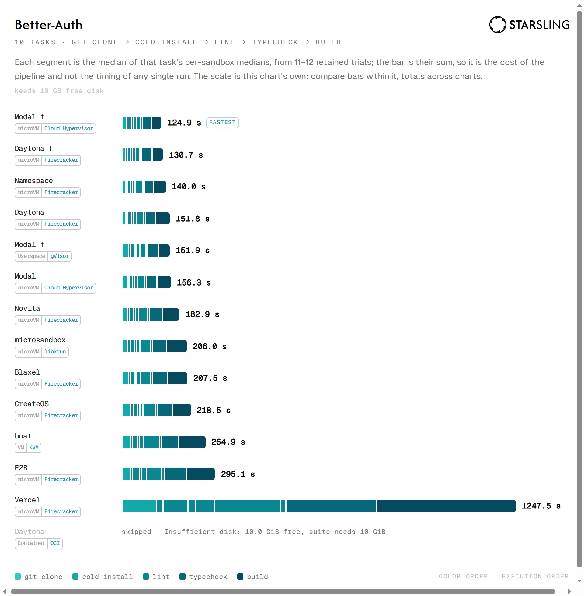

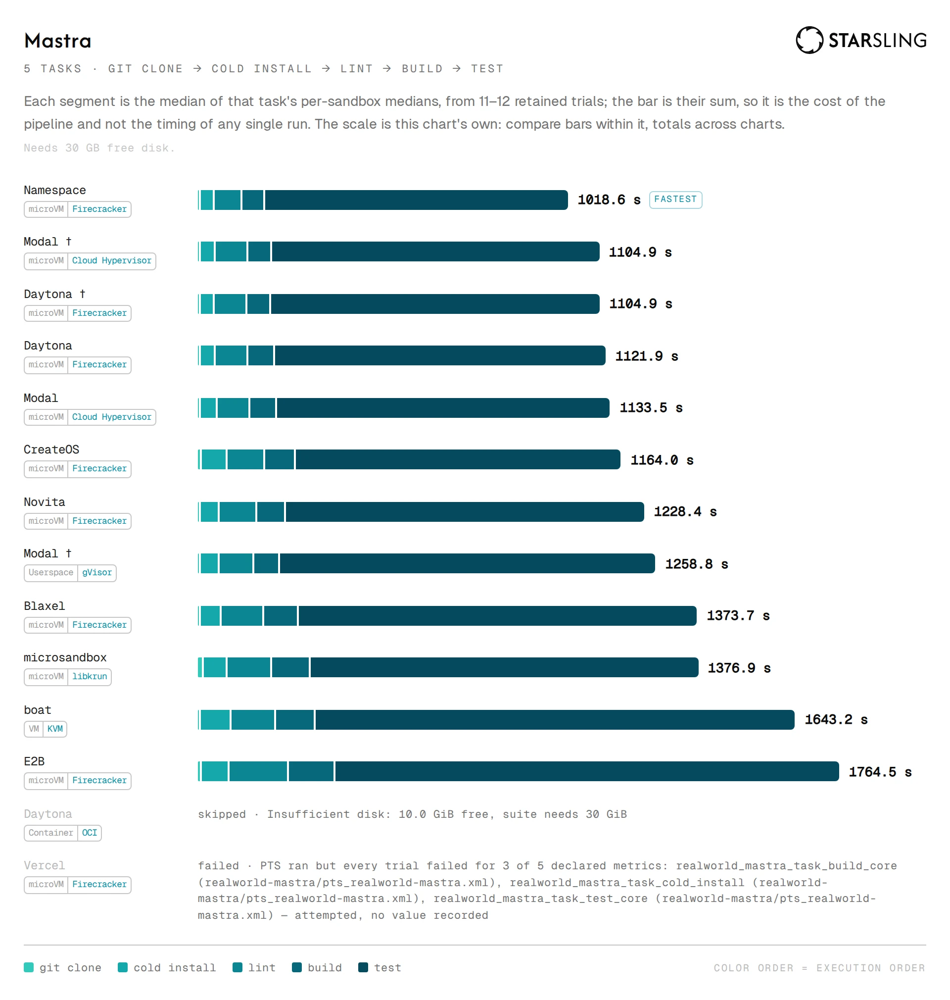

<strong>Per-task rankings</strong> · 21 tasks, with medians, intervals and trial counts

### Mastra: cold install _(headline)_

Seconds · lower is better

_Daytona (VM, burst) leads on median (lower is better); see notes for how ranks are decided._

| Rank | Provider | Mastra: cold install (Seconds) | 95% bootstrap interval | Sandboxes | Trials | Note |
| ---: | --- | ---: | ---: | ---: | ---: | --- |
| 1 | Daytona (VM, burst) | 34.66 | 34.16 – 34.95 | 12 | 12 | — |
| 2 | Namespace | 35.77 | 35.25 – 36.05 | 12 | 12 | — |
| 3 | Modal (VM, burst) | 37.31 | 36.38 – 38.47 | 12 | 12 | — |
| 3 | Daytona (VM) | 38.09 | 37.67 – 38.57 | 12 | 12 | tied |
| 5 | Modal (VM) | 41.34 | 40.81 – 41.87 | 12 | 12 | — |
| 6 | Modal (gVisor) | 46.48 | 46.09 – 47 | 12 | 12 | — |
| 6 | Novita | 47.63 | 46.04 – 48.87 | 12 | 12 | tied |
| 8 | Blaxel | 54.16 | 49.34 – 56.12 | 12 | 12 | — |
| 9 | Microsandbox Cloud | 62.33 | 60.94 – 80.14 | 12 | 12 | — |
| 9 | CreateOS | 68.62 | 61.97 – 74.76 | 12 | 12 | tied |
| 9 | E2B | 71.76 | 67.82 – 75.76 | 12 | 12 | tied |
| 9 | boat | 80.42 | 63.36 – 96.71 | 12 | 12 | tied |
| 13 | Vercel Sandbox | 321.5 | — | 1 | 1 | — |

### Better-Auth: build

Seconds · lower is better

_Modal (VM, burst) leads · Modal (gVisor) is ~1.1× higher (lower is better)._

| Rank | Provider | Better-Auth: build (Seconds) | 95% bootstrap interval | Sandboxes | Trials | Note |
| ---: | --- | ---: | ---: | ---: | ---: | --- |
| 1 | Modal (VM, burst) | 40.53 | 40.36 – 42.14 | 12 | 12 | — |
| 2 | Modal (gVisor) | 43.18 | 42.69 – 44.99 | 12 | 12 | — |
| 2 | Daytona (VM, burst) | 43.73 | 42.1 – 44.07 | 12 | 12 | tied |
| 4 | Namespace | 49.25 | 48.79 – 49.73 | 12 | 12 | — |
| 5 | Daytona (VM) | 54.25 | 53.44 – 57.15 | 12 | 12 | — |
| 5 | Modal (VM) | 54.98 | 53.96 – 55.97 | 11 | 11 | tied |
| 7 | Novita | 64.47 | 63.79 – 65.8 | 12 | 12 | — |
| 8 | CreateOS | 68.32 | 65.53 – 79.75 | 12 | 12 | — |
| 8 | Blaxel | 74.05 | 72.06 – 75.7 | 12 | 12 | tied |
| 8 | Microsandbox Cloud | 74.93 | 72.09 – 84.47 | 12 | 12 | tied |
| 8 | boat | 95.23 | 75.02 – 116.1 | 12 | 12 | tied |
| 8 | E2B | 100.8 | 96.73 – 103.9 | 12 | 12 | tied |
| 13 | Vercel Sandbox | 451.6 | 420.7 – 577.3 | 12 | 12 | — |

### Better-Auth: cold install

Seconds · lower is better

_Daytona (VM, burst) leads · Namespace is ~1.2× higher (lower is better)._

| Rank | Provider | Better-Auth: cold install (Seconds) | 95% bootstrap interval | Sandboxes | Trials | Note |
| ---: | --- | ---: | ---: | ---: | ---: | --- |
| 1 | Daytona (VM, burst) | 7.88 | 7.732 – 8.083 | 12 | 12 | — |
| 2 | Namespace | 9.361 | 9.289 – 9.402 | 12 | 12 | — |
| 3 | Daytona (VM) | 9.73 | 9.656 – 9.775 | 12 | 12 | — |
| 4 | Modal (VM, burst) | 11.76 | 11.62 – 12.66 | 12 | 12 | — |
| 5 | Novita | 13.2 | 12.91 – 13.41 | 12 | 12 | — |
| 5 | Modal (VM) | 13.29 | 12.69 – 13.58 | 11 | 11 | tied |
| 7 | Microsandbox Cloud | 15.61 | 14.41 – 21.54 | 12 | 12 | — |
| 7 | Blaxel | 17.87 | 17.57 – 18.42 | 12 | 12 | tied |
| 7 | Modal (gVisor) | 18.05 | 17.81 – 18.37 | 12 | 12 | tied |
| 10 | boat | 22.04 | 18 – 25.77 | 12 | 12 | — |
| 10 | E2B | 22.78 | 21.25 – 26.71 | 12 | 12 | tied |
| 10 | CreateOS | 25.67 | 19.67 – 31.78 | 12 | 12 | tied |
| 13 | Vercel Sandbox | 103.8 | 86.72 – 127.8 | 12 | 12 | — |

### Better-Auth: git clone

Seconds · lower is better

_Namespace leads · Daytona (VM) is ~1.1× higher (lower is better)._

| Rank | Provider | Better-Auth: git clone (Seconds) | 95% bootstrap interval | Sandboxes | Trials | Note |
| ---: | --- | ---: | ---: | ---: | ---: | --- |
| 1 | Namespace | 0.5335 | 0.499 – 0.5395 | 12 | 12 | — |
| 2 | Daytona (VM) | 0.6 | 0.587 – 0.6115 | 12 | 12 | — |
| 2 | Modal (VM, burst) | 0.6045 | 0.5725 – 0.629 | 12 | 12 | tied |
| 2 | Modal (VM) | 0.612 | 0.571 – 0.743 | 11 | 11 | tied |
| 5 | Blaxel | 0.712 | 0.686 – 0.7475 | 12 | 12 | — |
| 5 | Modal (gVisor) | 0.745 | 0.702 – 0.7735 | 12 | 12 | tied |
| 7 | Daytona (VM, burst) | 1.099 | 1.091 – 1.118 | 12 | 12 | — |
| 8 | E2B | 1.339 | 1.304 – 1.639 | 12 | 12 | — |
| 8 | CreateOS | 1.676 | 1.159 – 2.526 | 12 | 12 | tied |
| 8 | Microsandbox Cloud | 1.746 | 1.526 – 1.835 | 12 | 12 | tied |
| 8 | boat | 2.03 | 1.645 – 2.189 | 12 | 12 | tied |
| 8 | Novita | 2.165 | 1.89 – 2.365 | 12 | 12 | tied |
| 8 | Vercel Sandbox | 2.188 | 2.022 – 3.01 | 12 | 12 | tied |

### Better-Auth: lint (Biome)

Seconds · lower is better

_Daytona (VM, burst) leads on median (lower is better); see notes for how ranks are decided._

| Rank | Provider | Better-Auth: lint (Biome) (Seconds) | 95% bootstrap interval | Sandboxes | Trials | Note |
| ---: | --- | ---: | ---: | ---: | ---: | --- |
| 1 | Daytona (VM, burst) | 1.867 | 1.828 – 1.901 | 12 | 12 | — |
| 2 | Modal (VM, burst) | 1.926 | 1.901 – 1.943 | 12 | 12 | — |
| 3 | Namespace | 2.458 | 2.418 – 2.507 | 12 | 12 | — |
| 4 | Daytona (VM) | 2.853 | 2.797 – 2.924 | 12 | 12 | — |
| 5 | Modal (VM) | 3.047 | 2.933 – 3.075 | 11 | 11 | — |
| 6 | Novita | 3.221 | 3.176 – 3.28 | 12 | 12 | — |
| 7 | Microsandbox Cloud | 3.602 | 3.46 – 3.715 | 12 | 12 | — |
| 7 | Blaxel | 3.638 | 3.611 – 3.73 | 12 | 12 | tied |
| 7 | CreateOS | 3.648 | 3.287 – 4.22 | 12 | 12 | tied |
| 7 | boat | 3.827 | 3.067 – 4.96 | 12 | 12 | tied |
| 11 | E2B | 4.886 | 4.728 – 5.076 | 12 | 12 | — |
| 12 | Modal (gVisor) | 5.522 | 5.364 – 5.627 | 12 | 12 | — |
| 13 | Vercel Sandbox | 17.79 | 15.61 – 19.04 | 12 | 12 | — |

### Better-Auth: lint deps (Knip)

Seconds · lower is better

_Namespace leads · Daytona (VM) is ~1.1× higher (lower is better)._

| Rank | Provider | Better-Auth: lint deps (Knip) (Seconds) | 95% bootstrap interval | Sandboxes | Trials | Note |
| ---: | --- | ---: | ---: | ---: | ---: | --- |
| 1 | Namespace | 9.275 | 9.206 – 9.337 | 12 | 12 | — |
| 2 | Daytona (VM) | 9.94 | 9.871 – 10.07 | 12 | 12 | — |
| 2 | Modal (VM, burst) | 9.956 | 9.846 – 9.995 | 12 | 12 | tied |
| 2 | Daytona (VM, burst) | 9.994 | 9.938 – 10.23 | 12 | 12 | tied |
| 2 | Modal (VM) | 10.3 | 9.887 – 10.35 | 11 | 11 | tied |
| 6 | Novita | 11.22 | 10.9 – 11.64 | 12 | 12 | — |
| 6 | Blaxel | 11.45 | 11.16 – 11.7 | 12 | 12 | tied |
| 6 | Microsandbox Cloud | 11.99 | 11.11 – 12.6 | 12 | 12 | tied |
| 6 | Modal (gVisor) | 12.22 | 12.03 – 12.49 | 12 | 12 | tied |
| 6 | CreateOS | 13.56 | 12.12 – 14.83 | 12 | 12 | tied |
| 6 | boat | 14.1 | 10.54 – 19.45 | 12 | 12 | tied |
| 6 | E2B | 18.99 | 18.07 – 19.48 | 12 | 12 | tied |
| 13 | Vercel Sandbox | 78.78 | 72.55 – 93.75 | 12 | 12 | — |

### Better-Auth: lint format

Seconds · lower is better

_Namespace leads · Daytona (VM) is ~1.2× higher (lower is better)._

| Rank | Provider | Better-Auth: lint format (Seconds) | 95% bootstrap interval | Sandboxes | Trials | Note |
| ---: | --- | ---: | ---: | ---: | ---: | --- |
| 1 | Namespace | 2.145 | 2.115 – 2.18 | 12 | 12 | — |
| 2 | Daytona (VM) | 2.58 | 2.507 – 2.646 | 12 | 12 | — |
| 2 | Daytona (VM, burst) | 2.585 | 2.519 – 2.644 | 12 | 12 | tied |
| 2 | Modal (VM, burst) | 2.657 | 2.598 – 2.675 | 12 | 12 | tied |
| 2 | Modal (VM) | 2.693 | 2.639 – 2.765 | 11 | 11 | tied |
| 6 | Modal (gVisor) | 2.843 | 2.807 – 2.882 | 12 | 12 | — |
| 6 | CreateOS | 2.986 | 2.74 – 3.365 | 12 | 12 | tied |
| 6 | Novita | 3.009 | 2.96 – 3.104 | 12 | 12 | tied |
| 6 | Blaxel | 3.035 | 3.008 – 3.083 | 12 | 12 | tied |
| 6 | Microsandbox Cloud | 3.18 | 3.01 – 3.382 | 12 | 12 | tied |
| 6 | boat | 3.374 | 2.989 – 4.857 | 12 | 12 | tied |
| 12 | E2B | 5.232 | 4.841 – 5.374 | 12 | 12 | — |
| 13 | Vercel Sandbox | 19.14 | 17.93 – 22.57 | 12 | 12 | — |

### Better-Auth: lint packages

Seconds · lower is better

_Daytona (VM, burst) leads · Modal (VM, burst) is ~1.1× higher (lower is better)._

| Rank | Provider | Better-Auth: lint packages (Seconds) | 95% bootstrap interval | Sandboxes | Trials | Note |
| ---: | --- | ---: | ---: | ---: | ---: | --- |
| 1 | Daytona (VM, burst) | 1.698 | 1.662 – 1.796 | 12 | 12 | — |
| 2 | Modal (VM, burst) | 1.853 | 1.822 – 1.929 | 12 | 12 | — |
| 3 | Namespace | 2.051 | 2.038 – 2.167 | 12 | 12 | — |
| 3 | Modal (gVisor) | 2.07 | 2.043 – 2.126 | 12 | 12 | tied |
| 5 | Daytona (VM) | 2.381 | 2.361 – 2.391 | 12 | 12 | — |
| 6 | Modal (VM) | 2.633 | 2.598 – 2.673 | 11 | 11 | — |
| 6 | Novita | 2.699 | 2.619 – 2.723 | 12 | 12 | tied |
| 8 | Blaxel | 3.046 | 2.986 – 3.08 | 12 | 12 | — |
| 8 | Microsandbox Cloud | 3.117 | 2.941 – 3.214 | 12 | 12 | tied |
| 8 | boat | 3.12 | 2.883 – 4.313 | 12 | 12 | tied |
| 8 | CreateOS | 3.472 | 2.74 – 3.796 | 12 | 12 | tied |
| 12 | E2B | 4.072 | 3.976 – 4.322 | 12 | 12 | — |
| 13 | Vercel Sandbox | 12.8 | 11.39 – 13.51 | 12 | 12 | — |

### Better-Auth: lint spell

Seconds · lower is better

_Namespace leads · Modal (VM, burst) is ~1.2× higher (lower is better)._

| Rank | Provider | Better-Auth: lint spell (Seconds) | 95% bootstrap interval | Sandboxes | Trials | Note |
| ---: | --- | ---: | ---: | ---: | ---: | --- |
| 1 | Namespace | 5.568 | 5.538 – 5.592 | 12 | 12 | — |
| 2 | Modal (VM, burst) | 6.473 | 6.42 – 6.564 | 12 | 12 | — |
| 2 | Daytona (VM) | 6.507 | 6.445 – 6.748 | 12 | 12 | tied |
| 2 | Modal (VM) | 6.659 | 6.489 – 6.706 | 11 | 11 | tied |
| 2 | Daytona (VM, burst) | 6.781 | 6.582 – 6.941 | 12 | 12 | tied |
| 6 | Modal (gVisor) | 7.237 | 7.129 – 7.321 | 12 | 12 | — |
| 6 | CreateOS | 7.348 | 6.74 – 8.505 | 12 | 12 | tied |
| 6 | Novita | 7.783 | 7.582 – 7.909 | 12 | 12 | tied |
| 6 | Microsandbox Cloud | 8.113 | 7.474 – 8.557 | 12 | 12 | tied |
| 10 | Blaxel | 8.943 | 8.787 – 9.271 | 12 | 12 | — |
| 10 | boat | 9.491 | 7.608 – 12.98 | 12 | 12 | tied |
| 10 | E2B | 12.91 | 12.25 – 13.46 | 12 | 12 | tied |
| 13 | Vercel Sandbox | 58.12 | 53.66 – 62.07 | 12 | 12 | — |

### Better-Auth: lint types

Seconds · lower is better

_Modal (VM, burst) leads · Daytona (VM, burst) is ~1.1× higher (lower is better)._

| Rank | Provider | Better-Auth: lint types (Seconds) | 95% bootstrap interval | Sandboxes | Trials | Note |
| ---: | --- | ---: | ---: | ---: | ---: | --- |
| 1 | Modal (VM, burst) | 14.18 | 14.03 – 14.75 | 12 | 12 | — |
| 2 | Daytona (VM, burst) | 15.1 | 14.47 – 15.36 | 12 | 12 | — |
| 3 | Modal (gVisor) | 21 | 20.86 – 21.36 | 12 | 12 | — |
| 4 | Daytona (VM) | 25.19 | 24.49 – 26.53 | 12 | 12 | — |
| 4 | Modal (VM) | 25.75 | 25.12 – 26.31 | 11 | 11 | tied |
| 6 | Namespace | 27.43 | 27.06 – 27.78 | 12 | 12 | — |
| 7 | Novita | 30.8 | 29.87 – 31.44 | 12 | 12 | — |
| 8 | Blaxel | 35.15 | 34.65 – 36.56 | 12 | 12 | — |
| 9 | Microsandbox Cloud | 37.04 | 35.84 – 38.85 | 12 | 12 | — |
| 9 | CreateOS | 41.78 | 36.66 – 49.78 | 12 | 12 | tied |
| 11 | E2B | 50.02 | 47.72 – 52.35 | 12 | 12 | — |
| 11 | boat | 53.01 | 37.96 – 60.95 | 12 | 12 | tied |
| 13 | Vercel Sandbox | 211.5 | 196.6 – 217.6 | 12 | 12 | — |

### Better-Auth: typecheck

Seconds · lower is better

_Namespace leads · Modal (VM, burst) is ~1.1× higher (lower is better)._

| Rank | Provider | Better-Auth: typecheck (Seconds) | 95% bootstrap interval | Sandboxes | Trials | Note |
| ---: | --- | ---: | ---: | ---: | ---: | --- |
| 1 | Namespace | 31.91 | 31.65 – 32.73 | 12 | 12 | — |
| 2 | Modal (VM, burst) | 34.95 | 34.12 – 35.97 | 12 | 12 | — |
| 3 | Modal (VM) | 36.35 | 35.91 – 37.78 | 11 | 11 | — |
| 3 | Daytona (VM) | 37.79 | 36.56 – 38.97 | 12 | 12 | tied |
| 3 | Modal (gVisor) | 39.06 | 38.16 – 39.81 | 12 | 12 | tied |
| 3 | Daytona (VM, burst) | 39.93 | 36.98 – 40.86 | 12 | 12 | tied |
| 7 | Novita | 44.37 | 42.69 – 45.39 | 12 | 12 | — |
| 8 | Microsandbox Cloud | 46.7 | 45.02 – 55.5 | 12 | 12 | — |
| 8 | Blaxel | 49.64 | 48.38 – 51.92 | 12 | 12 | tied |
| 8 | CreateOS | 50.05 | 47.92 – 55.16 | 12 | 12 | tied |
| 8 | boat | 58.63 | 49.23 – 89.71 | 12 | 12 | tied |
| 8 | E2B | 74.05 | 70.31 – 80.27 | 12 | 12 | tied |
| 13 | Vercel Sandbox | 291.8 | 248.4 – 306.8 | 12 | 12 | — |

### Mastra: build:core

Seconds · lower is better

_Namespace leads · Daytona (VM, burst) is ~1.1× higher (lower is better)._

| Rank | Provider | Mastra: build:core (Seconds) | 95% bootstrap interval | Sandboxes | Trials | Note |
| ---: | --- | ---: | ---: | ---: | ---: | --- |
| 1 | Namespace | 57.64 | 57.19 – 58.53 | 12 | 12 | — |
| 2 | Daytona (VM, burst) | 61.61 | 61.06 – 62.3 | 12 | 12 | — |
| 2 | Modal (VM, burst) | 61.88 | 61.61 – 62.06 | 12 | 12 | tied |
| 4 | Modal (gVisor) | 67 | 66.8 – 68.34 | 12 | 12 | — |
| 4 | Daytona (VM) | 68.15 | 67.65 – 69.26 | 12 | 12 | tied |
| 6 | Modal (VM) | 69.59 | 69.2 – 70.93 | 12 | 12 | — |
| 7 | Novita | 76.73 | 75.72 – 77.65 | 12 | 12 | — |
| 7 | CreateOS | 81.08 | 76.17 – 84.71 | 12 | 12 | tied |
| 9 | Blaxel | 89.67 | 83.53 – 91.93 | 12 | 12 | — |
| 10 | Microsandbox Cloud | 100.6 | 93.29 – 101.6 | 12 | 12 | — |
| 10 | boat | 103.1 | 71.82 – 111.6 | 12 | 12 | tied |
| 12 | E2B | 125.5 | 124.4 – 134.6 | 12 | 12 | — |
| 13 | Vercel Sandbox | 250.4 | — | 1 | 1 | — |

### Mastra: git clone

Seconds · lower is better

_Namespace leads · Modal (VM, burst) is ~1.2× higher (lower is better)._

| Rank | Provider | Mastra: git clone (Seconds) | 95% bootstrap interval | Sandboxes | Trials | Note |
| ---: | --- | ---: | ---: | ---: | ---: | --- |
| 1 | Namespace | 1.406 | 1.395 – 1.458 | 12 | 12 | — |
| 2 | Modal (VM, burst) | 1.643 | 1.633 – 2.076 | 12 | 12 | — |
| 2 | Modal (VM) | 1.738 | 1.683 – 2.048 | 12 | 12 | tied |
| 2 | Daytona (VM) | 1.749 | 1.735 – 1.809 | 12 | 12 | tied |
| 2 | Daytona (VM, burst) | 1.773 | 1.751 – 2.832 | 12 | 12 | tied |
| 6 | Blaxel | 2.079 | 1.986 – 2.8 | 12 | 12 | — |
| 6 | Modal (gVisor) | 2.131 | 2.072 – 2.146 | 12 | 12 | tied |
| 8 | Novita | 3.412 | 2.918 – 3.539 | 12 | 12 | — |
| 8 | boat | 3.475 | 3.179 – 4.28 | 12 | 12 | tied |
| 8 | CreateOS | 4.547 | 2.867 – 8.234 | 12 | 12 | tied |
| 8 | E2B | 5.125 | 4.176 – 5.973 | 12 | 12 | tied |
| 8 | Vercel Sandbox | 5.956 | 5.053 – 6.308 | 4 | 4 | tied |
| 8 | Microsandbox Cloud | 9.747 | 2.936 – 26.46 | 12 | 12 | tied |

### Mastra: lint:format

Seconds · lower is better

_Namespace leads · Daytona (VM) is ~1.2× higher (lower is better)._

| Rank | Provider | Mastra: lint:format (Seconds) | 95% bootstrap interval | Sandboxes | Trials | Note |
| ---: | --- | ---: | ---: | ---: | ---: | --- |
| 1 | Namespace | 71.3 | 70.62 – 71.9 | 12 | 12 | — |
| 2 | Daytona (VM) | 85.69 | 85.24 – 86.32 | 12 | 12 | — |
| 2 | Daytona (VM, burst) | 85.72 | 84.85 – 89.04 | 12 | 12 | tied |
| 2 | Modal (VM, burst) | 86.27 | 85.94 – 87.6 | 12 | 12 | tied |
| 2 | Modal (VM) | 88.31 | 87.3 – 92.13 | 12 | 12 | tied |
| 2 | Modal (gVisor) | 92.08 | 90.84 – 94.65 | 12 | 12 | tied |
| 7 | Novita | 97.41 | 96.56 – 98.35 | 12 | 12 | — |
| 7 | CreateOS | 97.87 | 95.4 – 105.7 | 12 | 12 | tied |
| 9 | Blaxel | 113.5 | 104 – 116 | 12 | 12 | — |
| 9 | boat | 118.2 | 92.16 – 153 | 12 | 12 | tied |
| 9 | Microsandbox Cloud | 119.8 | 118.8 – 123.9 | 12 | 12 | tied |
| 12 | E2B | 159.6 | 150.2 – 167.8 | 12 | 12 | — |
| 13 | Vercel Sandbox | 649.7 | 406.7 – 693.3 | 4 | 4 | — |

### Mastra: test:core

Seconds · lower is better

_Namespace leads · CreateOS is ~1.1× higher (lower is better)._

| Rank | Provider | Mastra: test:core (Seconds) | 95% bootstrap interval | Sandboxes | Trials | Note |
| ---: | --- | ---: | ---: | ---: | ---: | --- |
| 1 | Namespace | 852.4 | 845.9 – 864.8 | 12 | 12 | — |
| 2 | CreateOS | 911.9 | 908.4 – 950.7 | 12 | 12 | — |
| 2 | Modal (VM, burst) | 917.8 | 912.1 – 923.9 | 12 | 12 | tied |
| 2 | Daytona (VM, burst) | 921.2 | 917.9 – 925.6 | 12 | 12 | tied |
| 5 | Daytona (VM) | 928.2 | 923.5 – 941.9 | 12 | 12 | — |
| 5 | Modal (VM) | 932.5 | 930.6 – 946.2 | 12 | 12 | tied |
| 7 | Novita | 1003 | 1000 – 1008 | 12 | 12 | — |
| 8 | Modal (gVisor) | 1051 | 1045 – 1057 | 12 | 12 | — |
| 9 | Microsandbox Cloud | 1084 | 1071 – 1110 | 11 | 11 | — |
| 10 | Blaxel | 1114 | 1097 – 1128 | 12 | 12 | — |
| 10 | boat | 1338 | 999.5 – 1381 | 11 | 11 | tied |
| 12 | E2B | 1403 | 1371 – 1426 | 12 | 12 | — |

### OpenClaw: cold install

Seconds · lower is better

_Daytona (VM, burst) leads · Namespace is ~1.2× higher (lower is better)._

| Rank | Provider | OpenClaw: cold install (Seconds) | 95% bootstrap interval | Sandboxes | Trials | Note |
| ---: | --- | ---: | ---: | ---: | ---: | --- |
| 1 | Daytona (VM, burst) | 7.999 | 7.736 – 8.245 | 12 | 12 | — |
| 2 | Namespace | 9.831 | 9.646 – 9.964 | 12 | 12 | — |
| 2 | Daytona (VM) | 9.924 | 9.7 – 10.24 | 12 | 12 | tied |
| 4 | Modal (VM, burst) | 11.2 | 9.932 – 11.35 | 12 | 12 | — |
| 5 | Modal (VM) | 13.19 | 13.03 – 14.34 | 12 | 12 | — |
| 6 | Novita | 14.89 | 14.65 – 15.34 | 12 | 12 | — |
| 6 | Modal (gVisor) | 15.41 | 15.29 – 15.94 | 12 | 12 | tied |
| 8 | Blaxel | 16.49 | 15.66 – 17.15 | 12 | 12 | — |
| 9 | Microsandbox Cloud | 18.25 | 17.6 – 19.07 | 11 | 11 | — |
| 9 | boat | 22.33 | 16.13 – 25.4 | 12 | 12 | tied |
| 9 | E2B | 24.78 | 22.29 – 27.69 | 12 | 12 | tied |
| 9 | CreateOS | 30.25 | 22.52 – 37.64 | 6 | 6 | tied |
| 13 | Vercel Sandbox | 92.75 | 71.08 – 111.2 | 9 | 9 | — |

### OpenClaw: git clone

Seconds · lower is better

_Namespace leads · Daytona (VM) is ~1.2× higher (lower is better)._

| Rank | Provider | OpenClaw: git clone (Seconds) | 95% bootstrap interval | Sandboxes | Trials | Note |
| ---: | --- | ---: | ---: | ---: | ---: | --- |
| 1 | Namespace | 2.253 | 2.128 – 2.566 | 12 | 12 | — |
| 2 | Daytona (VM) | 2.783 | 2.753 – 2.92 | 12 | 12 | — |
| 2 | Modal (VM) | 2.813 | 2.675 – 4.651 | 12 | 12 | tied |
| 2 | Blaxel | 2.992 | 2.891 – 3.257 | 12 | 12 | tied |
| 5 | Microsandbox Cloud | 4.435 | 4.168 – 4.774 | 11 | 11 | — |
| 5 | Novita | 4.905 | 4.4 – 7.595 | 12 | 12 | tied |
| 5 | Modal (gVisor) | 4.973 | 3.764 – 7.634 | 12 | 12 | tied |
| 5 | E2B | 5.625 | 5.243 – 9.581 | 12 | 12 | tied |
| 5 | boat | 7.397 | 5.325 – 9.887 | 12 | 12 | tied |
| 5 | Daytona (VM, burst) | 8.041 | 2.9 – 8.189 | 12 | 12 | tied |
| 5 | Modal (VM, burst) | 8.171 | 4.643 – 8.37 | 12 | 12 | tied |
| 12 | Vercel Sandbox | 10.57 | 8.337 – 12.61 | 9 | 9 | — |
| 13 | CreateOS | 12.67 | 12.44 – 14.51 | 6 | 6 | — |

### OpenClaw: lint (all extensions)

Seconds · lower is better

_Daytona (VM, burst) leads · Modal (VM, burst) is ~1.2× higher (lower is better)._

| Rank | Provider | OpenClaw: lint (all extensions) (Seconds) | 95% bootstrap interval | Sandboxes | Trials | Note |
| ---: | --- | ---: | ---: | ---: | ---: | --- |
| 1 | Daytona (VM, burst) | 108.9 | 106 – 117.3 | 12 | 12 | — |
| 2 | Modal (VM, burst) | 127.9 | 125.5 – 133.2 | 12 | 12 | — |
| 2 | Modal (gVisor) | 129.1 | 126.5 – 140.1 | 12 | 12 | tied |
| 2 | Daytona (VM) | 137.6 | 133.3 – 141.7 | 12 | 12 | tied |
| 5 | Namespace | 143.9 | 141.4 – 156.9 | 12 | 12 | — |
| 5 | Microsandbox Cloud | 151.5 | 145.7 – 163 | 11 | 11 | tied |
| 5 | Modal (VM) | 160 | 153.1 – 167.9 | 12 | 12 | tied |
| 5 | CreateOS | 173.1 | 165.4 – 183.7 | 6 | 6 | tied |
| 5 | Novita | 176.7 | 173.3 – 185.5 | 12 | 12 | tied |
| 5 | Blaxel | 182.3 | 173.4 – 187.6 | 12 | 12 | tied |
| 5 | boat | 192.1 | 169 – 284.3 | 12 | 12 | tied |
| 12 | E2B | 315.1 | 290.6 – 324.4 | 12 | 12 | — |
| 13 | Vercel Sandbox | 576.4 | 502.3 – 696.6 | 6 | 6 | — |

### OpenClaw: lint (Oxlint)

Seconds · lower is better

_Daytona (VM, burst) leads · Modal (gVisor) is ~1.2× higher (lower is better)._

| Rank | Provider | OpenClaw: lint (Oxlint) (Seconds) | 95% bootstrap interval | Sandboxes | Trials | Note |
| ---: | --- | ---: | ---: | ---: | ---: | --- |
| 1 | Daytona (VM, burst) | 185.7 | 180.5 – 193.3 | 12 | 12 | — |
| 2 | Modal (gVisor) | 230.2 | 217.5 – 235.7 | 12 | 12 | — |
| 2 | Modal (VM, burst) | 231.8 | 226.7 – 238.9 | 12 | 12 | tied |
| 4 | Daytona (VM) | 246.9 | 242.7 – 252.1 | 12 | 12 | — |
| 5 | Namespace | 282.9 | 280.6 – 289.5 | 12 | 12 | — |
| 5 | Microsandbox Cloud | 288.1 | 283 – 306.1 | 11 | 11 | tied |
| 7 | Modal (VM) | 305 | 292.9 – 318.4 | 12 | 12 | — |
| 7 | CreateOS | 332.9 | 297.8 – 360.8 | 6 | 6 | tied |
| 7 | Blaxel | 345.7 | 336.3 – 357.1 | 12 | 12 | tied |
| 7 | Novita | 348.4 | 341.1 – 352.6 | 12 | 12 | tied |
| 7 | boat | 356 | 319.3 – 543.9 | 12 | 12 | tied |
| 12 | E2B | 616.3 | 602.5 – 623.6 | 12 | 12 | — |
| 13 | Vercel Sandbox | 986.7 | — | 1 | 1 | — |

### OpenClaw: typecheck (test tree)

Seconds · lower is better

_Daytona (VM) leads · Modal (VM) is ~1.1× higher (lower is better)._

| Rank | Provider | OpenClaw: typecheck (test tree) (Seconds) | 95% bootstrap interval | Sandboxes | Trials | Note |
| ---: | --- | ---: | ---: | ---: | ---: | --- |
| 1 | Daytona (VM) | 88.55 | 85.49 – 91.19 | 12 | 12 | — |
| 2 | Modal (VM) | 99.8 | 95.44 – 104.4 | 12 | 12 | — |
| 2 | Daytona (VM, burst) | 101.9 | 100.4 – 105.2 | 12 | 12 | tied |
| 2 | Microsandbox Cloud | 104.4 | 101.1 – 107.5 | 11 | 11 | tied |
| 2 | Namespace | 104.7 | 100.5 – 106 | 12 | 12 | tied |
| 6 | Modal (VM, burst) | 111 | 109.8 – 112.4 | 12 | 12 | — |
| 6 | CreateOS | 113.7 | 106.4 – 116.3 | 6 | 6 | tied |
| 6 | Novita | 115 | 112 – 116.5 | 12 | 12 | tied |
| 9 | Blaxel | 123.4 | 119.4 – 129.1 | 12 | 12 | — |
| 10 | Modal (gVisor) | 135.4 | 134.3 – 139.4 | 12 | 12 | — |
| 10 | boat | 137.3 | 116 – 193.7 | 12 | 12 | tied |
| 10 | E2B | 185.5 | 180.7 – 196.9 | 12 | 12 | tied |
| 13 | Vercel Sandbox | 608.4 | 376.7 – 755.8 | 9 | 9 | — |

### OpenClaw: typecheck (tsgo)

Seconds · lower is better

_Daytona (VM, burst) leads · Modal (gVisor) is ~1.1× higher (lower is better)._

| Rank | Provider | OpenClaw: typecheck (tsgo) (Seconds) | 95% bootstrap interval | Sandboxes | Trials | Note |
| ---: | --- | ---: | ---: | ---: | ---: | --- |
| 1 | Daytona (VM, burst) | 11.3 | 10.99 – 11.75 | 12 | 12 | — |
| 2 | Modal (gVisor) | 12.29 | 11.68 – 13.02 | 12 | 12 | — |
| 3 | Daytona (VM) | 13.64 | 13.39 – 14.01 | 12 | 12 | — |
| 3 | Modal (VM, burst) | 13.77 | 13.09 – 13.93 | 12 | 12 | tied |
| 5 | Modal (VM) | 17.97 | 17.54 – 19.02 | 12 | 12 | — |
| 5 | Microsandbox Cloud | 18.62 | 17.44 – 18.8 | 11 | 11 | tied |
| 5 | Namespace | 18.96 | 18.27 – 19.61 | 12 | 12 | tied |
| 5 | CreateOS | 20.21 | 19 – 23.75 | 6 | 6 | tied |
| 5 | Blaxel | 20.5 | 19.95 – 21.19 | 12 | 12 | tied |
| 10 | Novita | 21.77 | 20.88 – 22.42 | 12 | 12 | — |
| 10 | boat | 23.17 | 19.7 – 33.9 | 12 | 12 | tied |
| 12 | E2B | 37.02 | 35.62 – 38.32 | 12 | 12 | — |
| 13 | Vercel Sandbox | 90.34 | 64.71 – 155.4 | 9 | 9 | — |

## cpu

<strong>1 synthetic metric</strong> · headline: Node.js web tooling

### Node.js web tooling _(headline)_

runs/s · higher is better

_Namespace leads · ~1.2× Daytona (VM, burst) on median (higher is better)._

| Rank | Provider | Node.js web tooling (runs/s) | 95% bootstrap interval | Sandboxes | Trials | Note |
| ---: | --- | ---: | ---: | ---: | ---: | --- |
| 1 | Namespace | 26.43 | 24.39 – 26.73 | 5 | 10 | — |
| 2 | Daytona (VM, burst) | 21.61 | 19.93 – 21.7 | 5 | 10 | — |
| 2 | Modal (VM, burst) | 21.61 | 20.87 – 21.93 | 5 | 10 | tied |
| 2 | Daytona (VM) | 21.11 | 20.62 – 21.22 | 5 | 10 | tied |
| 2 | Modal (VM) | 20.88 | 15.99 – 21.16 | 5 | 10 | tied |
| 2 | Modal (gVisor) | 20.85 | 18.74 – 21.46 | 5 | 10 | tied |
| 2 | CreateOS | 20.44 | 19.85 – 22.66 | 5 | 10 | tied |
| 2 | Novita | 19.77 | 19.23 – 21.5 | 5 | 10 | tied |
| 2 | Blaxel | 18.77 | 16.91 – 20.2 | 5 | 10 | tied |
| 10 | Daytona (container) | 16.3 | 13.38 – 16.47 | 5 | 10 | — |
| 10 | Microsandbox Cloud | 15.32 | 14.21 – 16.38 | 5 | 10 | tied |
| 10 | boat | 12.79 | 9.2 – 20.13 | 5 | 10 | tied |
| 10 | E2B | 11 | 10.84 – 15.75 | 5 | 10 | tied |
| 14 | Vercel Sandbox | 2.67 | 2.11 – 2.88 | 5 | 10 | — |

## disk

<strong>9 synthetic metrics</strong> · headline: fio rand write 4KB, O_DIRECT (MB/s)

### fio rand write 4KB, O_DIRECT (MB/s) _(headline)_

MB/s · higher is better

_boat leads · ~1.1× Daytona (VM, burst) on median (higher is better)._

| Rank | Provider | fio rand write 4KB, O_DIRECT (MB/s) (MB/s) | 95% bootstrap interval | Sandboxes | Trials | Note |
| ---: | --- | ---: | ---: | ---: | ---: | --- |
| 1 | boat | 961.5 | 888.7 – 980.4 | 3 | 6 | — |
| 2 | Daytona (VM, burst) | 913.3 | 848.3 – 1231 | 3 | 6 | too few sandboxes |
| 3 | Daytona (VM) | 855.1 | 849.9 – 866.1 | 3 | 6 | too few sandboxes |
| 4 | Modal (VM) | 827.3 | 809.5 – 1539 | 3 | 6 | too few sandboxes |
| 5 | Modal (VM, burst) | 797.4 | 782.8 – 809 | 3 | 6 | too few sandboxes |
| 6 | Modal (gVisor) | 796.9 | 772.8 – 797.4 | 3 | 6 | too few sandboxes |
| 7 | Blaxel | 780.7 | 731.9 – 1039 | 3 | 6 | too few sandboxes |
| 8 | CreateOS | 405.3 | 346.6 – 455.1 | 3 | 6 | too few sandboxes |
| 9 | Namespace | 388 | 384.3 – 388.5 | 3 | 6 | too few sandboxes |
| 10 | Novita | 325.6 | 325.6 – 327.7 | 3 | 6 | too few sandboxes |
| 11 | E2B | 239.1 | 192.9 – 242.2 | 3 | 6 | too few sandboxes |
| 12 | Daytona (container) | 231.2 | 221.2 – 435.7 | 3 | 6 | too few sandboxes |
| 13 | Vercel Sandbox | 65.9 | 29.46 – 121.6 | 3 | 6 | too few sandboxes |

### fio rand read 4KB, O_DIRECT (IOPS)

IOPS · higher is better

_boat leads · ~1.4× Blaxel on median (higher is better)._

| Rank | Provider | fio rand read 4KB, O_DIRECT (IOPS) (IOPS) | 95% bootstrap interval | Sandboxes | Trials | Note |
| ---: | --- | ---: | ---: | ---: | ---: | --- |
| 1 | boat | 322500 | 287500 – 333500 | 3 | 6 | — |
| 2 | Blaxel | 227500 | 204000 – 270500 | 3 | 6 | too few sandboxes |
| 3 | Modal (VM) | 223500 | 164500 – 427000 | 3 | 6 | too few sandboxes |
| 4 | Daytona (VM, burst) | 212500 | 108650 – 315500 | 3 | 6 | too few sandboxes |
| 5 | Modal (VM, burst) | 210500 | 207500 – 214000 | 3 | 6 | too few sandboxes |
| 6 | Modal (gVisor) | 176000 | 171500 – 181500 | 3 | 6 | too few sandboxes |
| 7 | Daytona (VM) | 135300 | 98050 – 214500 | 3 | 6 | too few sandboxes |
| 8 | Daytona (container) | 112500 | 98650 – 122000 | 3 | 6 | too few sandboxes |
| 9 | Namespace | 89300 | 88650 – 91200 | 3 | 6 | too few sandboxes |
| 10 | Novita | 77400 | 73100 – 77600 | 3 | 6 | too few sandboxes |
| 11 | E2B | 56800 | 48900 – 59950 | 3 | 6 | too few sandboxes |
| 12 | CreateOS | 52450 | 51800 – 53700 | 3 | 6 | too few sandboxes |
| 13 | Vercel Sandbox | 31750 | 18150 – 40600 | 3 | 6 | too few sandboxes |

### fio rand read 4KB, O_DIRECT (MB/s)

MB/s · higher is better

_boat leads · ~1.4× Blaxel on median (higher is better)._

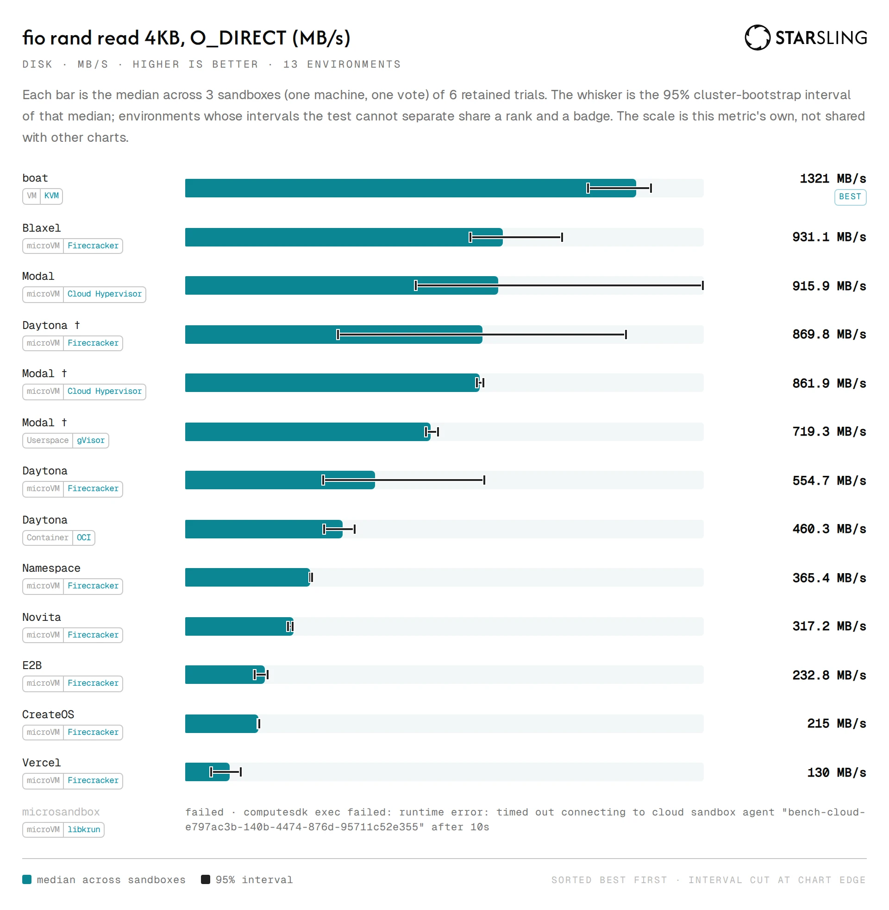

| Rank | Provider | fio rand read 4KB, O_DIRECT (MB/s) (MB/s) | 95% bootstrap interval | Sandboxes | Trials | Note |
| ---: | --- | ---: | ---: | ---: | ---: | --- |
| 1 | boat | 1321 | 1178 – 1366 | 3 | 6 | — |
| 2 | Blaxel | 931.1 | 833.6 – 1107 | 3 | 6 | too few sandboxes |
| 3 | Modal (VM) | 915.9 | 672.7 – 1749 | 3 | 6 | too few sandboxes |
| 4 | Daytona (VM, burst) | 869.8 | 445.6 – 1293 | 3 | 6 | too few sandboxes |
| 5 | Modal (VM, burst) | 861.9 | 850.9 – 876.6 | 3 | 6 | too few sandboxes |
| 6 | Modal (gVisor) | 719.3 | 702.5 – 742.4 | 3 | 6 | too few sandboxes |
| 7 | Daytona (VM) | 554.7 | 401.1 – 877.7 | 3 | 6 | too few sandboxes |
| 8 | Daytona (container) | 460.3 | 403.7 – 498.1 | 3 | 6 | too few sandboxes |
| 9 | Namespace | 365.4 | 363.3 – 373.3 | 3 | 6 | too few sandboxes |
| 10 | Novita | 317.2 | 299.4 – 317.7 | 3 | 6 | too few sandboxes |
| 11 | E2B | 232.8 | 200.3 – 245.4 | 3 | 6 | too few sandboxes |
| 12 | CreateOS | 215 | 212.3 – 219.7 | 3 | 6 | too few sandboxes |
| 13 | Vercel Sandbox | 130 | 74.34 – 166.7 | 3 | 6 | too few sandboxes |

### fio rand write 4KB, O_DIRECT (IOPS)

IOPS · higher is better

_boat leads · ~1.1× Daytona (VM, burst) on median (higher is better)._

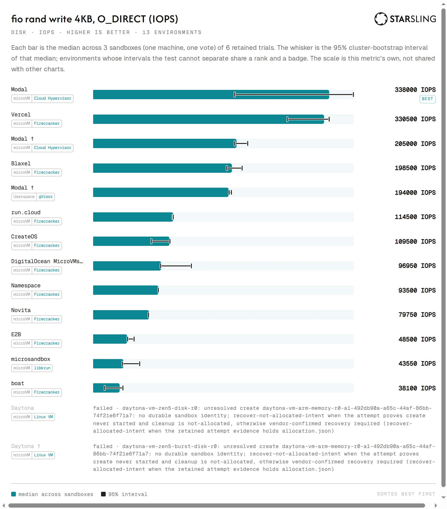

| Rank | Provider | fio rand write 4KB, O_DIRECT (IOPS) (IOPS) | 95% bootstrap interval | Sandboxes | Trials | Note |
| ---: | --- | ---: | ---: | ---: | ---: | --- |
| 1 | boat | 234500 | 217000 – 239500 | 3 | 6 | — |
| 2 | Daytona (VM, burst) | 223000 | 207000 – 300500 | 3 | 6 | too few sandboxes |
| 3 | Daytona (VM) | 209000 | 207500 – 211500 | 3 | 6 | too few sandboxes |
| 4 | Modal (VM) | 202000 | 197500 – 376000 | 3 | 6 | too few sandboxes |
| 5 | Modal (gVisor) | 194500 | 188500 – 194500 | 3 | 6 | too few sandboxes |
| 5 | Modal (VM, burst) | 194500 | 191500 – 197500 | 3 | 6 | too few sandboxes, equal medians |
| 7 | Blaxel | 190500 | 179000 – 253500 | 3 | 6 | too few sandboxes |
| 8 | CreateOS | 99050 | 84650 – 111000 | 3 | 6 | too few sandboxes |
| 9 | Namespace | 94700 | 93750 – 94950 | 3 | 6 | too few sandboxes |
| 10 | Novita | 79550 | 79450 – 79950 | 3 | 6 | too few sandboxes |
| 11 | E2B | 58450 | 46950 – 59150 | 3 | 6 | too few sandboxes |
| 12 | Daytona (container) | 56500 | 54100 – 106500 | 3 | 6 | too few sandboxes |
| 13 | Vercel Sandbox | 16100 | 7198 – 29750 | 3 | 6 | too few sandboxes |

### fio seq read 1MB, O_DIRECT (IOPS)

IOPS · higher is better

_Modal (gVisor) leads · ~4.7× Daytona (VM) on median (higher is better)._

| Rank | Provider | fio seq read 1MB, O_DIRECT (IOPS) (IOPS) | 95% bootstrap interval | Sandboxes | Trials | Note |
| ---: | --- | ---: | ---: | ---: | ---: | --- |
| 1 | Modal (gVisor) | 96350 | 88850 – 97100 | 3 | 6 | — |
| 2 | Daytona (VM) | 20700 | 20650 – 20850 | 3 | 6 | too few sandboxes |
| 3 | Daytona (VM, burst) | 18300 | 18050 – 20550 | 3 | 6 | too few sandboxes |
| 4 | Modal (VM) | 12950 | 12850 – 13000 | 3 | 6 | too few sandboxes |
| 5 | Modal (VM, burst) | 12150 | 8892 – 12450 | 3 | 6 | too few sandboxes |
| 6 | Novita | 11250 | 10800 – 11450 | 3 | 6 | too few sandboxes |
| 7 | Daytona (container) | 9214 | 8242 – 11550 | 3 | 6 | too few sandboxes |
| 8 | boat | 7963 | 6150 – 10404 | 3 | 6 | too few sandboxes |
| 9 | Blaxel | 5018 | 4121 – 5088 | 3 | 6 | too few sandboxes |
| 10 | CreateOS | 2758 | 2743 – 2768 | 3 | 6 | too few sandboxes |
| 11 | Namespace | 2501 | 2469 – 2622 | 3 | 6 | too few sandboxes |
| 12 | Vercel Sandbox | 870 | 857 – 1106 | 3 | 6 | too few sandboxes |
| 13 | E2B | 599.5 | 599 – 599.5 | 3 | 6 | too few sandboxes |

### fio seq read 1MB, O_DIRECT (MB/s)

MB/s · higher is better

_Modal (gVisor) leads · ~4.7× Daytona (VM) on median (higher is better)._

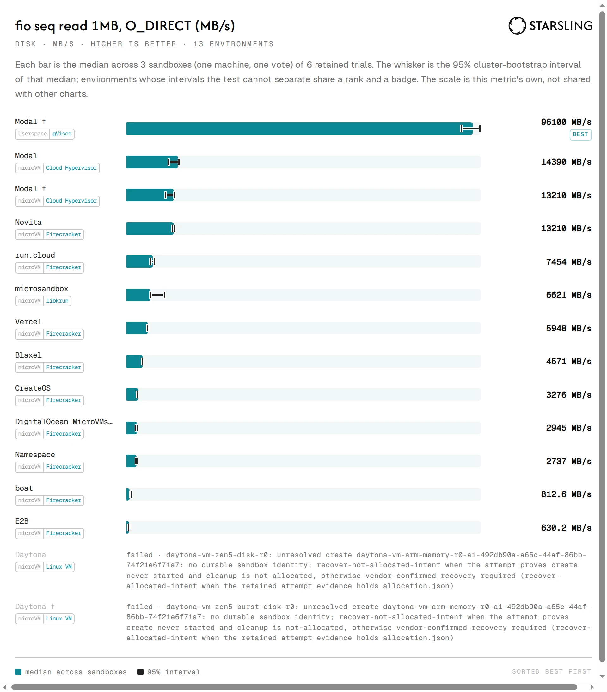

| Rank | Provider | fio seq read 1MB, O_DIRECT (MB/s) (MB/s) | 95% bootstrap interval | Sandboxes | Trials | Note |
| ---: | --- | ---: | ---: | ---: | ---: | --- |
| 1 | Modal (gVisor) | 101000 | 93200 – 101800 | 3 | 6 | — |
| 2 | Daytona (VM) | 21690 | 21690 – 21850 | 3 | 6 | too few sandboxes |
| 3 | Daytona (VM, burst) | 19220 | 18950 – 21580 | 3 | 6 | too few sandboxes |
| 4 | Modal (VM) | 13580 | 13480 – 13640 | 3 | 6 | too few sandboxes |
| 5 | Modal (VM, burst) | 12720 | 9314 – 13050 | 3 | 6 | too few sandboxes |
| 6 | Novita | 11790 | 11330 – 11970 | 3 | 6 | too few sandboxes |
| 7 | Daytona (container) | 9663 | 8644 – 12130 | 3 | 6 | too few sandboxes |
| 8 | boat | 8351 | 6450 – 10900 | 3 | 6 | too few sandboxes |
| 9 | Blaxel | 5263 | 4322 – 5337 | 3 | 6 | too few sandboxes |
| 10 | CreateOS | 2893 | 2878 – 2903 | 3 | 6 | too few sandboxes |
| 11 | Namespace | 2625 | 2591 – 2750 | 3 | 6 | too few sandboxes |
| 12 | Vercel Sandbox | 913.3 | 900.2 – 1161 | 3 | 6 | too few sandboxes |
| 13 | E2B | 630.2 | 630.2 – 630.2 | 3 | 6 | too few sandboxes |

### fio seq write 1MB, O_DIRECT (IOPS)

IOPS · higher is better

_Daytona (VM) leads · ~1.1× Daytona (VM, burst) on median (higher is better)._

| Rank | Provider | fio seq write 1MB, O_DIRECT (IOPS) (IOPS) | 95% bootstrap interval | Sandboxes | Trials | Note |
| ---: | --- | ---: | ---: | ---: | ---: | --- |
| 1 | Daytona (VM) | 16600 | 15650 – 16700 | 3 | 6 | — |
| 2 | Daytona (VM, burst) | 15300 | 14750 – 16600 | 3 | 6 | too few sandboxes |
| 3 | Modal (VM) | 10750 | 6997 – 10800 | 3 | 6 | too few sandboxes |
| 4 | Modal (VM, burst) | 9910 | 9747 – 9954 | 3 | 6 | too few sandboxes |
| 5 | Modal (gVisor) | 8883 | 8852 – 10360 | 3 | 6 | too few sandboxes |
| 6 | Novita | 6342 | 6207 – 6460 | 3 | 6 | too few sandboxes |
| 7 | Blaxel | 4130 | 3971 – 4144 | 3 | 6 | too few sandboxes |
| 8 | Daytona (container) | 3374 | 3336 – 3922 | 3 | 6 | too few sandboxes |
| 9 | CreateOS | 2565 | 2323 – 2765 | 3 | 6 | too few sandboxes |
| 10 | Namespace | 1935 | 1879 – 2132 | 3 | 6 | too few sandboxes |
| 11 | boat | 1724 | 1678 – 2100 | 3 | 6 | too few sandboxes |
| 12 | Vercel Sandbox | 668 | 589.5 – 1376 | 3 | 6 | too few sandboxes |
| 13 | E2B | 598.5 | 550.5 – 600 | 3 | 6 | too few sandboxes |

### fio seq write 1MB, O_DIRECT (MB/s)

MB/s · higher is better

_Daytona (VM) leads · ~1.1× Daytona (VM, burst) on median (higher is better)._

| Rank | Provider | fio seq write 1MB, O_DIRECT (MB/s) (MB/s) | 95% bootstrap interval | Sandboxes | Trials | Note |
| ---: | --- | ---: | ---: | ---: | ---: | --- |
| 1 | Daytona (VM) | 17450 | 16430 – 17500 | 3 | 6 | — |
| 2 | Daytona (VM, burst) | 16000 | 15460 – 17390 | 3 | 6 | too few sandboxes |
| 3 | Modal (VM) | 11220 | 7338 – 11270 | 3 | 6 | too few sandboxes |
| 4 | Modal (VM, burst) | 10360 | 10220 – 10410 | 3 | 6 | too few sandboxes |
| 5 | Modal (gVisor) | 9286 | 9283 – 10850 | 3 | 6 | too few sandboxes |
| 6 | Novita | 6652 | 6510 – 6775 | 3 | 6 | too few sandboxes |
| 7 | Blaxel | 4331 | 4166 – 4347 | 3 | 6 | too few sandboxes |
| 8 | Daytona (container) | 3539 | 3499 – 4114 | 3 | 6 | too few sandboxes |
| 9 | CreateOS | 2690 | 2437 – 2901 | 3 | 6 | too few sandboxes |
| 10 | Namespace | 2030 | 1972 – 2237 | 3 | 6 | too few sandboxes |
| 11 | boat | 1809 | 1761 – 2203 | 3 | 6 | too few sandboxes |
| 12 | Vercel Sandbox | 702 | 619.7 – 1445 | 3 | 6 | too few sandboxes |
| 13 | E2B | 629.7 | 578.8 – 630.2 | 3 | 6 | too few sandboxes |

### Hardlink throughput

bogo ops/s · higher is better

_CreateOS leads on median (higher is better); see notes for how ranks are decided._

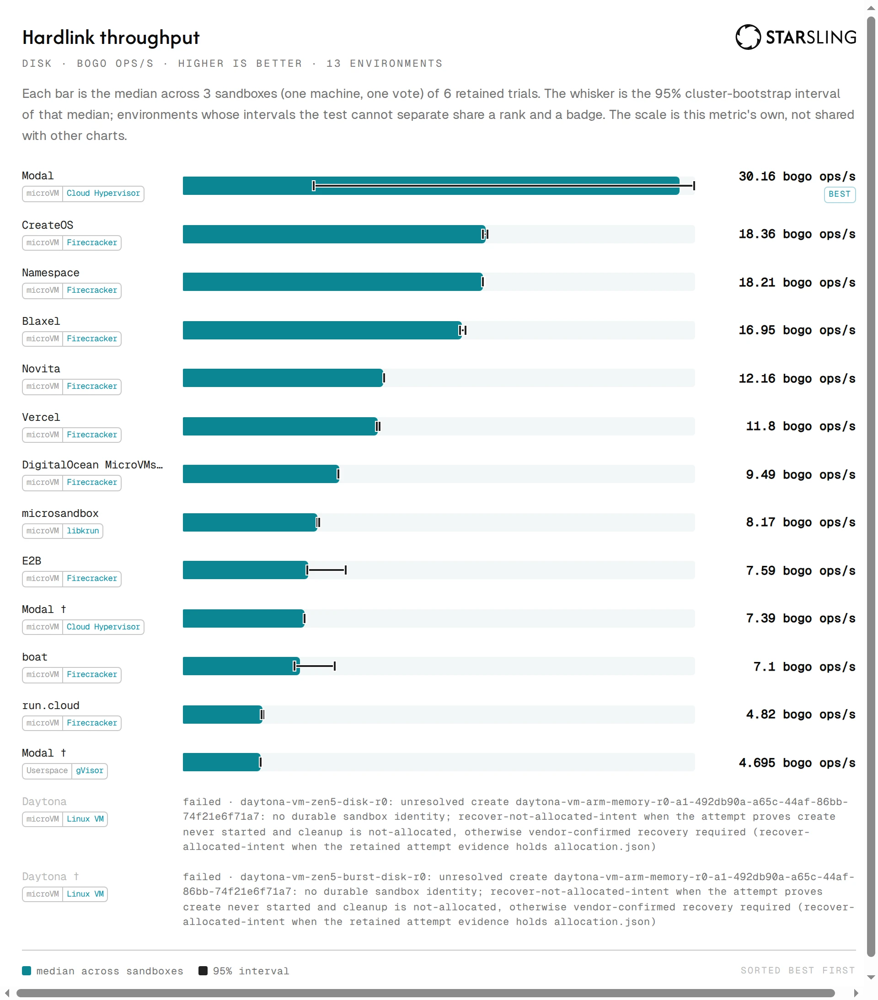

| Rank | Provider | Hardlink throughput (bogo ops/s) | 95% bootstrap interval | Sandboxes | Trials | Note |
| ---: | --- | ---: | ---: | ---: | ---: | --- |
| 1 | CreateOS | 18.48 | 17.88 – 18.5 | 3 | 6 | — |
| 2 | Namespace | 18.19 | 17.61 – 18.28 | 3 | 6 | too few sandboxes |
| 3 | Daytona (VM) | 17.42 | 17.32 – 17.45 | 3 | 6 | too few sandboxes |
| 4 | Blaxel | 16.91 | 16.89 – 16.98 | 3 | 6 | too few sandboxes |
| 5 | Daytona (VM, burst) | 16.18 | 16.11 – 17.39 | 3 | 6 | too few sandboxes |
| 6 | Novita | 12.18 | 12.14 – 12.18 | 3 | 6 | too few sandboxes |
| 7 | E2B | 8.39 | 7.855 – 8.525 | 3 | 6 | too few sandboxes |
| 8 | boat | 8.165 | 5.955 – 8.305 | 3 | 6 | too few sandboxes |
| 9 | Modal (VM) | 7.605 | 7.585 – 31.05 | 3 | 6 | too few sandboxes |
| 10 | Modal (VM, burst) | 7.405 | 7.37 – 7.475 | 3 | 6 | too few sandboxes |
| 11 | Modal (gVisor) | 4.71 | 4.525 – 4.74 | 3 | 6 | too few sandboxes |
| 12 | Vercel Sandbox | 2.76 | 2.705 – 3.925 | 3 | 6 | too few sandboxes |
| 13 | Daytona (container) | 1.855 | 1.695 – 1.96 | 3 | 6 | too few sandboxes |

## memory

<strong>4 synthetic metrics</strong> · headline: STREAM Triad

### STREAM Triad _(headline)_

MB/s · higher is better

_Daytona (VM, burst) leads · ~1.6× Modal (gVisor) on median (higher is better)._

| Rank | Provider | STREAM Triad (MB/s) | 95% bootstrap interval | Sandboxes | Trials | Note |
| ---: | --- | ---: | ---: | ---: | ---: | --- |
| 1 | Daytona (VM, burst) | 260000 | 116600 – 263800 | 3 | 6 | — |
| 2 | Modal (gVisor) | 167000 | 122100 – 197100 | 3 | 6 | too few sandboxes |
| 3 | Daytona (VM) | 124500 | 122643 – 134400 | 3 | 6 | too few sandboxes |
| 4 | Modal (VM) | 106600 | 105100 – 132500 | 3 | 6 | too few sandboxes |
| 5 | Modal (VM, burst) | 88270 | 87520 – 155600 | 3 | 6 | too few sandboxes |
| 6 | Blaxel | 68030 | 61090 – 68420 | 3 | 6 | too few sandboxes |
| 7 | Novita | 53820 | 53740 – 167300 | 3 | 6 | too few sandboxes |
| 8 | E2B | 51140 | 45230 – 53850 | 3 | 6 | too few sandboxes |
| 9 | CreateOS | 44220 | 41720 – 44990 | 3 | 6 | too few sandboxes |
| 10 | boat | 34160 | 22210 – 36260 | 3 | 6 | too few sandboxes |
| 11 | Namespace | 33640 | 33520 – 33680 | 3 | 6 | too few sandboxes |
| 12 | Microsandbox Cloud | 24970 | 20070 – 25892 | 3 | 6 | too few sandboxes |
| 13 | Daytona (container) | 18140 | 17260 – 18205 | 3 | 6 | too few sandboxes |
| 14 | Vercel Sandbox | 13500 | 12680 – 17840 | 3 | 6 | too few sandboxes |

### STREAM Add

MB/s · higher is better

_Daytona (VM, burst) leads · ~1.6× Modal (gVisor) on median (higher is better)._

| Rank | Provider | STREAM Add (MB/s) | 95% bootstrap interval | Sandboxes | Trials | Note |
| ---: | --- | ---: | ---: | ---: | ---: | --- |
| 1 | Daytona (VM, burst) | 257800 | 116100 – 261000 | 3 | 6 | — |
| 2 | Modal (gVisor) | 164800 | 121800 – 199100 | 3 | 6 | too few sandboxes |
| 3 | Daytona (VM) | 124000 | 121900 – 134200 | 3 | 6 | too few sandboxes |
| 4 | Modal (VM) | 106400 | 104800 – 137600 | 3 | 6 | too few sandboxes |
| 5 | Modal (VM, burst) | 87960 | 87060 – 154600 | 3 | 6 | too few sandboxes |
| 6 | Blaxel | 67610 | 61260 – 68030 | 3 | 6 | too few sandboxes |
| 7 | Novita | 53835 | 53620 – 166700 | 3 | 6 | too few sandboxes |
| 8 | E2B | 51440 | 45030 – 54120 | 3 | 6 | too few sandboxes |
| 9 | CreateOS | 44040 | 41510 – 44810 | 3 | 6 | too few sandboxes |
| 10 | boat | 34860 | 23110 – 36440 | 3 | 6 | too few sandboxes |
| 11 | Namespace | 33538 | 33460 – 33580 | 3 | 6 | too few sandboxes |
| 12 | Microsandbox Cloud | 24890 | 20090 – 24960 | 3 | 6 | too few sandboxes |
| 13 | Daytona (container) | 17410 | 17220 – 18350 | 3 | 6 | too few sandboxes |
| 14 | Vercel Sandbox | 14760 | 12780 – 23240 | 3 | 6 | too few sandboxes |

### STREAM Copy

MB/s · higher is better

_Daytona (VM, burst) leads · ~1.4× Modal (gVisor) on median (higher is better)._

| Rank | Provider | STREAM Copy (MB/s) | 95% bootstrap interval | Sandboxes | Trials | Note |
| ---: | --- | ---: | ---: | ---: | ---: | --- |
| 1 | Daytona (VM, burst) | 280400 | 173000 – 284400 | 3 | 6 | — |
| 2 | Modal (gVisor) | 207600 | 165700 – 244300 | 3 | 6 | too few sandboxes |
| 3 | Daytona (VM) | 146300 | 145400 – 149200 | 3 | 6 | too few sandboxes |
| 4 | Modal (VM) | 145600 | 142300 – 160700 | 3 | 6 | too few sandboxes |
| 5 | Modal (VM, burst) | 132000 | 128800 – 206100 | 3 | 6 | too few sandboxes |
| 6 | Blaxel | 86270 | 86220 – 90420 | 3 | 6 | too few sandboxes |
| 7 | E2B | 72940 | 66950 – 78000 | 3 | 6 | too few sandboxes |
| 8 | Novita | 58550 | 58460 – 168821 | 3 | 6 | too few sandboxes |
| 9 | CreateOS | 47420 | 45390 – 47460 | 3 | 6 | too few sandboxes |
| 10 | Namespace | 44490 | 44140 – 44670 | 3 | 6 | too few sandboxes |
| 11 | boat | 42090 | 30650 – 42990 | 3 | 6 | too few sandboxes |
| 12 | Microsandbox Cloud | 32690 | 24340 – 33560 | 3 | 6 | too few sandboxes |
| 13 | Vercel Sandbox | 20400 | 14340 – 22720 | 3 | 6 | too few sandboxes |
| 14 | Daytona (container) | 12680 | 12189 – 21080 | 3 | 6 | too few sandboxes |

### STREAM Scale

MB/s · higher is better

_Daytona (VM, burst) leads · ~1.6× Modal (gVisor) on median (higher is better)._

| Rank | Provider | STREAM Scale (MB/s) | 95% bootstrap interval | Sandboxes | Trials | Note |
| ---: | --- | ---: | ---: | ---: | ---: | --- |
| 1 | Daytona (VM, burst) | 241700 | 107900 – 246000 | 3 | 6 | — |
| 2 | Modal (gVisor) | 152700 | 112500 – 182700 | 3 | 6 | too few sandboxes |
| 3 | Daytona (VM) | 114500 | 113000 – 127400 | 3 | 6 | too few sandboxes |
| 4 | Modal (VM) | 97550 | 96030 – 130000 | 3 | 6 | too few sandboxes |
| 5 | Modal (VM, burst) | 82500 | 81250 – 142400 | 3 | 6 | too few sandboxes |
| 6 | Blaxel | 62960 | 54777 – 63080 | 3 | 6 | too few sandboxes |
| 7 | Novita | 51370 | 51050 – 158500 | 3 | 6 | too few sandboxes |
| 8 | E2B | 44260 | 42070 – 46640 | 3 | 6 | too few sandboxes |
| 9 | CreateOS | 40330 | 38040 – 41160 | 3 | 6 | too few sandboxes |
| 10 | boat | 32230 | 20670 – 33020 | 3 | 6 | too few sandboxes |
| 11 | Namespace | 30540 | 30430 – 30610 | 3 | 6 | too few sandboxes |
| 12 | Microsandbox Cloud | 22420 | 19020 – 23560 | 3 | 6 | too few sandboxes |
| 13 | Daytona (container) | 16250 | 12210 – 21740 | 3 | 6 | too few sandboxes |
| 14 | Vercel Sandbox | 13240 | 12000 – 21320 | 3 | 6 | too few sandboxes |

## network

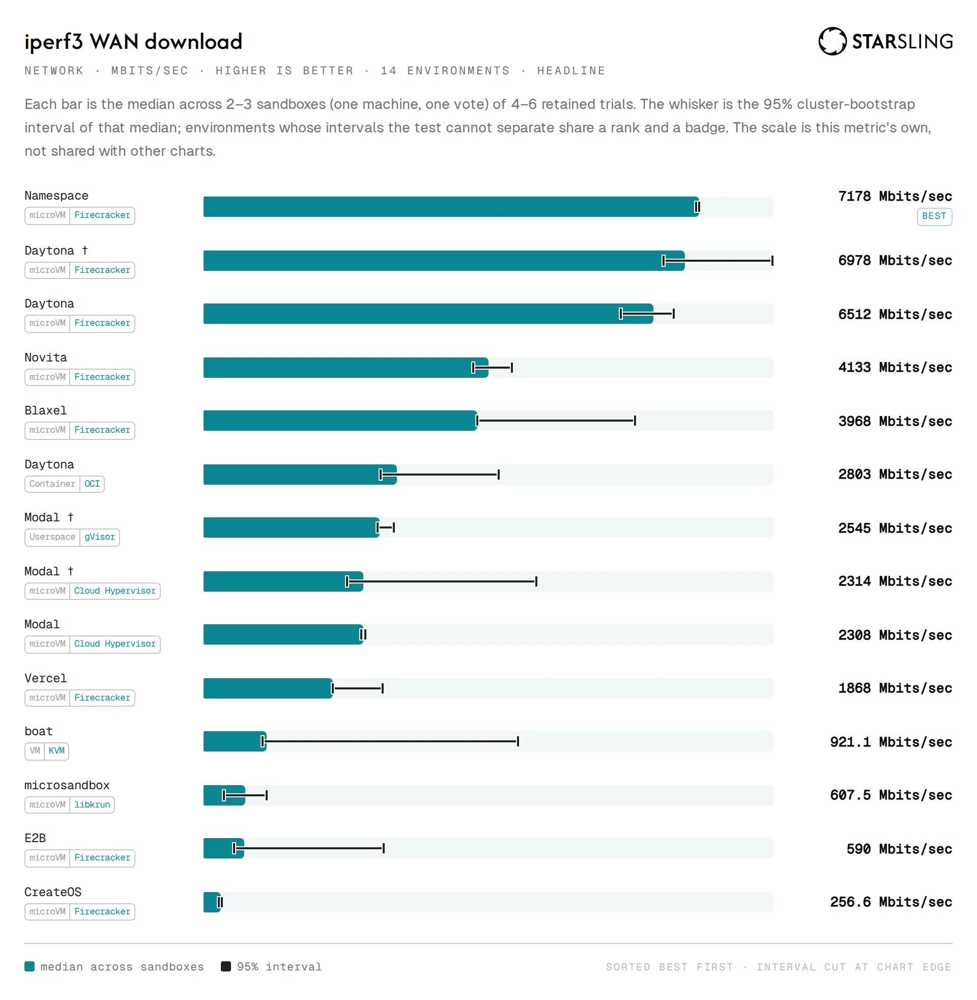

<strong>22 synthetic metrics</strong> · headlines: iperf3 WAN download · iperf3 WAN upload

### iperf3 WAN download _(headline)_

Mbits/sec · higher is better

_Namespace leads on median (higher is better); see notes for how ranks are decided._

| Rank | Provider | iperf3 WAN download (Mbits/sec) | 95% bootstrap interval | Sandboxes | Trials | Note |
| ---: | --- | ---: | ---: | ---: | ---: | --- |
| 1 | Namespace | 7178 | 7117 – 7199 | 3 | 6 | — |
| 2 | Daytona (VM, burst) | 6978 | 6641 – 11340 | 3 | 6 | too few sandboxes |
| 3 | Daytona (VM) | 6512 | 6027 – 6820 | 3 | 6 | too few sandboxes |
| 4 | Novita | 4133 | 3892 – 4476 | 3 | 6 | too few sandboxes |
| 5 | Blaxel | 3968 | 3944 – 6259 | 3 | 6 | too few sandboxes |
| 6 | Daytona (container) | 2803 | 2555 – 4288 | 3 | 6 | too few sandboxes |
| 7 | Modal (gVisor) | 2545 | 2501 – 2764 | 3 | 6 | too few sandboxes |
| 8 | Modal (VM, burst) | 2314 | 2061 – 4833 | 3 | 6 | too few sandboxes |
| 9 | Modal (VM) | 2308 | 2269 – 2358 | 3 | 6 | too few sandboxes |
| 10 | Vercel Sandbox | 1868 | 1858 – 2616 | 3 | 6 | too few sandboxes |
| 11 | boat | 921.1 | 840.9 – 4569 | 3 | 6 | too few sandboxes |
| 12 | Microsandbox Cloud | 607.5 | 280.6 – 934.4 | 2 | 4 | too few sandboxes |
| 13 | E2B | 590 | 423.7 – 2621 | 3 | 6 | too few sandboxes |
| 14 | CreateOS | 256.6 | 213.2 – 274.7 | 3 | 6 | too few sandboxes |

### iperf3 WAN upload _(headline)_

Mbits/sec · higher is better

_Daytona (container) leads · ~1.2× Daytona (VM) on median (higher is better)._

| Rank | Provider | iperf3 WAN upload (Mbits/sec) | 95% bootstrap interval | Sandboxes | Trials | Note |
| ---: | --- | ---: | ---: | ---: | ---: | --- |
| 1 | Daytona (container) | 6646 | 1078 – 6916 | 3 | 6 | — |
| 2 | Daytona (VM) | 5459 | 4615 – 5526 | 3 | 6 | too few sandboxes |
| 3 | Modal (VM, burst) | 5427 | 3730 – 5558 | 3 | 6 | too few sandboxes |
| 4 | Daytona (VM, burst) | 5424 | 5400 – 5615 | 3 | 6 | too few sandboxes |
| 5 | Modal (VM) | 5419 | 4813 – 5477 | 3 | 6 | too few sandboxes |
| 6 | Namespace | 5036 | 3340 – 5209 | 3 | 6 | too few sandboxes |
| 7 | Novita | 3926 | 1047 – 3984 | 3 | 6 | too few sandboxes |
| 8 | Blaxel | 2504 | 2024 – 2508 | 3 | 6 | too few sandboxes |
| 9 | Vercel Sandbox | 2141 | 1685 – 2480 | 3 | 6 | too few sandboxes |
| 10 | E2B | 1695 | 692.3 – 2634 | 3 | 6 | too few sandboxes |
| 11 | boat | 915 | 34.99 – 1635 | 3 | 6 | too few sandboxes |
| 12 | Microsandbox Cloud | 868.4 | 812.4 – 924.4 | 2 | 4 | too few sandboxes |
| 13 | Modal (gVisor) | 776.8 | 247.4 – 2200 | 3 | 6 | too few sandboxes |
| 14 | CreateOS | 768 | 757.2 – 883.2 | 3 | 6 | too few sandboxes |

### iperf3 loopback TCP, 1 stream

Mbits/sec · higher is better

_Novita leads · ~1.7× CreateOS on median (higher is better)._

| Rank | Provider | iperf3 loopback TCP, 1 stream (Mbits/sec) | 95% bootstrap interval | Sandboxes | Trials | Note |
| ---: | --- | ---: | ---: | ---: | ---: | --- |
| 1 | Novita | 160075 | 155500 – 160400 | 3 | 6 | — |
| 2 | CreateOS | 91786 | 84524 – 93680 | 3 | 6 | too few sandboxes |
| 3 | Daytona (VM, burst) | 87529 | 84160 – 89100 | 3 | 6 | too few sandboxes |
| 4 | Daytona (VM) | 81690 | 67010 – 82897 | 3 | 6 | too few sandboxes |
| 5 | Blaxel | 68675 | 68077 – 69720 | 3 | 6 | too few sandboxes |
| 6 | Microsandbox Cloud | 67147 | 65930 – 68370 | 2 | 4 | too few sandboxes |
| 7 | boat | 64430 | 57830 – 93370 | 3 | 6 | too few sandboxes |
| 8 | E2B | 57630 | 48530 – 58710 | 3 | 6 | too few sandboxes |
| 9 | Modal (VM, burst) | 57370 | 55648 – 64700 | 3 | 6 | too few sandboxes |
| 10 | Modal (VM) | 55474 | 46859 – 56750 | 3 | 6 | too few sandboxes |
| 11 | Modal (gVisor) | 49850 | 44140 – 50400 | 3 | 6 | too few sandboxes |
| 12 | Namespace | 36870 | 35670 – 36981 | 3 | 6 | too few sandboxes |
| 13 | Daytona (container) | 34045 | 31455 – 34728 | 3 | 6 | too few sandboxes |
| 14 | Vercel Sandbox | 11506 | 9391 – 18980 | 3 | 6 | too few sandboxes |

### iperf3 loopback TCP, 10 streams

Mbits/sec · higher is better

_Novita leads on median (higher is better); see notes for how ranks are decided._

| Rank | Provider | iperf3 loopback TCP, 10 streams (Mbits/sec) | 95% bootstrap interval | Sandboxes | Trials | Note |
| ---: | --- | ---: | ---: | ---: | ---: | --- |
| 1 | Novita | 148193 | 145218 – 157300 | 3 | 6 | — |
| 2 | CreateOS | 145348 | 141400 – 154290 | 3 | 6 | too few sandboxes |
| 3 | Daytona (VM, burst) | 102000 | 96460 – 102415 | 3 | 6 | too few sandboxes |
| 4 | Daytona (VM) | 98650 | 92590 – 103461 | 3 | 6 | too few sandboxes |
| 5 | Blaxel | 89691 | 88311 – 92505 | 3 | 6 | too few sandboxes |
| 6 | Microsandbox Cloud | 88990 | 88972 – 89003 | 2 | 4 | too few sandboxes |
| 7 | boat | 61818 | 49830 – 64680 | 3 | 6 | too few sandboxes |
| 8 | Modal (VM, burst) | 56220 | 46055 – 62163 | 3 | 6 | too few sandboxes |
| 9 | Modal (VM) | 55040 | 39642 – 59797 | 3 | 6 | too few sandboxes |
| 10 | E2B | 53646 | 52615 – 60750 | 3 | 6 | too few sandboxes |
| 11 | Namespace | 42255 | 41151 – 44057 | 3 | 6 | too few sandboxes |
| 12 | Modal (gVisor) | 41982 | 39730 – 43087 | 3 | 6 | too few sandboxes |
| 13 | Daytona (container) | 34466 | 33770 – 35500 | 3 | 6 | too few sandboxes |
| 14 | Vercel Sandbox | 9339 | 7557 – 12060 | 3 | 6 | too few sandboxes |

### iperf3 loopback UDP, 10G objective

Mbits/sec · higher is better

_Blaxel, boat, CreateOS, Daytona (container), Daytona (VM), Daytona (VM, burst), E2B, Microsandbox Cloud, Modal (gVisor), Modal (VM, burst), Modal (VM), Namespace and Novita share the top on this metric (higher is better)._

| Rank | Provider | iperf3 loopback UDP, 10G objective (Mbits/sec) | 95% bootstrap interval | Sandboxes | Trials | Note |
| ---: | --- | ---: | ---: | ---: | ---: | --- |
| 1 | Blaxel | 9999 | 9999 – 9999 | 3 | 6 | — |
| 1 | boat | 9999 | 9999 – 9999 | 3 | 6 | too few sandboxes, equal medians |
| 1 | CreateOS | 9999 | 9999 – 9999 | 3 | 6 | too few sandboxes, equal medians |
| 1 | Daytona (container) | 9999 | 9999 – 10000 | 3 | 6 | too few sandboxes, equal medians |
| 1 | Daytona (VM) | 9999 | 9999 – 9999 | 3 | 6 | too few sandboxes, equal medians |
| 1 | Daytona (VM, burst) | 9999 | 9999 – 9999 | 3 | 6 | too few sandboxes, equal medians |
| 1 | E2B | 9999 | 9999 – 9999 | 3 | 6 | too few sandboxes, equal medians |
| 1 | Microsandbox Cloud | 9999 | 9999 – 9999 | 2 | 4 | too few sandboxes, equal medians |
| 1 | Modal (gVisor) | 9999 | 9999 – 9999 | 3 | 6 | too few sandboxes, equal medians |
| 1 | Modal (VM, burst) | 9999 | 9999 – 9999 | 3 | 6 | too few sandboxes, equal medians |
| 1 | Modal (VM) | 9999 | 9999 – 9999 | 3 | 6 | too few sandboxes, equal medians |
| 1 | Namespace | 9999 | 9999 – 10000 | 3 | 6 | too few sandboxes, equal medians |
| 1 | Novita | 9999 | 9999 – 9999 | 3 | 6 | too few sandboxes, equal medians |
| 14 | Vercel Sandbox | 9999 | 9986 – 9999 | 3 | 6 | too few sandboxes |

### github.com HTTPS

ms · lower is better

_Namespace leads · Daytona (VM, burst) is ~1.2× higher (lower is better)._

| Rank | Provider | github.com HTTPS (ms) | 95% bootstrap interval | Sandboxes | Trials | Note |
| ---: | --- | ---: | ---: | ---: | ---: | --- |
| 1 | Namespace | 14.4 | 14.15 – 14.94 | 3 | 90 | — |
| 2 | Daytona (VM, burst) | 16.95 | 16.44 – 17.76 | 3 | 90 | too few sandboxes |
| 3 | Daytona (VM) | 17.39 | 16.93 – 18.01 | 3 | 90 | too few sandboxes |
| 4 | Blaxel | 28.13 | 24.06 – 28.79 | 3 | 90 | too few sandboxes |
| 5 | CreateOS | 50.81 | 49.6 – 51.86 | 3 | 90 | too few sandboxes |
| 6 | Daytona (container) | 59.08 | 57.67 – 227.8 | 3 | 90 | too few sandboxes |
| 7 | Modal (VM, burst) | 60.97 | 58.8 – 507.2 | 3 | 90 | too few sandboxes |
| 8 | Modal (gVisor) | 62.9 | 22.31 – 514 | 3 | 90 | too few sandboxes |
| 9 | Modal (VM) | 63.99 | 61.33 – 64.07 | 3 | 90 | too few sandboxes |
| 10 | Vercel Sandbox | 71.08 | 57.87 – 79.1 | 3 | 90 | too few sandboxes |
| 11 | E2B | 96.39 | 94.87 – 98.41 | 3 | 90 | too few sandboxes |
| 12 | boat | 137.9 | 109.3 – 171.9 | 3 | 90 | too few sandboxes |
| 13 | Microsandbox Cloud | 176.8 | 62.9 – 290.6 | 2 | 60 | too few sandboxes |
| 14 | Novita | 559.6 | 554.4 – 564.6 | 3 | 90 | too few sandboxes |

### api.github.com HTTPS

ms · lower is better

_Namespace leads · Daytona (VM, burst) is ~1.2× higher (lower is better)._

| Rank | Provider | api.github.com HTTPS (ms) | 95% bootstrap interval | Sandboxes | Trials | Note |
| ---: | --- | ---: | ---: | ---: | ---: | --- |
| 1 | Namespace | 9.204 | 9.029 – 9.423 | 3 | 90 | — |
| 2 | Daytona (VM, burst) | 11.09 | 11.09 – 11.3 | 3 | 90 | too few sandboxes |
| 3 | Daytona (VM) | 11.16 | 11.14 – 11.47 | 3 | 90 | too few sandboxes |
| 4 | Blaxel | 14.5 | 14.18 – 14.59 | 3 | 90 | too few sandboxes |
| 5 | CreateOS | 24.17 | 22.46 – 24.69 | 3 | 90 | too few sandboxes |
| 6 | Modal (VM, burst) | 25.15 | 25.15 – 192.7 | 3 | 90 | too few sandboxes |
| 7 | Modal (VM) | 25.51 | 25.12 – 25.56 | 3 | 90 | too few sandboxes |
| 8 | Daytona (container) | 26.8 | 26.12 – 91.24 | 3 | 90 | too few sandboxes |
| 9 | Modal (gVisor) | 27.94 | 15.26 – 195.9 | 3 | 90 | too few sandboxes |
| 10 | Microsandbox Cloud | 34.17 | 33.9 – 34.44 | 2 | 60 | too few sandboxes |
| 11 | E2B | 45.36 | 43.82 – 46.42 | 3 | 90 | too few sandboxes |
| 12 | boat | 48.93 | 43.18 – 67.25 | 3 | 90 | too few sandboxes |
| 13 | Vercel Sandbox | 51.8 | 41.16 – 55.25 | 3 | 90 | too few sandboxes |
| 14 | Novita | 192.9 | 191.1 – 195.6 | 3 | 90 | too few sandboxes |

### raw.githubusercontent.com HTTPS

ms · lower is better

_Namespace leads · Daytona (VM, burst) is ~1.2× higher (lower is better)._

| Rank | Provider | raw.githubusercontent.com HTTPS (ms) | 95% bootstrap interval | Sandboxes | Trials | Note |
| ---: | --- | ---: | ---: | ---: | ---: | --- |
| 1 | Namespace | 7.526 | 7.268 – 7.774 | 3 | 90 | — |
| 2 | Daytona (VM, burst) | 9.197 | 9.154 – 9.229 | 3 | 90 | too few sandboxes |
| 3 | Daytona (VM) | 9.203 | 9.055 – 10.01 | 3 | 90 | too few sandboxes |
| 4 | Modal (VM, burst) | 9.998 | 9.766 – 12.83 | 3 | 90 | too few sandboxes |
| 5 | Modal (VM) | 10.08 | 10.04 – 10.71 | 3 | 90 | too few sandboxes |
| 6 | Daytona (container) | 11.78 | 11.5 – 14.22 | 3 | 90 | too few sandboxes |
| 7 | Blaxel | 12.11 | 11.96 – 12.18 | 3 | 90 | too few sandboxes |
| 8 | Modal (gVisor) | 15.59 | 14.14 – 18.56 | 3 | 90 | too few sandboxes |
| 9 | CreateOS | 22.31 | 20.85 – 22.81 | 3 | 90 | too few sandboxes |
| 10 | boat | 25.21 | 24.68 – 67.5 | 3 | 90 | too few sandboxes |
| 11 | E2B | 31.18 | 30.4 – 31.58 | 3 | 90 | too few sandboxes |
| 12 | Novita | 40.66 | 40.47 – 41.15 | 3 | 90 | too few sandboxes |
| 13 | Vercel Sandbox | 44.25 | 41.65 – 50 | 3 | 90 | too few sandboxes |
| 14 | Microsandbox Cloud | 75.62 | 72.73 – 78.51 | 2 | 60 | too few sandboxes |

### registry.npmjs.org HTTPS

ms · lower is better

_Namespace leads · Daytona (VM) is ~1.2× higher (lower is better)._

| Rank | Provider | registry.npmjs.org HTTPS (ms) | 95% bootstrap interval | Sandboxes | Trials | Note |
| ---: | --- | ---: | ---: | ---: | ---: | --- |
| 1 | Namespace | 13.85 | 13.75 – 14.23 | 3 | 90 | — |
| 2 | Daytona (VM) | 16.39 | 16.34 – 16.66 | 3 | 90 | too few sandboxes |
| 3 | Daytona (VM, burst) | 16.59 | 16.33 – 17.48 | 3 | 89 | too few sandboxes |
| 4 | Modal (VM) | 17.44 | 16.88 – 17.88 | 3 | 90 | too few sandboxes |
| 5 | Modal (VM, burst) | 17.49 | 16.84 – 17.5 | 3 | 90 | too few sandboxes |
| 6 | Blaxel | 20.4 | 20.21 – 21.09 | 3 | 90 | too few sandboxes |
| 7 | Daytona (container) | 21.12 | 20.1 – 28.98 | 3 | 90 | too few sandboxes |
| 8 | Modal (gVisor) | 24.27 | 21.3 – 26.08 | 3 | 90 | too few sandboxes |
| 9 | CreateOS | 31.11 | 30.84 – 32.28 | 3 | 90 | too few sandboxes |
| 10 | boat | 38.03 | 25.61 – 40.6 | 3 | 90 | too few sandboxes |
| 11 | E2B | 43.1 | 43.1 – 43.8 | 3 | 90 | too few sandboxes |
| 12 | Vercel Sandbox | 58.91 | 45.15 – 71.13 | 3 | 90 | too few sandboxes |
| 13 | Novita | 62.69 | 61.73 – 64.22 | 3 | 90 | too few sandboxes |
| 14 | Microsandbox Cloud | 79.92 | 78.07 – 81.78 | 2 | 60 | too few sandboxes |

### pypi.org HTTPS

ms · lower is better

_Modal (VM) leads on median (lower is better); see notes for how ranks are decided._

| Rank | Provider | pypi.org HTTPS (ms) | 95% bootstrap interval | Sandboxes | Trials | Note |
| ---: | --- | ---: | ---: | ---: | ---: | --- |
| 1 | Modal (VM) | 10.58 | 10.31 – 10.83 | 3 | 90 | — |
| 2 | Modal (VM, burst) | 10.93 | 10.9 – 17.24 | 3 | 90 | too few sandboxes |
| 3 | Daytona (container) | 12.2 | 12.2 – 16.19 | 3 | 90 | too few sandboxes |
| 4 | Modal (gVisor) | 22.46 | 16.61 – 57.21 | 3 | 90 | too few sandboxes |
| 5 | Namespace | 25.75 | 24.2 – 45.13 | 3 | 90 | too few sandboxes |
| 6 | boat | 26.97 | 25.99 – 75.16 | 3 | 90 | too few sandboxes |
| 7 | CreateOS | 35.79 | 35.72 – 45.8 | 3 | 90 | too few sandboxes |
| 8 | E2B | 36.15 | 35.05 – 38.81 | 3 | 90 | too few sandboxes |
| 9 | Daytona (VM, burst) | 46.52 | 29.72 – 61.66 | 3 | 90 | too few sandboxes |
| 10 | Novita | 46.71 | 46.57 – 48.22 | 3 | 90 | too few sandboxes |
| 11 | Blaxel | 48.63 | 36.91 – 50.14 | 3 | 90 | too few sandboxes |
| 12 | Daytona (VM) | 59.68 | 58.29 – 60.1 | 3 | 90 | too few sandboxes |
| 13 | Vercel Sandbox | 71.45 | 62.71 – 76.51 | 3 | 90 | too few sandboxes |
| 14 | Microsandbox Cloud | 133.1 | 76.69 – 189.5 | 2 | 60 | too few sandboxes |

### files.pythonhosted.org HTTPS

ms · lower is better

_Modal (VM) leads on median (lower is better); see notes for how ranks are decided._

| Rank | Provider | files.pythonhosted.org HTTPS (ms) | 95% bootstrap interval | Sandboxes | Trials | Note |
| ---: | --- | ---: | ---: | ---: | ---: | --- |
| 1 | Modal (VM) | 10.23 | 10.04 – 10.24 | 3 | 90 | — |
| 2 | Modal (VM, burst) | 10.4 | 10.05 – 13.09 | 3 | 90 | too few sandboxes |
| 3 | Daytona (container) | 12.49 | 11.48 – 15.62 | 3 | 90 | too few sandboxes |
| 4 | Modal (gVisor) | 19.28 | 15.8 – 55.48 | 3 | 90 | too few sandboxes |
| 5 | Namespace | 23.85 | 23.3 – 34.27 | 3 | 90 | too few sandboxes |
| 6 | boat | 25.98 | 25.16 – 67.36 | 3 | 90 | too few sandboxes |
| 7 | Blaxel | 32.14 | 26.6 – 32.96 | 3 | 90 | too few sandboxes |
| 8 | E2B | 34.97 | 34.82 – 36.7 | 3 | 90 | too few sandboxes |
| 9 | Novita | 42.37 | 42.03 – 42.54 | 3 | 90 | too few sandboxes |
| 10 | CreateOS | 46.45 | 37.73 – 46.82 | 3 | 90 | too few sandboxes |
| 11 | Daytona (VM, burst) | 51.95 | 51.83 – 54.42 | 3 | 90 | too few sandboxes |
| 12 | Daytona (VM) | 52.74 | 40 – 56.54 | 3 | 90 | too few sandboxes |
| 13 | Vercel Sandbox | 66.87 | 58.48 – 83.55 | 3 | 90 | too few sandboxes |
| 14 | Microsandbox Cloud | 510.5 | 33.18 – 987.8 | 2 | 60 | too few sandboxes |

### ghcr.io/v2 HTTPS

ms · lower is better

_Namespace leads · Daytona (VM) is ~1.2× higher (lower is better)._

| Rank | Provider | ghcr.io/v2 HTTPS (ms) | 95% bootstrap interval | Sandboxes | Trials | Note |
| ---: | --- | ---: | ---: | ---: | ---: | --- |
| 1 | Namespace | 15.16 | 14.97 – 15.69 | 3 | 90 | — |
| 2 | Daytona (VM) | 17.61 | 17.04 – 18.98 | 3 | 90 | too few sandboxes |
| 3 | Daytona (VM, burst) | 17.71 | 17.62 – 17.85 | 3 | 90 | too few sandboxes |
| 4 | Blaxel | 19.93 | 18.19 – 20.02 | 3 | 90 | too few sandboxes |
| 5 | CreateOS | 27.7 | 27 – 28.44 | 3 | 90 | too few sandboxes |
| 6 | Modal (VM) | 33.5 | 33.34 – 33.96 | 3 | 90 | too few sandboxes |
| 7 | Modal (gVisor) | 34.94 | 19.92 – 90.46 | 3 | 90 | too few sandboxes |
| 8 | Modal (VM, burst) | 35.03 | 34.02 – 202.3 | 3 | 90 | too few sandboxes |
| 9 | Daytona (container) | 35.08 | 32.92 – 102.5 | 3 | 90 | too few sandboxes |
| 10 | Vercel Sandbox | 58.99 | 39.25 – 60.13 | 3 | 90 | too few sandboxes |
| 11 | E2B | 111.3 | 109.7 – 111.4 | 3 | 90 | too few sandboxes |
| 12 | Microsandbox Cloud | 133.8 | 132.6 – 135.1 | 2 | 60 | too few sandboxes |
| 13 | boat | 150.3 | 144 – 166.8 | 3 | 90 | too few sandboxes |
| 14 | Novita | 204.2 | 204 – 204.7 | 3 | 90 | too few sandboxes |

### gcr.io/v2 HTTPS

ms · lower is better

_Namespace leads · Daytona (VM, burst) is ~1.2× higher (lower is better)._

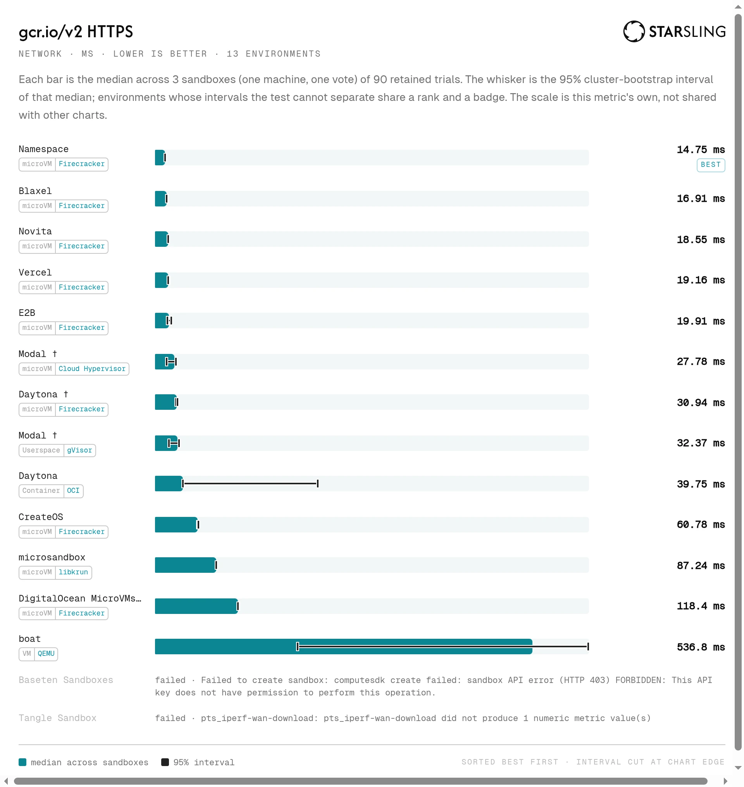

| Rank | Provider | gcr.io/v2 HTTPS (ms) | 95% bootstrap interval | Sandboxes | Trials | Note |
| ---: | --- | ---: | ---: | ---: | ---: | --- |
| 1 | Namespace | 12.37 | 12.11 – 13.36 | 3 | 90 | — |
| 2 | Daytona (VM, burst) | 14.92 | 14.66 – 15.28 | 3 | 90 | too few sandboxes |
| 3 | Daytona (VM) | 15.04 | 14.2 – 15.27 | 3 | 90 | too few sandboxes |
| 4 | Blaxel | 16.84 | 15.66 – 17.16 | 3 | 90 | too few sandboxes |
| 5 | E2B | 18.11 | 17.45 – 20.49 | 3 | 90 | too few sandboxes |
| 6 | Novita | 20.94 | 19.93 – 20.98 | 3 | 90 | too few sandboxes |
| 7 | Modal (VM, burst) | 28.14 | 27.99 – 28.71 | 3 | 90 | too few sandboxes |
| 8 | Modal (VM) | 28.39 | 28.21 – 28.56 | 3 | 90 | too few sandboxes |
| 9 | Modal (gVisor) | 30.61 | 19.02 – 30.68 | 3 | 90 | too few sandboxes |
| 10 | Daytona (container) | 31.54 | 29.4 – 93.76 | 3 | 90 | too few sandboxes |
| 11 | Vercel Sandbox | 53.28 | 40.78 – 64.52 | 3 | 90 | too few sandboxes |
| 12 | CreateOS | 60.78 | 60.05 – 63.3 | 3 | 90 | too few sandboxes |
| 13 | Microsandbox Cloud | 267.8 | 133.9 – 401.7 | 2 | 60 | too few sandboxes |
| 14 | boat | 522.3 | 514.1 – 595.3 | 3 | 90 | too few sandboxes |

### auth.docker.io token HTTPS

ms · lower is better

_Namespace leads · Daytona (VM, burst) is ~1.1× higher (lower is better)._

| Rank | Provider | auth.docker.io token HTTPS (ms) | 95% bootstrap interval | Sandboxes | Trials | Note |
| ---: | --- | ---: | ---: | ---: | ---: | --- |
| 1 | Namespace | 22.4 | 22.18 – 23.24 | 3 | 90 | — |
| 2 | Daytona (VM, burst) | 23.79 | 23.6 – 24.09 | 3 | 90 | too few sandboxes |
| 3 | Daytona (VM) | 24.75 | 24.06 – 26.77 | 3 | 90 | too few sandboxes |
| 4 | Blaxel | 26.66 | 26.19 – 26.94 | 3 | 90 | too few sandboxes |
| 5 | Modal (VM, burst) | 36.67 | 35.82 – 98.98 | 3 | 90 | too few sandboxes |
| 6 | Modal (VM) | 37.53 | 35.27 – 39.99 | 3 | 90 | too few sandboxes |
| 7 | Modal (gVisor) | 38.04 | 28.61 – 111.9 | 3 | 90 | too few sandboxes |
| 8 | CreateOS | 38.17 | 36.21 – 39.2 | 3 | 90 | too few sandboxes |
| 9 | Daytona (container) | 40.98 | 39.95 – 61.69 | 3 | 90 | too few sandboxes |
| 10 | Vercel Sandbox | 55.75 | 52.85 – 70.39 | 3 | 90 | too few sandboxes |
| 11 | boat | 120.4 | 118.8 – 138 | 3 | 90 | too few sandboxes |
| 12 | Novita | 124.3 | 121.5 – 125.4 | 3 | 90 | too few sandboxes |
| 13 | E2B | 125.2 | 121.6 – 125.9 | 3 | 90 | too few sandboxes |
| 14 | Microsandbox Cloud | 148.5 | 140.7 – 156.2 | 2 | 60 | too few sandboxes |

### crates.io HTTPS

ms · lower is better

_Modal (VM) leads on median (lower is better); see notes for how ranks are decided._

| Rank | Provider | crates.io HTTPS (ms) | 95% bootstrap interval | Sandboxes | Trials | Note |
| ---: | --- | ---: | ---: | ---: | ---: | --- |
| 1 | Modal (VM) | 12.48 | 12.42 – 12.94 | 3 | 90 | — |
| 2 | Namespace | 12.67 | 12.14 – 13.53 | 3 | 90 | too few sandboxes |
| 3 | Modal (VM, burst) | 13.06 | 13.05 – 20.44 | 3 | 90 | too few sandboxes |
| 4 | Daytona (VM, burst) | 13.94 | 12.93 – 16.68 | 3 | 90 | too few sandboxes |
| 5 | Daytona (VM) | 14.2 | 13.81 – 15.25 | 3 | 90 | too few sandboxes |
| 6 | Daytona (container) | 15.89 | 14.12 – 19.62 | 3 | 90 | too few sandboxes |
| 7 | Blaxel | 17.25 | 16.35 – 17.68 | 3 | 90 | too few sandboxes |
| 8 | Modal (gVisor) | 18.41 | 17.14 – 27.84 | 3 | 90 | too few sandboxes |
| 9 | boat | 27.53 | 25.63 – 71.18 | 3 | 90 | too few sandboxes |
| 10 | CreateOS | 28.25 | 26.76 – 29.7 | 3 | 90 | too few sandboxes |
| 11 | E2B | 36.92 | 35.49 – 36.92 | 3 | 90 | too few sandboxes |
| 12 | Novita | 45.92 | 45.8 – 46.67 | 3 | 90 | too few sandboxes |
| 13 | Vercel Sandbox | 48.5 | 40.68 – 60.1 | 3 | 90 | too few sandboxes |
| 14 | Microsandbox Cloud | 431.7 | 37.2 – 826.3 | 2 | 60 | too few sandboxes |

### index.crates.io config HTTPS

ms · lower is better

_Namespace leads · Daytona (VM, burst) is ~1.3× higher (lower is better)._

| Rank | Provider | index.crates.io config HTTPS (ms) | 95% bootstrap interval | Sandboxes | Trials | Note |
| ---: | --- | ---: | ---: | ---: | ---: | --- |
| 1 | Namespace | 7.33 | 7.165 – 7.655 | 3 | 90 | — |
| 2 | Daytona (VM, burst) | 9.888 | 9.805 – 10.04 | 3 | 90 | too few sandboxes |
| 3 | Modal (VM) | 10.03 | 9.956 – 10.41 | 3 | 90 | too few sandboxes |
| 4 | Modal (VM, burst) | 10.05 | 9.973 – 13 | 3 | 90 | too few sandboxes |
| 5 | Daytona (VM) | 10.27 | 10.2 – 10.46 | 3 | 90 | too few sandboxes |
| 6 | Blaxel | 11.86 | 11.68 – 12.18 | 3 | 90 | too few sandboxes |
| 7 | Daytona (container) | 12.21 | 11.4 – 14.12 | 3 | 90 | too few sandboxes |
| 8 | Modal (gVisor) | 15.81 | 14.45 – 20.07 | 3 | 90 | too few sandboxes |
| 9 | CreateOS | 22.51 | 20.47 – 23.8 | 3 | 90 | too few sandboxes |
| 10 | boat | 25.91 | 24.02 – 68.1 | 3 | 90 | too few sandboxes |
| 11 | E2B | 32.02 | 31.77 – 34.55 | 3 | 90 | too few sandboxes |
| 12 | Microsandbox Cloud | 33.66 | 33.59 – 33.72 | 2 | 60 | too few sandboxes |
| 13 | Novita | 40.97 | 40.1 – 41.04 | 3 | 90 | too few sandboxes |
| 14 | Vercel Sandbox | 53.8 | 32.57 – 58.93 | 3 | 90 | too few sandboxes |

### github.com cold DNS

ms · lower is better

_Blaxel leads · Daytona (container) is ~1.3× higher (lower is better)._

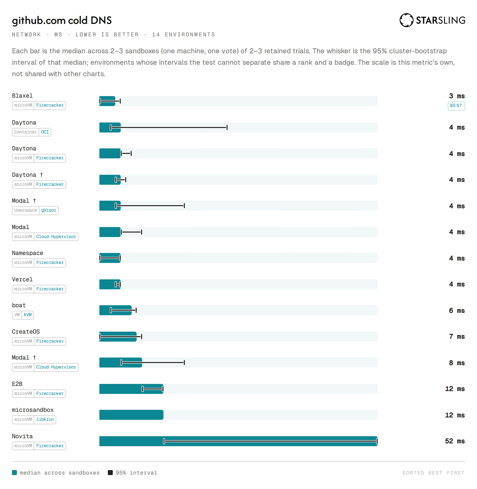

| Rank | Provider | github.com cold DNS (ms) | 95% bootstrap interval | Sandboxes | Trials | Note |
| ---: | --- | ---: | ---: | ---: | ---: | --- |
| 1 | Blaxel | 3 | 0 – 4 | 3 | 3 | — |
| 2 | Daytona (container) | 4 | 2 – 24 | 3 | 3 | too few sandboxes |
| 2 | Daytona (VM) | 4 | 4 – 6 | 3 | 3 | too few sandboxes, equal medians |
| 2 | Daytona (VM, burst) | 4 | 3 – 5 | 3 | 3 | too few sandboxes, equal medians |
| 2 | Modal (gVisor) | 4 | 3 – 16 | 3 | 3 | too few sandboxes, equal medians |
| 2 | Modal (VM) | 4 | 4 – 8 | 3 | 3 | too few sandboxes, equal medians |
| 2 | Namespace | 4 | 0 – 4 | 3 | 3 | too few sandboxes, equal medians |
| 2 | Vercel Sandbox | 4 | 3 – 4 | 3 | 3 | too few sandboxes, equal medians |
| 9 | boat | 6 | 2 – 7 | 3 | 3 | too few sandboxes |
| 10 | CreateOS | 7 | 0 – 8 | 3 | 3 | too few sandboxes |
| 11 | Modal (VM, burst) | 8 | 4 – 16 | 3 | 3 | too few sandboxes |
| 12 | E2B | 12 | 8 – 12 | 3 | 3 | too few sandboxes |
| 12 | Microsandbox Cloud | 12 | 12 – 12 | 2 | 2 | too few sandboxes, equal medians |
| 14 | Novita | 52 | 12 – 52 | 3 | 3 | too few sandboxes |

### registry.npmjs.org cold DNS

ms · lower is better

_Blaxel, Daytona (VM, burst), Modal (VM, burst), Modal (VM) and Namespace share the top on this metric (lower is better)._

| Rank | Provider | registry.npmjs.org cold DNS (ms) | 95% bootstrap interval | Sandboxes | Trials | Note |
| ---: | --- | ---: | ---: | ---: | ---: | --- |
| 1 | Blaxel | 4 | 4 – 4 | 3 | 3 | — |
| 1 | Daytona (VM, burst) | 4 | 4 – 8 | 3 | 3 | too few sandboxes, equal medians |
| 1 | Modal (VM, burst) | 4 | 4 – 20 | 3 | 3 | too few sandboxes, equal medians |
| 1 | Modal (VM) | 4 | 4 – 4 | 3 | 3 | too few sandboxes, equal medians |
| 1 | Namespace | 4 | 0 – 4 | 3 | 3 | too few sandboxes, equal medians |
| 6 | Modal (gVisor) | 5 | 4 – 19 | 3 | 3 | too few sandboxes |
| 7 | Daytona (VM) | 6 | 5 – 10 | 3 | 3 | too few sandboxes |
| 8 | Daytona (container) | 7 | 4 – 19 | 3 | 3 | too few sandboxes |
| 9 | CreateOS | 8 | 8 – 12 | 3 | 3 | too few sandboxes |
| 10 | Microsandbox Cloud | 10 | 8 – 12 | 2 | 2 | too few sandboxes |
| 11 | E2B | 12 | 8 – 12 | 3 | 3 | too few sandboxes |
| 11 | Novita | 12 | 12 – 16 | 3 | 3 | too few sandboxes, equal medians |
| 11 | Vercel Sandbox | 12 | 7 – 12 | 3 | 3 | too few sandboxes, equal medians |
| 14 | boat | 19 | 17 – 25 | 3 | 3 | too few sandboxes |

### docker.io cold DNS

ms · lower is better

_Blaxel leads on median (lower is better); see notes for how ranks are decided._

| Rank | Provider | docker.io cold DNS (ms) | 95% bootstrap interval | Sandboxes | Trials | Note |
| ---: | --- | ---: | ---: | ---: | ---: | --- |
| 1 | Blaxel | 0 | 0 – 3 | 3 | 3 | — |
| 2 | Daytona (container) | 3 | 3 – 19 | 3 | 3 | too few sandboxes |
| 3 | Daytona (VM) | 4 | 4 – 4 | 3 | 3 | too few sandboxes |
| 3 | Daytona (VM, burst) | 4 | 4 – 6 | 3 | 3 | too few sandboxes, equal medians |
| 3 | Modal (gVisor) | 4 | 4 – 41 | 3 | 3 | too few sandboxes, equal medians |
| 3 | Modal (VM) | 4 | 4 – 4 | 3 | 3 | too few sandboxes, equal medians |
| 7 | Vercel Sandbox | 7 | 4 – 8 | 3 | 3 | too few sandboxes |
| 8 | CreateOS | 8 | 4 – 20 | 3 | 3 | too few sandboxes |
| 8 | Microsandbox Cloud | 8 | 8 – 8 | 2 | 2 | too few sandboxes, equal medians |
| 8 | Modal (VM, burst) | 8 | 4 – 16 | 3 | 3 | too few sandboxes, equal medians |
| 11 | Namespace | 12 | 4 – 72 | 3 | 3 | too few sandboxes |
| 12 | boat | 22 | 9 – 30 | 3 | 3 | too few sandboxes |
| 13 | E2B | 44 | 12 – 72 | 3 | 3 | too few sandboxes |
| 14 | Novita | 52 | 20 – 56 | 3 | 3 | too few sandboxes |

### pypi.org cold DNS

ms · lower is better

_Blaxel leads · Vercel Sandbox is ~1.8× higher (lower is better)._

| Rank | Provider | pypi.org cold DNS (ms) | 95% bootstrap interval | Sandboxes | Trials | Note |
| ---: | --- | ---: | ---: | ---: | ---: | --- |
| 1 | Blaxel | 4 | 3 – 4 | 3 | 3 | — |
| 2 | Vercel Sandbox | 7 | 4 – 24 | 3 | 3 | too few sandboxes |
| 3 | Microsandbox Cloud | 8 | 8 – 8 | 2 | 2 | too few sandboxes |
| 4 | boat | 9 | 7 – 22 | 3 | 3 | too few sandboxes |
| 5 | Modal (gVisor) | 14 | 4 – 27 | 3 | 3 | too few sandboxes |
| 6 | Daytona (VM, burst) | 15 | 15 – 19 | 3 | 3 | too few sandboxes |
| 7 | Modal (VM) | 16 | 16 – 20 | 3 | 3 | too few sandboxes |
| 7 | Namespace | 16 | 4 – 68 | 3 | 3 | too few sandboxes, equal medians |
| 9 | Daytona (VM) | 17 | 17 – 17 | 3 | 3 | too few sandboxes |
| 10 | CreateOS | 19 | 15 – 20 | 3 | 3 | too few sandboxes |
| 11 | Daytona (container) | 20 | 11 – 44 | 3 | 3 | too few sandboxes |
| 11 | Novita | 20 | 16 – 56 | 3 | 3 | too few sandboxes, equal medians |
| 13 | Modal (VM, burst) | 24 | 20 – 28 | 3 | 3 | too few sandboxes |
| 14 | E2B | 56 | 28 – 112 | 3 | 3 | too few sandboxes |

### rubygems.org cold DNS

ms · lower is better

_Microsandbox Cloud leads · boat is ~1.9× higher (lower is better)._

| Rank | Provider | rubygems.org cold DNS (ms) | 95% bootstrap interval | Sandboxes | Trials | Note |
| ---: | --- | ---: | ---: | ---: | ---: | --- |
| 1 | Microsandbox Cloud | 16 | 16 – 16 | 2 | 2 | — |
| 2 | boat | 30 | 30 – 85 | 3 | 3 | too few sandboxes |
| 3 | Blaxel | 51 | 51 – 55 | 3 | 3 | too few sandboxes |
| 4 | Namespace | 56 | 56 – 60 | 3 | 3 | too few sandboxes |
| 4 | Vercel Sandbox | 56 | 52 – 59 | 3 | 3 | too few sandboxes, equal medians |
| 6 | Daytona (VM) | 59 | 57 – 116 | 3 | 3 | too few sandboxes |
| 7 | CreateOS | 60 | 59 – 67 | 3 | 3 | too few sandboxes |
| 8 | Daytona (container) | 67 | 30 – 80 | 3 | 3 | too few sandboxes |
| 9 | Modal (gVisor) | 71 | 57 – 109 | 3 | 3 | too few sandboxes |
| 10 | Modal (VM, burst) | 72 | 64 – 176 | 3 | 3 | too few sandboxes |
| 10 | Modal (VM) | 72 | 68 – 76 | 3 | 3 | too few sandboxes, equal medians |
| 12 | Daytona (VM, burst) | 73 | 58 – 75 | 3 | 3 | too few sandboxes |
| 13 | E2B | 176 | 104 – 184 | 3 | 3 | too few sandboxes |
| 14 | Novita | 220 | 84 – 264 | 3 | 3 | too few sandboxes |

### Node 22 download

Mbits/sec · higher is better

_Namespace leads on median (higher is better); see notes for how ranks are decided._

| Rank | Provider | Node 22 download (Mbits/sec) | 95% bootstrap interval | Sandboxes | Trials | Note |
| ---: | --- | ---: | ---: | ---: | ---: | --- |
| 1 | Namespace | 2698 | 2452 – 2874 | 3 | 3 | — |
| 2 | Blaxel | 2684 | 1629 – 3126 | 3 | 3 | too few sandboxes |
| 3 | Daytona (VM) | 2519 | 1692 – 3163 | 3 | 3 | too few sandboxes |
| 4 | Daytona (VM, burst) | 2325 | 1466 – 2670 | 3 | 3 | too few sandboxes |
| 5 | Modal (VM, burst) | 2102 | 1354 – 2130 | 3 | 3 | too few sandboxes |
| 6 | Modal (VM) | 2028 | 1128 – 2189 | 3 | 3 | too few sandboxes |
| 7 | Modal (gVisor) | 1618 | 1542 – 2259 | 3 | 3 | too few sandboxes |
| 8 | Daytona (container) | 1053 | 765.5 – 2214 | 3 | 3 | too few sandboxes |
| 9 | E2B | 984.6 | 150.2 – 1000 | 3 | 3 | too few sandboxes |
| 10 | Vercel Sandbox | 936.4 | 872.2 – 1033 | 3 | 3 | too few sandboxes |
| 11 | Novita | 866.2 | 850.1 – 1353 | 3 | 3 | too few sandboxes |
| 12 | boat | 821.6 | 514.6 – 2310 | 3 | 3 | too few sandboxes |
| 13 | Microsandbox Cloud | 692.3 | 605.5 – 779.1 | 2 | 2 | too few sandboxes |
| 14 | CreateOS | 647.1 | 632.1 – 861.3 | 3 | 3 | too few sandboxes |

## system

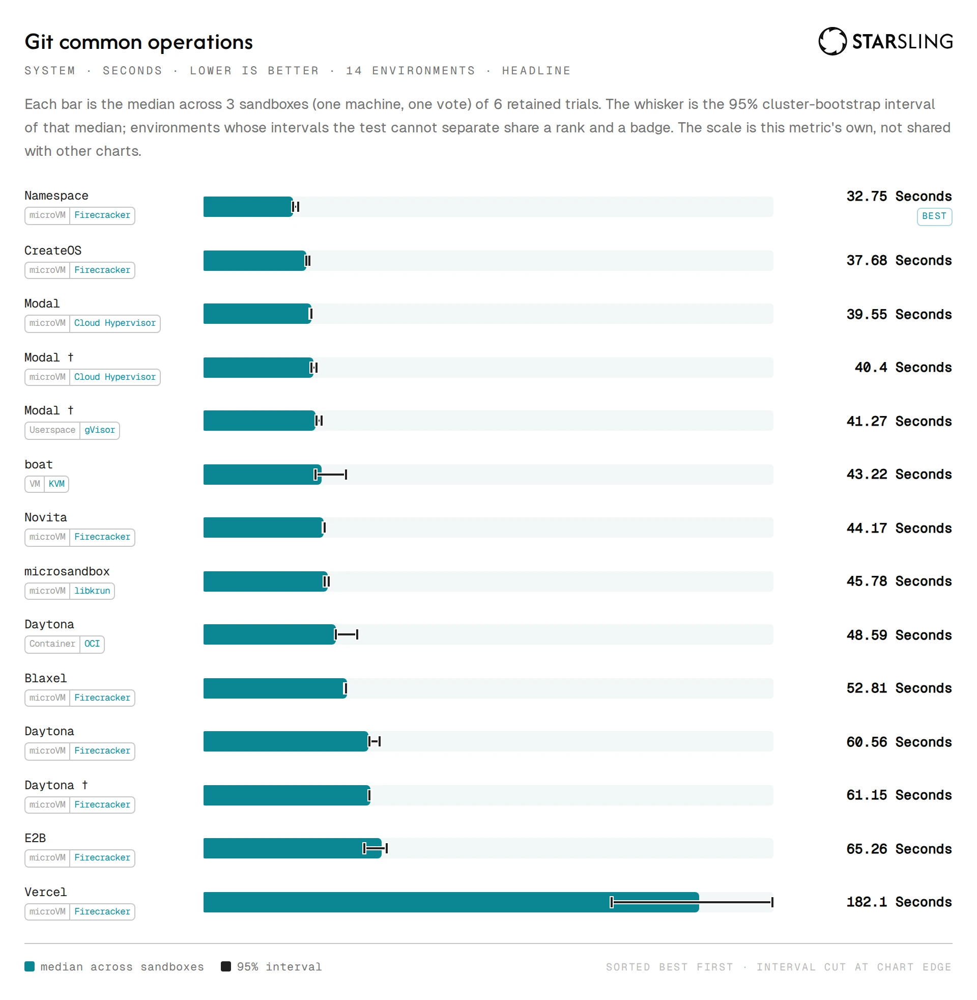

<strong>7 synthetic metrics</strong> · headline: Git common operations

### Git common operations _(headline)_

Seconds · lower is better

_Namespace leads · CreateOS is ~1.2× higher (lower is better)._

| Rank | Provider | Git common operations (Seconds) | 95% bootstrap interval | Sandboxes | Trials | Note |
| ---: | --- | ---: | ---: | ---: | ---: | --- |
| 1 | Namespace | 32.75 | 32.62 – 35.29 | 3 | 6 | — |
| 2 | CreateOS | 37.68 | 37.55 – 39.12 | 3 | 6 | too few sandboxes |
| 3 | Modal (VM) | 39.55 | 39.04 – 40.09 | 3 | 6 | too few sandboxes |
| 4 | Modal (VM, burst) | 40.4 | 39.2 – 42.05 | 3 | 6 | too few sandboxes |
| 5 | Modal (gVisor) | 41.27 | 41.08 – 43.85 | 3 | 6 | too few sandboxes |
| 6 | boat | 43.22 | 40.92 – 52.55 | 3 | 6 | too few sandboxes |
| 7 | Novita | 44.17 | 43.89 – 44.86 | 3 | 6 | too few sandboxes |
| 8 | Microsandbox Cloud | 45.78 | 44.08 – 46.23 | 3 | 6 | too few sandboxes |
| 9 | Daytona (container) | 48.59 | 48.09 – 56.9 | 3 | 6 | too few sandboxes |
| 10 | Blaxel | 52.81 | 51.77 – 52.82 | 3 | 6 | too few sandboxes |
| 11 | Daytona (VM) | 60.56 | 60.53 – 64.95 | 3 | 6 | too few sandboxes |
| 12 | Daytona (VM, burst) | 61.15 | 61.02 – 61.16 | 3 | 6 | too few sandboxes |
| 13 | E2B | 65.26 | 58.79 – 67.75 | 3 | 6 | too few sandboxes |
| 14 | Vercel Sandbox | 182.1 | 149.6 – 282.5 | 3 | 6 | too few sandboxes |

### pgbench RO (s100, 50c)

TPS · higher is better

_Daytona (VM, burst) leads · ~1.4× Modal (gVisor) on median (higher is better)._

| Rank | Provider | pgbench RO (s100, 50c) (TPS) | 95% bootstrap interval | Sandboxes | Trials | Note |
| ---: | --- | ---: | ---: | ---: | ---: | --- |
| 1 | Daytona (VM, burst) | 659100 | 637800 – 674500 | 3 | 6 | — |
| 2 | Modal (gVisor) | 486300 | 439800 – 539000 | 3 | 6 | too few sandboxes |
| 3 | Modal (VM, burst) | 444500 | 413500 – 667600 | 3 | 6 | too few sandboxes |
| 4 | Daytona (VM) | 299800 | 292500 – 301500 | 3 | 6 | too few sandboxes |
| 5 | CreateOS | 278800 | 273200 – 283800 | 3 | 6 | too few sandboxes |
| 6 | Namespace | 257900 | 248100 – 265800 | 3 | 6 | too few sandboxes |
| 7 | Novita | 250200 | 249000 – 294500 | 3 | 6 | too few sandboxes |
| 8 | boat | 246600 | 224800 – 254700 | 3 | 6 | too few sandboxes |
| 9 | Blaxel | 244800 | 220400 – 276100 | 3 | 6 | too few sandboxes |
| 10 | Modal (VM) | 221800 | 217900 – 324400 | 3 | 6 | too few sandboxes |
| 11 | Microsandbox Cloud | 178400 | 167500 – 205100 | 3 | 6 | too few sandboxes |
| 12 | E2B | 163700 | 161100 – 167000 | 3 | 6 | too few sandboxes |
| 13 | Daytona (container) | 83210 | 82610 – 96710 | 3 | 6 | too few sandboxes |
| 14 | Vercel Sandbox | 31780 | 15470 – 34300 | 3 | 6 | too few sandboxes |

### pgbench RO latency (s100, 50c)

ms · lower is better

_Daytona (VM, burst) leads · Modal (gVisor) is ~1.4× higher (lower is better)._

| Rank | Provider | pgbench RO latency (s100, 50c) (ms) | 95% bootstrap interval | Sandboxes | Trials | Note |
| ---: | --- | ---: | ---: | ---: | ---: | --- |
| 1 | Daytona (VM, burst) | 0.0755 | 0.074 – 0.0785 | 3 | 6 | — |
| 2 | Modal (gVisor) | 0.103 | 0.0925 – 0.1135 | 3 | 6 | too few sandboxes |
| 3 | Modal (VM, burst) | 0.1125 | 0.075 – 0.121 | 3 | 6 | too few sandboxes |
| 4 | Daytona (VM) | 0.167 | 0.166 – 0.171 | 3 | 6 | too few sandboxes |
| 5 | CreateOS | 0.18 | 0.1765 – 0.184 | 3 | 6 | too few sandboxes |
| 6 | Namespace | 0.1935 | 0.1885 – 0.202 | 3 | 6 | too few sandboxes |
| 7 | Novita | 0.2 | 0.17 – 0.2005 | 3 | 6 | too few sandboxes |
| 8 | boat | 0.2035 | 0.1965 – 0.2225 | 3 | 6 | too few sandboxes |
| 9 | Blaxel | 0.204 | 0.1815 – 0.2275 | 3 | 6 | too few sandboxes |
| 10 | Modal (VM) | 0.2255 | 0.1545 – 0.2295 | 3 | 6 | too few sandboxes |
| 11 | Microsandbox Cloud | 0.28 | 0.2435 – 0.2985 | 3 | 6 | too few sandboxes |
| 12 | E2B | 0.3055 | 0.2995 – 0.3105 | 3 | 6 | too few sandboxes |
| 13 | Daytona (container) | 0.603 | 0.517 – 0.6055 | 3 | 6 | too few sandboxes |
| 14 | Vercel Sandbox | 1.582 | 1.545 – 3.288 | 3 | 6 | too few sandboxes |

### pgbench RW (s100, 50c)

TPS · higher is better

_Daytona (VM, burst) leads on median (higher is better); see notes for how ranks are decided._

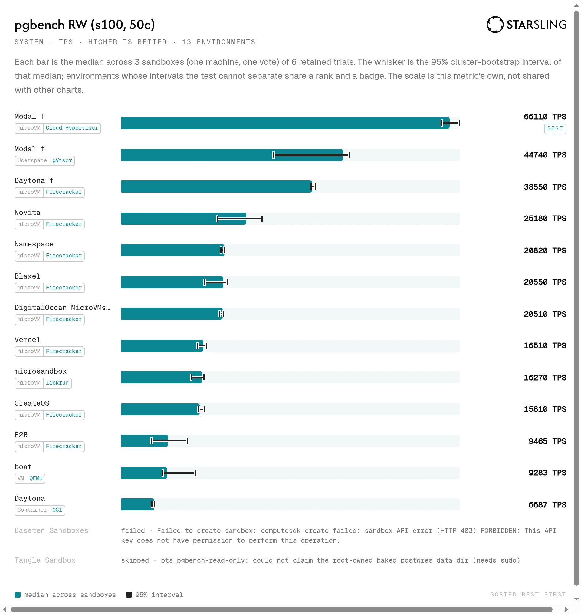

| Rank | Provider | pgbench RW (s100, 50c) (TPS) | 95% bootstrap interval | Sandboxes | Trials | Note |
| ---: | --- | ---: | ---: | ---: | ---: | --- |
| 1 | Daytona (VM, burst) | 39220 | 39130 – 39270 | 3 | 6 | — |
| 2 | Modal (gVisor) | 37500 | 35230 – 41780 | 3 | 6 | too few sandboxes |
| 3 | Modal (VM, burst) | 33360 | 33120 – 38570 | 3 | 6 | too few sandboxes |
| 4 | Daytona (VM) | 22430 | 21950 – 22840 | 3 | 6 | too few sandboxes |
| 5 | Namespace | 21730 | 19780 – 22950 | 3 | 6 | too few sandboxes |
| 6 | Novita | 20080 | 20010 – 26110 | 3 | 6 | too few sandboxes |
| 7 | Modal (VM) | 19260 | 18920 – 21610 | 3 | 6 | too few sandboxes |
| 8 | Blaxel | 17890 | 16350 – 20180 | 3 | 6 | too few sandboxes |
| 9 | CreateOS | 16880 | 15750 – 16990 | 3 | 6 | too few sandboxes |
| 10 | boat | 14820 | 9246 – 15670 | 3 | 6 | too few sandboxes |
| 11 | Microsandbox Cloud | 13970 | 12660 – 14420 | 3 | 6 | too few sandboxes |
| 12 | E2B | 10650 | 9812 – 10750 | 3 | 6 | too few sandboxes |
| 13 | Daytona (container) | 5704 | 5309 – 8028 | 3 | 6 | too few sandboxes |
| 14 | Vercel Sandbox | 1335 | 1045 – 1375 | 3 | 6 | too few sandboxes |

### pgbench RW latency (s100, 50c)

ms · lower is better

_Daytona (VM, burst) leads on median (lower is better); see notes for how ranks are decided._

| Rank | Provider | pgbench RW latency (s100, 50c) (ms) | 95% bootstrap interval | Sandboxes | Trials | Note |
| ---: | --- | ---: | ---: | ---: | ---: | --- |
| 1 | Daytona (VM, burst) | 1.275 | 1.273 – 1.278 | 3 | 6 | — |
| 2 | Modal (gVisor) | 1.333 | 1.196 – 1.42 | 3 | 6 | too few sandboxes |
| 3 | Modal (VM, burst) | 1.499 | 1.298 – 1.51 | 3 | 6 | too few sandboxes |
| 4 | Daytona (VM) | 2.229 | 2.189 – 2.279 | 3 | 6 | too few sandboxes |
| 5 | Namespace | 2.301 | 2.179 – 2.539 | 3 | 6 | too few sandboxes |
| 6 | Novita | 2.493 | 1.918 – 2.501 | 3 | 6 | too few sandboxes |
| 7 | Modal (VM) | 2.596 | 2.314 – 2.644 | 3 | 6 | too few sandboxes |
| 8 | Blaxel | 2.8 | 2.481 – 3.061 | 3 | 6 | too few sandboxes |
| 9 | CreateOS | 2.973 | 2.965 – 3.191 | 3 | 6 | too few sandboxes |
| 10 | boat | 3.378 | 3.192 – 5.415 | 3 | 6 | too few sandboxes |
| 11 | Microsandbox Cloud | 3.579 | 3.466 – 3.949 | 3 | 6 | too few sandboxes |
| 12 | E2B | 4.697 | 4.652 – 5.117 | 3 | 6 | too few sandboxes |
| 13 | Daytona (container) | 8.766 | 6.229 – 9.489 | 3 | 6 | too few sandboxes |
| 14 | Vercel Sandbox | 37.73 | 36.37 – 47.84 | 3 | 6 | too few sandboxes |

### PyBench

Milliseconds · lower is better

_Namespace leads · Daytona (VM) is ~1.2× higher (lower is better)._

| Rank | Provider | PyBench (Milliseconds) | 95% bootstrap interval | Sandboxes | Trials | Note |
| ---: | --- | ---: | ---: | ---: | ---: | --- |
| 1 | Namespace | 365.5 | 361 – 365.5 | 3 | 6 | — |
| 2 | Daytona (VM) | 430.5 | 427 – 440 | 3 | 6 | too few sandboxes |
| 3 | Daytona (VM, burst) | 433.5 | 429 – 435.5 | 3 | 6 | too few sandboxes |
| 4 | Modal (gVisor) | 434.5 | 434 – 462.5 | 3 | 6 | too few sandboxes |
| 5 | Modal (VM) | 435 | 434 – 441 | 3 | 6 | too few sandboxes |
| 6 | Modal (VM, burst) | 436 | 435.5 – 438.5 | 3 | 6 | too few sandboxes |
| 7 | boat | 465.5 | 407.5 – 504 | 3 | 6 | too few sandboxes |
| 8 | Novita | 479.5 | 478.5 – 481 | 3 | 6 | too few sandboxes |
| 9 | E2B | 525 | 510 – 802.5 | 3 | 6 | too few sandboxes |
| 10 | Blaxel | 531.5 | 526.5 – 535 | 3 | 6 | too few sandboxes |
| 11 | Microsandbox Cloud | 553.5 | 545.5 – 651 | 3 | 6 | too few sandboxes |
| 12 | CreateOS | 557 | 552 – 559.5 | 3 | 6 | too few sandboxes |
| 13 | Daytona (container) | 632 | 603.5 – 721.5 | 3 | 6 | too few sandboxes |
| 14 | Vercel Sandbox | 1269 | 1224 – 1942 | 3 | 6 | too few sandboxes |

### SQLite Speedtest

Seconds · lower is better

_Modal (VM) leads on median (lower is better); see notes for how ranks are decided._

| Rank | Provider | SQLite Speedtest (Seconds) | 95% bootstrap interval | Sandboxes | Trials | Note |
| ---: | --- | ---: | ---: | ---: | ---: | --- |
| 1 | Modal (VM) | 35.12 | 34.34 – 50.92 | 3 | 6 | — |
| 2 | Namespace | 35.17 | 31.83 – 36.15 | 3 | 6 | too few sandboxes |
| 3 | Daytona (VM) | 35.27 | 35.17 – 40.88 | 3 | 6 | too few sandboxes |
| 4 | Daytona (VM, burst) | 35.65 | 35.64 – 36.22 | 3 | 6 | too few sandboxes |
| 5 | CreateOS | 38.51 | 36.93 – 39.51 | 3 | 6 | too few sandboxes |
| 6 | Novita | 40.28 | 38.92 – 41.02 | 3 | 6 | too few sandboxes |
| 7 | Blaxel | 51.01 | 49.26 – 51.51 | 3 | 6 | too few sandboxes |
| 8 | Modal (VM, burst) | 52.26 | 51.66 – 56.32 | 3 | 6 | too few sandboxes |
| 9 | E2B | 66.39 | 60.73 – 74.77 | 3 | 6 | too few sandboxes |
| 10 | Microsandbox Cloud | 81.02 | 76 – 81.47 | 3 | 6 | too few sandboxes |
| 11 | Modal (gVisor) | 83.66 | 77.08 – 86.4 | 3 | 6 | too few sandboxes |
| 12 | boat | 89.1 | 88.69 – 95.25 | 3 | 6 | too few sandboxes |
| 13 | Daytona (container) | 111.9 | 107.7 – 129.7 | 3 | 6 | too few sandboxes |
| 14 | Vercel Sandbox | 202.7 | 193.3 – 285.7 | 3 | 6 | too few sandboxes |

## economics

What one run of each realworld pipeline costs, in USD. Lower is better. Not ranked: the two
kinds of cost are not directly comparable.

The first chart plots each environment's three-pipeline total: cost against time, bottom left
best. The three after it show each pipeline's cost per run, the median across sandboxes.

- **Billed**: the provider's own bill rate × pipeline time: each sandbox's bill × its timed
  seconds ÷ its billed seconds.
- **Estimated**: the provider's published prices × pipeline time.

Both price the pipeline's timed steps alone. A sandbox's whole bill also covers boot, setup
and an untimed warm-up of each task; it is under provider bills.

Cost per run table and provider bills

| Pipeline | Provider | Cost | Median USD per run | Lowest – highest | Sandboxes |
| --- | --- | --- | ---: | ---: | ---: |
| Mastra | boat | **Billed** | 0.01695 | 0.01135 – 0.02086 | 11 |
| Mastra | Namespace | **Billed** | 0.06803 | 0.06704 – 0.06931 | 12 |
| Mastra | Novita | Estimated | 0.07969 | 0.07744 – 0.08042 | 12 |
| Mastra | CreateOS | Estimated | 0.07992 | 0.07764 – 0.08148 | 12 |
| Mastra | Microsandbox Cloud | **Billed** | 0.08484 | 0.07209 – 0.08687 | 11 |
| Mastra | Vercel Sandbox | **Billed** | 0.1114 | — | 1 |
| Mastra | Blaxel | Estimated (at most) | 0.1266 | 0.1187 – 0.1332 | 12 |
| Mastra | E2B | Estimated | 0.1634 | 0.1528 – 0.1745 | 12 |
| Mastra | Daytona (VM, burst) | Estimated (at least) | 0.1841 | 0.1822 – 0.187 | 12 |
| Mastra | Daytona (VM) | Estimated (at least) | 0.187 | 0.1851 – 0.1929 | 12 |
| Mastra | Modal (VM, burst) | Estimated (at least) | 0.2342 | 0.2254 – 0.2379 | 12 |
| Mastra | Modal (VM) | **Billed** | 0.2398 | 0.2314 – 0.2446 | 12 |
| Mastra | Modal (gVisor) | Estimated (at least) | 0.2658 | 0.2639 – 0.2857 | 12 |
| Better-Auth | boat | **Billed** | 0.002635 | 0.001692 – 0.004654 | 12 |
| Better-Auth | Namespace | **Billed** | 0.009335 | 0.009174 – 0.009914 | 12 |
| Better-Auth | Novita | Estimated | 0.01188 | 0.01102 – 0.01219 | 12 |
| Better-Auth | Microsandbox Cloud | **Billed** | 0.01256 | 0.01184 – 0.01509 | 12 |
| Better-Auth | CreateOS | Estimated | 0.01542 | 0.0139 – 0.01764 | 12 |
| Better-Auth | Blaxel | Estimated (at most) | 0.01921 | 0.01815 – 0.01988 | 12 |
| Better-Auth | Modal (VM, burst) | **Billed** | 0.02088 | 0.02032 – 0.02483 | 12 |
| Better-Auth | Daytona (VM, burst) | Estimated (at least) | 0.02197 | 0.02006 – 0.02362 | 12 |
| Better-Auth | Daytona (VM) | Estimated (at least) | 0.02526 | 0.02456 – 0.02706 | 12 |
| Better-Auth | E2B | Estimated | 0.02758 | 0.02302 – 0.02987 | 12 |
| Better-Auth | Modal (gVisor) | Estimated (at least) | 0.03201 | 0.03149 – 0.03765 | 12 |
| Better-Auth | Modal (VM) | **Billed** | 0.03292 | 0.0316 – 0.04007 | 11 |
| Better-Auth | Vercel Sandbox | **Billed** | 0.1325 | 0.1121 – 0.1813 | 12 |
| OpenClaw | boat | **Billed** | 0.007205 | 0.005322 – 0.01282 | 12 |
| OpenClaw | Microsandbox Cloud | **Billed** | 0.036 | 0.03452 – 0.03818 | 11 |
| OpenClaw | Namespace | **Billed** | 0.03803 | 0.03635 – 0.03947 | 12 |
| OpenClaw | Novita | Estimated | 0.04397 | 0.04295 – 0.04801 | 12 |
| OpenClaw | CreateOS | Estimated | 0.04683 | 0.04389 – 0.04768 | 6 |
| OpenClaw | Blaxel | Estimated (at most) | 0.06395 | 0.06097 – 0.06744 | 12 |
| OpenClaw | Daytona (VM, burst) | Estimated (at least) | 0.07068 | 0.0674 – 0.0789 | 12 |
| OpenClaw | Daytona (VM) | Estimated (at least) | 0.08286 | 0.08099 – 0.08783 | 12 |
| OpenClaw | E2B | Estimated | 0.1094 | 0.09671 – 0.1171 | 12 |
| OpenClaw | Modal (VM) | **Billed** | 0.1265 | 0.1167 – 0.1523 | 12 |
| OpenClaw | Modal (VM, burst) | **Billed** | 0.1353 | 0.133 – 0.1438 | 12 |
| OpenClaw | Modal (gVisor) | **Billed** | 0.139 | 0.1256 – 0.1593 | 12 |
| OpenClaw | Vercel Sandbox | **Billed** | 0.3087 | — | 1 |

#### Provider bills

What each provider's billing API charged for each whole sandbox (boot, setup and untimed
warm-ups included), read after the sandbox was deleted.
A sandbox with no bill shows why; it never counts as zero. A total appears only when every
sandbox was billed.

| Provider | Billed sandboxes | Total billed (USD) | No bill (reason) |
| --- | ---: | ---: | --- |
| Blaxel | 45 of 56 | — | 11 × `provider_api_error` |
| boat | 56 of 56 | 0.6797 USD | — |
| Daytona (container) | 36 of 56 | — | 20 × `provider_api_error` |
| Daytona (VM) | 0 of 56 | — | 56 × `provider_api_error` |
| Daytona (VM, burst) | 0 of 56 | — | 56 × `provider_api_error` |
| Microsandbox Cloud | 56 of 56 | 3.208 USD | — |
| Modal (gVisor) | 53 of 56 | — | 3 × `provider_api_error` |
| Modal (VM, burst) | 55 of 56 | — | 1 × `provider_api_error` |
| Modal (VM) | 56 of 56 | 11.46 USD | — |
| Namespace | 56 of 56 | 3.059 USD | — |
| Vercel Sandbox | 51 of 56 | — | 5 × `provider_api_error` |

#### Provider bills per suite

Median and lowest – highest bill across the suite's billed sandboxes. A total appears only when
every sandbox in the suite was billed.

| Provider | Suite | Median bill | Lowest – highest | Billed sandboxes | Suite total | No bill (reason) | Source |
| --- | --- | ---: | ---: | ---: | ---: | --- | --- |
| Blaxel | realworld-mastra | 0.1665 USD | 0.1456 – 0.1716 | 9 of 12 | — | 3 × `provider_api_error` | provider-reported |
| Blaxel | realworld-better-auth | 0.05759 USD | 0.05465 – 0.05833 | 9 of 12 | — | 3 × `provider_api_error` | provider-reported |
| Blaxel | realworld-openclaw | 0.1473 USD | 0.1401 – 0.1539 | 10 of 12 | — | 2 × `provider_api_error` | provider-reported |
| Blaxel | cpu-node | 0.01932 USD | 0.01858 – 0.0195 | 3 of 5 | — | 2 × `provider_api_error` | provider-reported |
| Blaxel | system | 0.03312 USD | 0.03303 – 0.0333 | 3 of 3 | 0.09945 USD | — | provider-reported |
| Blaxel | pgbench | 0.061 USD | 0.0609 – 0.06109 | 2 of 3 | — | 1 × `provider_api_error` | provider-reported |
| Blaxel | memory | 0.01076 USD | 0.00966 – 0.01104 | 3 of 3 | 0.03146 USD | — | provider-reported |
| Blaxel | disk | 0.08436 USD | 0.084 – 0.08446 | 3 of 3 | 0.2528 USD | — | provider-reported |
| Blaxel | network | 0.0288 USD | 0.02852 – 0.02889 | 3 of 3 | 0.0862 USD | — | provider-reported |
| boat | realworld-mastra | 0.02063 USD | 0.01617 – 0.02764 | 12 of 12 | 0.2465 USD | — | provider-reported |
| boat | realworld-better-auth | 0.007845 USD | 0.00573 – 0.01152 | 12 of 12 | 0.09702 USD | — | provider-reported |
| boat | realworld-openclaw | 0.01671 USD | 0.01351 – 0.02736 | 12 of 12 | 0.2267 USD | — | provider-reported |
| boat | cpu-node | 0.00371 USD | 0.00304 – 0.00434 | 5 of 5 | 0.01851 USD | — | provider-reported |
| boat | system | 0.00555 USD | 0.00546 – 0.00577 | 3 of 3 | 0.01678 USD | — | provider-reported |
| boat | pgbench | 0.00783 USD | 0.00761 – 0.00791 | 3 of 3 | 0.02335 USD | — | provider-reported |
| boat | memory | 0.00245 USD | 0.00237 – 0.00247 | 3 of 3 | 0.00729 USD | — | provider-reported |
| boat | disk | 0.01041 USD | 0.00954 – 0.01042 | 3 of 3 | 0.03037 USD | — | provider-reported |
| boat | network | 0.0044 USD | 0.00413 – 0.00458 | 3 of 3 | 0.01311 USD | — | provider-reported |
| Daytona (container) | realworld-mastra | 0.001857 USD | 0.0008458 – 0.006207 | 10 of 12 | — | 2 × `provider_api_error` | provider-reported |
| Daytona (container) | realworld-better-auth | 0.006235 USD | 0.006107 – 0.006353 | 10 of 12 | — | 2 × `provider_api_error` | provider-reported |
| Daytona (container) | realworld-openclaw | 0.006373 USD | 0.006334 – 0.006477 | 8 of 12 | — | 4 × `provider_api_error` | provider-reported |
| Daytona (container) | cpu-node | 0.02452 USD | 0.02362 – 0.02562 | 3 of 5 | — | 2 × `provider_api_error` | provider-reported |
| Daytona (container) | system | — | — | 0 of 3 | — | 3 × `provider_api_error` | — |
| Daytona (container) | pgbench | 0.05873 USD | 0.05837 – 0.05997 | 3 of 3 | 0.1771 USD | — | provider-reported |
| Daytona (container) | memory | 0.02723 USD | 0.02712 – 0.02734 | 2 of 3 | — | 1 × `provider_api_error` | provider-reported |
| Daytona (container) | disk | — | — | 0 of 3 | — | 3 × `provider_api_error` | — |
| Daytona (container) | network | — | — | 0 of 3 | — | 3 × `provider_api_error` | — |
| Microsandbox Cloud | realworld-mastra | 0.1171 USD | 0.06909 – 0.1196 | 12 of 12 | 1.347 USD | — | calculated from provider usage |
| Microsandbox Cloud | realworld-better-auth | 0.0391 USD | 0.03665 – 0.0455 | 12 of 12 | 0.4891 USD | — | calculated from provider usage |
| Microsandbox Cloud | realworld-openclaw | 0.08492 USD | 0.00628 – 0.09196 | 12 of 12 | 0.9579 USD | — | calculated from provider usage |
| Microsandbox Cloud | cpu-node | 0.01553 USD | 0.01547 – 0.0161 | 5 of 5 | 0.07842 USD | — | calculated from provider usage |
| Microsandbox Cloud | system | 0.02862 USD | 0.02683 – 0.02906 | 3 of 3 | 0.08452 USD | — | calculated from provider usage |
| Microsandbox Cloud | pgbench | 0.04331 USD | 0.04262 – 0.04338 | 3 of 3 | 0.1293 USD | — | calculated from provider usage |
| Microsandbox Cloud | memory | 0.0187 USD | 0.01606 – 0.01884 | 3 of 3 | 0.05359 USD | — | calculated from provider usage |
| Microsandbox Cloud | disk | 0.002372 USD | 0.002331 – 0.00243 | 3 of 3 | 0.007132 USD | — | calculated from provider usage |
| Microsandbox Cloud | network | 0.02861 USD | 0.002381 – 0.02998 | 3 of 3 | 0.06098 USD | — | calculated from provider usage |
| Modal (gVisor) | realworld-mastra | 0.09692 USD | 0.09635 – 0.1078 | 10 of 12 | — | 2 × `provider_api_error` | provider-reported |
| Modal (gVisor) | realworld-better-auth | 0.04336 USD | 0.04273 – 0.04969 | 11 of 12 | — | 1 × `provider_api_error` | provider-reported |
| Modal (gVisor) | realworld-openclaw | 0.3521 USD | 0.3312 – 0.3906 | 12 of 12 | 4.272 USD | — | provider-reported |
| Modal (gVisor) | cpu-node | 0.008335 USD | 0.008318 – 0.009082 | 5 of 5 | 0.04255 USD | — | provider-reported |
| Modal (gVisor) | system | 0.01283 USD | 0.01228 – 0.0134 | 3 of 3 | 0.03852 USD | — | provider-reported |
| Modal (gVisor) | pgbench | 0.2944 USD | 0.2918 – 0.3012 | 3 of 3 | 0.8873 USD | — | provider-reported |
| Modal (gVisor) | memory | 0.01209 USD | 0.01003 – 0.01564 | 3 of 3 | 0.03776 USD | — | provider-reported |
| Modal (gVisor) | disk | 0.1217 USD | 0.1214 – 0.1224 | 3 of 3 | 0.3656 USD | — | provider-reported |
| Modal (gVisor) | network | 0.01109 USD | 0.01041 – 0.01134 | 3 of 3 | 0.03284 USD | — | provider-reported |
| Modal (VM, burst) | realworld-mastra | 0.1991 USD | 0.1947 – 0.2272 | 11 of 12 | — | 1 × `provider_api_error` | provider-reported |
| Modal (VM, burst) | realworld-better-auth | 0.06591 USD | 0.06452 – 0.07586 | 12 of 12 | 0.7977 USD | — | provider-reported |
| Modal (VM, burst) | realworld-openclaw | 0.297 USD | 0.2912 – 0.3142 | 12 of 12 | 3.601 USD | — | provider-reported |
| Modal (VM, burst) | cpu-node | 0.03732 USD | 0.03717 – 0.03745 | 5 of 5 | 0.1866 USD | — | provider-reported |
| Modal (VM, burst) | system | 0.05606 USD | 0.0556 – 0.05801 | 3 of 3 | 0.1697 USD | — | provider-reported |
| Modal (VM, burst) | pgbench | 0.2107 USD | 0.2095 – 0.211 | 3 of 3 | 0.6312 USD | — | provider-reported |
| Modal (VM, burst) | memory | 0.02157 USD | 0.01651 – 0.02444 | 3 of 3 | 0.06253 USD | — | provider-reported |
| Modal (VM, burst) | disk | 0.1327 USD | 0.1325 – 0.1331 | 3 of 3 | 0.3983 USD | — | provider-reported |
| Modal (VM, burst) | network | 0.05493 USD | 0.05348 – 0.05505 | 3 of 3 | 0.1635 USD | — | provider-reported |
| Modal (VM) | realworld-mastra | 0.3436 USD | 0.3308 – 0.3504 | 12 of 12 | 4.125 USD | — | provider-reported |
| Modal (VM) | realworld-better-auth | 0.1317 USD | 0.04366 – 0.1437 | 12 of 12 | 1.503 USD | — | provider-reported |
| Modal (VM) | realworld-openclaw | 0.318 USD | 0.2968 – 0.3541 | 12 of 12 | 3.842 USD | — | provider-reported |
| Modal (VM) | cpu-node | 0.06066 USD | 0.06008 – 0.06514 | 5 of 5 | 0.3069 USD | — | provider-reported |
| Modal (VM) | system | 0.08285 USD | 0.08225 – 0.08828 | 3 of 3 | 0.2534 USD | — | provider-reported |
| Modal (VM) | pgbench | 0.1564 USD | 0.1561 – 0.1574 | 3 of 3 | 0.4699 USD | — | provider-reported |
| Modal (VM) | memory | 0.02035 USD | 0.01961 – 0.02183 | 3 of 3 | 0.06179 USD | — | provider-reported |
| Modal (VM) | disk | 0.2123 USD | 0.2118 – 0.2128 | 3 of 3 | 0.6369 USD | — | provider-reported |
| Modal (VM) | network | 0.08584 USD | 0.08335 – 0.08794 | 3 of 3 | 0.2571 USD | — | provider-reported |
| Namespace | realworld-mastra | 0.09132 USD | 0.09056 – 0.09284 | 12 of 12 | 1.099 USD | — | calculated from provider usage |
| Namespace | realworld-better-auth | 0.03266 USD | 0.03132 – 0.03343 | 12 of 12 | 0.3896 USD | — | calculated from provider usage |
| Namespace | realworld-openclaw | 0.08866 USD | 0.08564 – 0.09062 | 12 of 12 | 1.059 USD | — | calculated from provider usage |
| Namespace | cpu-node | 0.01208 USD | 0.01142 – 0.01211 | 5 of 5 | 0.05919 USD | — | calculated from provider usage |
| Namespace | system | 0.01823 USD | 0.01741 – 0.01824 | 3 of 3 | 0.05388 USD | — | calculated from provider usage |
| Namespace | pgbench | 0.0426 USD | 0.04259 – 0.04264 | 3 of 3 | 0.1278 USD | — | calculated from provider usage |
| Namespace | memory | 0.009554 USD | 0.009542 – 0.01027 | 3 of 3 | 0.02936 USD | — | calculated from provider usage |
| Namespace | disk | 0.05999 USD | 0.05913 – 0.06018 | 3 of 3 | 0.1793 USD | — | calculated from provider usage |
| Namespace | network | 0.02077 USD | 0.02012 – 0.02081 | 3 of 3 | 0.06171 USD | — | calculated from provider usage |
| Vercel Sandbox | realworld-mastra | 0.2413 USD | 0.05003 – 0.4574 | 9 of 12 | — | 3 × `provider_api_error` | calculated from provider usage |
| Vercel Sandbox | realworld-better-auth | 0.2757 USD | 0.2426 – 0.3726 | 12 of 12 | 3.516 USD | — | calculated from provider usage |
| Vercel Sandbox | realworld-openclaw | 0.5266 USD | 0.3214 – 0.7122 | 10 of 12 | — | 2 × `provider_api_error` | calculated from provider usage |
| Vercel Sandbox | cpu-node | 0.05915 USD | 0.05762 – 0.07551 | 5 of 5 | 0.3118 USD | — | calculated from provider usage |
| Vercel Sandbox | system | 0.07881 USD | 0.07145 – 0.1134 | 3 of 3 | 0.2637 USD | — | calculated from provider usage |
| Vercel Sandbox | pgbench | 0.08041 USD | 0.07634 – 0.08933 | 3 of 3 | 0.2461 USD | — | calculated from provider usage |
| Vercel Sandbox | memory | 0.05454 USD | 0.04807 – 0.06106 | 3 of 3 | 0.1637 USD | — | calculated from provider usage |
| Vercel Sandbox | disk | 0.0698 USD | 0.06484 – 0.07313 | 3 of 3 | 0.2078 USD | — | calculated from provider usage |
| Vercel Sandbox | network | 0.03088 USD | 0.02866 – 0.03553 | 3 of 3 | 0.09507 USD | — | calculated from provider usage |

## Coverage gaps

45 uncovered results across 7 providers (Baseten Sandboxes 9, boat 2, CreateOS 2, Daytona (container) 6, Microsandbox Cloud 10, Modal (VM) 2, Vercel Sandbox 14). A gap is a missing result — the provider **failing to cover** that workload — never a tie or a zero.

Full coverage table

| Provider | Benchmark | Outcome | Detail |
| --- | --- | --- | --- |
| Daytona (container) | realworld-better-auth | ❌ **disk** (skipped) | Insufficient disk: 10.0 GiB free, suite needs 10 GiB |
| Daytona (container) | realworld-mastra | ❌ **disk** (skipped) | Insufficient disk: 10.0 GiB free, suite needs 30 GiB |
| Daytona (container) | realworld-openclaw | ❌ **disk** (skipped) | Insufficient disk: 10.0 GiB free, suite needs 25 GiB |
| Vercel Sandbox | realworld-mastra | **skipped** | pts_realworld-mastra: PTS install of local/realworld-mastra-1.0.0 failed (exit 0, not in list-installed-tests) |
| Baseten Sandboxes | cpu-node | **failed** | Publication withheld for baseten: unresolved cleanup: baseten-realworld-openclaw-r7-a1-9deaeff4-6a82-4b10-8031-c0e66081bacf |
| Baseten Sandboxes | disk | **failed** | Publication withheld for baseten: unresolved cleanup: baseten-realworld-openclaw-r7-a1-9deaeff4-6a82-4b10-8031-c0e66081bacf |
| Baseten Sandboxes | memory | **failed** | Publication withheld for baseten: unresolved cleanup: baseten-realworld-openclaw-r7-a1-9deaeff4-6a82-4b10-8031-c0e66081bacf |
| Baseten Sandboxes | network | **failed** | Publication withheld for baseten: unresolved cleanup: baseten-realworld-openclaw-r7-a1-9deaeff4-6a82-4b10-8031-c0e66081bacf |
| Baseten Sandboxes | pgbench | **failed** | Publication withheld for baseten: unresolved cleanup: baseten-realworld-openclaw-r7-a1-9deaeff4-6a82-4b10-8031-c0e66081bacf |
| Baseten Sandboxes | realworld-better-auth | **failed** | Publication withheld for baseten: unresolved cleanup: baseten-realworld-openclaw-r7-a1-9deaeff4-6a82-4b10-8031-c0e66081bacf |
| Baseten Sandboxes | realworld-mastra | **failed** | Publication withheld for baseten: unresolved cleanup: baseten-realworld-openclaw-r7-a1-9deaeff4-6a82-4b10-8031-c0e66081bacf |
| Baseten Sandboxes | realworld-openclaw | **failed** | Publication withheld for baseten: unresolved cleanup: baseten-realworld-openclaw-r7-a1-9deaeff4-6a82-4b10-8031-c0e66081bacf |
| Baseten Sandboxes | system | **failed** | Publication withheld for baseten: unresolved cleanup: baseten-realworld-openclaw-r7-a1-9deaeff4-6a82-4b10-8031-c0e66081bacf |
| boat | realworld-mastra | **failed** | PTS ran but every trial failed for 1 of 5 declared metrics: realworld_mastra_task_test_core (realworld-mastra/pts_realworld-mastra.xml) — attempted, no value recorded |
| boat | realworld-mastra | **failed** | Partial publication withheld unverified measurements: realworld_mastra_task_test_core |
| CreateOS | realworld-openclaw | **failed** | Failed to create sandbox: computesdk create failed: service unavailable |
| CreateOS | realworld-openclaw | **failed** | Partial publication withheld unverified measurements: realworld_openclaw_task_git_clone, realworld_openclaw_task_cold_install, realworld_openclaw_task_lint_oxlint, realworld_openclaw_task_lint_extensions_all, realworld_openclaw_task_typecheck, realworld_openclaw_task_test_types |
| Daytona (container) | realworld-better-auth | **failed** | Partial publication withheld unverified measurements: realworld_better_auth_task_git_clone, realworld_better_auth_task_cold_install, realworld_better_auth_task_lint_biome, realworld_better_auth_task_lint_deps_knip, realworld_better_auth_task_lint_format, realworld_better_auth_task_lint_spell, realworld_better_auth_task_lint_types, realworld_better_auth_task_lint_packages, realworld_better_auth_task_typecheck, realworld_better_auth_task_build |
| Daytona (container) | realworld-mastra | **failed** | Partial publication withheld unverified measurements: realworld_mastra_task_git_clone, realworld_mastra_task_cold_install, realworld_mastra_task_lint_format, realworld_mastra_task_build_core, realworld_mastra_task_test_core |
| Daytona (container) | realworld-openclaw | **failed** | Partial publication withheld unverified measurements: realworld_openclaw_task_git_clone, realworld_openclaw_task_cold_install, realworld_openclaw_task_lint_oxlint, realworld_openclaw_task_lint_extensions_all, realworld_openclaw_task_typecheck, realworld_openclaw_task_test_types |
| Microsandbox Cloud | disk | **failed** | computesdk exec failed: runtime error: timed out connecting to cloud sandbox agent "bench-cloud-e797ac3b-140b-4474-876d-95711c52e355" after 10s |
| Microsandbox Cloud | disk | **failed** | Partial publication withheld unverified measurements: hardlink_bogo_ops_per_s, fio_type_sequential_read_engine_linux_aio_direct_yes_block_size_1mb_job_count_1_disk_target_default_test_directory_mb_per_s, fio_type_sequential_read_engine_linux_aio_direct_yes_block_size_1mb_job_count_1_disk_target_default_test_directory_iops, fio_type_sequential_write_engine_linux_aio_direct_yes_block_size_1mb_job_count_1_disk_target_default_test_directory_mb_per_s, fio_type_sequential_write_engine_linux_aio_direct_yes_block_size_1mb_job_count_1_disk_target_default_test_directory_iops, fio_type_random_read_engine_linux_aio_direct_yes_block_size_4kb_job_count_1_disk_target_default_test_directory_mb_per_s, fio_type_random_read_engine_linux_aio_direct_yes_block_size_4kb_job_count_1_disk_target_default_test_directory_iops, fio_type_random_write_engine_linux_aio_direct_yes_block_size_4kb_job_count_1_disk_target_default_test_directory_mb_per_s, fio_type_random_write_engine_linux_aio_direct_yes_block_size_4kb_job_count_1_disk_target_default_test_directory_iops |
| Microsandbox Cloud | disk | **failed** | computesdk exec failed: runtime error: timed out connecting to cloud sandbox agent "bench-cloud-82a0e2b6-bfd8-43b3-b847-7ec2caaa70c5" after 10s |
| Microsandbox Cloud | disk | **failed** | computesdk exec failed: runtime error: timed out connecting to cloud sandbox agent "bench-cloud-b98bd17d-13c4-4061-bf71-f6e00ab40bf8" after 10s |
| Microsandbox Cloud | network | **failed** | computesdk exec failed: runtime error: timed out connecting to cloud sandbox agent "bench-cloud-34bbb56e-5f4c-4756-86f7-7811bbd6826d" after 10s |
| Microsandbox Cloud | network | **failed** | Partial publication withheld unverified measurements: iperf_server_address_localhost_server_port_5201_duration_10_seconds_test_tcp_parallel_1, iperf_server_address_localhost_server_port_5201_duration_10_seconds_test_tcp_parallel_10, iperf_server_address_localhost_server_port_5201_duration_10_seconds_test_udp_10000mbit_objective_parallel_1, iperf_wan_direction_download, iperf_wan_direction_upload, network_https_github_com_total_ms, network_https_api_github_com_total_ms, network_https_raw_githubusercontent_com_total_ms, network_https_registry_npmjs_org_total_ms, network_https_pypi_org_total_ms, network_https_files_pythonhosted_org_total_ms, network_https_ghcr_io_v2_total_ms, network_https_gcr_io_v2_total_ms, network_https_auth_docker_io_registry_token_total_ms, network_https_crates_io_total_ms, network_https_index_crates_io_config_total_ms, network_dns_cold_github_com_ms, network_dns_cold_registry_npmjs_org_ms, network_dns_cold_docker_io_ms, network_dns_cold_pypi_org_ms, network_dns_cold_rubygems_org_ms, network_download_node_v22_23_1_linux_x64_mbits_per_sec |
| Microsandbox Cloud | realworld-mastra | **failed** | PTS ran but every trial failed for 1 of 5 declared metrics: realworld_mastra_task_test_core (realworld-mastra/pts_realworld-mastra.xml) — attempted, no value recorded |
| Microsandbox Cloud | realworld-mastra | **failed** | Partial publication withheld unverified measurements: realworld_mastra_task_test_core |
| Microsandbox Cloud | realworld-openclaw | **failed** | computesdk background launch failed: runtime error: timed out connecting to cloud sandbox agent "bench-cloud-9a25f3de-48f1-4b2e-afbb-b690da70bc33" after 10s |
| Microsandbox Cloud | realworld-openclaw | **failed** | Partial publication withheld unverified measurements: realworld_openclaw_task_git_clone, realworld_openclaw_task_cold_install, realworld_openclaw_task_lint_oxlint, realworld_openclaw_task_lint_extensions_all, realworld_openclaw_task_typecheck, realworld_openclaw_task_test_types |
| Modal (VM) | realworld-better-auth | **failed** | computesdk exec failed: Modal control operation exceeded 5000ms |
| Modal (VM) | realworld-better-auth | **failed** | Partial publication withheld unverified measurements: realworld_better_auth_task_git_clone, realworld_better_auth_task_cold_install, realworld_better_auth_task_lint_biome, realworld_better_auth_task_lint_deps_knip, realworld_better_auth_task_lint_format, realworld_better_auth_task_lint_spell, realworld_better_auth_task_lint_types, realworld_better_auth_task_lint_packages, realworld_better_auth_task_typecheck, realworld_better_auth_task_build |
| Vercel Sandbox | realworld-mastra | **failed** | PTS ran but every trial failed for 3 of 5 declared metrics: realworld_mastra_task_build_core (realworld-mastra/pts_realworld-mastra.xml), realworld_mastra_task_cold_install (realworld-mastra/pts_realworld-mastra.xml), realworld_mastra_task_test_core (realworld-mastra/pts_realworld-mastra.xml) — attempted, no value recorded |
| Vercel Sandbox | realworld-mastra | **failed** | Partial publication withheld unverified measurements: realworld_mastra_task_cold_install, realworld_mastra_task_build_core, realworld_mastra_task_test_core |
| Vercel Sandbox | realworld-mastra | **failed** | Step "REALWORLD_TASK_TIMEOUT_SECONDS=2400 mise run benchmark:realworld:pts:mastra" timed out after 4800s |
| Vercel Sandbox | realworld-mastra | **failed** | Partial publication withheld unverified measurements: realworld_mastra_task_git_clone, realworld_mastra_task_cold_install, realworld_mastra_task_lint_format, realworld_mastra_task_build_core, realworld_mastra_task_test_core |
| Vercel Sandbox | realworld-mastra | **failed** | Suite "realworld-mastra" on vercel produced no pts_*.xml — PTS likely failed silently |
| Vercel Sandbox | realworld-mastra | **failed** | PTS ran but every trial failed for 1 of 5 declared metrics: realworld_mastra_task_test_core (realworld-mastra/pts_realworld-mastra.xml) — attempted, no value recorded |
| Vercel Sandbox | realworld-mastra | **failed** | Partial publication withheld unverified measurements: realworld_mastra_task_test_core |
| Vercel Sandbox | realworld-openclaw | **failed** | PTS ran but every trial failed for 1 of 6 declared metrics: realworld_openclaw_task_lint_oxlint (realworld-openclaw/pts_realworld-openclaw.xml) — attempted, no value recorded |
| Vercel Sandbox | realworld-openclaw | **failed** | Partial publication withheld unverified measurements: realworld_openclaw_task_lint_oxlint |
| Vercel Sandbox | realworld-openclaw | **failed** | Step "mise run benchmark:realworld:pts:openclaw" timed out after 4800s |
| Vercel Sandbox | realworld-openclaw | **failed** | Partial publication withheld unverified measurements: realworld_openclaw_task_git_clone, realworld_openclaw_task_cold_install, realworld_openclaw_task_lint_oxlint, realworld_openclaw_task_lint_extensions_all, realworld_openclaw_task_typecheck, realworld_openclaw_task_test_types |
| Vercel Sandbox | realworld-openclaw | **failed** | PTS ran but every trial failed for 2 of 6 declared metrics: realworld_openclaw_task_lint_extensions_all (realworld-openclaw/pts_realworld-openclaw.xml), realworld_openclaw_task_lint_oxlint (realworld-openclaw/pts_realworld-openclaw.xml) — attempted, no value recorded |
| Vercel Sandbox | realworld-openclaw | **failed** | Partial publication withheld unverified measurements: realworld_openclaw_task_lint_oxlint, realworld_openclaw_task_lint_extensions_all |

**skipped** — a precondition said no before the benchmark was attempted. A ❌ **disk** skip is the
loud one: the provider could not supply the disk the suite needs, so the workload does not run on
its current allocation at all. That is a structural absence, not a slow result.

**failed** — the benchmark was attempted and broke: it threw, timed out, or died with the sandbox.
Unlike a skip, this is a reliability fact about the provider, not a decision made on its behalf.

How rankings are decided

The value is the median of the PER-SANDBOX medians — one machine, one vote — not the median of all
trials pooled together. Pooling would weight each machine by how many trials it ran, and the harness
chooses that count adaptively by watching the variance, so the noisiest machine would carry the most
weight in the published number. The median, not the mean, because a single stalled pass drags a mean
far more than it moves a median.

The interval is a cluster bootstrap of that same statistic (10,000 resamples, seeded from the Run id
so the table is reproducible byte-for-byte): whole sandboxes are resampled with replacement, keeping
each machine's trials intact.

**The interval is labelled 95%, and at these sandbox counts it does not achieve 95%.** Coverage is a
property of how many machines were measured, not of the estimator: simulated at ≈77% for 3 sandboxes,
≈92% at 6, and ≈95% at 20. No percentile bootstrap reaches nominal coverage at 3 clusters. Read a
3-sandbox interval as a resampling envelope over three machines, **not** as a calibrated frequentist
confidence interval. Within-sandbox trials may also be dependent on host scheduling.

Rows are separated only when Mann-Whitney U (two-sided, α = 0.05, enumerated exactly
over the permutation null rather than approximated) finds evidence of stochastic ordering — at these
sample sizes the normal approximation can report a p the exact test cannot actually produce. Where
replicate sandboxes exist that test runs on the PER-SANDBOX MEDIANS, so whole machines are the
exchangeable unit; testing pooled trials instead would treat repeated measurements of one machine as
independent evidence about the provider. KS is reported separately for distribution *shape* and does
not drive the ranking.

**A Note cell always says why a rank is shared, and the reasons are not interchangeable.**
`tied` — the test could have separated those providers and did not, so a faster median earned
inside the noise is not a faster provider. This is the only note that claims two providers are
statistically indistinguishable.
`equal medians` / `equal values` — arithmetic, not a finding: the ranking sorts on the value,
and two identical values have no order between them. It says nothing about the distributions.

Each metric is measured on several independent sandboxes (the **Sandboxes** column), and within each
sandbox the benchmark runs several trials (**Trials**). Trials capture within-machine noise —
neighbours, host contention, virtualization; sandboxes capture the machine-to-machine variation a
user actually experiences when they start a new environment. The ranking and its interval both treat
the SANDBOX as the unit, so more trials on the same machine never make a row look better-evidenced.
Under adaptive trial counts a large **Trials** figure is in fact a sign the machines were unstable
(the harness kept re-running), not that the estimate is precise.

At the sandbox counts this suite produces, a non-significant result means *not enough evidence to
separate*, never *the providers are equal*.

`too few sandboxes` is the extreme of that: the deciding test's best attainable p already exceeds α,
so it could not have separated the rows at any effect size, however far apart their values are.
The floor is a property of the design — here 2 v 3 sandboxes floors at p ≈ 0.10; 2 v 3 sandboxes floors at p ≈ 0.20; 2 v 3 sandboxes floors at p ≈ 0.40; 2 v 3 sandboxes floors at p ≈ 0.60; 3 v 2 sandboxes floors at p ≈ 0.10; 3 v 2 sandboxes floors at p ≈ 0.20; 3 v 2 sandboxes floors at p ≈ 0.40; 3 v 2 sandboxes floors at p ≈ 0.60; 3 v 2 sandboxes floors at p ≈ 1.0; 3 v 3 sandboxes floors at p ≈ 0.10; 3 v 3 sandboxes floors at p ≈ 0.20; 3 v 3 sandboxes floors at p ≈ 0.30; 3 v 3 sandboxes floors at p ≈ 0.40; 3 v 3 sandboxes floors at p ≈ 0.60; 3 v 3 sandboxes floors at p ≈ 1.0.
At three sandboxes a side the floor is 2/C(6,3) = 0.1, which is above α, so **no** three-sandbox
comparison in this table can ever be declared separated. That is a fact about the replicate count,
not about the providers. One shape can appear more than once above with different floors: ties
among a provider's per-sandbox medians raise the floor further (to 1.0 when every median in the
comparison is equal), so the count alone does not determine it.
Such rows are ranked on their observed medians and are **not** claimed to be tied — read the gap
between the values, and treat the p-value as unable to settle them either way. Where such a row
nevertheless shares the rank above it, the note reads `equal medians`: the two values are simply
identical, which is the ranking having nothing to order them by — never a finding that the
providers are alike.

### Pairwise tests (vs. row above)

`p vs. above` is the SANDBOX-LEVEL test that decides the rank wherever replicate sandboxes exist —
Mann-Whitney U on each provider's per-sandbox medians, whole machines as the exchangeable unit.
(Only where a provider ran in a single sandbox does it fall back to Mann-Whitney on pooled trials,
which treats repeated measurements of one machine as independent and is anti-conservative.)
`p (KS)` is Kolmogorov-Smirnov on distribution
*shape* — it does not drive the ranking. A tied Mann-Whitney beside a small KS often means the
same typical speed with different behaviour (e.g. bimodal stalls).
These are unadjusted, exploratory per-comparison p-values; no family-wise or false-discovery-rate
correction is applied across providers or metrics.

| Dimension | Metric | Provider | p vs. above | p (KS) |
| --- | --- | --- | ---: | ---: |
| realworld | Mastra: cold install | Daytona (VM, burst) | — | — |
| realworld | Mastra: cold install | Namespace | <0.001 | <0.001 |
| realworld | Mastra: cold install | Modal (VM, burst) | 0.033 | 0.0046 |
| realworld | Mastra: cold install | Daytona (VM) | 0.22 (tied) | 0.19 |
| realworld | Mastra: cold install | Modal (VM) | 0.0045 | <0.001 |
| realworld | Mastra: cold install | Modal (gVisor) | <0.001 | <0.001 |
| realworld | Mastra: cold install | Novita | 0.44 (tied) | 0.19 |
| realworld | Mastra: cold install | Blaxel | 0.0018 | 0.0046 |
| realworld | Mastra: cold install | Microsandbox Cloud | <0.001 | <0.001 |
| realworld | Mastra: cold install | CreateOS | 0.93 (tied) | 0.19 |
| realworld | Mastra: cold install | E2B | 0.14 (tied) | 0.19 |
| realworld | Mastra: cold install | boat | 0.55 (tied) | 0.066 |
| realworld | Mastra: cold install | Vercel Sandbox | — | — |
| realworld | Better-Auth: build | Modal (VM, burst) | — | — |
| realworld | Better-Auth: build | Modal (gVisor) | 0.0029 | <0.001 |
| realworld | Better-Auth: build | Daytona (VM, burst) | 0.55 (tied) | 0.43 |
| realworld | Better-Auth: build | Namespace | <0.001 | <0.001 |
| realworld | Better-Auth: build | Daytona (VM) | <0.001 | <0.001 |
| realworld | Better-Auth: build | Modal (VM) | 0.29 (tied) | 0.20 |
| realworld | Better-Auth: build | Novita | <0.001 | <0.001 |
| realworld | Better-Auth: build | CreateOS | 0.024 | <0.001 |
| realworld | Better-Auth: build | Blaxel | 0.20 (tied) | 0.066 |
| realworld | Better-Auth: build | Microsandbox Cloud | 0.32 (tied) | 0.19 |
| realworld | Better-Auth: build | boat | 0.068 (tied) | 0.019 |
| realworld | Better-Auth: build | E2B | 0.89 (tied) | 0.19 |
| realworld | Better-Auth: build | Vercel Sandbox | <0.001 | <0.001 |
| realworld | Better-Auth: cold install | Daytona (VM, burst) | — | — |
| realworld | Better-Auth: cold install | Namespace | <0.001 | <0.001 |
| realworld | Better-Auth: cold install | Daytona (VM) | <0.001 | <0.001 |
| realworld | Better-Auth: cold install | Modal (VM, burst) | <0.001 | <0.001 |
| realworld | Better-Auth: cold install | Novita | 0.0019 | <0.001 |
| realworld | Better-Auth: cold install | Modal (VM) | 0.74 (tied) | 0.65 |
| realworld | Better-Auth: cold install | Microsandbox Cloud | <0.001 | <0.001 |
| realworld | Better-Auth: cold install | Blaxel | 0.55 (tied) | 0.066 |
| realworld | Better-Auth: cold install | Modal (gVisor) | 0.38 (tied) | 0.43 |
| realworld | Better-Auth: cold install | boat | 0.039 | <0.001 |
| realworld | Better-Auth: cold install | E2B | 0.48 (tied) | 0.79 |
| realworld | Better-Auth: cold install | CreateOS | 0.51 (tied) | 0.43 |
| realworld | Better-Auth: cold install | Vercel Sandbox | <0.001 | <0.001 |
| realworld | Better-Auth: git clone | Namespace | — | — |
| realworld | Better-Auth: git clone | Daytona (VM) | <0.001 | <0.001 |
| realworld | Better-Auth: git clone | Modal (VM, burst) | 0.99 (tied) | 0.79 |
| realworld | Better-Auth: git clone | Modal (VM) | 0.92 (tied) | 0.97 |
| realworld | Better-Auth: git clone | Blaxel | 0.042 | 0.0019 |
| realworld | Better-Auth: git clone | Modal (gVisor) | 0.17 (tied) | 0.43 |
| realworld | Better-Auth: git clone | Daytona (VM, burst) | <0.001 | <0.001 |
| realworld | Better-Auth: git clone | E2B | <0.001 | <0.001 |
| realworld | Better-Auth: git clone | CreateOS | 0.76 (tied) | 0.43 |
| realworld | Better-Auth: git clone | Microsandbox Cloud | 0.89 (tied) | 0.19 |
| realworld | Better-Auth: git clone | boat | 0.13 (tied) | 0.066 |
| realworld | Better-Auth: git clone | Novita | 0.43 (tied) | 0.43 |
| realworld | Better-Auth: git clone | Vercel Sandbox | 0.43 (tied) | 0.43 |
| realworld | Better-Auth: lint (Biome) | Daytona (VM, burst) | — | — |
| realworld | Better-Auth: lint (Biome) | Modal (VM, burst) | 0.014 | 0.019 |
| realworld | Better-Auth: lint (Biome) | Namespace | <0.001 | <0.001 |
| realworld | Better-Auth: lint (Biome) | Daytona (VM) | <0.001 | <0.001 |
| realworld | Better-Auth: lint (Biome) | Modal (VM) | 0.0017 | 0.0076 |
| realworld | Better-Auth: lint (Biome) | Novita | <0.001 | 0.0014 |
| realworld | Better-Auth: lint (Biome) | Microsandbox Cloud | <0.001 | <0.001 |
| realworld | Better-Auth: lint (Biome) | Blaxel | 0.29 (tied) | 0.19 |
| realworld | Better-Auth: lint (Biome) | CreateOS | 0.93 (tied) | 0.19 |
| realworld | Better-Auth: lint (Biome) | boat | 0.67 (tied) | 0.79 |
| realworld | Better-Auth: lint (Biome) | E2B | 0.045 | 0.0046 |
| realworld | Better-Auth: lint (Biome) | Modal (gVisor) | <0.001 | <0.001 |
| realworld | Better-Auth: lint (Biome) | Vercel Sandbox | <0.001 | <0.001 |
| realworld | Better-Auth: lint deps (Knip) | Namespace | — | — |
| realworld | Better-Auth: lint deps (Knip) | Daytona (VM) | <0.001 | <0.001 |
| realworld | Better-Auth: lint deps (Knip) | Modal (VM, burst) | 0.70 (tied) | 0.79 |
| realworld | Better-Auth: lint deps (Knip) | Daytona (VM, burst) | 0.38 (tied) | 0.43 |
| realworld | Better-Auth: lint deps (Knip) | Modal (VM) | 0.26 (tied) | 0.12 |
| realworld | Better-Auth: lint deps (Knip) | Novita | <0.001 | <0.001 |
| realworld | Better-Auth: lint deps (Knip) | Blaxel | 0.41 (tied) | 0.79 |
| realworld | Better-Auth: lint deps (Knip) | Microsandbox Cloud | 0.29 (tied) | 0.066 |
| realworld | Better-Auth: lint deps (Knip) | Modal (gVisor) | 0.32 (tied) | 0.066 |
| realworld | Better-Auth: lint deps (Knip) | CreateOS | 0.13 (tied) | 0.019 |
| realworld | Better-Auth: lint deps (Knip) | boat | 0.67 (tied) | 0.43 |
| realworld | Better-Auth: lint deps (Knip) | E2B | 0.10 (tied) | 0.019 |
| realworld | Better-Auth: lint deps (Knip) | Vercel Sandbox | <0.001 | <0.001 |
| realworld | Better-Auth: lint format | Namespace | — | — |
| realworld | Better-Auth: lint format | Daytona (VM) | <0.001 | <0.001 |
| realworld | Better-Auth: lint format | Daytona (VM, burst) | 0.90 (tied) | 0.79 |
| realworld | Better-Auth: lint format | Modal (VM, burst) | 0.060 (tied) | 0.066 |
| realworld | Better-Auth: lint format | Modal (VM) | 0.088 (tied) | 0.11 |
| realworld | Better-Auth: lint format | Modal (gVisor) | 0.0020 | 0.0014 |
| realworld | Better-Auth: lint format | CreateOS | 0.48 (tied) | 0.19 |
| realworld | Better-Auth: lint format | Novita | 0.76 (tied) | 0.43 |
| realworld | Better-Auth: lint format | Blaxel | 0.59 (tied) | 0.43 |
| realworld | Better-Auth: lint format | Microsandbox Cloud | 0.13 (tied) | 0.066 |
| realworld | Better-Auth: lint format | boat | 0.44 (tied) | 0.43 |
| realworld | Better-Auth: lint format | E2B | 0.024 | 0.0046 |
| realworld | Better-Auth: lint format | Vercel Sandbox | <0.001 | <0.001 |
| realworld | Better-Auth: lint packages | Daytona (VM, burst) | — | — |
| realworld | Better-Auth: lint packages | Modal (VM, burst) | <0.001 | <0.001 |
| realworld | Better-Auth: lint packages | Namespace | <0.001 | <0.001 |
| realworld | Better-Auth: lint packages | Modal (gVisor) | 0.70 (tied) | 0.43 |
| realworld | Better-Auth: lint packages | Daytona (VM) | <0.001 | <0.001 |
| realworld | Better-Auth: lint packages | Modal (VM) | <0.001 | <0.001 |
| realworld | Better-Auth: lint packages | Novita | 0.17 (tied) | 0.24 |
| realworld | Better-Auth: lint packages | Blaxel | <0.001 | <0.001 |
| realworld | Better-Auth: lint packages | Microsandbox Cloud | 0.67 (tied) | 0.19 |
| realworld | Better-Auth: lint packages | boat | 0.51 (tied) | 0.43 |
| realworld | Better-Auth: lint packages | CreateOS | 0.84 (tied) | 0.79 |
| realworld | Better-Auth: lint packages | E2B | <0.001 | <0.001 |
| realworld | Better-Auth: lint packages | Vercel Sandbox | <0.001 | <0.001 |
| realworld | Better-Auth: lint spell | Namespace | — | — |
| realworld | Better-Auth: lint spell | Modal (VM, burst) | <0.001 | <0.001 |
| realworld | Better-Auth: lint spell | Daytona (VM) | 0.51 (tied) | 0.79 |
| realworld | Better-Auth: lint spell | Modal (VM) | 0.49 (tied) | 0.86 |
| realworld | Better-Auth: lint spell | Daytona (VM, burst) | 0.17 (tied) | 0.24 |
| realworld | Better-Auth: lint spell | Modal (gVisor) | <0.001 | <0.001 |
| realworld | Better-Auth: lint spell | CreateOS | 0.84 (tied) | 0.43 |
| realworld | Better-Auth: lint spell | Novita | 0.60 (tied) | 0.19 |
| realworld | Better-Auth: lint spell | Microsandbox Cloud | 0.11 (tied) | 0.0046 |
| realworld | Better-Auth: lint spell | Blaxel | 0.0014 | <0.001 |
| realworld | Better-Auth: lint spell | boat | 0.71 (tied) | 0.19 |
| realworld | Better-Auth: lint spell | E2B | 0.052 (tied) | 0.0046 |
| realworld | Better-Auth: lint spell | Vercel Sandbox | <0.001 | <0.001 |
| realworld | Better-Auth: lint types | Modal (VM, burst) | — | — |
| realworld | Better-Auth: lint types | Daytona (VM, burst) | 0.045 | 0.066 |
| realworld | Better-Auth: lint types | Modal (gVisor) | <0.001 | <0.001 |
| realworld | Better-Auth: lint types | Daytona (VM) | <0.001 | <0.001 |
| realworld | Better-Auth: lint types | Modal (VM) | 0.29 (tied) | 0.22 |
| realworld | Better-Auth: lint types | Namespace | 0.0056 | <0.001 |
| realworld | Better-Auth: lint types | Novita | <0.001 | <0.001 |
| realworld | Better-Auth: lint types | Blaxel | <0.001 | <0.001 |
| realworld | Better-Auth: lint types | Microsandbox Cloud | 0.020 | 0.066 |
| realworld | Better-Auth: lint types | CreateOS | 0.16 (tied) | 0.066 |
| realworld | Better-Auth: lint types | E2B | 0.045 | 0.019 |
| realworld | Better-Auth: lint types | boat | 0.67 (tied) | 0.19 |
| realworld | Better-Auth: lint types | Vercel Sandbox | <0.001 | <0.001 |
| realworld | Better-Auth: typecheck | Namespace | — | — |
| realworld | Better-Auth: typecheck | Modal (VM, burst) | <0.001 | <0.001 |
| realworld | Better-Auth: typecheck | Modal (VM) | 0.027 | 0.026 |
| realworld | Better-Auth: typecheck | Daytona (VM) | 0.24 (tied) | 0.22 |
| realworld | Better-Auth: typecheck | Modal (gVisor) | 0.10 (tied) | 0.066 |
| realworld | Better-Auth: typecheck | Daytona (VM, burst) | 0.80 (tied) | 0.19 |
| realworld | Better-Auth: typecheck | Novita | 0.0023 | <0.001 |
| realworld | Better-Auth: typecheck | Microsandbox Cloud | 0.010 | 0.066 |
| realworld | Better-Auth: typecheck | Blaxel | 0.35 (tied) | 0.066 |
| realworld | Better-Auth: typecheck | CreateOS | 0.98 (tied) | 0.99 |
| realworld | Better-Auth: typecheck | boat | 0.13 (tied) | 0.066 |
| realworld | Better-Auth: typecheck | E2B | 0.24 (tied) | 0.066 |
| realworld | Better-Auth: typecheck | Vercel Sandbox | <0.001 | <0.001 |
| realworld | Mastra: build:core | Namespace | — | — |
| realworld | Mastra: build:core | Daytona (VM, burst) | <0.001 | <0.001 |
| realworld | Mastra: build:core | Modal (VM, burst) | 0.59 (tied) | 0.43 |
| realworld | Mastra: build:core | Modal (gVisor) | <0.001 | <0.001 |
| realworld | Mastra: build:core | Daytona (VM) | 0.078 (tied) | 0.019 |
| realworld | Mastra: build:core | Modal (VM) | 0.0058 | 0.0046 |
| realworld | Mastra: build:core | Novita | <0.001 | <0.001 |
| realworld | Mastra: build:core | CreateOS | 0.078 (tied) | 0.019 |
| realworld | Mastra: build:core | Blaxel | 0.0018 | 0.0046 |
| realworld | Mastra: build:core | Microsandbox Cloud | 0.0036 | <0.001 |
| realworld | Mastra: build:core | boat | 0.63 (tied) | 0.066 |
| realworld | Mastra: build:core | E2B | 0.0029 | <0.001 |
| realworld | Mastra: build:core | Vercel Sandbox | — | — |
| realworld | Mastra: git clone | Namespace | — | — |
| realworld | Mastra: git clone | Modal (VM, burst) | <0.001 | <0.001 |
| realworld | Mastra: git clone | Modal (VM) | 0.16 (tied) | 0.066 |
| realworld | Mastra: git clone | Daytona (VM) | 0.71 (tied) | 0.43 |
| realworld | Mastra: git clone | Daytona (VM, burst) | 0.20 (tied) | 0.43 |
| realworld | Mastra: git clone | Blaxel | 0.014 | <0.001 |
| realworld | Mastra: git clone | Modal (gVisor) | 0.51 (tied) | 0.066 |
| realworld | Mastra: git clone | Novita | <0.001 | <0.001 |
| realworld | Mastra: git clone | boat | 0.22 (tied) | 0.43 |
| realworld | Mastra: git clone | CreateOS | 0.71 (tied) | 0.19 |
| realworld | Mastra: git clone | E2B | 0.48 (tied) | 0.19 |
| realworld | Mastra: git clone | Vercel Sandbox | 0.38 (tied) | 0.32 |
| realworld | Mastra: git clone | Microsandbox Cloud | 1.0 (tied) | 0.32 |
| realworld | Mastra: lint:format | Namespace | — | — |
| realworld | Mastra: lint:format | Daytona (VM) | <0.001 | <0.001 |
| realworld | Mastra: lint:format | Daytona (VM, burst) | 0.80 (tied) | 0.19 |
| realworld | Mastra: lint:format | Modal (VM, burst) | 0.76 (tied) | 0.43 |
| realworld | Mastra: lint:format | Modal (VM) | 0.052 (tied) | 0.066 |
| realworld | Mastra: lint:format | Modal (gVisor) | 0.052 (tied) | 0.019 |
| realworld | Mastra: lint:format | Novita | <0.001 | <0.001 |
| realworld | Mastra: lint:format | CreateOS | 0.59 (tied) | 0.19 |
| realworld | Mastra: lint:format | Blaxel | 0.0014 | 0.0046 |
| realworld | Mastra: lint:format | boat | 0.63 (tied) | 0.19 |
| realworld | Mastra: lint:format | Microsandbox Cloud | 0.67 (tied) | 0.066 |
| realworld | Mastra: lint:format | E2B | <0.001 | <0.001 |
| realworld | Mastra: lint:format | Vercel Sandbox | 0.0011 | 0.0013 |
| realworld | Mastra: test:core | Namespace | — | — |
| realworld | Mastra: test:core | CreateOS | <0.001 | <0.001 |
| realworld | Mastra: test:core | Modal (VM, burst) | 0.71 (tied) | 0.43 |
| realworld | Mastra: test:core | Daytona (VM, burst) | 0.48 (tied) | 0.43 |
| realworld | Mastra: test:core | Daytona (VM) | 0.020 | 0.066 |
| realworld | Mastra: test:core | Modal (VM) | 0.20 (tied) | 0.066 |
| realworld | Mastra: test:core | Novita | <0.001 | <0.001 |
| realworld | Mastra: test:core | Modal (gVisor) | <0.001 | <0.001 |
| realworld | Mastra: test:core | Microsandbox Cloud | 0.027 | 0.0076 |
| realworld | Mastra: test:core | Blaxel | 0.044 | 0.091 |
| realworld | Mastra: test:core | boat | 0.74 (tied) | 0.040 |
| realworld | Mastra: test:core | E2B | 0.027 | 0.0087 |
| realworld | OpenClaw: cold install | Daytona (VM, burst) | — | — |
| realworld | OpenClaw: cold install | Namespace | <0.001 | <0.001 |
| realworld | OpenClaw: cold install | Daytona (VM) | 0.51 (tied) | 0.43 |
| realworld | OpenClaw: cold install | Modal (VM, burst) | 0.014 | 0.0046 |
| realworld | OpenClaw: cold install | Modal (VM) | <0.001 | <0.001 |
| realworld | OpenClaw: cold install | Novita | 0.024 | <0.001 |
| realworld | OpenClaw: cold install | Modal (gVisor) | 0.060 (tied) | 0.019 |
| realworld | OpenClaw: cold install | Blaxel | 0.010 | 0.019 |
| realworld | OpenClaw: cold install | Microsandbox Cloud | <0.001 | 0.0012 |
| realworld | OpenClaw: cold install | boat | 0.19 (tied) | 0.0059 |
| realworld | OpenClaw: cold install | E2B | 0.11 (tied) | 0.19 |
| realworld | OpenClaw: cold install | CreateOS | 0.21 (tied) | 0.19 |
| realworld | OpenClaw: cold install | Vercel Sandbox | 0.0028 | 0.0022 |
| realworld | OpenClaw: git clone | Namespace | — | — |
| realworld | OpenClaw: git clone | Daytona (VM) | 0.0023 | <0.001 |
| realworld | OpenClaw: git clone | Modal (VM) | 0.98 (tied) | 0.43 |
| realworld | OpenClaw: git clone | Blaxel | 0.32 (tied) | 0.066 |
| realworld | OpenClaw: git clone | Microsandbox Cloud | 0.0028 | <0.001 |
| realworld | OpenClaw: git clone | Novita | 0.17 (tied) | 0.24 |
| realworld | OpenClaw: git clone | Modal (gVisor) | 0.67 (tied) | 0.79 |
| realworld | OpenClaw: git clone | E2B | 0.16 (tied) | 0.066 |
| realworld | OpenClaw: git clone | boat | 0.67 (tied) | 0.79 |
| realworld | OpenClaw: git clone | Daytona (VM, burst) | 0.18 (tied) | 0.066 |
| realworld | OpenClaw: git clone | Modal (VM, burst) | 0.24 (tied) | 0.43 |
| realworld | OpenClaw: git clone | Vercel Sandbox | 0.0035 | 0.010 |
| realworld | OpenClaw: git clone | CreateOS | 0.012 | 0.011 |
| realworld | OpenClaw: lint (all extensions) | Daytona (VM, burst) | — | — |
| realworld | OpenClaw: lint (all extensions) | Modal (VM, burst) | <0.001 | <0.001 |
| realworld | OpenClaw: lint (all extensions) | Modal (gVisor) | 0.55 (tied) | 0.79 |
| realworld | OpenClaw: lint (all extensions) | Daytona (VM) | 0.060 (tied) | 0.0046 |
| realworld | OpenClaw: lint (all extensions) | Namespace | 0.0045 | 0.019 |
| realworld | OpenClaw: lint (all extensions) | Microsandbox Cloud | 0.059 (tied) | 0.083 |
| realworld | OpenClaw: lint (all extensions) | Modal (VM) | 0.069 (tied) | 0.22 |
| realworld | OpenClaw: lint (all extensions) | CreateOS | 0.053 (tied) | 0.030 |
| realworld | OpenClaw: lint (all extensions) | Novita | 0.15 (tied) | 0.19 |
| realworld | OpenClaw: lint (all extensions) | Blaxel | 0.55 (tied) | 0.79 |
| realworld | OpenClaw: lint (all extensions) | boat | 0.32 (tied) | 0.19 |
| realworld | OpenClaw: lint (all extensions) | E2B | 0.0018 | <0.001 |
| realworld | OpenClaw: lint (all extensions) | Vercel Sandbox | <0.001 | <0.001 |
| realworld | OpenClaw: lint (Oxlint) | Daytona (VM, burst) | — | — |
| realworld | OpenClaw: lint (Oxlint) | Modal (gVisor) | <0.001 | <0.001 |
| realworld | OpenClaw: lint (Oxlint) | Modal (VM, burst) | 0.32 (tied) | 0.43 |
| realworld | OpenClaw: lint (Oxlint) | Daytona (VM) | 0.0023 | <0.001 |
| realworld | OpenClaw: lint (Oxlint) | Namespace | <0.001 | <0.001 |
| realworld | OpenClaw: lint (Oxlint) | Microsandbox Cloud | 0.091 (tied) | 0.091 |
| realworld | OpenClaw: lint (Oxlint) | Modal (VM) | 0.037 | 0.036 |
| realworld | OpenClaw: lint (Oxlint) | CreateOS | 0.34 (tied) | 0.38 |
| realworld | OpenClaw: lint (Oxlint) | Blaxel | 0.34 (tied) | 0.19 |
| realworld | OpenClaw: lint (Oxlint) | Novita | 0.71 (tied) | 0.43 |
| realworld | OpenClaw: lint (Oxlint) | boat | 1.0 (tied) | 0.19 |
| realworld | OpenClaw: lint (Oxlint) | E2B | <0.001 | <0.001 |
| realworld | OpenClaw: lint (Oxlint) | Vercel Sandbox | — | — |
| realworld | OpenClaw: typecheck (test tree) | Daytona (VM) | — | — |
| realworld | OpenClaw: typecheck (test tree) | Modal (VM) | <0.001 | <0.001 |
| realworld | OpenClaw: typecheck (test tree) | Daytona (VM, burst) | 0.41 (tied) | 0.43 |
| realworld | OpenClaw: typecheck (test tree) | Microsandbox Cloud | 0.35 (tied) | 0.28 |
| realworld | OpenClaw: typecheck (test tree) | Namespace | 0.83 (tied) | 0.96 |
| realworld | OpenClaw: typecheck (test tree) | Modal (VM, burst) | <0.001 | <0.001 |
| realworld | OpenClaw: typecheck (test tree) | CreateOS | 0.44 (tied) | 0.38 |
| realworld | OpenClaw: typecheck (test tree) | Novita | 0.49 (tied) | 0.67 |
| realworld | OpenClaw: typecheck (test tree) | Blaxel | <0.001 | <0.001 |
| realworld | OpenClaw: typecheck (test tree) | Modal (gVisor) | <0.001 | <0.001 |
| realworld | OpenClaw: typecheck (test tree) | boat | 0.89 (tied) | 0.066 |
| realworld | OpenClaw: typecheck (test tree) | E2B | 0.078 (tied) | 0.0046 |
| realworld | OpenClaw: typecheck (test tree) | Vercel Sandbox | <0.001 | <0.001 |
| realworld | OpenClaw: typecheck (tsgo) | Daytona (VM, burst) | — | — |
| realworld | OpenClaw: typecheck (tsgo) | Modal (gVisor) | 0.0045 | 0.0046 |
| realworld | OpenClaw: typecheck (tsgo) | Daytona (VM) | 0.010 | <0.001 |
| realworld | OpenClaw: typecheck (tsgo) | Modal (VM, burst) | 1.0 (tied) | 0.79 |
| realworld | OpenClaw: typecheck (tsgo) | Modal (VM) | <0.001 | <0.001 |
| realworld | OpenClaw: typecheck (tsgo) | Microsandbox Cloud | 0.98 (tied) | 0.86 |
| realworld | OpenClaw: typecheck (tsgo) | Namespace | 0.12 (tied) | 0.24 |
| realworld | OpenClaw: typecheck (tsgo) | CreateOS | 0.053 (tied) | 0.19 |
| realworld | OpenClaw: typecheck (tsgo) | Blaxel | 0.82 (tied) | 0.38 |
| realworld | OpenClaw: typecheck (tsgo) | Novita | 0.012 | 0.019 |
| realworld | OpenClaw: typecheck (tsgo) | boat | 0.48 (tied) | 0.066 |
| realworld | OpenClaw: typecheck (tsgo) | E2B | <0.001 | <0.001 |
| realworld | OpenClaw: typecheck (tsgo) | Vercel Sandbox | <0.001 | <0.001 |
| cpu | Node.js web tooling | Namespace | — | — |
| cpu | Node.js web tooling | Daytona (VM, burst) | 0.0079 | <0.001 |
| cpu | Node.js web tooling | Modal (VM, burst) | 0.57 (tied) | 0.97 |
| cpu | Node.js web tooling | Daytona (VM) | 0.056 (tied) | 0.0012 |
| cpu | Node.js web tooling | Modal (VM) | 0.42 (tied) | 0.31 |
| cpu | Node.js web tooling | Modal (gVisor) | 0.84 (tied) | 0.68 |
| cpu | Node.js web tooling | CreateOS | 0.84 (tied) | 0.97 |
| cpu | Node.js web tooling | Novita | 0.15 (tied) | 0.31 |
| cpu | Node.js web tooling | Blaxel | 0.42 (tied) | 0.11 |
| cpu | Node.js web tooling | Daytona (container) | 0.0079 | 0.0012 |
| cpu | Node.js web tooling | Microsandbox Cloud | 0.84 (tied) | 0.31 |
| cpu | Node.js web tooling | boat | 0.69 (tied) | 0.11 |
| cpu | Node.js web tooling | E2B | 0.55 (tied) | 0.31 |
| cpu | Node.js web tooling | Vercel Sandbox | 0.0079 | <0.001 |
| disk | fio rand write 4KB, O_DIRECT (MB/s) | boat | — | — |
| disk | fio rand write 4KB, O_DIRECT (MB/s) | Daytona (VM, burst) | 1.0 (too few sandboxes) | 0.32 |
| disk | fio rand write 4KB, O_DIRECT (MB/s) | Daytona (VM) | 0.70 (too few sandboxes) | 0.32 |
| disk | fio rand write 4KB, O_DIRECT (MB/s) | Modal (VM) | 0.70 (too few sandboxes) | 0.32 |
| disk | fio rand write 4KB, O_DIRECT (MB/s) | Modal (VM, burst) | 0.10 (too few sandboxes) | 0.077 |
| disk | fio rand write 4KB, O_DIRECT (MB/s) | Modal (gVisor) | 0.50 (too few sandboxes) | 0.32 |
| disk | fio rand write 4KB, O_DIRECT (MB/s) | Blaxel | 1.0 (too few sandboxes) | 0.81 |
| disk | fio rand write 4KB, O_DIRECT (MB/s) | CreateOS | 0.10 (too few sandboxes) | 0.0013 |
| disk | fio rand write 4KB, O_DIRECT (MB/s) | Namespace | 0.70 (too few sandboxes) | 0.32 |
| disk | fio rand write 4KB, O_DIRECT (MB/s) | Novita | 0.10 (too few sandboxes) | 0.0013 |
| disk | fio rand write 4KB, O_DIRECT (MB/s) | E2B | 0.10 (too few sandboxes) | 0.0013 |
| disk | fio rand write 4KB, O_DIRECT (MB/s) | Daytona (container) | 1.0 (too few sandboxes) | 0.81 |
| disk | fio rand write 4KB, O_DIRECT (MB/s) | Vercel Sandbox | 0.10 (too few sandboxes) | 0.0013 |
| disk | fio rand read 4KB, O_DIRECT (IOPS) | boat | — | — |
| disk | fio rand read 4KB, O_DIRECT (IOPS) | Blaxel | 0.10 (too few sandboxes) | 0.012 |
| disk | fio rand read 4KB, O_DIRECT (IOPS) | Modal (VM) | 1.0 (too few sandboxes) | 0.81 |
| disk | fio rand read 4KB, O_DIRECT (IOPS) | Daytona (VM, burst) | 0.70 (too few sandboxes) | 0.81 |
| disk | fio rand read 4KB, O_DIRECT (IOPS) | Modal (VM, burst) | 1.0 (too few sandboxes) | 0.81 |
| disk | fio rand read 4KB, O_DIRECT (IOPS) | Modal (gVisor) | 0.10 (too few sandboxes) | 0.0013 |
| disk | fio rand read 4KB, O_DIRECT (IOPS) | Daytona (VM) | 0.70 (too few sandboxes) | 0.32 |
| disk | fio rand read 4KB, O_DIRECT (IOPS) | Daytona (container) | 0.70 (too few sandboxes) | 0.077 |
| disk | fio rand read 4KB, O_DIRECT (IOPS) | Namespace | 0.10 (too few sandboxes) | 0.0013 |
| disk | fio rand read 4KB, O_DIRECT (IOPS) | Novita | 0.10 (too few sandboxes) | 0.0013 |
| disk | fio rand read 4KB, O_DIRECT (IOPS) | E2B | 0.10 (too few sandboxes) | 0.0013 |
| disk | fio rand read 4KB, O_DIRECT (IOPS) | CreateOS | 0.70 (too few sandboxes) | 0.32 |
| disk | fio rand read 4KB, O_DIRECT (IOPS) | Vercel Sandbox | 0.10 (too few sandboxes) | 0.0013 |
| disk | fio rand read 4KB, O_DIRECT (MB/s) | boat | — | — |
| disk | fio rand read 4KB, O_DIRECT (MB/s) | Blaxel | 0.10 (too few sandboxes) | 0.012 |
| disk | fio rand read 4KB, O_DIRECT (MB/s) | Modal (VM) | 1.0 (too few sandboxes) | 0.81 |
| disk | fio rand read 4KB, O_DIRECT (MB/s) | Daytona (VM, burst) | 0.70 (too few sandboxes) | 0.81 |
| disk | fio rand read 4KB, O_DIRECT (MB/s) | Modal (VM, burst) | 1.0 (too few sandboxes) | 0.81 |
| disk | fio rand read 4KB, O_DIRECT (MB/s) | Modal (gVisor) | 0.10 (too few sandboxes) | 0.0013 |
| disk | fio rand read 4KB, O_DIRECT (MB/s) | Daytona (VM) | 0.70 (too few sandboxes) | 0.32 |
| disk | fio rand read 4KB, O_DIRECT (MB/s) | Daytona (container) | 0.70 (too few sandboxes) | 0.077 |
| disk | fio rand read 4KB, O_DIRECT (MB/s) | Namespace | 0.10 (too few sandboxes) | 0.0013 |
| disk | fio rand read 4KB, O_DIRECT (MB/s) | Novita | 0.10 (too few sandboxes) | 0.0013 |
| disk | fio rand read 4KB, O_DIRECT (MB/s) | E2B | 0.10 (too few sandboxes) | 0.0013 |
| disk | fio rand read 4KB, O_DIRECT (MB/s) | CreateOS | 0.70 (too few sandboxes) | 0.32 |
| disk | fio rand read 4KB, O_DIRECT (MB/s) | Vercel Sandbox | 0.10 (too few sandboxes) | 0.0013 |
| disk | fio rand write 4KB, O_DIRECT (IOPS) | boat | — | — |
| disk | fio rand write 4KB, O_DIRECT (IOPS) | Daytona (VM, burst) | 1.0 (too few sandboxes) | 0.32 |
| disk | fio rand write 4KB, O_DIRECT (IOPS) | Daytona (VM) | 0.70 (too few sandboxes) | 0.32 |
| disk | fio rand write 4KB, O_DIRECT (IOPS) | Modal (VM) | 0.70 (too few sandboxes) | 0.32 |
| disk | fio rand write 4KB, O_DIRECT (IOPS) | Modal (gVisor) | 0.10 (too few sandboxes) | 0.012 |
| disk | fio rand write 4KB, O_DIRECT (IOPS) | Modal (VM, burst) | 0.70 (too few sandboxes, equal medians) | 0.32 |
| disk | fio rand write 4KB, O_DIRECT (IOPS) | Blaxel | 0.70 (too few sandboxes) | 0.81 |
| disk | fio rand write 4KB, O_DIRECT (IOPS) | CreateOS | 0.10 (too few sandboxes) | 0.0013 |
| disk | fio rand write 4KB, O_DIRECT (IOPS) | Namespace | 0.70 (too few sandboxes) | 0.32 |
| disk | fio rand write 4KB, O_DIRECT (IOPS) | Novita | 0.10 (too few sandboxes) | 0.0013 |
| disk | fio rand write 4KB, O_DIRECT (IOPS) | E2B | 0.10 (too few sandboxes) | 0.0013 |
| disk | fio rand write 4KB, O_DIRECT (IOPS) | Daytona (container) | 1.0 (too few sandboxes) | 0.81 |
| disk | fio rand write 4KB, O_DIRECT (IOPS) | Vercel Sandbox | 0.10 (too few sandboxes) | 0.0013 |
| disk | fio seq read 1MB, O_DIRECT (IOPS) | Modal (gVisor) | — | — |
| disk | fio seq read 1MB, O_DIRECT (IOPS) | Daytona (VM) | 0.10 (too few sandboxes) | 0.0013 |
| disk | fio seq read 1MB, O_DIRECT (IOPS) | Daytona (VM, burst) | 0.10 (too few sandboxes) | 0.012 |
| disk | fio seq read 1MB, O_DIRECT (IOPS) | Modal (VM) | 0.10 (too few sandboxes) | 0.0013 |
| disk | fio seq read 1MB, O_DIRECT (IOPS) | Modal (VM, burst) | 0.10 (too few sandboxes) | 0.012 |
| disk | fio seq read 1MB, O_DIRECT (IOPS) | Novita | 0.70 (too few sandboxes) | 0.32 |
| disk | fio seq read 1MB, O_DIRECT (IOPS) | Daytona (container) | 0.70 (too few sandboxes) | 0.077 |
| disk | fio seq read 1MB, O_DIRECT (IOPS) | boat | 0.40 (too few sandboxes) | 0.32 |
| disk | fio seq read 1MB, O_DIRECT (IOPS) | Blaxel | 0.10 (too few sandboxes) | 0.0013 |
| disk | fio seq read 1MB, O_DIRECT (IOPS) | CreateOS | 0.10 (too few sandboxes) | 0.0013 |
| disk | fio seq read 1MB, O_DIRECT (IOPS) | Namespace | 0.10 (too few sandboxes) | 0.012 |
| disk | fio seq read 1MB, O_DIRECT (IOPS) | Vercel Sandbox | 0.10 (too few sandboxes) | 0.0013 |
| disk | fio seq read 1MB, O_DIRECT (IOPS) | E2B | 0.10 (too few sandboxes) | 0.0013 |
| disk | fio seq read 1MB, O_DIRECT (MB/s) | Modal (gVisor) | — | — |
| disk | fio seq read 1MB, O_DIRECT (MB/s) | Daytona (VM) | 0.10 (too few sandboxes) | 0.0013 |
| disk | fio seq read 1MB, O_DIRECT (MB/s) | Daytona (VM, burst) | 0.10 (too few sandboxes) | 0.012 |
| disk | fio seq read 1MB, O_DIRECT (MB/s) | Modal (VM) | 0.10 (too few sandboxes) | 0.0013 |
| disk | fio seq read 1MB, O_DIRECT (MB/s) | Modal (VM, burst) | 0.10 (too few sandboxes) | 0.012 |
| disk | fio seq read 1MB, O_DIRECT (MB/s) | Novita | 0.70 (too few sandboxes) | 0.32 |
| disk | fio seq read 1MB, O_DIRECT (MB/s) | Daytona (container) | 0.70 (too few sandboxes) | 0.077 |
| disk | fio seq read 1MB, O_DIRECT (MB/s) | boat | 0.40 (too few sandboxes) | 0.32 |
| disk | fio seq read 1MB, O_DIRECT (MB/s) | Blaxel | 0.10 (too few sandboxes) | 0.0013 |
| disk | fio seq read 1MB, O_DIRECT (MB/s) | CreateOS | 0.10 (too few sandboxes) | 0.0013 |
| disk | fio seq read 1MB, O_DIRECT (MB/s) | Namespace | 0.10 (too few sandboxes) | 0.012 |
| disk | fio seq read 1MB, O_DIRECT (MB/s) | Vercel Sandbox | 0.10 (too few sandboxes) | 0.0013 |
| disk | fio seq read 1MB, O_DIRECT (MB/s) | E2B | 0.10 (too few sandboxes) | 0.0013 |
| disk | fio seq write 1MB, O_DIRECT (IOPS) | Daytona (VM) | — | — |
| disk | fio seq write 1MB, O_DIRECT (IOPS) | Daytona (VM, burst) | 0.30 (too few sandboxes) | 0.32 |
| disk | fio seq write 1MB, O_DIRECT (IOPS) | Modal (VM) | 0.10 (too few sandboxes) | 0.0013 |
| disk | fio seq write 1MB, O_DIRECT (IOPS) | Modal (VM, burst) | 0.70 (too few sandboxes) | 0.077 |
| disk | fio seq write 1MB, O_DIRECT (IOPS) | Modal (gVisor) | 0.70 (too few sandboxes) | 0.32 |
| disk | fio seq write 1MB, O_DIRECT (IOPS) | Novita | 0.10 (too few sandboxes) | 0.0013 |
| disk | fio seq write 1MB, O_DIRECT (IOPS) | Blaxel | 0.10 (too few sandboxes) | 0.0013 |
| disk | fio seq write 1MB, O_DIRECT (IOPS) | Daytona (container) | 0.10 (too few sandboxes) | 0.32 |
| disk | fio seq write 1MB, O_DIRECT (IOPS) | CreateOS | 0.10 (too few sandboxes) | 0.012 |
| disk | fio seq write 1MB, O_DIRECT (IOPS) | Namespace | 0.10 (too few sandboxes) | 0.0013 |
| disk | fio seq write 1MB, O_DIRECT (IOPS) | boat | 0.40 (too few sandboxes) | 0.32 |
| disk | fio seq write 1MB, O_DIRECT (IOPS) | Vercel Sandbox | 0.10 (too few sandboxes) | 0.012 |
| disk | fio seq write 1MB, O_DIRECT (IOPS) | E2B | 0.40 (too few sandboxes) | 0.077 |
| disk | fio seq write 1MB, O_DIRECT (MB/s) | Daytona (VM) | — | — |
| disk | fio seq write 1MB, O_DIRECT (MB/s) | Daytona (VM, burst) | 0.20 (too few sandboxes) | 0.32 |
| disk | fio seq write 1MB, O_DIRECT (MB/s) | Modal (VM) | 0.10 (too few sandboxes) | 0.0013 |
| disk | fio seq write 1MB, O_DIRECT (MB/s) | Modal (VM, burst) | 0.70 (too few sandboxes) | 0.077 |
| disk | fio seq write 1MB, O_DIRECT (MB/s) | Modal (gVisor) | 0.70 (too few sandboxes) | 0.32 |
| disk | fio seq write 1MB, O_DIRECT (MB/s) | Novita | 0.10 (too few sandboxes) | 0.0013 |
| disk | fio seq write 1MB, O_DIRECT (MB/s) | Blaxel | 0.10 (too few sandboxes) | 0.0013 |
| disk | fio seq write 1MB, O_DIRECT (MB/s) | Daytona (container) | 0.10 (too few sandboxes) | 0.32 |
| disk | fio seq write 1MB, O_DIRECT (MB/s) | CreateOS | 0.10 (too few sandboxes) | 0.012 |
| disk | fio seq write 1MB, O_DIRECT (MB/s) | Namespace | 0.10 (too few sandboxes) | 0.0013 |
| disk | fio seq write 1MB, O_DIRECT (MB/s) | boat | 0.40 (too few sandboxes) | 0.32 |
| disk | fio seq write 1MB, O_DIRECT (MB/s) | Vercel Sandbox | 0.10 (too few sandboxes) | 0.012 |
| disk | fio seq write 1MB, O_DIRECT (MB/s) | E2B | 0.40 (too few sandboxes) | 0.077 |
| disk | Hardlink throughput | CreateOS | — | — |
| disk | Hardlink throughput | Namespace | 0.40 (too few sandboxes) | 0.077 |
| disk | Hardlink throughput | Daytona (VM) | 0.10 (too few sandboxes) | 0.012 |
| disk | Hardlink throughput | Blaxel | 0.10 (too few sandboxes) | 0.0013 |
| disk | Hardlink throughput | Daytona (VM, burst) | 0.70 (too few sandboxes) | 0.077 |
| disk | Hardlink throughput | Novita | 0.10 (too few sandboxes) | 0.0013 |
| disk | Hardlink throughput | E2B | 0.10 (too few sandboxes) | 0.0013 |
| disk | Hardlink throughput | boat | 0.40 (too few sandboxes) | 0.32 |
| disk | Hardlink throughput | Modal (VM) | 1.0 (too few sandboxes) | 0.81 |
| disk | Hardlink throughput | Modal (VM, burst) | 0.10 (too few sandboxes) | 0.0013 |
| disk | Hardlink throughput | Modal (gVisor) | 0.10 (too few sandboxes) | 0.0013 |
| disk | Hardlink throughput | Vercel Sandbox | 0.10 (too few sandboxes) | 0.0013 |
| disk | Hardlink throughput | Daytona (container) | 0.10 (too few sandboxes) | 0.0013 |
| memory | STREAM Triad | Daytona (VM, burst) | — | — |
| memory | STREAM Triad | Modal (gVisor) | 0.70 (too few sandboxes) | 0.077 |
| memory | STREAM Triad | Daytona (VM) | 0.70 (too few sandboxes) | 0.077 |
| memory | STREAM Triad | Modal (VM) | 0.40 (too few sandboxes) | 0.077 |
| memory | STREAM Triad | Modal (VM, burst) | 0.70 (too few sandboxes) | 0.077 |
| memory | STREAM Triad | Blaxel | 0.10 (too few sandboxes) | 0.0013 |
| memory | STREAM Triad | Novita | 0.70 (too few sandboxes) | 0.077 |
| memory | STREAM Triad | E2B | 0.40 (too few sandboxes) | 0.012 |
| memory | STREAM Triad | CreateOS | 0.10 (too few sandboxes) | 0.012 |
| memory | STREAM Triad | boat | 0.10 (too few sandboxes) | 0.0013 |
| memory | STREAM Triad | Namespace | 0.70 (too few sandboxes) | 0.32 |
| memory | STREAM Triad | Microsandbox Cloud | 0.10 (too few sandboxes) | 0.0013 |
| memory | STREAM Triad | Daytona (container) | 0.10 (too few sandboxes) | 0.077 |
| memory | STREAM Triad | Vercel Sandbox | 0.20 (too few sandboxes) | 0.012 |
| memory | STREAM Add | Daytona (VM, burst) | — | — |
| memory | STREAM Add | Modal (gVisor) | 0.70 (too few sandboxes) | 0.077 |
| memory | STREAM Add | Daytona (VM) | 0.70 (too few sandboxes) | 0.077 |
| memory | STREAM Add | Modal (VM) | 0.70 (too few sandboxes) | 0.32 |
| memory | STREAM Add | Modal (VM, burst) | 0.70 (too few sandboxes) | 0.077 |
| memory | STREAM Add | Blaxel | 0.10 (too few sandboxes) | 0.0013 |
| memory | STREAM Add | Novita | 0.70 (too few sandboxes) | 0.077 |
| memory | STREAM Add | E2B | 0.40 (too few sandboxes) | 0.012 |
| memory | STREAM Add | CreateOS | 0.10 (too few sandboxes) | 0.012 |
| memory | STREAM Add | boat | 0.10 (too few sandboxes) | 0.0013 |
| memory | STREAM Add | Namespace | 0.70 (too few sandboxes) | 0.32 |
| memory | STREAM Add | Microsandbox Cloud | 0.10 (too few sandboxes) | 0.0013 |
| memory | STREAM Add | Daytona (container) | 0.10 (too few sandboxes) | 0.077 |
| memory | STREAM Add | Vercel Sandbox | 0.70 (too few sandboxes) | 0.077 |
| memory | STREAM Copy | Daytona (VM, burst) | — | — |
| memory | STREAM Copy | Modal (gVisor) | 0.40 (too few sandboxes) | 0.32 |
| memory | STREAM Copy | Daytona (VM) | 0.10 (too few sandboxes) | 0.012 |
| memory | STREAM Copy | Modal (VM) | 1.0 (too few sandboxes) | 1.0 |
| memory | STREAM Copy | Modal (VM, burst) | 0.70 (too few sandboxes) | 0.32 |
| memory | STREAM Copy | Blaxel | 0.10 (too few sandboxes) | 0.0013 |
| memory | STREAM Copy | E2B | 0.10 (too few sandboxes) | 0.0013 |
| memory | STREAM Copy | Novita | 0.70 (too few sandboxes) | 0.077 |
| memory | STREAM Copy | CreateOS | 0.10 (too few sandboxes) | 0.0013 |
| memory | STREAM Copy | Namespace | 0.10 (too few sandboxes) | 0.012 |
| memory | STREAM Copy | boat | 0.10 (too few sandboxes) | 0.012 |
| memory | STREAM Copy | Microsandbox Cloud | 0.40 (too few sandboxes) | 0.077 |
| memory | STREAM Copy | Vercel Sandbox | 0.10 (too few sandboxes) | 0.077 |
| memory | STREAM Copy | Daytona (container) | 0.40 (too few sandboxes) | 0.077 |
| memory | STREAM Scale | Daytona (VM, burst) | — | — |
| memory | STREAM Scale | Modal (gVisor) | 0.70 (too few sandboxes) | 0.077 |
| memory | STREAM Scale | Daytona (VM) | 0.70 (too few sandboxes) | 0.077 |
| memory | STREAM Scale | Modal (VM) | 0.70 (too few sandboxes) | 0.077 |
| memory | STREAM Scale | Modal (VM, burst) | 0.70 (too few sandboxes) | 0.077 |
| memory | STREAM Scale | Blaxel | 0.10 (too few sandboxes) | 0.0013 |
| memory | STREAM Scale | Novita | 0.70 (too few sandboxes) | 0.077 |
| memory | STREAM Scale | E2B | 0.10 (too few sandboxes) | 0.0013 |
| memory | STREAM Scale | CreateOS | 0.10 (too few sandboxes) | 0.0013 |
| memory | STREAM Scale | boat | 0.10 (too few sandboxes) | 0.0013 |
| memory | STREAM Scale | Namespace | 0.70 (too few sandboxes) | 0.077 |
| memory | STREAM Scale | Microsandbox Cloud | 0.10 (too few sandboxes) | 0.0013 |
| memory | STREAM Scale | Daytona (container) | 0.20 (too few sandboxes) | 0.32 |
| memory | STREAM Scale | Vercel Sandbox | 0.70 (too few sandboxes) | 0.81 |
| network | iperf3 WAN download | Namespace | — | — |
| network | iperf3 WAN download | Daytona (VM, burst) | 0.70 (too few sandboxes) | 0.32 |
| network | iperf3 WAN download | Daytona (VM) | 0.20 (too few sandboxes) | 0.32 |
| network | iperf3 WAN download | Novita | 0.10 (too few sandboxes) | 0.077 |
| network | iperf3 WAN download | Blaxel | 1.0 (too few sandboxes) | 0.81 |
| network | iperf3 WAN download | Daytona (container) | 0.40 (too few sandboxes) | 0.077 |
| network | iperf3 WAN download | Modal (gVisor) | 0.20 (too few sandboxes) | 0.32 |
| network | iperf3 WAN download | Modal (VM, burst) | 0.70 (too few sandboxes) | 0.077 |
| network | iperf3 WAN download | Modal (VM) | 1.0 (too few sandboxes) | 0.81 |
| network | iperf3 WAN download | Vercel Sandbox | 0.70 (too few sandboxes) | 0.077 |
| network | iperf3 WAN download | boat | 0.70 (too few sandboxes) | 0.012 |
| network | iperf3 WAN download | Microsandbox Cloud | 0.80 (too few sandboxes) | 0.44 |
| network | iperf3 WAN download | E2B | 0.80 (too few sandboxes) | 0.89 |
| network | iperf3 WAN download | CreateOS | 0.10 (too few sandboxes) | 0.012 |
| network | iperf3 WAN upload | Daytona (container) | — | — |
| network | iperf3 WAN upload | Daytona (VM) | 0.70 (too few sandboxes) | 0.077 |
| network | iperf3 WAN upload | Modal (VM, burst) | 1.0 (too few sandboxes) | 0.81 |
| network | iperf3 WAN upload | Daytona (VM, burst) | 1.0 (too few sandboxes) | 0.32 |
| network | iperf3 WAN upload | Modal (VM) | 0.70 (too few sandboxes) | 0.32 |
| network | iperf3 WAN upload | Namespace | 0.40 (too few sandboxes) | 0.077 |
| network | iperf3 WAN upload | Novita | 0.40 (too few sandboxes) | 0.81 |
| network | iperf3 WAN upload | Blaxel | 0.70 (too few sandboxes) | 0.077 |
| network | iperf3 WAN upload | Vercel Sandbox | 0.40 (too few sandboxes) | 0.32 |
| network | iperf3 WAN upload | E2B | 1.0 (too few sandboxes) | 0.32 |
| network | iperf3 WAN upload | boat | 0.40 (too few sandboxes) | 0.32 |
| network | iperf3 WAN upload | Microsandbox Cloud | 1.0 (too few sandboxes) | 0.89 |
| network | iperf3 WAN upload | Modal (gVisor) | 0.80 (too few sandboxes) | 0.44 |
| network | iperf3 WAN upload | CreateOS | 1.0 (too few sandboxes) | 0.32 |
| network | iperf3 loopback TCP, 1 stream | Novita | — | — |
| network | iperf3 loopback TCP, 1 stream | CreateOS | 0.10 (too few sandboxes) | 0.0013 |
| network | iperf3 loopback TCP, 1 stream | Daytona (VM, burst) | 0.40 (too few sandboxes) | 0.32 |
| network | iperf3 loopback TCP, 1 stream | Daytona (VM) | 0.10 (too few sandboxes) | 0.012 |
| network | iperf3 loopback TCP, 1 stream | Blaxel | 0.70 (too few sandboxes) | 0.012 |
| network | iperf3 loopback TCP, 1 stream | Microsandbox Cloud | 0.40 (too few sandboxes) | 0.066 |
| network | iperf3 loopback TCP, 1 stream | boat | 0.80 (too few sandboxes) | 0.44 |
| network | iperf3 loopback TCP, 1 stream | E2B | 0.20 (too few sandboxes) | 0.012 |
| network | iperf3 loopback TCP, 1 stream | Modal (VM, burst) | 1.0 (too few sandboxes) | 0.32 |
| network | iperf3 loopback TCP, 1 stream | Modal (VM) | 0.20 (too few sandboxes) | 0.81 |
| network | iperf3 loopback TCP, 1 stream | Modal (gVisor) | 0.40 (too few sandboxes) | 0.012 |
| network | iperf3 loopback TCP, 1 stream | Namespace | 0.10 (too few sandboxes) | 0.0013 |
| network | iperf3 loopback TCP, 1 stream | Daytona (container) | 0.10 (too few sandboxes) | 0.012 |
| network | iperf3 loopback TCP, 1 stream | Vercel Sandbox | 0.10 (too few sandboxes) | 0.0013 |
| network | iperf3 loopback TCP, 10 streams | Novita | — | — |
| network | iperf3 loopback TCP, 10 streams | CreateOS | 0.70 (too few sandboxes) | 0.32 |
| network | iperf3 loopback TCP, 10 streams | Daytona (VM, burst) | 0.10 (too few sandboxes) | 0.0013 |
| network | iperf3 loopback TCP, 10 streams | Daytona (VM) | 1.0 (too few sandboxes) | 0.32 |
| network | iperf3 loopback TCP, 10 streams | Blaxel | 0.10 (too few sandboxes) | 0.012 |
| network | iperf3 loopback TCP, 10 streams | Microsandbox Cloud | 0.80 (too few sandboxes) | 0.44 |
| network | iperf3 loopback TCP, 10 streams | boat | 0.20 (too few sandboxes) | 0.0047 |
| network | iperf3 loopback TCP, 10 streams | Modal (VM, burst) | 0.70 (too few sandboxes) | 0.32 |
| network | iperf3 loopback TCP, 10 streams | Modal (VM) | 0.70 (too few sandboxes) | 0.32 |
| network | iperf3 loopback TCP, 10 streams | E2B | 1.0 (too few sandboxes) | 0.32 |
| network | iperf3 loopback TCP, 10 streams | Namespace | 0.10 (too few sandboxes) | 0.0013 |
| network | iperf3 loopback TCP, 10 streams | Modal (gVisor) | 0.70 (too few sandboxes) | 0.32 |
| network | iperf3 loopback TCP, 10 streams | Daytona (container) | 0.10 (too few sandboxes) | 0.0013 |
| network | iperf3 loopback TCP, 10 streams | Vercel Sandbox | 0.10 (too few sandboxes) | 0.0013 |
| network | iperf3 loopback UDP, 10G objective | Blaxel | — | — |
| network | iperf3 loopback UDP, 10G objective | boat | 1.0 (too few sandboxes, equal medians) | 1.0 |
| network | iperf3 loopback UDP, 10G objective | CreateOS | 1.0 (too few sandboxes, equal medians) | 1.0 |
| network | iperf3 loopback UDP, 10G objective | Daytona (container) | 1.0 (too few sandboxes, equal medians) | 1.0 |
| network | iperf3 loopback UDP, 10G objective | Daytona (VM) | 1.0 (too few sandboxes, equal medians) | 1.0 |
| network | iperf3 loopback UDP, 10G objective | Daytona (VM, burst) | 1.0 (too few sandboxes, equal medians) | 1.0 |
| network | iperf3 loopback UDP, 10G objective | E2B | 1.0 (too few sandboxes, equal medians) | 1.0 |
| network | iperf3 loopback UDP, 10G objective | Microsandbox Cloud | 1.0 (too few sandboxes, equal medians) | 1.0 |
| network | iperf3 loopback UDP, 10G objective | Modal (gVisor) | 1.0 (too few sandboxes, equal medians) | 1.0 |
| network | iperf3 loopback UDP, 10G objective | Modal (VM, burst) | 1.0 (too few sandboxes, equal medians) | 1.0 |
| network | iperf3 loopback UDP, 10G objective | Modal (VM) | 1.0 (too few sandboxes, equal medians) | 1.0 |
| network | iperf3 loopback UDP, 10G objective | Namespace | 1.0 (too few sandboxes, equal medians) | 1.0 |
| network | iperf3 loopback UDP, 10G objective | Novita | 1.0 (too few sandboxes, equal medians) | 1.0 |
| network | iperf3 loopback UDP, 10G objective | Vercel Sandbox | 0.40 (too few sandboxes) | 0.32 |
| network | github.com HTTPS | Namespace | — | — |
| network | github.com HTTPS | Daytona (VM, burst) | 0.10 (too few sandboxes) | <0.001 |
| network | github.com HTTPS | Daytona (VM) | 0.70 (too few sandboxes) | 0.38 |
| network | github.com HTTPS | Blaxel | 0.10 (too few sandboxes) | <0.001 |
| network | github.com HTTPS | CreateOS | 0.10 (too few sandboxes) | <0.001 |
| network | github.com HTTPS | Daytona (container) | 0.10 (too few sandboxes) | <0.001 |
| network | github.com HTTPS | Modal (VM, burst) | 0.70 (too few sandboxes) | <0.001 |
| network | github.com HTTPS | Modal (gVisor) | 1.0 (too few sandboxes) | <0.001 |
| network | github.com HTTPS | Modal (VM) | 1.0 (too few sandboxes) | <0.001 |
| network | github.com HTTPS | Vercel Sandbox | 0.70 (too few sandboxes) | <0.001 |
| network | github.com HTTPS | E2B | 0.10 (too few sandboxes) | <0.001 |
| network | github.com HTTPS | boat | 0.10 (too few sandboxes) | <0.001 |
| network | github.com HTTPS | Microsandbox Cloud | 1.0 (too few sandboxes) | <0.001 |
| network | github.com HTTPS | Novita | 0.20 (too few sandboxes) | <0.001 |
| network | api.github.com HTTPS | Namespace | — | — |
| network | api.github.com HTTPS | Daytona (VM, burst) | 0.10 (too few sandboxes) | <0.001 |
| network | api.github.com HTTPS | Daytona (VM) | 0.40 (too few sandboxes) | 0.49 |
| network | api.github.com HTTPS | Blaxel | 0.10 (too few sandboxes) | <0.001 |
| network | api.github.com HTTPS | CreateOS | 0.10 (too few sandboxes) | <0.001 |
| network | api.github.com HTTPS | Modal (VM, burst) | 0.10 (too few sandboxes) | <0.001 |
| network | api.github.com HTTPS | Modal (VM) | 1.0 (too few sandboxes) | <0.001 |
| network | api.github.com HTTPS | Daytona (container) | 0.10 (too few sandboxes) | <0.001 |
| network | api.github.com HTTPS | Modal (gVisor) | 1.0 (too few sandboxes) | <0.001 |
| network | api.github.com HTTPS | Microsandbox Cloud | 0.80 (too few sandboxes) | <0.001 |
| network | api.github.com HTTPS | E2B | 0.20 (too few sandboxes) | <0.001 |
| network | api.github.com HTTPS | boat | 0.70 (too few sandboxes) | <0.001 |
| network | api.github.com HTTPS | Vercel Sandbox | 1.0 (too few sandboxes) | 0.047 |
| network | api.github.com HTTPS | Novita | 0.10 (too few sandboxes) | <0.001 |
| network | raw.githubusercontent.com HTTPS | Namespace | — | — |
| network | raw.githubusercontent.com HTTPS | Daytona (VM, burst) | 0.10 (too few sandboxes) | <0.001 |
| network | raw.githubusercontent.com HTTPS | Daytona (VM) | 1.0 (too few sandboxes) | 0.071 |
| network | raw.githubusercontent.com HTTPS | Modal (VM, burst) | 0.40 (too few sandboxes) | <0.001 |
| network | raw.githubusercontent.com HTTPS | Modal (VM) | 0.70 (too few sandboxes) | 0.020 |
| network | raw.githubusercontent.com HTTPS | Daytona (container) | 0.10 (too few sandboxes) | <0.001 |
| network | raw.githubusercontent.com HTTPS | Blaxel | 0.70 (too few sandboxes) | 0.0044 |
| network | raw.githubusercontent.com HTTPS | Modal (gVisor) | 0.10 (too few sandboxes) | <0.001 |
| network | raw.githubusercontent.com HTTPS | CreateOS | 0.10 (too few sandboxes) | <0.001 |
| network | raw.githubusercontent.com HTTPS | boat | 0.10 (too few sandboxes) | <0.001 |
| network | raw.githubusercontent.com HTTPS | E2B | 0.70 (too few sandboxes) | <0.001 |
| network | raw.githubusercontent.com HTTPS | Novita | 0.10 (too few sandboxes) | <0.001 |
| network | raw.githubusercontent.com HTTPS | Vercel Sandbox | 0.10 (too few sandboxes) | <0.001 |
| network | raw.githubusercontent.com HTTPS | Microsandbox Cloud | 0.20 (too few sandboxes) | <0.001 |
| network | registry.npmjs.org HTTPS | Namespace | — | — |
| network | registry.npmjs.org HTTPS | Daytona (VM) | 0.10 (too few sandboxes) | <0.001 |
| network | registry.npmjs.org HTTPS | Daytona (VM, burst) | 1.0 (too few sandboxes) | 0.55 |
| network | registry.npmjs.org HTTPS | Modal (VM) | 0.40 (too few sandboxes) | 0.0099 |
| network | registry.npmjs.org HTTPS | Modal (VM, burst) | 1.0 (too few sandboxes) | 0.61 |
| network | registry.npmjs.org HTTPS | Blaxel | 0.10 (too few sandboxes) | <0.001 |
| network | registry.npmjs.org HTTPS | Daytona (container) | 0.70 (too few sandboxes) | 0.012 |
| network | registry.npmjs.org HTTPS | Modal (gVisor) | 0.70 (too few sandboxes) | <0.001 |
| network | registry.npmjs.org HTTPS | CreateOS | 0.10 (too few sandboxes) | <0.001 |
| network | registry.npmjs.org HTTPS | boat | 0.70 (too few sandboxes) | <0.001 |
| network | registry.npmjs.org HTTPS | E2B | 0.10 (too few sandboxes) | <0.001 |
| network | registry.npmjs.org HTTPS | Vercel Sandbox | 0.10 (too few sandboxes) | <0.001 |
| network | registry.npmjs.org HTTPS | Novita | 0.70 (too few sandboxes) | <0.001 |
| network | registry.npmjs.org HTTPS | Microsandbox Cloud | 0.20 (too few sandboxes) | <0.001 |
| network | pypi.org HTTPS | Modal (VM) | — | — |
| network | pypi.org HTTPS | Modal (VM, burst) | 0.10 (too few sandboxes) | <0.001 |
| network | pypi.org HTTPS | Daytona (container) | 0.70 (too few sandboxes) | <0.001 |
| network | pypi.org HTTPS | Modal (gVisor) | 0.10 (too few sandboxes) | <0.001 |
| network | pypi.org HTTPS | Namespace | 0.70 (too few sandboxes) | <0.001 |
| network | pypi.org HTTPS | boat | 0.40 (too few sandboxes) | <0.001 |
| network | pypi.org HTTPS | CreateOS | 0.70 (too few sandboxes) | 0.020 |
| network | pypi.org HTTPS | E2B | 1.0 (too few sandboxes) | <0.001 |
| network | pypi.org HTTPS | Daytona (VM, burst) | 0.70 (too few sandboxes) | <0.001 |
| network | pypi.org HTTPS | Novita | 0.70 (too few sandboxes) | <0.001 |
| network | pypi.org HTTPS | Blaxel | 0.70 (too few sandboxes) | <0.001 |
| network | pypi.org HTTPS | Daytona (VM) | 0.10 (too few sandboxes) | <0.001 |
| network | pypi.org HTTPS | Vercel Sandbox | 0.10 (too few sandboxes) | <0.001 |
| network | pypi.org HTTPS | Microsandbox Cloud | 0.20 (too few sandboxes) | 0.012 |
| network | files.pythonhosted.org HTTPS | Modal (VM) | — | — |
| network | files.pythonhosted.org HTTPS | Modal (VM, burst) | 0.40 (too few sandboxes) | <0.001 |
| network | files.pythonhosted.org HTTPS | Daytona (container) | 0.40 (too few sandboxes) | <0.001 |
| network | files.pythonhosted.org HTTPS | Modal (gVisor) | 0.10 (too few sandboxes) | <0.001 |
| network | files.pythonhosted.org HTTPS | Namespace | 0.70 (too few sandboxes) | <0.001 |
| network | files.pythonhosted.org HTTPS | boat | 0.40 (too few sandboxes) | <0.001 |
| network | files.pythonhosted.org HTTPS | Blaxel | 0.70 (too few sandboxes) | <0.001 |
| network | files.pythonhosted.org HTTPS | E2B | 0.10 (too few sandboxes) | <0.001 |
| network | files.pythonhosted.org HTTPS | Novita | 0.10 (too few sandboxes) | <0.001 |
| network | files.pythonhosted.org HTTPS | CreateOS | 0.70 (too few sandboxes) | <0.001 |
| network | files.pythonhosted.org HTTPS | Daytona (VM, burst) | 0.10 (too few sandboxes) | <0.001 |
| network | files.pythonhosted.org HTTPS | Daytona (VM) | 1.0 (too few sandboxes) | 0.74 |
| network | files.pythonhosted.org HTTPS | Vercel Sandbox | 0.10 (too few sandboxes) | <0.001 |
| network | files.pythonhosted.org HTTPS | Microsandbox Cloud | 1.0 (too few sandboxes) | <0.001 |
| network | ghcr.io/v2 HTTPS | Namespace | — | — |
| network | ghcr.io/v2 HTTPS | Daytona (VM) | 0.10 (too few sandboxes) | <0.001 |
| network | ghcr.io/v2 HTTPS | Daytona (VM, burst) | 0.70 (too few sandboxes) | 0.94 |
| network | ghcr.io/v2 HTTPS | Blaxel | 0.10 (too few sandboxes) | <0.001 |
| network | ghcr.io/v2 HTTPS | CreateOS | 0.10 (too few sandboxes) | <0.001 |
| network | ghcr.io/v2 HTTPS | Modal (VM) | 0.10 (too few sandboxes) | <0.001 |
| network | ghcr.io/v2 HTTPS | Modal (gVisor) | 0.70 (too few sandboxes) | <0.001 |
| network | ghcr.io/v2 HTTPS | Modal (VM, burst) | 0.70 (too few sandboxes) | <0.001 |
| network | ghcr.io/v2 HTTPS | Daytona (container) | 1.0 (too few sandboxes) | <0.001 |
| network | ghcr.io/v2 HTTPS | Vercel Sandbox | 0.70 (too few sandboxes) | <0.001 |
| network | ghcr.io/v2 HTTPS | E2B | 0.10 (too few sandboxes) | <0.001 |
| network | ghcr.io/v2 HTTPS | Microsandbox Cloud | 0.20 (too few sandboxes) | <0.001 |
| network | ghcr.io/v2 HTTPS | boat | 0.20 (too few sandboxes) | <0.001 |
| network | ghcr.io/v2 HTTPS | Novita | 0.10 (too few sandboxes) | <0.001 |
| network | gcr.io/v2 HTTPS | Namespace | — | — |
| network | gcr.io/v2 HTTPS | Daytona (VM, burst) | 0.10 (too few sandboxes) | <0.001 |
| network | gcr.io/v2 HTTPS | Daytona (VM) | 1.0 (too few sandboxes) | 0.85 |
| network | gcr.io/v2 HTTPS | Blaxel | 0.10 (too few sandboxes) | <0.001 |
| network | gcr.io/v2 HTTPS | E2B | 0.10 (too few sandboxes) | <0.001 |
| network | gcr.io/v2 HTTPS | Novita | 0.20 (too few sandboxes) | <0.001 |
| network | gcr.io/v2 HTTPS | Modal (VM, burst) | 0.10 (too few sandboxes) | <0.001 |
| network | gcr.io/v2 HTTPS | Modal (VM) | 0.70 (too few sandboxes) | 0.74 |
| network | gcr.io/v2 HTTPS | Modal (gVisor) | 0.70 (too few sandboxes) | <0.001 |
| network | gcr.io/v2 HTTPS | Daytona (container) | 0.40 (too few sandboxes) | <0.001 |
| network | gcr.io/v2 HTTPS | Vercel Sandbox | 0.70 (too few sandboxes) | <0.001 |
| network | gcr.io/v2 HTTPS | CreateOS | 0.70 (too few sandboxes) | <0.001 |
| network | gcr.io/v2 HTTPS | Microsandbox Cloud | 0.20 (too few sandboxes) | <0.001 |
| network | gcr.io/v2 HTTPS | boat | 0.20 (too few sandboxes) | <0.001 |
| network | auth.docker.io token HTTPS | Namespace | — | — |
| network | auth.docker.io token HTTPS | Daytona (VM, burst) | 0.10 (too few sandboxes) | <0.001 |
| network | auth.docker.io token HTTPS | Daytona (VM) | 0.20 (too few sandboxes) | 0.0044 |
| network | auth.docker.io token HTTPS | Blaxel | 0.40 (too few sandboxes) | <0.001 |
| network | auth.docker.io token HTTPS | Modal (VM, burst) | 0.10 (too few sandboxes) | <0.001 |
| network | auth.docker.io token HTTPS | Modal (VM) | 1.0 (too few sandboxes) | <0.001 |
| network | auth.docker.io token HTTPS | Modal (gVisor) | 1.0 (too few sandboxes) | <0.001 |
| network | auth.docker.io token HTTPS | CreateOS | 1.0 (too few sandboxes) | <0.001 |
| network | auth.docker.io token HTTPS | Daytona (container) | 0.10 (too few sandboxes) | <0.001 |
| network | auth.docker.io token HTTPS | Vercel Sandbox | 0.40 (too few sandboxes) | <0.001 |
| network | auth.docker.io token HTTPS | boat | 0.10 (too few sandboxes) | <0.001 |
| network | auth.docker.io token HTTPS | Novita | 0.70 (too few sandboxes) | 0.031 |
| network | auth.docker.io token HTTPS | E2B | 0.70 (too few sandboxes) | 0.15 |
| network | auth.docker.io token HTTPS | Microsandbox Cloud | 0.20 (too few sandboxes) | <0.001 |
| network | crates.io HTTPS | Modal (VM) | — | — |
| network | crates.io HTTPS | Namespace | 1.0 (too few sandboxes) | 0.0026 |
| network | crates.io HTTPS | Modal (VM, burst) | 0.40 (too few sandboxes) | <0.001 |
| network | crates.io HTTPS | Daytona (VM, burst) | 1.0 (too few sandboxes) | 0.38 |
| network | crates.io HTTPS | Daytona (VM) | 1.0 (too few sandboxes) | 0.61 |
| network | crates.io HTTPS | Daytona (container) | 0.40 (too few sandboxes) | <0.001 |
| network | crates.io HTTPS | Blaxel | 0.70 (too few sandboxes) | 0.0044 |
| network | crates.io HTTPS | Modal (gVisor) | 0.40 (too few sandboxes) | <0.001 |
| network | crates.io HTTPS | boat | 0.40 (too few sandboxes) | <0.001 |
| network | crates.io HTTPS | CreateOS | 1.0 (too few sandboxes) | <0.001 |
| network | crates.io HTTPS | E2B | 0.10 (too few sandboxes) | <0.001 |
| network | crates.io HTTPS | Novita | 0.10 (too few sandboxes) | <0.001 |
| network | crates.io HTTPS | Vercel Sandbox | 0.70 (too few sandboxes) | <0.001 |
| network | crates.io HTTPS | Microsandbox Cloud | 1.0 (too few sandboxes) | <0.001 |
| network | index.crates.io config HTTPS | Namespace | — | — |
| network | index.crates.io config HTTPS | Daytona (VM, burst) | 0.10 (too few sandboxes) | <0.001 |
| network | index.crates.io config HTTPS | Modal (VM) | 0.40 (too few sandboxes) | 0.15 |
| network | index.crates.io config HTTPS | Modal (VM, burst) | 0.70 (too few sandboxes) | <0.001 |
| network | index.crates.io config HTTPS | Daytona (VM) | 0.70 (too few sandboxes) | 0.38 |
| network | index.crates.io config HTTPS | Blaxel | 0.10 (too few sandboxes) | <0.001 |
| network | index.crates.io config HTTPS | Daytona (container) | 0.70 (too few sandboxes) | 0.047 |
| network | index.crates.io config HTTPS | Modal (gVisor) | 0.10 (too few sandboxes) | <0.001 |
| network | index.crates.io config HTTPS | CreateOS | 0.10 (too few sandboxes) | <0.001 |
| network | index.crates.io config HTTPS | boat | 0.10 (too few sandboxes) | <0.001 |
| network | index.crates.io config HTTPS | E2B | 0.70 (too few sandboxes) | <0.001 |
| network | index.crates.io config HTTPS | Microsandbox Cloud | 0.80 (too few sandboxes) | <0.001 |
| network | index.crates.io config HTTPS | Novita | 0.20 (too few sandboxes) | <0.001 |
| network | index.crates.io config HTTPS | Vercel Sandbox | 0.70 (too few sandboxes) | <0.001 |
| network | github.com cold DNS | Blaxel | — | — |
| network | github.com cold DNS | Daytona (container) | 0.50 (too few sandboxes) | 0.98 |
| network | github.com cold DNS | Daytona (VM) | 1.0 (too few sandboxes, equal medians) | 0.98 |
| network | github.com cold DNS | Daytona (VM, burst) | 0.70 (too few sandboxes, equal medians) | 0.98 |
| network | github.com cold DNS | Modal (gVisor) | 1.0 (too few sandboxes, equal medians) | 0.98 |
| network | github.com cold DNS | Modal (VM) | 1.0 (too few sandboxes, equal medians) | 0.98 |
| network | github.com cold DNS | Namespace | 0.60 (too few sandboxes, equal medians) | 0.98 |
| network | github.com cold DNS | Vercel Sandbox | 1.0 (too few sandboxes, equal medians) | 0.98 |
| network | github.com cold DNS | boat | 0.60 (too few sandboxes) | 0.32 |
| network | github.com cold DNS | CreateOS | 0.80 (too few sandboxes) | 0.98 |
| network | github.com cold DNS | Modal (VM, burst) | 0.50 (too few sandboxes) | 0.98 |
| network | github.com cold DNS | E2B | 0.90 (too few sandboxes) | 0.98 |
| network | github.com cold DNS | Microsandbox Cloud | 1.0 (too few sandboxes, equal medians) | 0.99 |
| network | github.com cold DNS | Novita | 0.40 (too few sandboxes) | 0.42 |
| network | registry.npmjs.org cold DNS | Blaxel | — | — |
| network | registry.npmjs.org cold DNS | Daytona (VM, burst) | 1.0 (too few sandboxes, equal medians) | 0.98 |
| network | registry.npmjs.org cold DNS | Modal (VM, burst) | 1.0 (too few sandboxes, equal medians) | 0.98 |
| network | registry.npmjs.org cold DNS | Modal (VM) | 1.0 (too few sandboxes, equal medians) | 0.98 |
| network | registry.npmjs.org cold DNS | Namespace | 1.0 (too few sandboxes, equal medians) | 0.98 |
| network | registry.npmjs.org cold DNS | Modal (gVisor) | 0.30 (too few sandboxes) | 0.32 |
| network | registry.npmjs.org cold DNS | Daytona (VM) | 0.80 (too few sandboxes) | 0.98 |
| network | registry.npmjs.org cold DNS | Daytona (container) | 1.0 (too few sandboxes) | 0.98 |
| network | registry.npmjs.org cold DNS | CreateOS | 0.60 (too few sandboxes) | 0.32 |
| network | registry.npmjs.org cold DNS | Microsandbox Cloud | 1.0 (too few sandboxes) | 1.0 |
| network | registry.npmjs.org cold DNS | E2B | 1.0 (too few sandboxes) | 1.0 |
| network | registry.npmjs.org cold DNS | Novita | 0.60 (too few sandboxes, equal medians) | 0.98 |
| network | registry.npmjs.org cold DNS | Vercel Sandbox | 0.60 (too few sandboxes, equal medians) | 0.98 |
| network | registry.npmjs.org cold DNS | boat | 0.10 (too few sandboxes) | 0.033 |
| network | docker.io cold DNS | Blaxel | — | — |
| network | docker.io cold DNS | Daytona (container) | 0.30 (too few sandboxes) | 0.32 |
| network | docker.io cold DNS | Daytona (VM) | 0.40 (too few sandboxes) | 0.32 |
| network | docker.io cold DNS | Daytona (VM, burst) | 1.0 (too few sandboxes, equal medians) | 0.98 |
| network | docker.io cold DNS | Modal (gVisor) | 1.0 (too few sandboxes, equal medians) | 0.98 |
| network | docker.io cold DNS | Modal (VM) | 1.0 (too few sandboxes, equal medians) | 0.98 |
| network | docker.io cold DNS | Vercel Sandbox | 0.40 (too few sandboxes) | 0.32 |
| network | docker.io cold DNS | CreateOS | 0.80 (too few sandboxes) | 0.98 |
| network | docker.io cold DNS | Microsandbox Cloud | 1.0 (too few sandboxes, equal medians) | 0.99 |
| network | docker.io cold DNS | Modal (VM, burst) | 1.0 (too few sandboxes, equal medians) | 0.99 |
| network | docker.io cold DNS | Namespace | 0.80 (too few sandboxes) | 0.98 |
| network | docker.io cold DNS | boat | 1.0 (too few sandboxes) | 0.98 |
| network | docker.io cold DNS | E2B | 0.40 (too few sandboxes) | 0.32 |
| network | docker.io cold DNS | Novita | 1.0 (too few sandboxes) | 0.98 |
| network | pypi.org cold DNS | Blaxel | — | — |
| network | pypi.org cold DNS | Vercel Sandbox | 0.30 (too few sandboxes) | 0.32 |
| network | pypi.org cold DNS | Microsandbox Cloud | 0.70 (too few sandboxes) | 0.42 |
| network | pypi.org cold DNS | boat | 0.70 (too few sandboxes) | 0.42 |
| network | pypi.org cold DNS | Modal (gVisor) | 1.0 (too few sandboxes) | 0.98 |
| network | pypi.org cold DNS | Daytona (VM, burst) | 0.60 (too few sandboxes) | 0.32 |
| network | pypi.org cold DNS | Modal (VM) | 0.30 (too few sandboxes) | 0.32 |
| network | pypi.org cold DNS | Namespace | 1.0 (too few sandboxes, equal medians) | 0.98 |
| network | pypi.org cold DNS | Daytona (VM) | 0.70 (too few sandboxes) | 0.32 |
| network | pypi.org cold DNS | CreateOS | 0.70 (too few sandboxes) | 0.32 |
| network | pypi.org cold DNS | Daytona (container) | 0.80 (too few sandboxes) | 0.98 |
| network | pypi.org cold DNS | Novita | 0.80 (too few sandboxes, equal medians) | 0.98 |
| network | pypi.org cold DNS | Modal (VM, burst) | 0.80 (too few sandboxes) | 0.98 |
| network | pypi.org cold DNS | E2B | 0.20 (too few sandboxes) | 0.32 |
| network | rubygems.org cold DNS | Microsandbox Cloud | — | — |
| network | rubygems.org cold DNS | boat | 0.10 (too few sandboxes) | 0.063 |
| network | rubygems.org cold DNS | Blaxel | 0.60 (too few sandboxes) | 0.32 |
| network | rubygems.org cold DNS | Namespace | 0.10 (too few sandboxes) | 0.033 |
| network | rubygems.org cold DNS | Vercel Sandbox | 0.70 (too few sandboxes, equal medians) | 0.98 |
| network | rubygems.org cold DNS | Daytona (VM) | 0.30 (too few sandboxes) | 0.32 |
| network | rubygems.org cold DNS | CreateOS | 0.80 (too few sandboxes) | 0.98 |
| network | rubygems.org cold DNS | Daytona (container) | 0.80 (too few sandboxes) | 0.98 |
| network | rubygems.org cold DNS | Modal (gVisor) | 0.70 (too few sandboxes) | 0.98 |
| network | rubygems.org cold DNS | Modal (VM, burst) | 0.70 (too few sandboxes) | 0.98 |
| network | rubygems.org cold DNS | Modal (VM) | 1.0 (too few sandboxes, equal medians) | 0.98 |
| network | rubygems.org cold DNS | Daytona (VM, burst) | 1.0 (too few sandboxes) | 0.98 |
| network | rubygems.org cold DNS | E2B | 0.10 (too few sandboxes) | 0.033 |
| network | rubygems.org cold DNS | Novita | 0.70 (too few sandboxes) | 0.32 |
| network | Node 22 download | Namespace | — | — |
| network | Node 22 download | Blaxel | 1.0 (too few sandboxes) | 0.98 |
| network | Node 22 download | Daytona (VM) | 1.0 (too few sandboxes) | 0.98 |
| network | Node 22 download | Daytona (VM, burst) | 0.70 (too few sandboxes) | 0.98 |
| network | Node 22 download | Modal (VM, burst) | 0.40 (too few sandboxes) | 0.32 |
| network | Node 22 download | Modal (VM) | 1.0 (too few sandboxes) | 0.98 |
| network | Node 22 download | Modal (gVisor) | 1.0 (too few sandboxes) | 0.98 |
| network | Node 22 download | Daytona (container) | 0.40 (too few sandboxes) | 0.32 |
| network | Node 22 download | E2B | 0.40 (too few sandboxes) | 0.32 |
| network | Node 22 download | Vercel Sandbox | 1.0 (too few sandboxes) | 0.98 |
| network | Node 22 download | Novita | 0.70 (too few sandboxes) | 0.32 |
| network | Node 22 download | boat | 0.70 (too few sandboxes) | 0.32 |
| network | Node 22 download | Microsandbox Cloud | 0.80 (too few sandboxes) | 0.42 |
| network | Node 22 download | CreateOS | 0.80 (too few sandboxes) | 0.78 |
| system | Git common operations | Namespace | — | — |
| system | Git common operations | CreateOS | 0.10 (too few sandboxes) | 0.0013 |
| system | Git common operations | Modal (VM) | 0.20 (too few sandboxes) | 0.012 |
| system | Git common operations | Modal (VM, burst) | 0.40 (too few sandboxes) | 0.32 |
| system | Git common operations | Modal (gVisor) | 0.40 (too few sandboxes) | 0.077 |
| system | Git common operations | boat | 1.0 (too few sandboxes) | 0.32 |
| system | Git common operations | Novita | 0.70 (too few sandboxes) | 0.32 |
| system | Git common operations | Microsandbox Cloud | 0.40 (too few sandboxes) | 0.077 |
| system | Git common operations | Daytona (container) | 0.10 (too few sandboxes) | 0.0013 |
| system | Git common operations | Blaxel | 0.70 (too few sandboxes) | 0.077 |
| system | Git common operations | Daytona (VM) | 0.10 (too few sandboxes) | 0.0013 |
| system | Git common operations | Daytona (VM, burst) | 0.70 (too few sandboxes) | 0.077 |
| system | Git common operations | E2B | 0.70 (too few sandboxes) | 0.077 |
| system | Git common operations | Vercel Sandbox | 0.10 (too few sandboxes) | 0.0013 |
| system | pgbench RO (s100, 50c) | Daytona (VM, burst) | — | — |
| system | pgbench RO (s100, 50c) | Modal (gVisor) | 0.10 (too few sandboxes) | 0.0013 |
| system | pgbench RO (s100, 50c) | Modal (VM, burst) | 1.0 (too few sandboxes) | 0.32 |
| system | pgbench RO (s100, 50c) | Daytona (VM) | 0.10 (too few sandboxes) | 0.0013 |
| system | pgbench RO (s100, 50c) | CreateOS | 0.10 (too few sandboxes) | 0.32 |
| system | pgbench RO (s100, 50c) | Namespace | 0.10 (too few sandboxes) | 0.077 |
| system | pgbench RO (s100, 50c) | Novita | 1.0 (too few sandboxes) | 0.32 |
| system | pgbench RO (s100, 50c) | boat | 0.40 (too few sandboxes) | 0.32 |
| system | pgbench RO (s100, 50c) | Blaxel | 1.0 (too few sandboxes) | 0.81 |
| system | pgbench RO (s100, 50c) | Modal (VM) | 1.0 (too few sandboxes) | 0.32 |
| system | pgbench RO (s100, 50c) | Microsandbox Cloud | 0.10 (too few sandboxes) | 0.0013 |
| system | pgbench RO (s100, 50c) | E2B | 0.10 (too few sandboxes) | 0.077 |
| system | pgbench RO (s100, 50c) | Daytona (container) | 0.10 (too few sandboxes) | 0.0013 |
| system | pgbench RO (s100, 50c) | Vercel Sandbox | 0.10 (too few sandboxes) | 0.0013 |
| system | pgbench RO latency (s100, 50c) | Daytona (VM, burst) | — | — |
| system | pgbench RO latency (s100, 50c) | Modal (gVisor) | 0.10 (too few sandboxes) | 0.0013 |
| system | pgbench RO latency (s100, 50c) | Modal (VM, burst) | 1.0 (too few sandboxes) | 0.32 |
| system | pgbench RO latency (s100, 50c) | Daytona (VM) | 0.10 (too few sandboxes) | 0.0013 |
| system | pgbench RO latency (s100, 50c) | CreateOS | 0.10 (too few sandboxes) | 0.32 |
| system | pgbench RO latency (s100, 50c) | Namespace | 0.10 (too few sandboxes) | 0.077 |
| system | pgbench RO latency (s100, 50c) | Novita | 1.0 (too few sandboxes) | 0.81 |
| system | pgbench RO latency (s100, 50c) | boat | 0.40 (too few sandboxes) | 0.32 |
| system | pgbench RO latency (s100, 50c) | Blaxel | 1.0 (too few sandboxes) | 0.81 |
| system | pgbench RO latency (s100, 50c) | Modal (VM) | 1.0 (too few sandboxes) | 0.32 |
| system | pgbench RO latency (s100, 50c) | Microsandbox Cloud | 0.10 (too few sandboxes) | 0.0013 |
| system | pgbench RO latency (s100, 50c) | E2B | 0.10 (too few sandboxes) | 0.077 |
| system | pgbench RO latency (s100, 50c) | Daytona (container) | 0.10 (too few sandboxes) | 0.0013 |
| system | pgbench RO latency (s100, 50c) | Vercel Sandbox | 0.10 (too few sandboxes) | 0.0013 |
| system | pgbench RW (s100, 50c) | Daytona (VM, burst) | — | — |
| system | pgbench RW (s100, 50c) | Modal (gVisor) | 0.70 (too few sandboxes) | 0.077 |
| system | pgbench RW (s100, 50c) | Modal (VM, burst) | 0.40 (too few sandboxes) | 0.077 |
| system | pgbench RW (s100, 50c) | Daytona (VM) | 0.10 (too few sandboxes) | 0.0013 |
| system | pgbench RW (s100, 50c) | Namespace | 0.70 (too few sandboxes) | 0.32 |
| system | pgbench RW (s100, 50c) | Novita | 1.0 (too few sandboxes) | 0.32 |
| system | pgbench RW (s100, 50c) | Modal (VM) | 0.40 (too few sandboxes) | 0.077 |
| system | pgbench RW (s100, 50c) | Blaxel | 0.40 (too few sandboxes) | 0.32 |
| system | pgbench RW (s100, 50c) | CreateOS | 0.40 (too few sandboxes) | 0.32 |
| system | pgbench RW (s100, 50c) | boat | 0.10 (too few sandboxes) | 0.077 |
| system | pgbench RW (s100, 50c) | Microsandbox Cloud | 0.70 (too few sandboxes) | 0.32 |
| system | pgbench RW (s100, 50c) | E2B | 0.10 (too few sandboxes) | 0.0013 |
| system | pgbench RW (s100, 50c) | Daytona (container) | 0.10 (too few sandboxes) | 0.0013 |
| system | pgbench RW (s100, 50c) | Vercel Sandbox | 0.10 (too few sandboxes) | 0.0013 |
| system | pgbench RW latency (s100, 50c) | Daytona (VM, burst) | — | — |
| system | pgbench RW latency (s100, 50c) | Modal (gVisor) | 0.70 (too few sandboxes) | 0.077 |
| system | pgbench RW latency (s100, 50c) | Modal (VM, burst) | 0.40 (too few sandboxes) | 0.077 |
| system | pgbench RW latency (s100, 50c) | Daytona (VM) | 0.10 (too few sandboxes) | 0.0013 |
| system | pgbench RW latency (s100, 50c) | Namespace | 0.70 (too few sandboxes) | 0.32 |
| system | pgbench RW latency (s100, 50c) | Novita | 1.0 (too few sandboxes) | 0.32 |
| system | pgbench RW latency (s100, 50c) | Modal (VM) | 0.40 (too few sandboxes) | 0.077 |
| system | pgbench RW latency (s100, 50c) | Blaxel | 0.40 (too few sandboxes) | 0.32 |
| system | pgbench RW latency (s100, 50c) | CreateOS | 0.40 (too few sandboxes) | 0.32 |
| system | pgbench RW latency (s100, 50c) | boat | 0.10 (too few sandboxes) | 0.077 |
| system | pgbench RW latency (s100, 50c) | Microsandbox Cloud | 0.70 (too few sandboxes) | 0.32 |
| system | pgbench RW latency (s100, 50c) | E2B | 0.10 (too few sandboxes) | 0.0013 |
| system | pgbench RW latency (s100, 50c) | Daytona (container) | 0.10 (too few sandboxes) | 0.0013 |
| system | pgbench RW latency (s100, 50c) | Vercel Sandbox | 0.10 (too few sandboxes) | 0.0013 |
| system | PyBench | Namespace | — | — |
| system | PyBench | Daytona (VM) | 0.10 (too few sandboxes) | 0.0013 |
| system | PyBench | Daytona (VM, burst) | 1.0 (too few sandboxes) | 0.81 |
| system | PyBench | Modal (gVisor) | 0.40 (too few sandboxes) | 0.32 |
| system | PyBench | Modal (VM) | 1.0 (too few sandboxes) | 0.81 |
| system | PyBench | Modal (VM, burst) | 0.70 (too few sandboxes) | 0.81 |
| system | PyBench | boat | 0.70 (too few sandboxes) | 0.077 |
| system | PyBench | Novita | 0.70 (too few sandboxes) | 0.32 |
| system | PyBench | E2B | 0.10 (too few sandboxes) | 0.0013 |
| system | PyBench | Blaxel | 0.70 (too few sandboxes) | 0.32 |
| system | PyBench | Microsandbox Cloud | 0.10 (too few sandboxes) | 0.32 |
| system | PyBench | CreateOS | 1.0 (too few sandboxes) | 0.32 |
| system | PyBench | Daytona (container) | 0.10 (too few sandboxes) | 0.0013 |
| system | PyBench | Vercel Sandbox | 0.10 (too few sandboxes) | 0.0013 |
| system | SQLite Speedtest | Modal (VM) | — | — |
| system | SQLite Speedtest | Namespace | 1.0 (too few sandboxes) | 0.32 |
| system | SQLite Speedtest | Daytona (VM) | 0.40 (too few sandboxes) | 0.32 |
| system | SQLite Speedtest | Daytona (VM, burst) | 0.70 (too few sandboxes) | 0.32 |
| system | SQLite Speedtest | CreateOS | 0.10 (too few sandboxes) | 0.32 |
| system | SQLite Speedtest | Novita | 0.20 (too few sandboxes) | 0.32 |
| system | SQLite Speedtest | Blaxel | 0.10 (too few sandboxes) | 0.0013 |
| system | SQLite Speedtest | Modal (VM, burst) | 0.10 (too few sandboxes) | 0.077 |
| system | SQLite Speedtest | E2B | 0.10 (too few sandboxes) | 0.0013 |
| system | SQLite Speedtest | Microsandbox Cloud | 0.10 (too few sandboxes) | 0.012 |
| system | SQLite Speedtest | Modal (gVisor) | 0.40 (too few sandboxes) | 0.32 |
| system | SQLite Speedtest | boat | 0.10 (too few sandboxes) | 0.077 |
| system | SQLite Speedtest | Daytona (container) | 0.10 (too few sandboxes) | 0.0013 |
| system | SQLite Speedtest | Vercel Sandbox | 0.10 (too few sandboxes) | 0.0013 |

